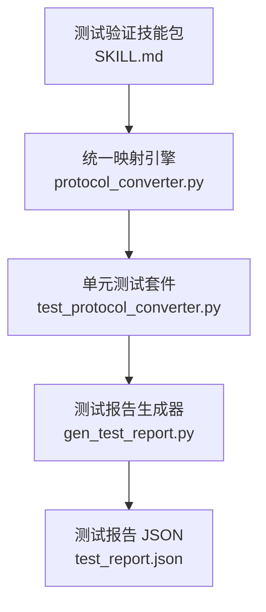
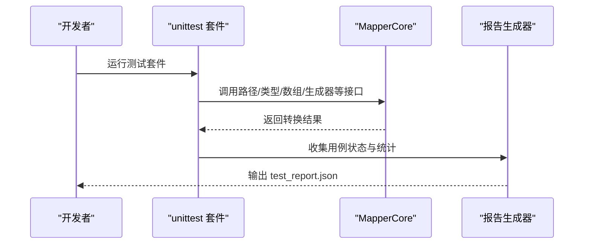
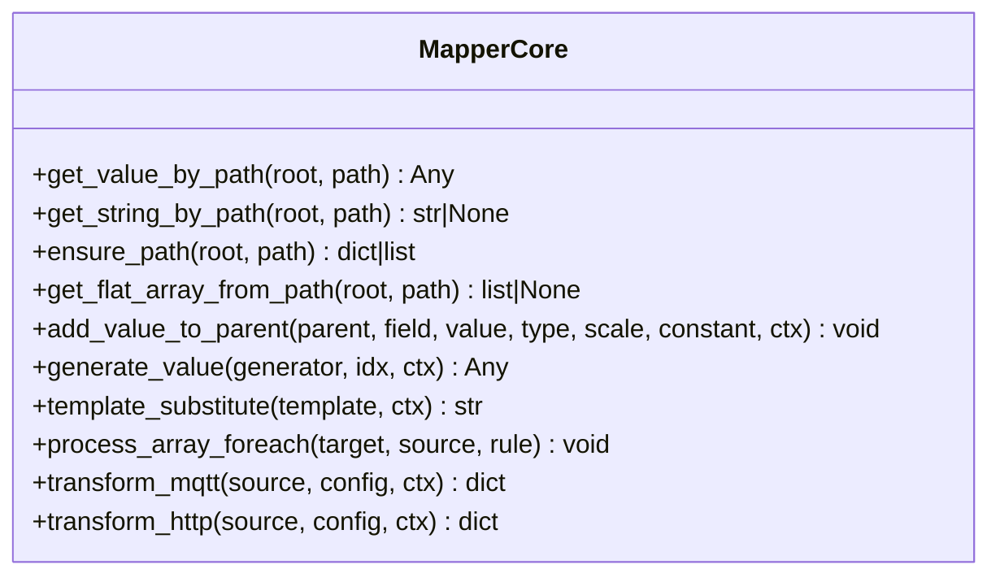
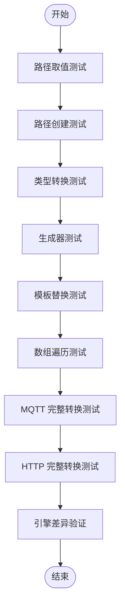
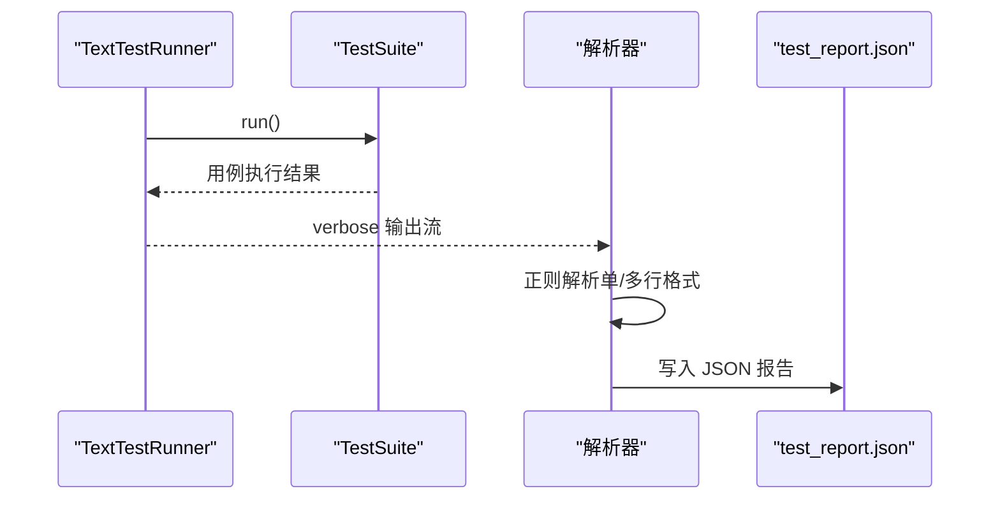
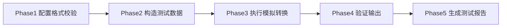
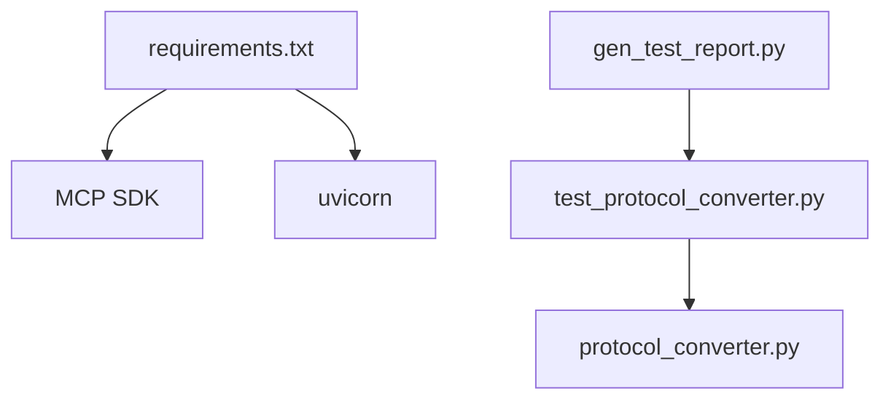

# 测试验证技能包

<cite>
**本文引用的文件**
- [SKILL.md](file://.trae/skills/test-validation/SKILL.md)
- [openai.yaml](file://.trae/skills/test-validation/agents/openai.yaml)
- [test_protocol_converter.py](file://.trae/skills/protocol-conversion/scripts/test_protocol_converter.py)
- [gen_test_report.py](file://.trae/skills/protocol-conversion/scripts/gen_test_report.py)
- [protocol_converter.py](file://.trae/skills/protocol-conversion/scripts/protocol_converter.py)
- [requirements.txt](file://mcp_server/requirements.txt)
</cite>

## 目录
1. [简介](#简介)
2. [项目结构](#项目结构)
3. [核心组件](#核心组件)
4. [架构总览](#架构总览)
5. [详细组件分析](#详细组件分析)
6. [依赖关系分析](#依赖关系分析)
7. [性能与可扩展性](#性能与可扩展性)
8. [故障排查指南](#故障排查指南)
9. [结论](#结论)
10. [附录](#附录)

## 简介
本技能包面向“协议转换配置”的测试与验证，提供从单元测试、集成测试到端到端验证的完整能力。其目标是对生成的 JSON 转换配置进行冒烟测试，覆盖字段映射正确性、数据类型转换、边界条件处理与错误恢复能力，适用于 MQTT、HTTP、Modbus 等协议类型的转换配置。当前以 Python 实现的统一映射引擎为核心，配合自动化测试脚本与报告生成器，形成可重复、可度量、可集成的质量保障体系。

## 项目结构
- 测试策略与流程定义位于测试验证技能包文档中，明确各阶段操作、通过标准与输出格式。
- 实际执行层由 Python 实现的统一映射引擎与测试套件组成，支持路径取值、路径创建、类型转换、数组遍历、模板替换、生成器、以及 MQTT/HTTP 完整转换流程。
- 报告生成器将 unittest 运行结果解析为结构化 JSON，便于持续集成与可视化。

图表来源
- [SKILL.md:19-117](file://.trae/skills/test-validation/SKILL.md#L19-L117)
- [protocol_converter.py:32-45](file://.trae/skills/protocol-conversion/scripts/protocol_converter.py#L32-L45)
- [test_protocol_converter.py:1-25](file://.trae/skills/protocol-conversion/scripts/test_protocol_converter.py#L1-L25)
- [gen_test_report.py:1-28](file://.trae/skills/protocol-conversion/scripts/gen_test_report.py#L1-L28)

章节来源
- [SKILL.md:19-117](file://.trae/skills/test-validation/SKILL.md#L19-L117)
- [protocol_converter.py:32-45](file://.trae/skills/protocol-conversion/scripts/protocol_converter.py#L32-L45)
- [test_protocol_converter.py:1-25](file://.trae/skills/protocol-conversion/scripts/test_protocol_converter.py#L1-L25)
- [gen_test_report.py:1-28](file://.trae/skills/protocol-conversion/scripts/gen_test_report.py#L1-L28)

## 核心组件
- 统一映射引擎（MapperCore）：提供路径取值、路径创建、扁平化数组获取、类型转换、模板替换、数组遍历、以及 MQTT/HTTP 完整转换入口。
- 单元测试套件：覆盖路径解析、路径创建、类型转换、生成器、模板替换、数组遍历、MQTT/HTTP 完整转换、引擎差异验证与边界条件。
- 测试报告生成器：自动发现并加载所有 TestCase，执行后解析 verbose 输出，生成结构化 JSON 报告。

章节来源
- [protocol_converter.py:32-45](file://.trae/skills/protocol-conversion/scripts/protocol_converter.py#L32-L45)
- [test_protocol_converter.py:27-118](file://.trae/skills/protocol-conversion/scripts/test_protocol_converter.py#L27-L118)
- [gen_test_report.py:13-28](file://.trae/skills/protocol-conversion/scripts/gen_test_report.py#L13-L28)

## 架构总览
测试验证技能包采用“策略文档 + 引擎实现 + 自动化测试 + 报告输出”的分层架构。策略文档定义测试维度、通过标准与操作流程；引擎实现镜像 C 引擎逻辑，确保行为一致；自动化测试覆盖关键路径与异常分支；报告生成器将测试结果标准化，便于 CI 集成与质量门禁。

图表来源
- [test_protocol_converter.py:27-118](file://.trae/skills/protocol-conversion/scripts/test_protocol_converter.py#L27-L118)
- [protocol_converter.py:49-118](file://.trae/skills/protocol-conversion/scripts/protocol_converter.py#L49-L118)
- [gen_test_report.py:13-28](file://.trae/skills/protocol-conversion/scripts/gen_test_report.py#L13-L28)

## 详细组件分析

### 统一映射引擎（MapperCore）
- 路径工具：支持 a.b.c、a[0]、a[*]、"."（HTTP 特有）等路径语法，并提供字符串取值与扁平化数组获取。
- 路径创建：按点号与索引构建嵌套对象或数组，自动填充缺失层级。
- 类型转换：支持 string、int、double、long、bool、object、substitute 等类型，含常量注入与比例系数。
- 生成器：uuid、current_timestamp、timestamp_sec/ms、datetime_compact/str、sequence、md5_sign、batch_id、random_string。
- 模板替换：基于 $var$ 语法的变量替换，支持嵌套路径。
- 数组遍历：支持 object/key_value 两种 item_type，支持嵌套遍历与 "." 源路径（HTTP）。
- 引擎差异：MQTT 不支持 context source_type；HTTP 支持 string→number 转换与 "." 源路径。

图表来源
- [protocol_converter.py:49-200](file://.trae/skills/protocol-conversion/scripts/protocol_converter.py#L49-L200)

章节来源
- [protocol_converter.py:49-200](file://.trae/skills/protocol-conversion/scripts/protocol_converter.py#L49-L200)

### 单元测试套件
- 路径取值测试：基本路径、嵌套路径、数组索引、通配符、HTTP 根路径、缺失路径、越界索引、字符串取值、扁平化数组。
- 路径创建测试：简单路径、嵌套路径、数组路径、数组填充、空路径。
- 类型转换测试：string/int/double/long/bool/object/substitute 多种输入与边界情况。
- 生成器测试：UUID、时间戳、日期时间、序列、签名、批次ID、随机字符串。
- 模板替换测试：单变量、嵌套变量、多变量、无匹配、纯文本。
- 数组遍历测试：object 遍历、key_value 遍历、嵌套遍历、"." 源路径、MQTT 嵌套展平。
- MQTT 完整转换测试：基本字段、嵌套数组遍历、substitute、常量 int、生成器 uuid/timestamp。
- HTTP 完整转换测试：常量字段、路径字段、嵌套常量、object 遍历、key_value 遍历、context source_type、"." 源路径。
- 引擎差异验证：MQTT 不支持 context；HTTP 不支持 substitute（在模拟场景下表现）；HTTP 支持 string→number。

图表来源
- [test_protocol_converter.py:27-800](file://.trae/skills/protocol-conversion/scripts/test_protocol_converter.py#L27-L800)

章节来源
- [test_protocol_converter.py:27-800](file://.trae/skills/protocol-conversion/scripts/test_protocol_converter.py#L27-L800)

### 测试报告生成器
- 动态发现模块内所有 TestCase 类，构建测试套件。
- 使用 TextTestRunner 以 verbose 模式执行，捕获逐条用例输出。
- 解析单行与多行格式的输出，统计每个类的 total/passed/skipped/failed。
- 生成包含总体统计与分类统计的 JSON 报告，写入 test_report.json。

图表来源
- [gen_test_report.py:13-89](file://.trae/skills/protocol-conversion/scripts/gen_test_report.py#L13-L89)

章节来源
- [gen_test_report.py:13-89](file://.trae/skills/protocol-conversion/scripts/gen_test_report.py#L13-L89)

### 测试策略与操作流程（技能包文档）
- 适用场景：配置生成后的验收测试、发布前质量门控、修改后回归测试、故障定位。
- 测试策略矩阵：通用维度（配置格式、字段映射、类型转换、数组遍历、常量、生成器、钩子函数）与专项维度（MQTT、HTTP、Modbus）。
- 操作流程：Phase1 配置格式校验 → Phase2 构造测试数据 → Phase3 执行模拟转换 → Phase4 验证输出 → Phase5 生成测试报告。
- MCP 工具规划：validate_config_format、generate_test_data、execute_conversion_test、get_test_report、save_conversion_config（当前以 AI 手动模拟替代）。

图表来源
- [SKILL.md:23-168](file://.trae/skills/test-validation/SKILL.md#L23-L168)

章节来源
- [SKILL.md:23-168](file://.trae/skills/test-validation/SKILL.md#L23-L168)

## 依赖关系分析
- 运行时依赖：MCP SDK（版本约束）、ASGI 服务器（uvicorn），用于服务化部署与外部集成。
- 测试依赖：Python 标准库 unittest、json、re、io、os、sys，无需额外第三方库即可运行测试套件与报告生成器。
- 模块耦合：测试套件依赖统一映射引擎；报告生成器依赖测试套件模块；三者通过文件系统与标准库交互，耦合度低、可移植性强。

图表来源
- [requirements.txt:1-3](file://mcp_server/requirements.txt#L1-L3)
- [test_protocol_converter.py:18-25](file://.trae/skills/protocol-conversion/scripts/test_protocol_converter.py#L18-L25)
- [gen_test_report.py:1-12](file://.trae/skills/protocol-conversion/scripts/gen_test_report.py#L1-L12)

章节来源
- [requirements.txt:1-3](file://mcp_server/requirements.txt#L1-L3)
- [test_protocol_converter.py:18-25](file://.trae/skills/protocol-conversion/scripts/test_protocol_converter.py#L18-L25)
- [gen_test_report.py:1-12](file://.trae/skills/protocol-conversion/scripts/gen_test_report.py#L1-L12)

## 性能与可扩展性
- 路径解析与数组遍历：采用正则与递归展平，时间复杂度与路径长度和数组规模线性相关；对于深层嵌套与大规模数组，建议控制遍历深度与批量大小。
- 类型转换与生成器：均为 O(1) 操作，开销极低；注意浮点数精度与字符串转换时的边界值处理。
- 可扩展点：新增 source_type 或 generator 时，应在引擎与测试套件中同步扩展，保持行为一致性与覆盖率。
- 报告扩展：可在解析器中增加耗时统计、失败堆栈、断言差异对比等字段，提升可观测性。

## 故障排查指南
- 路径解析失败：检查路径语法是否合法（点号分隔、索引范围、通配符位置），确认源数据结构与路径匹配。
- 类型转换异常：核对 type 与输入值兼容性（如 string→int/double），关注空值与常量注入场景。
- 数组遍历遗漏：确认 source_type 与 item_type 设置正确，检查嵌套层级与 "." 源路径的使用。
- 引擎差异问题：MQTT 不支持 context；HTTP 支持 string→number 与 "." 源路径；避免跨引擎误用特性。
- 报告为空或统计异常：确认 unittest 以 verbose 模式运行，且解析器能识别单/多行输出格式。

章节来源
- [test_protocol_converter.py:27-800](file://.trae/skills/protocol-conversion/scripts/test_protocol_converter.py#L27-L800)
- [gen_test_report.py:25-89](file://.trae/skills/protocol-conversion/scripts/gen_test_report.py#L25-L89)

## 结论
测试验证技能包以统一的映射引擎为核心，结合完备的单元测试与报告生成器，形成了对协议转换配置的全面验证能力。通过明确的测试策略与操作流程，能够在配置生成、修改与发布的全生命周期中提供稳定的质量保障。未来可结合 MCP 工具链，进一步实现沙箱执行与自动化闭环。

## 附录
- 环境准备：安装 requirements.txt 中的依赖，确保 Python 环境与标准库可用。
- 执行命令：直接运行测试套件与报告生成器，查看控制台输出与 test_report.json。
- 最佳实践：
  - 新增映射项必须配套测试用例，覆盖正常、边界与异常场景。
  - 保持引擎与测试套件同步演进，避免行为漂移。
  - 在持续集成中引入报告解析与质量门禁，阻断不合格变更。