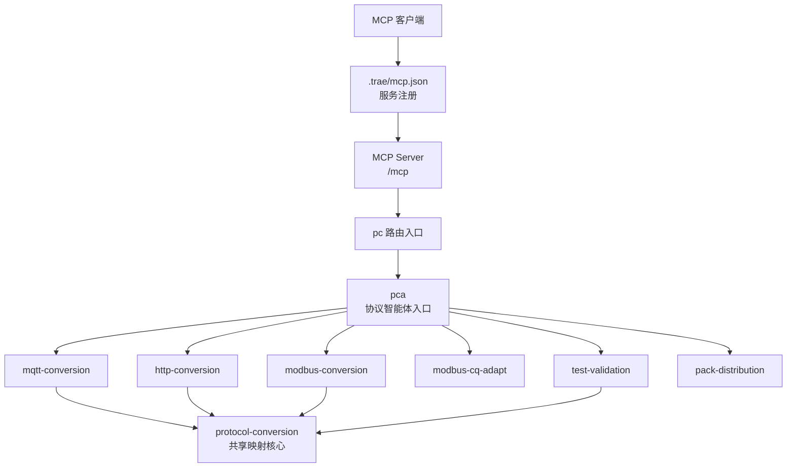
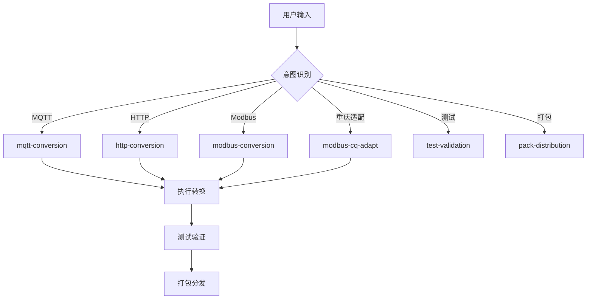
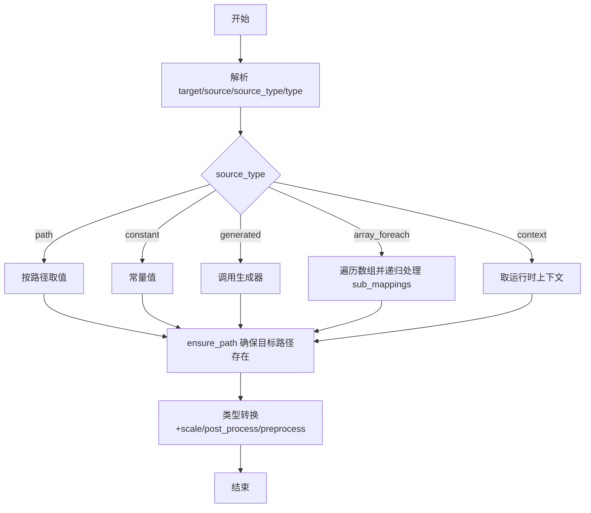
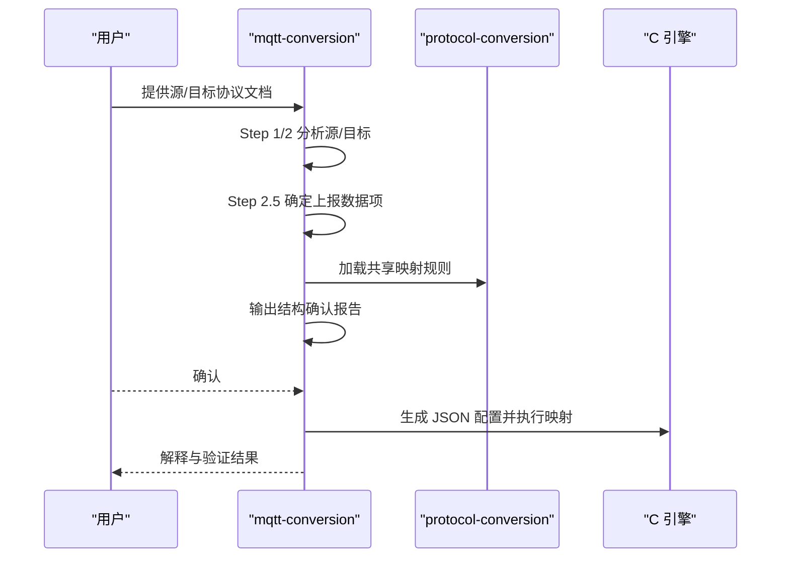
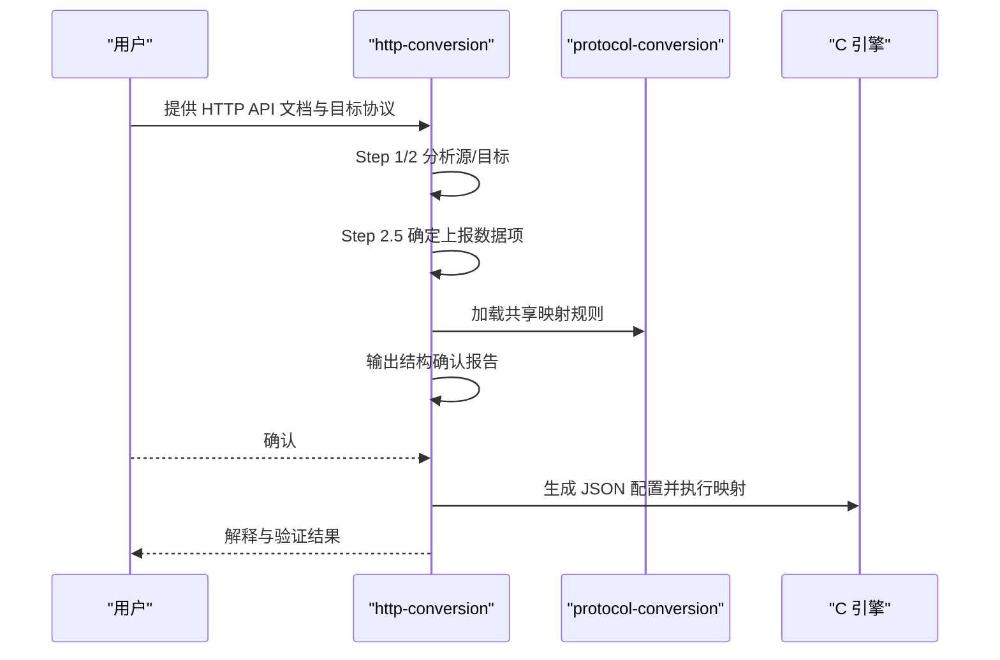
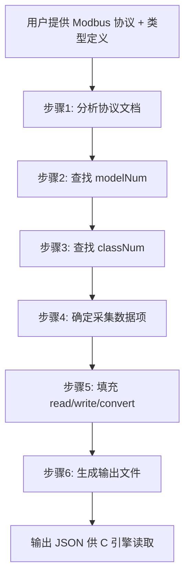
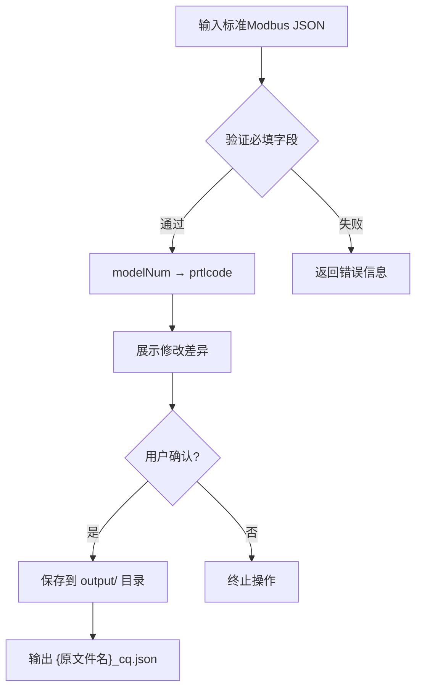
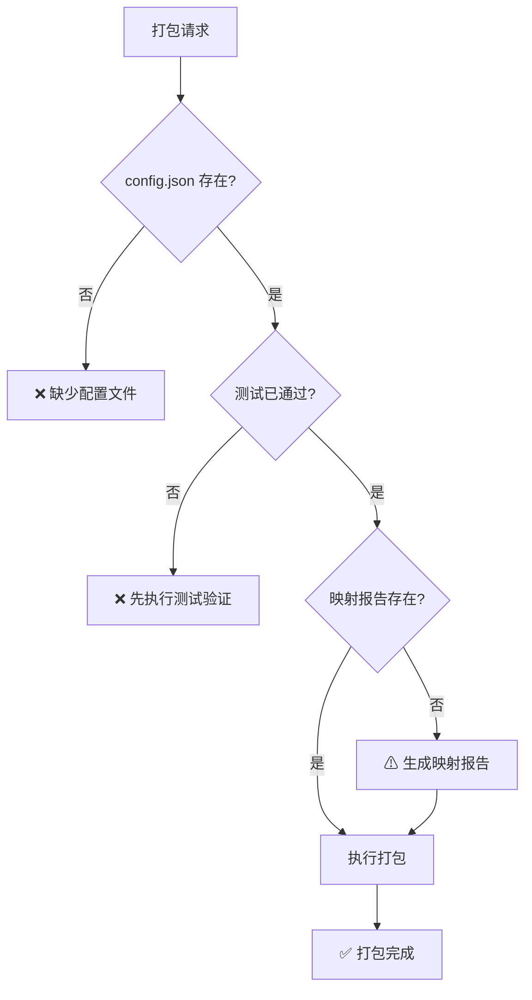
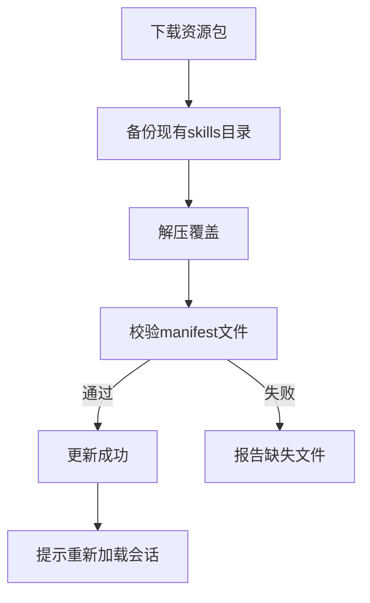
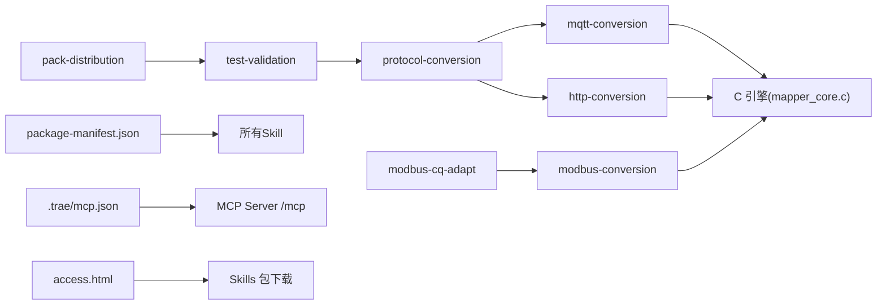

# 技能包系统

<cite>
**本文引用的文件**
- [mcp.json](file://.trae/mcp.json)
- [SKILL.md（pca入口）](file://.trae/skills/pca/SKILL.md)
- [SKILL.md（protocol-conversion）](file://.trae/skills/protocol-conversion/SKILL.md)
- [SKILL.md（mqtt-conversion）](file://.trae/skills/mqtt-conversion/SKILL.md)
- [SKILL.md（http-conversion）](file://.trae/skills/http-conversion/SKILL.md)
- [SKILL.md（modbus-conversion）](file://.trae/skills/modbus-conversion/SKILL.md)
- [SKILL.md（modbus-cq-adapt）](file://.trae/skills/modbus-cq-adapt/SKILL.md)
- [SKILL.md（test-validation）](file://.trae/skills/test-validation/SKILL.md)
- [SKILL.md（pack-distribution）](file://.trae/skills/pack-distribution/SKILL.md)
- [package-manifest.json](file://.trae/skills/package-manifest.json)
- [pca manifest.json](file://.trae/skills/pca/manifest.json)
- [build_pack.py](file://.trae/skills/protocol-conversion/scripts/build_pack.py)
- [access.html](file://mcp_server/static/access.html)
</cite>

## 更新摘要
**变更内容**
- 新增资源包管理系统，支持多Skill统一管理和版本控制
- 新增test-validation测试验证技能包，提供配置冒烟测试能力
- 新增modbus-cq-adapt重庆地区适配技能包，支持Modbus脚本本地化
- 移除agents-generator和OpenSpec相关技能包，简化系统架构
- 增强pack-distribution功能，支持完整的Agent资产包管理

## 目录
1. [简介](#简介)
2. [项目结构](#项目结构)
3. [核心组件](#核心组件)
4. [架构总览](#架构总览)
5. [详细组件分析](#详细组件分析)
6. [依赖关系分析](#依赖关系分析)
7. [性能与可维护性](#性能与可维护性)
8. [故障排查指南](#故障排查指南)
9. [结论](#结论)
10. [附录：自定义技能包开发指南](#附录自定义技能包开发指南)

## 简介
本仓库实现了"技能包系统"，围绕协议转换场景提供统一、可复用、可分发的能力。系统以 SKILL.md 为技能契约，定义元数据、职责边界、工作流与配置格式；通过共享映射核心（protocol-conversion）统一路径解析、类型转换、数组遍历、生成器与模板替换等通用能力；针对 MQTT、HTTP、Modbus 等协议提供专用技能；并提供打包分发流程，将配置、报告与清单打包为 ZIP，便于安装与版本管理。

**更新** 新增资源包管理系统，支持多Skill统一版本控制和完整性校验，确保Agent资产包的完整性和一致性。

## 项目结构
- .trae/mcp.json：MCP 服务注册信息，包含协议转换器端点与认证头。
- .trae/skills：技能包集合，每个子目录为一个技能，包含 SKILL.md、agents/openai.yaml、manifest.json 等。
- mcp_server/static/access.html：MCP 访问页，提供 Skills 包的下载入口与安装说明。
- .trae/skills/package-manifest.json：包级清单文件，定义整个Agent资源包的结构和必需文件。



图表来源
- [mcp.json:1-1](file://.trae/mcp.json#L1-L1)
- [SKILL.md（pca入口）:39-95](file://.trae/skills/pca/SKILL.md#L39-L95)
- [access.html:458-483](file://mcp_server/static/access.html#L458-L483)

章节来源
- [mcp.json:1-1](file://.trae/mcp.json#L1-L1)
- [SKILL.md（pca入口）:39-95](file://.trae/skills/pca/SKILL.md#L39-L95)
- [access.html:458-483](file://mcp_server/static/access.html#L458-L483)

## 核心组件
- **pca入口技能**：协议智能体操作入口，负责接收用户协议转换需求，路由到对应协议专属子技能，编排完整的协议分析→字段映射→配置生成→测试验证流程。
- **protocol-conversion**：共享映射核心，定义路径语法、类型系统、数组遍历准则、生成器清单、模板变量替换机制等，被 mqtt-conversion 与 http-conversion 引用。
- **mqtt-conversion**：面向内部 MQTT→平台 MQTT 的转换，使用 config_loader.c + mapper_core.c。
- **http-conversion**：面向第三方 HTTP→内部 MQTT 的转换，使用 vpp_http_config.load.c + mapper_core.c。
- **modbus-conversion**：面向 Modbus RTU/TCP 寄存器数据的读取与转换，输出供 C 引擎读取的配置。
- **modbus-cq-adapt**：重庆地区 Modbus 脚本适配，将标准 Modbus 转换脚本中的 modelNum 字段替换为 prtlcode。
- **test-validation**：协议转换配置测试验证，对生成的 JSON 转换配置进行冒烟测试。
- **pack-distribution**：将配置、映射报告、测试报告打包为 ZIP，并生成 manifest 与 README。

**更新** 新增test-validation和modbus-cq-adapt技能包，完善协议转换的测试验证和本地化适配能力。

章节来源
- [SKILL.md（pca入口）:1-680](file://.trae/skills/pca/SKILL.md#L1-L680)
- [SKILL.md（protocol-conversion）:1-458](file://.trae/skills/protocol-conversion/SKILL.md#L1-L458)
- [SKILL.md（mqtt-conversion）:1-461](file://.trae/skills/mqtt-conversion/SKILL.md#L1-L461)
- [SKILL.md（http-conversion）:1-586](file://.trae/skills/http-conversion/SKILL.md#L1-L586)
- [SKILL.md（modbus-conversion）:1-681](file://.trae/skills/modbus-conversion/SKILL.md#L1-L681)
- [SKILL.md（modbus-cq-adapt）:1-197](file://.trae/skills/modbus-cq-adapt/SKILL.md#L1-L197)
- [SKILL.md（test-validation）:1-190](file://.trae/skills/test-validation/SKILL.md#L1-L190)
- [SKILL.md（pack-distribution）:1-162](file://.trae/skills/pack-distribution/SKILL.md#L1-L162)

## 架构总览
系统采用"共享核心 + 协议专用 + 统一管理"的分层设计：
- 入口层（pca）：统一的协议智能体入口，负责意图识别和路由分发。
- 共享核心（protocol-conversion）：统一实现映射规则字段、路径语法、类型系统、数组遍历、生成器、模板替换等。
- 协议加载层：MQTT 使用 config_loader.c，HTTP 使用 vpp_http_config.load.c，负责解析各自的外层配置格式。
- 执行层：mapper_core.c 统一执行映射，保证一致性。
- 管理层：resource package management 提供统一的版本控制和完整性校验。
- 分发层：pack-distribution 将产物打包，附带清单与文档，支持一键安装。

**更新** 新增资源包管理系统，提供统一的版本控制和完整性校验机制。

```mermaid
sequenceDiagram
participant U as "用户"
participant PC as "pca入口"
participant MC as "mqtt-conversion"
participant HC as "http-conversion"
participant MB as "modbus-conversion"
participant TV as "test-validation"
participant PKG as "pack-distribution"
participant CORE as "protocol-conversion"
U->>PC : 选择协议转换任务
alt MQTT→MQTT
PC->>MC : 调用 MQTT 转换流程
MC->>CORE : 加载共享映射规则
else HTTP→MQTT
PC->>HC : 调用 HTTP 转换流程
HC->>CORE : 加载共享映射规则
else Modbus→内部
PC->>MB : 调用 Modbus 转换流程
end
MB->>TV : 执行测试验证
MC->>TV
HC->>TV
TV->>PKG : 请求打包分发
PKG-->>U : 返回ZIP(含配置/报告/清单)
```

图表来源
- [SKILL.md（pca入口）:284-305](file://.trae/skills/pca/SKILL.md#L284-L305)
- [SKILL.md（mqtt-conversion）:23-31](file://.trae/skills/mqtt-conversion/SKILL.md#L23-L31)
- [SKILL.md（http-conversion）:23-31](file://.trae/skills/http-conversion/SKILL.md#L23-L31)
- [SKILL.md（pack-distribution）:27-65](file://.trae/skills/pack-distribution/SKILL.md#L27-L65)

## 详细组件分析

### 协议智能体入口（pca）
- 职责：接收用户协议转换需求，路由到对应协议专属子技能，编排完整的协议分析→字段映射→配置生成→测试验证流程。
- 关键特性：
  - 智能意图识别：根据关键词自动识别协议类型（MQTT/HTTP/Modbus）。
  - 完整流程编排：支持单步执行和全流程编排两种模式。
  - Agent资源包管理：支持版本检查、更新和完整性验证。
  - MCP工具集成：优先使用IDE原生MCP连接，失败时自动切换到备用通道。

**更新** 新增Agent资源包管理能力，支持版本检查和自动更新。



图表来源
- [SKILL.md（pca入口）:256-267](file://.trae/skills/pca/SKILL.md#L256-L267)
- [SKILL.md（pca入口）:284-305](file://.trae/skills/pca/SKILL.md#L284-L305)

章节来源
- [SKILL.md（pca入口）:1-680](file://.trae/skills/pca/SKILL.md#L1-L680)

### 共享映射核心（protocol-conversion）
- 职责：定义映射规则字段、路径语法、类型系统、数组遍历准则、生成器清单、模板变量替换机制，以及 Python 镜像与测试套件。
- 关键要点：
  - 路径语法：支持点号、索引、通配符、锚点、根对象等。
  - 类型系统：string/double/int/long/bool/object/substitute，支持 scale 缩放。
  - source_type：path/constant/generated/array_foreach/context。
  - 数组遍历：优先依据目标结构决定遍历或固定索引，支持多层嵌套与 @ 锚点。
  - 生成器：uuid、时间戳、日期、随机串、签名、批次号、序列等。
  - 模板替换：通过 constant + substitute 组合触发。
  - 测试：Python 镜像 + 91 项测试覆盖路径、类型、生成器、模板、数组、边界等。



图表来源
- [SKILL.md（protocol-conversion）:37-125](file://.trae/skills/protocol-conversion/SKILL.md#L37-L125)
- [SKILL.md（protocol-conversion）:126-184](file://.trae/skills/protocol-conversion/SKILL.md#L126-L184)
- [SKILL.md（protocol-conversion）:196-224](file://.trae/skills/protocol-conversion/SKILL.md#L196-L224)
- [SKILL.md（protocol-conversion）:266-300](file://.trae/skills/protocol-conversion/SKILL.md#L266-L300)

章节来源
- [SKILL.md（protocol-conversion）:1-458](file://.trae/skills/protocol-conversion/SKILL.md#L1-L458)

### MQTT 转换（mqtt-conversion）
- 职责：分析内部 MQTT 源与平台 MQTT 目标，生成 JSON 配置供 config_loader.c + mapper_core.c 执行。
- 工作流：文档预处理 → 源/目标分析 → 数据项确认 → 映射表提取 → 共享规则加载 → 结构确认报告 → 用户确认 → 生成配置 → 解释脚本 → 验证脚本。
- 特有机制：substitute 模板替换、$item/$idx 数组变量、嵌套 [*] 展平、post_process 全局后处理（待完成）。



图表来源
- [SKILL.md（mqtt-conversion）:56-73](file://.trae/skills/mqtt-conversion/SKILL.md#L56-L73)
- [SKILL.md（mqtt-conversion）:85-113](file://.trae/skills/mqtt-conversion/SKILL.md#L85-L113)
- [SKILL.md（mqtt-conversion）:114-189](file://.trae/skills/mqtt-conversion/SKILL.md#L114-L189)
- [SKILL.md（mqtt-conversion）:191-309](file://.trae/skills/mqtt-conversion/SKILL.md#L191-L309)

章节来源
- [SKILL.md（mqtt-conversion）:1-461](file://.trae/skills/mqtt-conversion/SKILL.md#L1-L461)

### HTTP 转换（http-conversion）
- 职责：分析第三方 HTTP/REST 与内部 MQTT 目标，生成 JSON 配置供 vpp_http_config.load.c + mapper_core.c 执行。
- 工作流：文档预处理 → 源/目标分析 → 数据项确认 → 映射表提取 → 共享规则加载 → 结构确认报告 → 用户确认 → 生成配置 → 校验 → 解释 → 验证。
- 特有机制：context 上下文、key_value 模式、"."源路径、preprocess 预处理、链式调用 next_api、Token 管理。



图表来源
- [SKILL.md（http-conversion）:89-107](file://.trae/skills/http-conversion/SKILL.md#L89-L107)
- [SKILL.md（http-conversion）:119-145](file://.trae/skills/http-conversion/SKILL.md#L119-L145)
- [SKILL.md（http-conversion）:147-260](file://.trae/skills/http-conversion/SKILL.md#L147-L260)
- [SKILL.md（http-conversion）:319-393](file://.trae/skills/http-conversion/SKILL.md#L319-L393)

章节来源
- [SKILL.md（http-conversion）:1-586](file://.trae/skills/http-conversion/SKILL.md#L1-L586)

### Modbus 转换（modbus-conversion）
- 职责：分析第三方 Modbus 协议与内部类型定义，生成 JSON 配置供 C 引擎读取，实现寄存器数据到内部统一格式的转换。
- 关键点：数据类型语法、字节序、地址表达式、数据表达式、枚举映射、符号位处理、一次/二次值选择、采集顺序约束。
- 输出：output/{品牌}_{设备类型}_{日期}.json。



图表来源
- [SKILL.md（modbus-conversion）:120-136](file://.trae/skills/modbus-conversion/SKILL.md#L120-L136)
- [SKILL.md（modbus-conversion）:138-281](file://.trae/skills/modbus-conversion/SKILL.md#L138-L281)

章节来源
- [SKILL.md（modbus-conversion）:1-681](file://.trae/skills/modbus-conversion/SKILL.md#L1-L681)

### 重庆地区适配（modbus-cq-adapt）
- 职责：将标准 Modbus 转换脚本中的 modelNum 字段替换为 prtlcode，并重命名文件，仅针对重庆地区使用。
- 特点：纯本地JSON处理，无外部依赖，智能识别标准Modbus格式。
- 工作流程：读取验证输入JSON → 字段替换 → 展示diff确认 → 保存输出文件。

**新增** 专门针对重庆地区的Modbus脚本适配，支持智能识别和安全的字段替换。



图表来源
- [SKILL.md（modbus-cq-adapt）:81-133](file://.trae/skills/modbus-cq-adapt/SKILL.md#L81-L133)

章节来源
- [SKILL.md（modbus-cq-adapt）:1-197](file://.trae/skills/modbus-cq-adapt/SKILL.md#L1-L197)

### 测试验证（test-validation）
- 职责：对生成的 JSON 转换配置进行冒烟测试，验证字段映射正确性、数据类型转换、边界条件处理、错误恢复能力。
- 测试策略：涵盖配置格式、字段映射、类型转换、数组遍历、常量字段、生成器、钩子函数等多个维度。
- 专项测试：针对MQTT、HTTP、Modbus等不同协议提供专门的测试用例和通过标准。

**新增** 提供完整的测试验证框架，确保转换配置的正确性和可靠性。


图表来源
- [SKILL.md（test-validation）:79-168](file://.trae/skills/test-validation/SKILL.md#L79-L168)

章节来源
- [SKILL.md（test-validation）:1-190](file://.trae/skills/test-validation/SKILL.md#L1-L190)

### 打包分发（pack-distribution）
- 职责：将转换配置、映射报告、测试报告打包为 ZIP，生成 manifest.json 与 README.md，支持一键安装。
- 内容：config.json、mapping_report.md、test_report.json、源/目标协议规格、README.md、manifest.json。
- 流程：打包前检查 → 生成清单与文档 → 压缩为 ZIP → 安装到目标环境。

**更新** 增强打包功能，支持完整的Agent资产包管理和版本控制。



图表来源
- [SKILL.md（pack-distribution）:95-109](file://.trae/skills/pack-distribution/SKILL.md#L95-L109)
- [SKILL.md（pack-distribution）:111-140](file://.trae/skills/pack-distribution/SKILL.md#L111-L140)

章节来源
- [SKILL.md（pack-distribution）:1-162](file://.trae/skills/pack-distribution/SKILL.md#L1-L162)

### 资源包管理系统
- 职责：提供统一的Agent资源包管理，支持多Skill版本控制、完整性校验和自动更新。
- 核心特性：
  - 包级清单：package-manifest.json 定义整个资源包结构和必需文件。
  - Skill级清单：每个Skill独立的manifest.json声明其必需和可选文件。
  - 完整性校验：确保所有必需文件存在且版本一致。
  - 自动更新：支持版本检查和增量更新。

**新增** 完整的资源包管理系统，确保Agent资产包的完整性和一致性。



图表来源
- [SKILL.md（pca入口）:218-243](file://.trae/skills/pca/SKILL.md#L218-L243)
- [package-manifest.json:1-57](file://.trae/skills/package-manifest.json#L1-L57)

章节来源
- [package-manifest.json:1-57](file://.trae/skills/package-manifest.json#L1-L57)
- [SKILL.md（pca入口）:218-243](file://.trae/skills/pca/SKILL.md#L218-L243)

## 依赖关系分析
- 共享核心依赖：protocol-conversion 被 mqtt-conversion 与 http-conversion 引用。
- 协议加载层依赖：MQTT 使用 config_loader.c，HTTP 使用 vpp_http_config.load.c，两者均依赖 mapper_core.c。
- MCP 集成：.trae/mcp.json 注册协议转换器服务，access.html 提供 Skills 包下载与安装指引。
- 资源包管理：package-manifest.json 统一管理所有Skill的版本和依赖关系。

**更新** 新增资源包管理系统，统一管理所有Skill的依赖关系和版本控制。



图表来源
- [SKILL.md（pca入口）:334-363](file://.trae/skills/pca/SKILL.md#L334-L363)
- [package-manifest.json:8-17](file://.trae/skills/package-manifest.json#L8-L17)
- [mcp.json:1-1](file://.trae/mcp.json#L1-L1)
- [access.html:458-483](file://mcp_server/static/access.html#L458-L483)

章节来源
- [SKILL.md（pca入口）:334-363](file://.trae/skills/pca/SKILL.md#L334-L363)
- [package-manifest.json:8-17](file://.trae/skills/package-manifest.json#L8-L17)
- [mcp.json:1-1](file://.trae/mcp.json#L1-L1)
- [access.html:458-483](file://mcp_server/static/access.html#L458-L483)

## 性能与可维护性
- 共享核心减少重复实现，降低维护成本，提升一致性与可测试性。
- 91 项测试覆盖路径解析、类型转换、生成器、模板替换、数组遍历、边界条件，保障稳定性。
- 通过 scale、constant、substitute、generated 等声明式字段减少对硬编码函数的依赖，提高可配置性与性能。
- 打包脚本生成 SHA256 校验和与清单，便于版本管理与完整性校验。
- 资源包管理系统确保所有Skill版本一致，避免依赖冲突。

**更新** 新增资源包管理系统，进一步提升系统的可维护性和版本一致性。

章节来源
- [SKILL.md（protocol-conversion）:154-178](file://.trae/skills/protocol-conversion/SKILL.md#L154-L178)
- [build_pack.py:187-236](file://.trae/skills/protocol-conversion/scripts/build_pack.py#L187-L236)

## 故障排查指南
- 常见错误：
  - 引擎引用错误：MQTT 应使用 config_loader.c + mapper_core.c，HTTP 应使用 vpp_http_config.load.c + mapper_core.c。
  - 数组遍历误用：目标为 Object 时不应使用 @ 遍历；目标为 Array 时应使用 array_foreach + @。
  - 常量键名错误：JSON 键名为 constant，非 constant_value。
  - substitute 配置错误：需使用 source_type="constant" + type="substitute"。
  - 过度依赖 post_process：优先使用 scale/constant/substitute/generated。
  - 资源包完整性问题：manifest校验失败，缺少必需文件。
- 排查建议：
  - 检查映射规则字段是否符合 protocol-conversion 定义。
  - 校验数组遍历策略与 item_type 设置。
  - 确认生成器名称与参数正确。
  - 使用 Python 镜像与测试套件进行本地验证。
  - 检查package-manifest.json和各Skill的manifest.json是否完整。

**更新** 新增资源包完整性检查相关的故障排查指导。

章节来源
- [SKILL.md（protocol-conversion）:408-452](file://.trae/skills/protocol-conversion/SKILL.md#L408-L452)

## 结论
技能包系统通过共享核心与协议专用技能的解耦设计，提供了统一、可复用、可分发的协议转换能力。SKILL.md 作为契约明确了元数据、工作流与配置格式；打包分发流程保障了版本管理与安装便捷性。新增的资源包管理系统进一步提升了系统的可维护性和版本一致性。建议在新增协议时遵循共享规则，完善测试与报告，确保一致性与可维护性。

**更新** 资源包管理系统的引入使系统更加健壮和易于维护，为未来的扩展奠定了坚实基础。

## 附录：自定义技能包开发指南

### 目录组织规范
- 每个技能位于 .trae/skills/<skill-name>/ 目录下。
- 必备文件：
  - SKILL.md：技能契约，包含元数据与工作流。
  - agents/openai.yaml：Agent 配置（如适用）。
  - manifest.json：技能清单，声明必需和可选文件。
- 可选目录：
  - scripts/：脚本与工具。
  - references/：参考文档。
  - output/：生成产物。
  - temp/：临时文件。
  - tools/：工具脚本。
  - templates/：模板文件。
  - validators/：验证器。

**更新** 新增manifest.json要求和更多可选目录支持。

章节来源
- [SKILL.md（modbus-conversion）:31-45](file://.trae/skills/modbus-conversion/SKILL.md#L31-L45)
- [pca manifest.json:1-16](file://.trae/skills/pca/manifest.json#L1-L16)

### SKILL.md 文件格式
- 元数据字段：
  - name：技能名称。
  - description：技能描述。
  - when_to_use：使用场景。
  - compatibility：兼容性说明。
  - metadata.tags：标签列表。
  - metadata.order：执行顺序。
  - metadata.author：作者。
  - metadata.version：版本号。
- 正文内容：
  - 引擎架构、配置格式、工作流程、约束规则、示例、MCP 工具调用等。

章节来源
- [SKILL.md（pca入口）:1-17](file://.trae/skills/pca/SKILL.md#L1-L17)
- [SKILL.md（protocol-conversion）:1-17](file://.trae/skills/protocol-conversion/SKILL.md#L1-L17)
- [SKILL.md（mqtt-conversion）:1-17](file://.trae/skills/mqtt-conversion/SKILL.md#L1-L17)
- [SKILL.md（http-conversion）:1-17](file://.trae/skills/http-conversion/SKILL.md#L1-L17)
- [SKILL.md（modbus-conversion）:1-17](file://.trae/skills/modbus-conversion/SKILL.md#L1-L17)
- [SKILL.md（modbus-cq-adapt）:1-16](file://.trae/skills/modbus-cq-adapt/SKILL.md#L1-L16)
- [SKILL.md（test-validation）:1-17](file://.trae/skills/test-validation/SKILL.md#L1-L17)
- [SKILL.md（pack-distribution）:1-15](file://.trae/skills/pack-distribution/SKILL.md#L1-L15)

### 脚本编写与测试方法
- 脚本：
  - 使用 Python 脚本进行配置生成、校验与打包。
  - 生成 mapping_report.md、manifest.json、README.md。
  - 计算 SHA256 校验和，记录文件大小与依赖。
- 测试：
  - 使用 Python 镜像与测试套件进行本地验证。
  - 构造源 JSON 与期望目标 JSON，比对转换结果。
  - 输出测试报告，包含通过/失败/跳过统计。
  - 利用test-validation技能进行自动化测试。

**更新** 新增test-validation技能的使用方法和自动化测试支持。

章节来源
- [SKILL.md（protocol-conversion）:301-338](file://.trae/skills/protocol-conversion/SKILL.md#L301-L338)
- [SKILL.md（test-validation）:77-190](file://.trae/skills/test-validation/SKILL.md#L77-L190)
- [build_pack.py:187-236](file://.trae/skills/protocol-conversion/scripts/build_pack.py#L187-L236)
- [build_pack.py:352-404](file://.trae/skills/protocol-conversion/scripts/build_pack.py#L352-L404)

### 安装与使用流程
- MCP 配置：
  - 在 .trae/mcp.json 中注册协议转换器服务，包含 URL 与认证头。
- Skills 安装：
  - 从 access.html 提供的接口下载 Skills 包，解压至 .trae/skills/ 目录。
  - 保留每个 Skill 目录下的 agents/openai.yaml。
  - 不要自动转换目录名或展示名。
- 运行：
  - 启动 MCP Server，通过 pca 路由入口分发到对应技能。
  - 执行转换流程，生成配置并验证。
- 资源包管理：
  - 使用package-manifest.json进行版本控制和完整性校验。
  - 支持自动更新和回滚机制。

**更新** 新增资源包管理的安装和使用流程。

章节来源
- [mcp.json:1-1](file://.trae/mcp.json#L1-L1)
- [SKILL.md（pca入口）:97-148](file://.trae/skills/pca/SKILL.md#L97-L148)
- [access.html:458-483](file://mcp_server/static/access.html#L458-L483)

### 版本管理与兼容性
- 版本管理：
  - 每个技能在 SKILL.md 中声明 version。
  - 每个Skill有独立的manifest.json声明版本和依赖。
  - 包级package-manifest.json统一管理所有Skill版本。
  - 打包脚本生成 manifest.json，包含 packId、version、createdAt、files、dependencies、testStatus、testSummary、changes。
- 兼容性：
  - 明确兼容的引擎与库依赖（如 cJSON、paho.mqtt.c 等）。
  - 在 README.md 中列出占位符与替换说明。
  - 在打包前检查测试状态与文件完整性。
  - 资源包管理系统确保版本一致性和完整性。

**更新** 新增多层次的版本管理机制，包括包级和Skill级的版本控制。

章节来源
- [SKILL.md（pack-distribution）:42-65](file://.trae/skills/pack-distribution/SKILL.md#L42-L65)
- [package-manifest.json:1-57](file://.trae/skills/package-manifest.json#L1-L57)
- [build_pack.py:198-236](file://.trae/skills/protocol-conversion/scripts/build_pack.py#L198-L236)
- [build_pack.py:243-345](file://.trae/skills/protocol-conversion/scripts/build_pack.py#L243-L345)