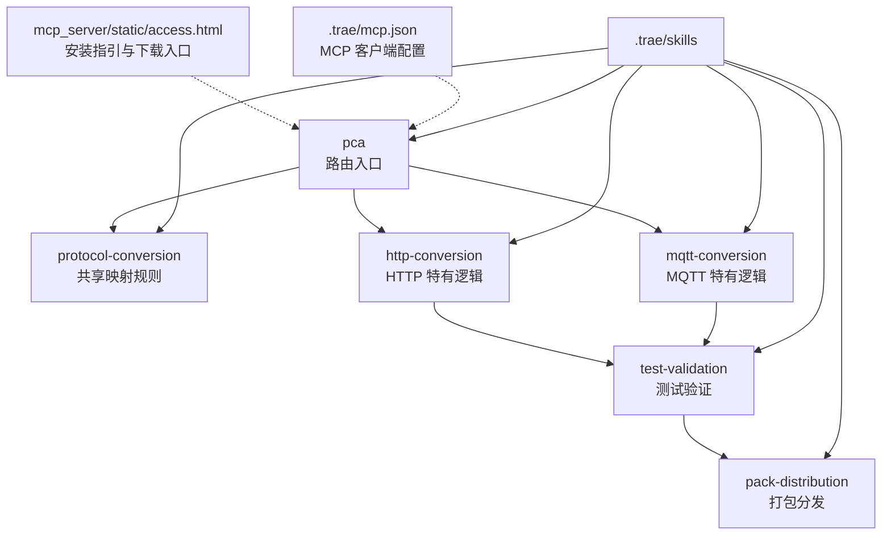
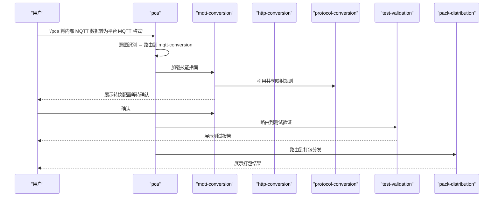
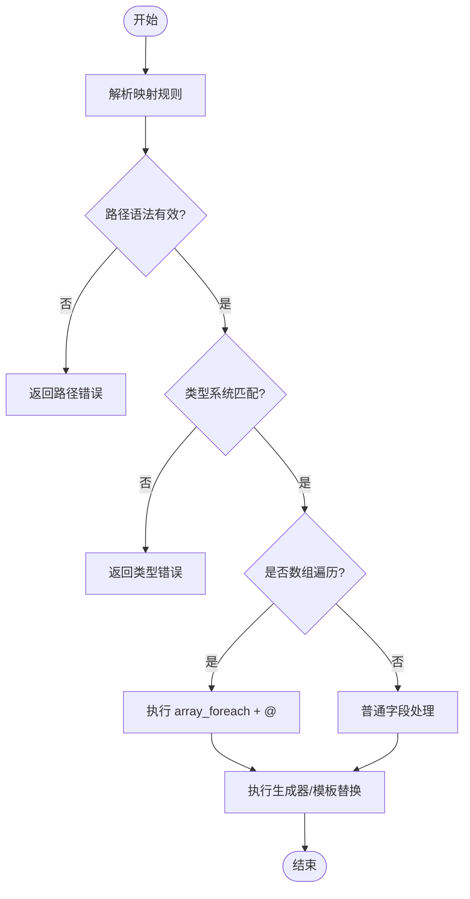
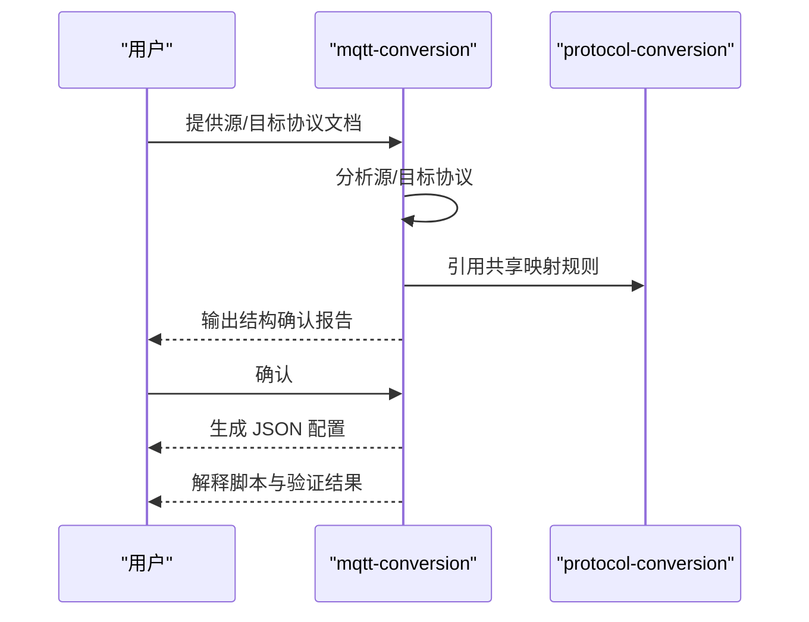
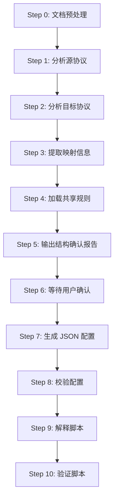
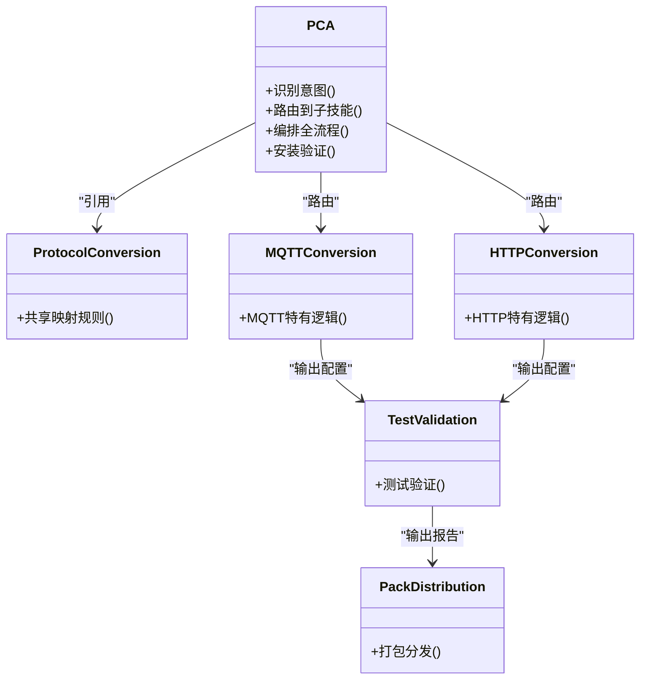
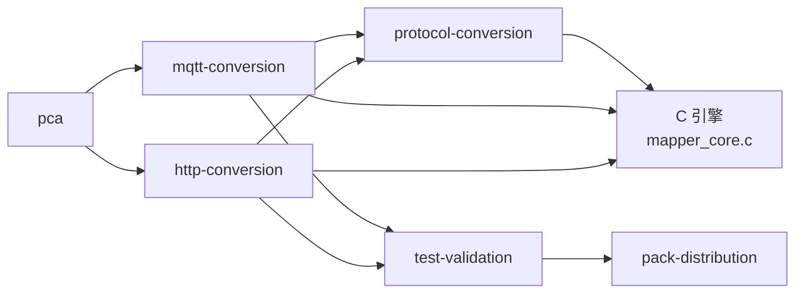

# 技能包结构规范

<cite>
**本文引用的文件**
- [mcp.json](file://.trae/mcp.json)
- [SKILL.md（protocol-conversion）](file://.trae/skills/protocol-conversion/SKILL.md)
- [SKILL.md（mqtt-conversion）](file://.trae/skills/mqtt-conversion/SKILL.md)
- [SKILL.md（http-conversion）](file://.trae/skills/http-conversion/SKILL.md)
- [SKILL.md（pca）](file://.trae/skills/pca/SKILL.md)
- [SKILL.md（test-validation）](file://.trae/skills/test-validation/SKILL.md)
- [build_pack.py](file://.trae/skills/protocol-conversion/scripts/build_pack.py)
- [access.html](file://mcp_server/static/access.html)
</cite>

## 目录
1. [简介](#简介)
2. [项目结构](#项目结构)
3. [核心组件](#核心组件)
4. [架构总览](#架构总览)
5. [详细组件分析](#详细组件分析)
6. [依赖关系分析](#依赖关系分析)
7. [性能与可维护性](#性能与可维护性)
8. [故障排查指南](#故障排查指南)
9. [结论](#结论)
10. [附录](#附录)

## 简介
本规范面向“协议转换”相关技能包的统一组织、配置与发布，覆盖以下要点：
- 技能包目录组织规范：每个技能以独立目录存放，包含 SKILL.md、脚本、默认配置、代理配置等。
- SKILL.md 文件格式与元数据：定义 name、description、when_to_use、compatibility、metadata（tags、order、author、version）。
- 配置文件格式与参数：MQTT 使用 platform_name + mappings[]；HTTP 使用 base_url + token + apis[]；共享映射规则由 protocol-conversion 统一定义。
- 版本管理、依赖声明与兼容性：通过 manifest.json 的 packId、version、dependencies、engineVersion 等字段进行声明；SKILL.md metadata.version 用于技能级版本。
- 标准模板与最佳实践：基于现有 mqtt-conversion、http-conversion、protocol-conversion、pca、test-validation 的结构与流程。
- 验证规则与错误处理：结构化校验、测试套件、打包产物校验与回滚策略。

## 项目结构
技能包位于 .trae/skills 下，按功能划分目录，入口为 pca，协议专属技能包括 mqtt-conversion、http-conversion，共享规则在 protocol-conversion，测试与打包分别在 test-validation 与 pack-distribution。MCP 客户端连接信息位于 .trae/mcp.json。

**图表来源**
- [SKILL.md（pca）:37-95](file://.trae/skills/pca/SKILL.md#L37-L95)
- [SKILL.md（protocol-conversion）:23-35](file://.trae/skills/protocol-conversion/SKILL.md#L23-L35)
- [SKILL.md（mqtt-conversion）:23-31](file://.trae/skills/mqtt-conversion/SKILL.md#L23-L31)
- [SKILL.md（http-conversion）:23-31](file://.trae/skills/http-conversion/SKILL.md#L23-L31)
- [mcp.json:1-1](file://.trae/mcp.json#L1-L1)
- [access.html:458-483](file://mcp_server/static/access.html#L458-L483)

**章节来源**
- [SKILL.md（pca）:37-95](file://.trae/skills/pca/SKILL.md#L37-L95)
- [mcp.json:1-1](file://.trae/mcp.json#L1-L1)
- [access.html:458-483](file://mcp_server/static/access.html#L458-L483)

## 核心组件
- 入口技能 pca：负责意图识别、路由到子技能、编排全流程（分析→生成→验证→打包）。
- 共享映射规则 protocol-conversion：定义路径语法、类型系统、数组遍历准则、生成器清单、模板替换机制等。
- MQTT 技能 mqtt-conversion：定义 MQTT 特有配置格式（platform_name + mappings[]）、substitute/$item/$idx/嵌套[*]/post_process 等。
- HTTP 技能 http-conversion：定义 HTTP 特有配置格式（base_url + token + apis[]）、context/key_value/"."源路径/preprocess/链式调用等。
- 测试验证 test-validation：对生成的 JSON 配置进行冒烟测试、边界条件检查、报告输出。
- 打包分发 pack-distribution：将配置与文档打包为 ZIP，并生成 manifest.json。

**章节来源**
- [SKILL.md（pca）:159-235](file://.trae/skills/pca/SKILL.md#L159-L235)
- [SKILL.md（protocol-conversion）:37-124](file://.trae/skills/protocol-conversion/SKILL.md#L37-L124)
- [SKILL.md（mqtt-conversion）:33-55](file://.trae/skills/mqtt-conversion/SKILL.md#L33-L55)
- [SKILL.md（http-conversion）:33-88](file://.trae/skills/http-conversion/SKILL.md#L33-L88)
- [SKILL.md（test-validation）:30-76](file://.trae/skills/test-validation/SKILL.md#L30-L76)

## 架构总览
整体采用“入口路由 + 协议专属 + 共享规则 + 测试验证 + 打包分发”的分层架构。pca 作为入口，根据用户意图路由到对应协议技能；协议技能引用 protocol-conversion 的共享规则；最终输出 JSON 配置供 C 引擎读取，并通过 test-validation 验证后由 pack-distribution 打包。

**图表来源**
- [SKILL.md（pca）:183-213](file://.trae/skills/pca/SKILL.md#L183-L213)
- [SKILL.md（mqtt-conversion）:56-73](file://.trae/skills/mqtt-conversion/SKILL.md#L56-L73)
- [SKILL.md（http-conversion）:89-107](file://.trae/skills/http-conversion/SKILL.md#L89-L107)

## 详细组件分析

### 共享映射规则（protocol-conversion）
- 引擎归属：MQTT 使用 config_loader.c + mapper_core.c；HTTP 使用 vpp_http_config.load.c + mapper_core.c。
- 映射规则字段：target、source_type、source、type、constant、generator、scale、post_process、preprocess、item_type、sub_mappings。
- 路径语法：支持 .、[index]、[*]、@、$item、$idx、"."根对象。
- 类型系统：string/double/int/long/bool/object/substitute，支持 scale 缩放。
- 数组遍历准则：目标为 Array 时使用 array_foreach + @；目标为 Object 时取第一个元素或固定索引。
- 模板变量替换：通过 source_type="constant" + type="substitute" 组合实现。
- 生成器清单：uuid、current_timestamp、datetime_compact、md5_sign、batch_id、sequence 等。
- Python 镜像与测试：protocol_converter.py 与 test_protocol_converter.py 提供本地测试能力。

**图表来源**
- [SKILL.md（protocol-conversion）:37-124](file://.trae/skills/protocol-conversion/SKILL.md#L37-L124)
- [SKILL.md（protocol-conversion）:126-170](file://.trae/skills/protocol-conversion/SKILL.md#L126-L170)
- [SKILL.md（protocol-conversion）:170-213](file://.trae/skills/protocol-conversion/SKILL.md#L170-L213)

**章节来源**
- [SKILL.md（protocol-conversion）:23-35](file://.trae/skills/protocol-conversion/SKILL.md#L23-L35)
- [SKILL.md（protocol-conversion）:37-124](file://.trae/skills/protocol-conversion/SKILL.md#L37-L124)
- [SKILL.md（protocol-conversion）:126-170](file://.trae/skills/protocol-conversion/SKILL.md#L126-L170)
- [SKILL.md（protocol-conversion）:170-213](file://.trae/skills/protocol-conversion/SKILL.md#L170-L213)

### MQTT 协议转换（mqtt-conversion）
- 配置文件格式：根对象包含 platform_name、topic_pattern、post_process、mappings[]。
- 工作流程：文档预处理 → 源/目标协议分析 → 提取映射信息 → 加载共享规则 → 结构确认报告 → 用户确认 → 生成 JSON → 解释脚本 → 验证脚本。
- 特有机制：substitute 模板替换、$item/$idx/嵌套[*]、post_process 全局后处理。
- 约束规则：禁止 HTTP 格式；必须对齐 config_loader.c + mapper_core.c；输出命名 mqtt_mapper_YYYYMMDDHHMM.json。

**图表来源**
- [SKILL.md（mqtt-conversion）:33-55](file://.trae/skills/mqtt-conversion/SKILL.md#L33-L55)
- [SKILL.md（mqtt-conversion）:56-73](file://.trae/skills/mqtt-conversion/SKILL.md#L56-L73)
- [SKILL.md（mqtt-conversion）:301-310](file://.trae/skills/mqtt-conversion/SKILL.md#L301-L310)

**章节来源**
- [SKILL.md（mqtt-conversion）:33-55](file://.trae/skills/mqtt-conversion/SKILL.md#L33-L55)
- [SKILL.md（mqtt-conversion）:56-73](file://.trae/skills/mqtt-conversion/SKILL.md#L56-L73)
- [SKILL.md（mqtt-conversion）:301-310](file://.trae/skills/mqtt-conversion/SKILL.md#L301-L310)

### HTTP 协议转换（http-conversion）
- 配置文件格式：根对象包含 base_url、timeout、domain、token、apis[]；每个 API 包含 body_params 与 data_mappings。
- 工作流程：文档预处理 → 源/目标协议分析 → 提取映射信息 → 加载共享规则 → 结构确认报告 → 用户确认 → 生成 JSON → 校验配置 → 解释脚本 → 验证脚本。
- 特有机制：context 上下文变量、key_value 模式、"."源路径、preprocess（如 url_to_base64）、链式调用 next_api。
- 约束规则：禁止 MQTT 格式；必须对齐 vpp_http_config.load.c + mapper_core.c；输出命名 protocol_mapping_output_YYYYMMDD_HHMMSS.json。

**图表来源**
- [SKILL.md（http-conversion）:89-107](file://.trae/skills/http-conversion/SKILL.md#L89-L107)
- [SKILL.md（http-conversion）:319-329](file://.trae/skills/http-conversion/SKILL.md#L319-L329)
- [SKILL.md（http-conversion）:331-345](file://.trae/skills/http-conversion/SKILL.md#L331-L345)

**章节来源**
- [SKILL.md（http-conversion）:33-88](file://.trae/skills/http-conversion/SKILL.md#L33-L88)
- [SKILL.md（http-conversion）:89-107](file://.trae/skills/http-conversion/SKILL.md#L89-L107)
- [SKILL.md（http-conversion）:319-329](file://.trae/skills/http-conversion/SKILL.md#L319-L329)
- [SKILL.md（http-conversion）:331-345](file://.trae/skills/http-conversion/SKILL.md#L331-L345)

### 入口技能（pca）
- 职责：接收用户指令，识别意图，路由到对应子技能，编排完整流程（分析→生成→验证→打包）。
- 安装验证：连接 MCP 端点，探测鉴权状态，三种场景处理（无需鉴权、已配置 Token、无 Token/无效）。
- 子技能清单：protocol-conversion、mqtt-conversion、http-conversion、modbus-conversion、modbus-cq-adapt、test-validation、pack-distribution。
- 互调关系：pca 路由到协议技能；协议技能引用共享规则；测试与打包串联。

**图表来源**
- [SKILL.md（pca）:159-235](file://.trae/skills/pca/SKILL.md#L159-L235)
- [SKILL.md（pca）:97-158](file://.trae/skills/pca/SKILL.md#L97-L158)

**章节来源**
- [SKILL.md（pca）:97-158](file://.trae/skills/pca/SKILL.md#L97-L158)
- [SKILL.md（pca）:159-235](file://.trae/skills/pca/SKILL.md#L159-L235)

### 测试验证（test-validation）
- 测试策略矩阵：通用测试（配置格式、字段映射、类型转换、数组遍历、常量字段、生成器、钩子函数）；MQTT/HTTP/Modbus 专项测试。
- 操作流程：配置格式校验 → 构造测试数据 → 执行模拟转换 → 验证输出 → 生成测试报告。
- 约束规则：安全设计、全量测试、边界覆盖、报告格式、修复重测、MCP 兼容。

**章节来源**
- [SKILL.md（test-validation）:30-76](file://.trae/skills/test-validation/SKILL.md#L30-L76)
- [SKILL.md（test-validation）:77-168](file://.trae/skills/test-validation/SKILL.md#L77-L168)
- [SKILL.md（test-validation）:180-190](file://.trae/skills/test-validation/SKILL.md#L180-L190)

## 依赖关系分析
- 技能间依赖：mqtt-conversion 与 http-conversion 依赖 protocol-conversion 的共享规则；pca 路由到各协议技能；test-validation 依赖协议技能输出；pack-distribution 依赖测试报告。
- 外部依赖：C 引擎（mapper_core.c、config_loader.c、vpp_http_config.load.c）；Python 镜像（protocol_converter.py）；MCP 工具（可选）。
- 打包依赖：build_pack.py 收集文件、生成 manifest.json、ZIP 包。

**图表来源**
- [SKILL.md（pca）:237-266](file://.trae/skills/pca/SKILL.md#L237-L266)
- [build_pack.py:210-236](file://.trae/skills/protocol-conversion/scripts/build_pack.py#L210-L236)

**章节来源**
- [SKILL.md（pca）:237-266](file://.trae/skills/pca/SKILL.md#L237-L266)
- [build_pack.py:210-236](file://.trae/skills/protocol-conversion/scripts/build_pack.py#L210-L236)

## 性能与可维护性
- 性能考虑：优先使用声明式字段（scale、constant、generated）减少硬编码；合理使用数组遍历避免过度嵌套；缓存上下文变量减少重复计算。
- 可维护性：共享规则集中管理；协议技能保持独立性；测试套件覆盖边界条件；打包产物包含 manifest.json 便于追溯。
- 扩展性：新增协议只需创建 {protocol}-conversion 目录，编写 SKILL.md，更新 pca 路由表，必要时添加 MCP 工具。

## 故障排查指南
- 常见错误：
  - 引擎引用错误：MQTT 应使用 config_loader.c + mapper_core.c；HTTP 应使用 vpp_http_config.load.c + mapper_core.c。
  - 数组遍历误用：目标为 Object 时不应使用 @ 遍历；目标为 Array 时必须使用 array_foreach + @。
  - 常量字段键名错误：JSON 键名为 constant，非 constant_value。
  - substitute 配置错误：应使用 source_type="constant" + type="substitute"。
  - 过度依赖 post_process：优先使用 scale/constant/substitute/generated。
- 恢复策略：MCP 工具调用失败重试一次；意图不明确时追问用户；子技能不存在时重新匹配路由表。

**章节来源**
- [SKILL.md（protocol-conversion）:408-452](file://.trae/skills/protocol-conversion/SKILL.md#L408-L452)
- [SKILL.md（pca）:367-373](file://.trae/skills/pca/SKILL.md#L367-L373)

## 结论
本规范基于现有代码库提炼出统一的技能包结构、配置格式、版本管理与验证流程。通过共享规则与协议专属技能的解耦设计，提升了可维护性与扩展性。建议在实际使用中严格遵循 SKILL.md 元数据与配置格式，结合测试验证与打包分发，确保转换配置的准确性与可追溯性。

## 附录
- MCP 客户端配置：参考 .trae/mcp.json，支持多种 IDE 的配置方式。
- 安装指引：参考 mcp_server/static/access.html，提供 Skills 包下载与安装步骤。
- 打包脚本：参考 build_pack.py，生成 manifest.json 与 ZIP 包，包含文件清单与依赖声明。

**章节来源**
- [mcp.json:1-1](file://.trae/mcp.json#L1-L1)
- [access.html:458-483](file://mcp_server/static/access.html#L458-L483)
- [build_pack.py:210-236](file://.trae/skills/protocol-conversion/scripts/build_pack.py#L210-L236)