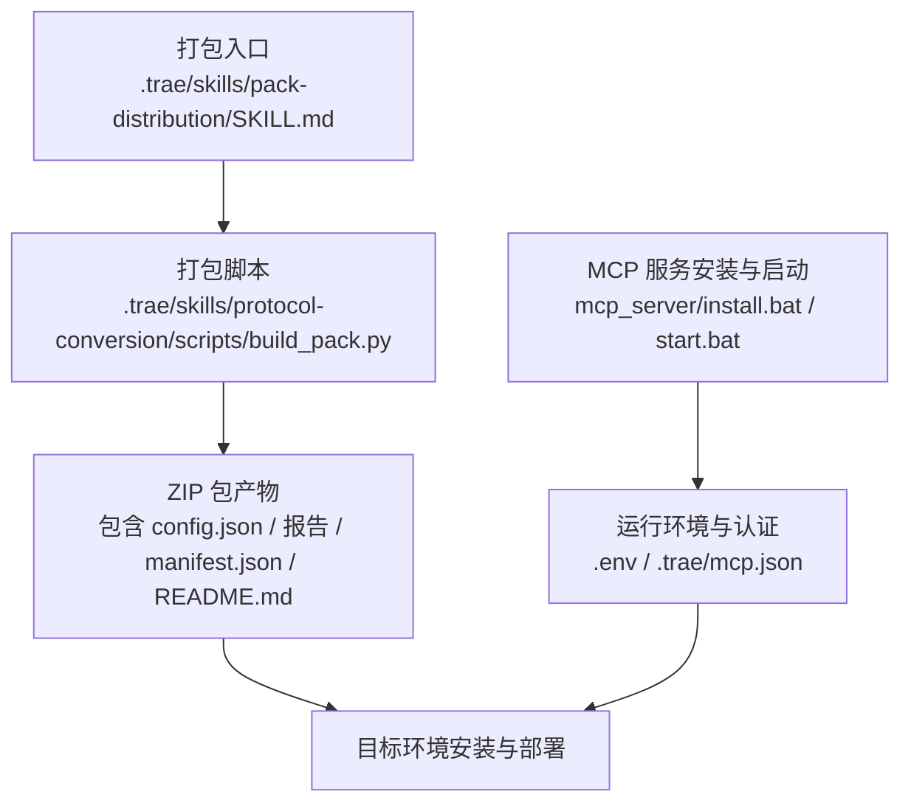
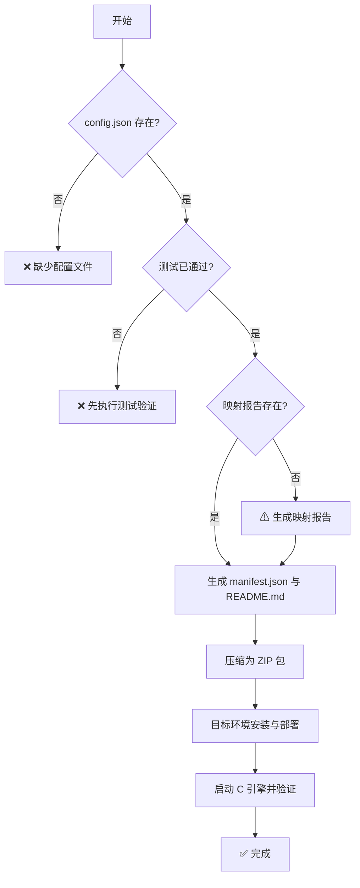
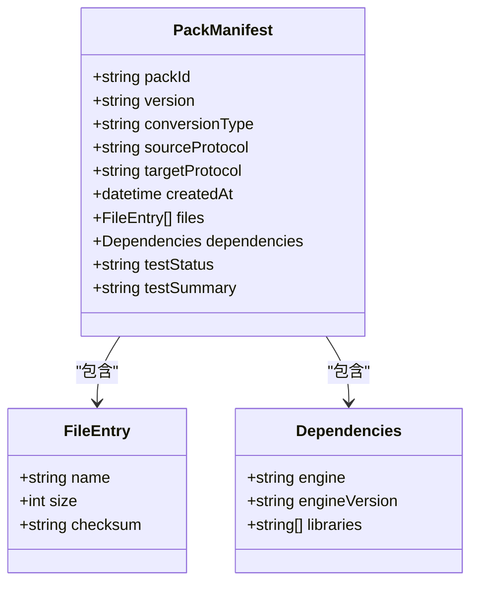
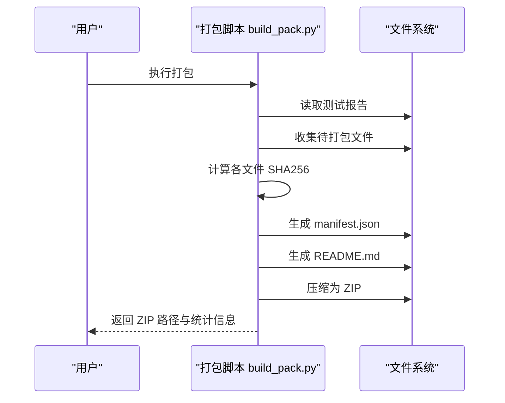
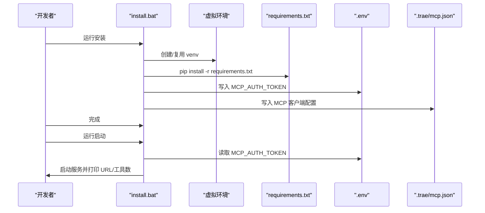
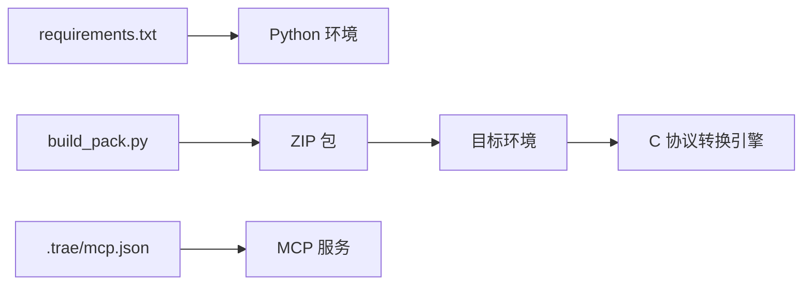

# 打包与分发

<cite>
**本文引用的文件**
- [SKILL.md](file://.trae/skills/pack-distribution/SKILL.md)
- [build_pack.py](file://.trae/skills/protocol-conversion/scripts/build_pack.py)
- [install.bat](file://mcp_server/install.bat)
- [start.bat](file://mcp_server/start.bat)
- [requirements.txt](file://mcp_server/requirements.txt)
- [mcp.json](file://.trae/mcp.json)
- [mcp server部署.md](file://mcp server部署.md)
</cite>

## 目录
1. [简介](#简介)
2. [项目结构](#项目结构)
3. [核心组件](#核心组件)
4. [架构总览](#架构总览)
5. [详细组件分析](#详细组件分析)
6. [依赖关系分析](#依赖关系分析)
7. [性能考虑](#性能考虑)
8. [故障排查指南](#故障排查指南)
9. [结论](#结论)
10. [附录](#附录)

## 简介
本文件面向“协议转换包”的标准化打包与分发，覆盖以下目标：
- 标准化打包流程：从配置、映射报告、测试报告到 ZIP 包的完整流水线。
- 依赖管理与版本控制：通过清单 manifest.json 声明引擎与库依赖，结合版本号与校验和保障可追溯性。
- 自动化打包与发布：基于 pack-distribution 技能说明如何组织输入、生成产物与安装步骤。
- 包格式规范与元数据：ZIP 目录结构、manifest.json 字段、README.md 模板与占位符清单。
- 签名与完整性验证：基于 SHA256 的文件级校验和；可扩展为数字签名（见建议）。
- 分发渠道与安装部署：本地开发、目标环境一键解压与替换占位符、启动 C 引擎并验证。
- 仓库管理、权限与访问策略：包仓库治理、访问控制与更新机制。
- 质量保证与安全合规：测试门控、安全扫描与合规检查建议。

## 项目结构
围绕打包与分发的关键目录与文件如下：
- .trae/skills/pack-distribution/SKILL.md：定义打包与分发的流程、约束与产物规范。
- .trae/skills/protocol-conversion/scripts/build_pack.py：实现统一打包脚本，生成映射报告、清单、README 并压缩为 ZIP。
- mcp_server/install.bat、mcp_server/start.bat：MCP 服务安装与启动脚本，负责虚拟环境、Token 配置与服务启动。
- mcp_server/requirements.txt：Python 运行时依赖声明。
- .trae/mcp.json：客户端连接 MCP 服务的配置（含 Token）。
- mcp server部署.md：部署与排错参考文档。

图表来源
- [SKILL.md:27-161](file://.trae/skills/pack-distribution/SKILL.md#L27-L161)
- [build_pack.py:183-408](file://.trae/skills/protocol-conversion/scripts/build_pack.py#L183-L408)
- [install.bat:52-85](file://mcp_server/install.bat#L52-L85)
- [start.bat:15-41](file://mcp_server/start.bat#L15-L41)
- [mcp.json:1-1](file://.trae/mcp.json#L1-L1)

章节来源
- [SKILL.md:27-161](file://.trae/skills/pack-distribution/SKILL.md#L27-L161)
- [build_pack.py:183-408](file://.trae/skills/protocol-conversion/scripts/build_pack.py#L183-L408)
- [install.bat:52-85](file://mcp_server/install.bat#L52-L85)
- [start.bat:15-41](file://mcp_server/start.bat#L15-L41)
- [requirements.txt:1-3](file://mcp_server/requirements.txt#L1-L3)
- [mcp.json:1-1](file://.trae/mcp.json#L1-L1)
- [mcp server部署.md:599-692](file://mcp server部署.md#L599-L692)

## 核心组件
- 打包技能（pack-distribution）：定义打包前检查、清单与文档生成、ZIP 打包、目标环境安装等阶段与约束规则。
- 打包脚本（build_pack.py）：读取测试报告、收集文件、计算 SHA256、生成 manifest.json 与 README.md，最终输出 ZIP。
- 安装与启动脚本（install.bat/start.bat）：创建虚拟环境、安装依赖、生成并写入 Token、配置 MCP 客户端连接、启动服务。
- 依赖声明（requirements.txt）：声明 Python 运行时依赖版本范围。
- 客户端配置（.trae/mcp.json）：记录 MCP 服务端点与鉴权头。

章节来源
- [SKILL.md:27-161](file://.trae/skills/pack-distribution/SKILL.md#L27-L161)
- [build_pack.py:183-408](file://.trae/skills/protocol-conversion/scripts/build_pack.py#L183-L408)
- [install.bat:52-85](file://mcp_server/install.bat#L52-L85)
- [start.bat:15-41](file://mcp_server/start.bat#L15-L41)
- [requirements.txt:1-3](file://mcp_server/requirements.txt#L1-L3)
- [mcp.json:1-1](file://.trae/mcp.json#L1-L1)

## 架构总览
打包与分发整体流程分为四个阶段：打包前检查、清单与文档生成、ZIP 打包、目标环境安装。

图表来源
- [SKILL.md:93-140](file://.trae/skills/pack-distribution/SKILL.md#L93-L140)

章节来源
- [SKILL.md:93-140](file://.trae/skills/pack-distribution/SKILL.md#L93-L140)

## 详细组件分析

### 打包技能（pack-distribution）
- 职责：定义打包产物结构、manifest.json 字段、README.md 模板、约束规则与操作流程。
- 关键要点：
  - ZIP 包必须包含 config.json、mapping_report.md、test_report.json、源/目标协议规格 JSON、README.md、manifest.json。
  - manifest.json 需包含 packId、version、conversionType、sourceProtocol、targetProtocol、createdAt、files（含 size 与 checksum）、dependencies（engine/engineVersion/libraries）、testStatus/testSummary。
  - 约束：测试门控、SHA256 校验和、占位符清单、依赖声明、版本管理、文件完整性。

图表来源
- [SKILL.md:42-65](file://.trae/skills/pack-distribution/SKILL.md#L42-L65)

章节来源
- [SKILL.md:27-161](file://.trae/skills/pack-distribution/SKILL.md#L27-L161)

### 打包脚本（build_pack.py）
- 职责：读取测试报告、收集要打包的文件、计算 SHA256、生成 manifest.json 与 README.md，最后压缩为 ZIP。
- 关键点：
  - 使用 hashlib.sha256 计算每个文件的校验和，并在 manifest.json 中记录。
  - 清理并创建输出目录，复制文件、生成报告与清单，再递归压缩为 ZIP。
  - 输出 ZIP 路径、大小与文件数量统计。

图表来源
- [build_pack.py:183-408](file://.trae/skills/protocol-conversion/scripts/build_pack.py#L183-L408)

章节来源
- [build_pack.py:183-408](file://.trae/skills/protocol-conversion/scripts/build_pack.py#L183-L408)

### 安装与启动（install.bat / start.bat）
- install.bat：
  - 检查 Python 版本，创建虚拟环境，安装 requirements.txt 依赖。
  - 交互式生成或输入 MCP_AUTH_TOKEN，写入 mcp_server/.env。
  - 生成 .trae/mcp.json，配置 MCP 客户端连接地址与鉴权头。
- start.bat：
  - 激活虚拟环境，读取 .env 中的 MCP_AUTH_TOKEN。
  - 若未设置则提示重新运行安装或手动设置。
  - 启动 MCP 服务进程。

图表来源
- [install.bat:52-85](file://mcp_server/install.bat#L52-L85)
- [start.bat:15-41](file://mcp_server/start.bat#L15-L41)
- [requirements.txt:1-3](file://mcp_server/requirements.txt#L1-L3)
- [mcp.json:1-1](file://.trae/mcp.json#L1-L1)

章节来源
- [install.bat:52-85](file://mcp_server/install.bat#L52-L85)
- [start.bat:15-41](file://mcp_server/start.bat#L15-L41)
- [requirements.txt:1-3](file://mcp_server/requirements.txt#L1-L3)
- [mcp.json:1-1](file://.trae/mcp.json#L1-L1)

### 包格式规范与元数据
- ZIP 包目录结构：包含主配置、映射报告、测试报告、源/目标协议规格、README.md、manifest.json。
- manifest.json 字段：
  - 标识与版本：packId、version、conversionType、sourceProtocol、targetProtocol、createdAt。
  - 文件清单：files 数组，每项包含 name、size、checksum（sha256:...）。
  - 依赖：dependencies.engine、dependencies.engineVersion、dependencies.libraries。
  - 测试：testStatus、testSummary。
- README.md 模板：安装步骤、配置参数（占位符清单）、测试结果摘要。

章节来源
- [SKILL.md:27-91](file://.trae/skills/pack-distribution/SKILL.md#L27-L91)
- [SKILL.md:42-65](file://.trae/skills/pack-distribution/SKILL.md#L42-L65)

### 签名与完整性验证
- 当前实现：对每个文件计算 SHA256 并记录在 manifest.json 中，用于完整性校验。
- 扩展建议：
  - 引入数字签名（如 GPG/SM2）对 ZIP 或 manifest.json 进行签名，并提供验签脚本。
  - 在目标环境安装时，先校验 manifest.json 中所有文件的 checksum，再执行安装。
  - 将签名公钥与验签脚本随包分发，确保可信来源。

章节来源
- [SKILL.md:152-161](file://.trae/skills/pack-distribution/SKILL.md#L152-L161)
- [build_pack.py:183-208](file://.trae/skills/protocol-conversion/scripts/build_pack.py#L183-L208)

### 分发渠道选择、安装部署与更新机制
- 分发渠道：
  - 内部制品库（如私有 PyPI/NPM 风格仓库）存放 ZIP 包与 manifest.json。
  - 代码仓库附件或 Git Tag 归档，便于审计与回溯。
  - 企业网盘/共享目录（配合访问控制）。
- 安装部署：
  - 解压 ZIP 至目标目录。
  - 替换 config.json 中的占位符为实际值。
  - 验证 C 引擎依赖（cJSON、paho.mqtt.c、libmicrohttpd 等）。
  - 启动 C 协议转换引擎并验证转换结果。
- 更新机制：
  - 基于 manifest.json 的 version 与 packId 进行增量或全量更新。
  - 更新前备份旧配置，更新后执行冒烟测试与回归测试。
  - 支持回滚：保留上一版本包与配置快照。

章节来源
- [SKILL.md:131-140](file://.trae/skills/pack-distribution/SKILL.md#L131-L140)

### 包仓库管理、权限控制与访问策略
- 仓库治理：
  - 按协议类型与版本划分目录（如 mqtt_to_mqtt/v1.0.0）。
  - 强制上传 manifest.json 与 ZIP，禁止直接修改历史版本。
  - 启用分支保护与变更审批。
- 权限控制：
  - 仅允许授权人员发布与删除包。
  - 下载权限按团队/角色划分。
- 访问策略：
  - 内网镜像加速与缓存。
  - 审计日志记录下载与发布行为。

[本节为通用实践建议，不直接引用具体文件]

### 包质量保证、安全扫描与合规检查
- 质量门禁：
  - 打包前必须通过测试验证（test-validation），否则阻断打包。
  - 生成映射报告与测试报告作为交付物。
- 安全扫描：
  - 对依赖进行漏洞扫描（如 Python 依赖与 C 库）。
  - 对 ZIP 包内容进行静态扫描，避免敏感信息泄露。
- 合规检查：
  - 许可证合规（第三方库许可声明）。
  - 数据隐私与最小化原则（配置中不包含敏感明文）。

章节来源
- [SKILL.md:152-161](file://.trae/skills/pack-distribution/SKILL.md#L152-L161)

## 依赖关系分析
- 运行时依赖：
  - Python 运行时与依赖：mcp、uvicorn（由 requirements.txt 声明）。
  - 打包脚本依赖标准库：hashlib、json、os、zipfile、shutil、datetime。
- 外部依赖：
  - C 协议转换引擎及其库（cJSON、paho.mqtt.c、libmicrohttpd）在目标环境安装。
- 客户端配置：
  - .trae/mcp.json 指定 MCP 服务端点与鉴权头。

图表来源
- [requirements.txt:1-3](file://mcp_server/requirements.txt#L1-L3)
- [build_pack.py:183-408](file://.trae/skills/protocol-conversion/scripts/build_pack.py#L183-L408)
- [mcp.json:1-1](file://.trae/mcp.json#L1-L1)

章节来源
- [requirements.txt:1-3](file://mcp_server/requirements.txt#L1-L3)
- [build_pack.py:183-408](file://.trae/skills/protocol-conversion/scripts/build_pack.py#L183-L408)
- [mcp.json:1-1](file://.trae/mcp.json#L1-L1)

## 性能考虑
- 打包性能：
  - 大文件压缩建议使用 ZIP_DEFLATED，合理设置临时目录与并行度（如需）。
  - 预计算校验和并缓存，避免重复 IO。
- 安装性能：
  - 目标环境提前准备 C 引擎与系统库，减少首次启动时间。
  - 使用镜像源加速依赖安装。
- 存储与传输：
  - 对 ZIP 包进行去重与增量更新，降低带宽占用。
  - 仓库层启用压缩与 CDN 缓存。

[本节提供通用指导，不直接分析具体文件]

## 故障排查指南
- 常见问题与解决：
  - 端口被占用：查找并结束占用 8765 端口的进程，或修改端口。
  - 移动项目后虚拟环境失效：删除旧 .venv 并重新运行 install.bat。
  - Token 未设置：运行 install.bat 生成 Token，或手动创建 mcp_server/.env。
- 安全注意事项：
  - Token 明文存储在 .env，仅用于本地开发，不要提交到 Git。
  - 生产环境建议更换更强认证、启用 HTTPS、使用进程管理与日志审计。

章节来源
- [mcp server部署.md:599-692](file://mcp server部署.md#L599-L692)
- [install.bat:52-85](file://mcp_server/install.bat#L52-L85)
- [start.bat:15-41](file://mcp_server/start.bat#L15-L41)

## 结论
本项目提供了标准化的协议转换包打包与分发能力：以 pack-distribution 技能定义流程与约束，以 build_pack.py 实现自动化打包与完整性校验，配合 install/start 脚本完成 MCP 服务的环境准备与启动。通过 manifest.json 的版本与依赖声明、README.md 的占位符清单，以及目标环境的安装与验证步骤，形成闭环的质量保证体系。建议在现有 SHA256 校验基础上引入数字签名与更严格的仓库治理，进一步提升安全性与可维护性。

## 附录
- 快速命令参考：
  - 首次安装：运行 mcp_server\install.bat
  - 启动服务：运行 mcp_server\start.bat
  - 停止服务：Ctrl+C
  - 手动激活虚拟环境：.venv\Scripts\activate.bat
  - 退出虚拟环境：deactivate
  - 手动启动服务：python mcp_server\server.py

章节来源
- [mcp server部署.md:677-687](file://mcp server部署.md#L677-L687)