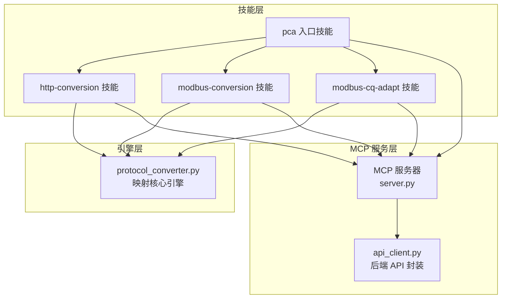
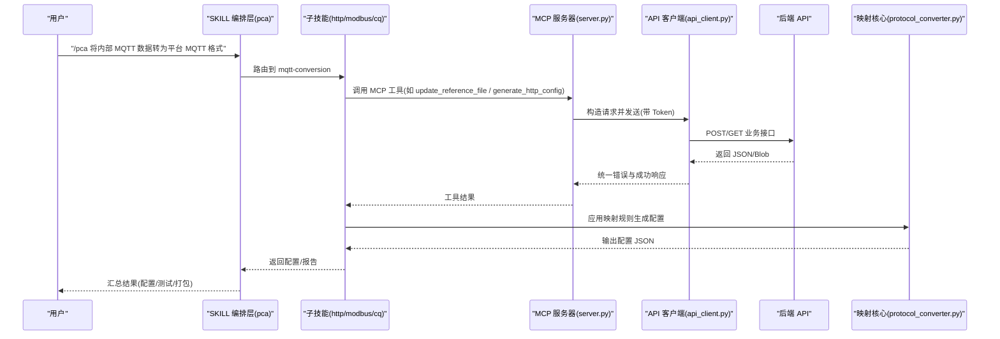
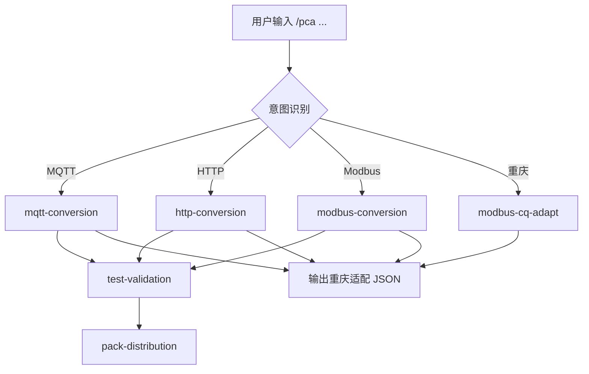
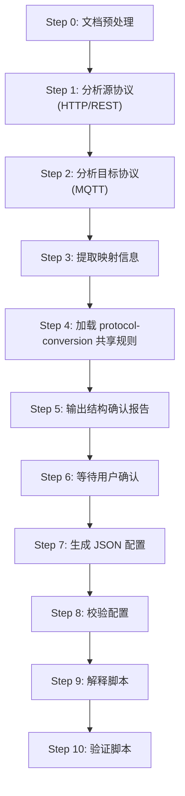
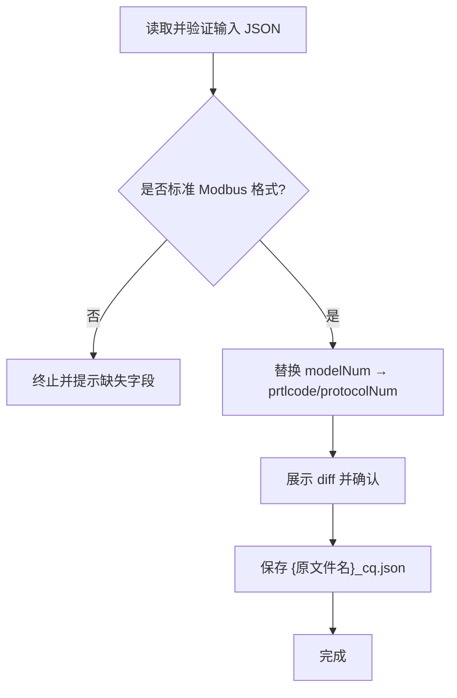
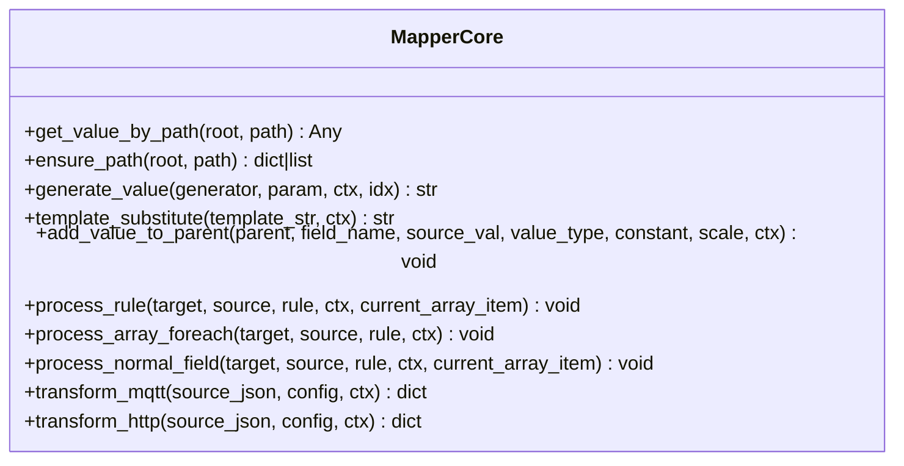
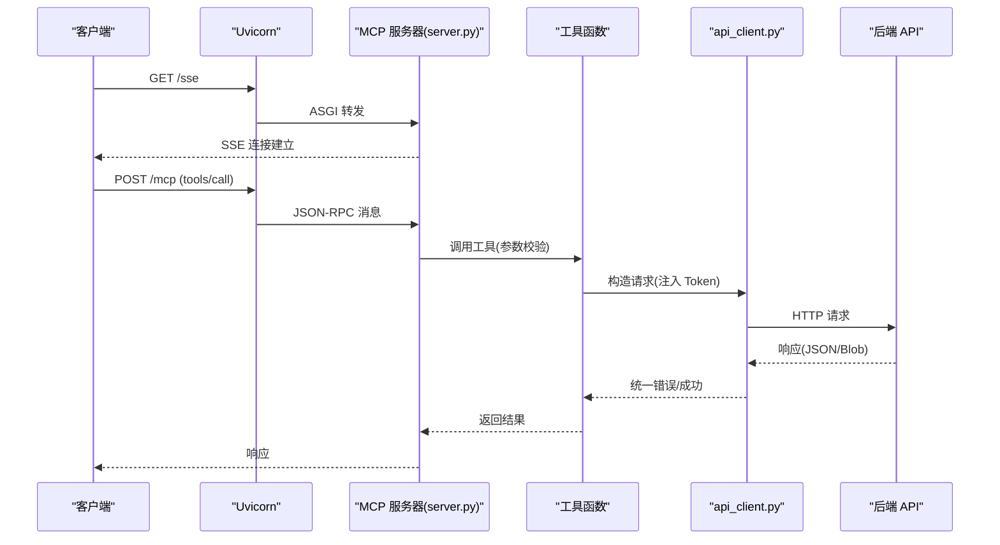
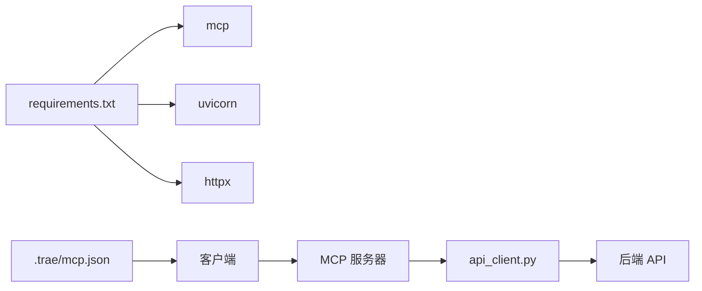

# 技能开发指南

<cite>
**本文引用的文件**
- [mcp server部署.md](file://mcp server部署.md)
- [规约管理MCP服务化Spec.md](file://规约管理MCP服务化Spec.md)
- [.trae/mcp.json](file://.trae/mcp.json)
- [pca/SKILL.md](file://.trae\skills\pca\SKILL.md)
- [http-conversion/SKILL.md](file://.trae\skills\http-conversion\SKILL.md)
- [modbus-cq-adapt/SKILL.md](file://.trae\skills\modbus-cq-adapt\SKILL.md)
- [protocol-conversion/scripts/protocol_converter.py](file://.trae\skills\protocol-conversion\scripts\protocol_converter.py)
- [mcp_server/requirements.txt](file://mcp_server/requirements.txt)
</cite>

## 目录
1. [引言](#引言)
2. [项目结构](#项目结构)
3. [核心组件](#核心组件)
4. [架构总览](#架构总览)
5. [详细组件分析](#详细组件分析)
6. [依赖分析](#依赖分析)
7. [性能考虑](#性能考虑)
8. [故障排查指南](#故障排查指南)
9. [结论](#结论)
10. [附录](#附录)

## 引言
本指南面向从零开始开发自定义 MCP 技能的工程师与 AI 智能体编排者，覆盖以下主题：
- 项目初始化、目录结构与 SKILL.md 元数据规范
- Python 脚本实现模式（参数处理、错误处理、日志记录）
- 技能与 MCP 服务器的集成方式、工具注册机制与调用约定
- 完整示例：简单数据处理技能与复杂协议转换技能
- 开发环境配置、调试技巧与最佳实践

## 项目结构
本项目围绕“技能（Skill）+ MCP 服务器 + 协议转换引擎”组织。关键目录与职责如下：
- .trae/skills：存放各技能定义与执行指南，每个技能一个目录，包含 SKILL.md 与可选的 agents 配置、脚本等
- mcp_server：MCP 服务端代码与启动脚本，提供工具注册、鉴权中间件、ASGI 路由与 Uvicorn 启动
- openspec：规约管理与变更流程配置
- .trae/mcp.json：IDE 或客户端连接 MCP 服务器的配置（URL、Headers 等）

图表来源
- [pca/SKILL.md:37-95](file://.trae\skills\pca\SKILL.md#L37-L95)
- [http-conversion/SKILL.md:23-31](file://.trae\skills\http-conversion\SKILL.md#L23-L31)
- [modbus-cq-adapt/SKILL.md:28-37](file://.trae\skills\modbus-cq-adapt\SKILL.md#L28-L37)
- [protocol-conversion/scripts/protocol_converter.py:1-16](file://.trae\skills\protocol-conversion\scripts\protocol_converter.py#L1-L16)

章节来源
- [mcp server部署.md:285-305](file://mcp server部署.md#L285-L305)
- [mcp server部署.md:463-500](file://mcp server部署.md#L463-L500)

## 核心组件
- 技能编排层（pca）：负责意图识别、路由到子技能、编排全流程（分析→生成→测试→打包）
- 协议专属技能（http-conversion、modbus-conversion、modbus-cq-adapt）：各自领域的数据采集、转换与适配逻辑
- 共享映射核心（protocol_converter.py）：统一路径解析、类型转换、数组遍历、模板替换与生成器
- MCP 服务器（server.py）：工具注册、鉴权中间件、ASGI 路由、Uvicorn 启动
- 后端 API 客户端（api_client.py）：异步 HTTP 请求封装、Token 注入、错误归一化

章节来源
- [pca/SKILL.md:159-181](file://.trae\skills\pca\SKILL.md#L159-L181)
- [http-conversion/SKILL.md:89-107](file://.trae\skills\http-conversion\SKILL.md#L89-L107)
- [protocol-conversion/scripts/protocol_converter.py:32-45](file://.trae\skills\protocol-conversion\scripts\protocol_converter.py#L32-L45)
- [mcp server部署.md:493-498](file://mcp server部署.md#L493-L498)
- [规约管理MCP服务化Spec.md:44-66](file://规约管理MCP服务化Spec.md#L44-L66)

## 架构总览
从用户输入到最终输出的端到端流程如下：

图表来源
- [pca/SKILL.md:270-314](file://.trae\skills\pca\SKILL.md#L270-L314)
- [http-conversion/SKILL.md:422-430](file://.trae\skills\http-conversion\SKILL.md#L422-L430)
- [protocol-conversion/scripts/protocol_converter.py:569-601](file://.trae\skills\protocol-conversion\scripts\protocol_converter.py#L569-L601)
- [规约管理MCP服务化Spec.md:56-66](file://规约管理MCP服务化Spec.md#L56-L66)

## 详细组件分析

### 技能元数据与目录规范（SKILL.md）
- 元数据字段建议：
  - name：技能名称
  - description：技能用途与适用场景
  - when_to_use：触发条件与关键词
  - compatibility：依赖说明（如需要 MCP Server、特定引擎）
  - metadata.tags：标签便于检索
  - metadata.order：执行顺序
  - metadata.author/version：作者与版本
- 目录结构建议：
  - agents/openai.yaml：Agent 配置（可选）
  - scripts：本地脚本（Python/Shell）
  - output：输出产物（JSON/ZIP/报告）
  - SKILL.md：技能操作手册与流程

章节来源
- [pca/SKILL.md:1-17](file://.trae\skills\pca\SKILL.md#L1-L17)
- [http-conversion/SKILL.md:1-17](file://.trae\skills\http-conversion\SKILL.md#L1-L17)
- [modbus-cq-adapt/SKILL.md:1-16](file://.trae\skills\modbus-cq-adapt\SKILL.md#L1-L16)

### 协议转换入口技能（pca）
- 功能：接收用户指令，识别意图，路由到对应子技能，编排全流程（分析→生成→测试→打包）
- 安装验证：连接 MCP → 探测鉴权状态（list_conversion_configs）→ 根据响应决定继续或提示配置 Token
- 意图路由表：按关键词匹配到 mqtt/http/modbus/cq/test/pack 等子技能
- 全流程编排：Phase 1 协议分析与配置生成；Phase 2 测试验证；Phase 3 打包分发

图表来源
- [pca/SKILL.md:159-208](file://.trae\skills\pca\SKILL.md#L159-L208)
- [pca/SKILL.md:225-235](file://.trae\skills\pca\SKILL.md#L225-L235)

章节来源
- [pca/SKILL.md:97-157](file://.trae\skills\pca\SKILL.md#L97-L157)
- [pca/SKILL.md:159-208](file://.trae\skills\pca\SKILL.md#L159-L208)

### HTTP 协议转换技能（http-conversion）
- 目标：分析第三方 HTTP/REST 源协议与内部 MQTT 目标协议，生成供 C 引擎读取的 JSON 配置
- 引擎架构：vpp_http_config.load.c 加载配置 → mapper_core.c 执行映射
- 配置文件根对象：base_url、timeout、domain、token、apis[]
- 工作流程：文档预处理 → 源/目标分析 → 提取映射 → 加载共享规则 → 确认报告 → 生成配置 → 校验 → 解释 → 验证
- MCP 工具调用：update_reference_file、analyze_http_protocol、generate_http_config、validate_config_rules、save_conversion_config

图表来源
- [http-conversion/SKILL.md:89-107](file://.trae\skills\http-conversion\SKILL.md#L89-L107)

章节来源
- [http-conversion/SKILL.md:33-88](file://.trae\skills\http-conversion\SKILL.md#L33-L88)
- [http-conversion/SKILL.md:119-145](file://.trae\skills\http-conversion\SKILL.md#L119-L145)
- [http-conversion/SKILL.md:319-345](file://.trae\skills\http-conversion\SKILL.md#L319-L345)
- [http-conversion/SKILL.md:422-430](file://.trae\skills\http-conversion\SKILL.md#L422-L430)

### Modbus 重庆地区适配技能（modbus-cq-adapt）
- 目标：将标准 Modbus 脚本中的 modelNum 字段替换为 prtlcode（或 protocolNum），并重命名输出文件
- 输入：标准 Modbus JSON（含 prtlType/modelNum/classNum/taskList/labelList）
- 输出：{原文件名}_cq.json，写入 modbus-cq-adapt/output/
- 约束：仅替换字段名，不修改值；保留原文件；必须展示 diff 并确认

图表来源
- [modbus-cq-adapt/SKILL.md:81-133](file://.trae\skills\modbus-cq-adapt\SKILL.md#L81-L133)

章节来源
- [modbus-cq-adapt/SKILL.md:18-20](file://.trae\skills\modbus-cq-adapt\SKILL.md#L18-L20)
- [modbus-cq-adapt/SKILL.md:81-133](file://.trae\skills\modbus-cq-adapt\SKILL.md#L81-L133)
- [modbus-cq-adapt/SKILL.md:135-162](file://.trae\skills\modbus-cq-adapt\SKILL.md#L135-L162)

### 共享映射核心（protocol_converter.py）
- 类与方法：
  - MapperCore.get_value_by_path：支持 a.b.c、a[0]、a[*]、"."（HTTP 根对象）
  - MapperCore.ensure_path：确保路径存在并创建必要结构
  - MapperCore.generate_value：uuid、时间戳、日期、随机串、签名、序列等
  - MapperCore.template_substitute：$var$ 模板变量替换
  - MapperCore.add_value_to_parent：类型转换（int/double/long/bool/object/substitute/string）
  - MapperCore.process_rule/process_array_foreach/process_normal_field：映射规则处理
  - MapperCore.transform_mqtt/transform_http：MQTT/HTTP 引擎入口
- 复杂度分析：
  - get_value_by_path：O(n)，n 为路径段数
  - ensure_path：O(n)
  - process_array_foreach：O(m*k)，m 为数组长度，k 为子规则数量
  - transform_*：O(R)，R 为规则总数

图表来源
- [protocol-conversion/scripts/protocol_converter.py:32-45](file://.trae\skills\protocol-conversion\scripts\protocol_converter.py#L32-L45)
- [protocol-conversion/scripts/protocol_converter.py:49-118](file://.trae\skills\protocol-conversion\scripts\protocol_converter.py#L49-L118)
- [protocol-conversion/scripts/protocol_converter.py:206-236](file://.trae\skills\protocol-conversion\scripts\protocol_converter.py#L206-L236)
- [protocol-convention/scripts/protocol_converter.py:269-376](file://.trae\skills\protocol-conversion\scripts\protocol_converter.py#L269-L376)
- [protocol-conversion/scripts/protocol_converter.py:379-565](file://.trae\skills\protocol-conversion\scripts\protocol_converter.py#L379-L565)
- [protocol-conversion/scripts/protocol_converter.py:569-601](file://.trae\skills\protocol-conversion\scripts\protocol_converter.py#L569-L601)

章节来源
- [protocol-conversion/scripts/protocol_converter.py:1-16](file://.trae\skills\protocol-conversion\scripts\protocol_converter.py#L1-L16)
- [protocol-conversion/scripts/protocol_converter.py:49-118](file://.trae\skills\protocol-conversion\scripts\protocol_converter.py#L49-L118)
- [protocol-conversion/scripts/protocol_converter.py:206-236](file://.trae\skills\protocol-conversion\scripts\protocol_converter.py#L206-L236)
- [protocol-conversion/scripts/protocol_converter.py:269-376](file://.trae\skills\protocol-conversion\scripts\protocol_converter.py#L269-L376)
- [protocol-conversion/scripts/protocol_converter.py:379-565](file://.trae\skills\protocol-conversion\scripts\protocol_converter.py#L379-L565)
- [protocol-conversion/scripts/protocol_converter.py:569-601](file://.trae\skills\protocol-conversion\scripts\protocol_converter.py#L569-L601)

### MCP 服务器集成与工具注册
- 角色分工：Uvicorn 负责网络层（端口监听、HTTP/SSE），MCP 负责应用层（路由、工具调用、资源管理）
- 端点：/sse（SSE 长连接）、/mcp（JSON-RPC over HTTP/SSE）
- 工具粒度：细粒度（每个 API 一个工具），Skill 负责流程编排
- 鉴权：MCP 接入 Bearer Token；后端业务 Token 作为工具参数传入 api_client
- 典型调用链：Skill → server.py 工具函数 → api_client.py → 后端 API

图表来源
- [mcp server部署.md:110-126](file://mcp server部署.md#L110-L126)
- [mcp server部署.md:163-261](file://mcp server部署.md#L163-L261)
- [规约管理MCP服务化Spec.md:44-66](file://规约管理MCP服务化Spec.md#L44-L66)

章节来源
- [mcp server部署.md:110-126](file://mcp server部署.md#L110-L126)
- [mcp server部署.md:163-261](file://mcp server部署.md#L163-L261)
- [mcp server部署.md:493-498](file://mcp server部署.md#L493-L498)
- [规约管理MCP服务化Spec.md:32-43](file://规约管理MCP服务化Spec.md#L32-L43)

## 依赖分析
- 运行时依赖：
  - mcp：MCP 协议 SDK（>=1.0.0,<2.0.0）
  - uvicorn：ASGI 服务器（>=0.30.0）
  - httpx：异步 HTTP 客户端（用于 api_client.py）
- 配置依赖：
  - .trae/mcp.json：客户端连接 MCP 的 URL 与 Headers（Authorization）
- 外部依赖：
  - 后端 API（https://18091.chinadny.com）
  - 协议转换 C 引擎（mapper_core.c、vpp_http_config.load.c）

图表来源
- [mcp_server/requirements.txt:1-3](file://mcp_server/requirements.txt#L1-L3)
- [.trae/mcp.json:1-1](file://.trae/mcp.json#L1-L1)
- [规约管理MCP服务化Spec.md:68-78](file://规约管理MCP服务化Spec.md#L68-L78)

章节来源
- [mcp_server/requirements.txt:1-3](file://mcp_server/requirements.txt#L1-L3)
- [.trae/mcp.json:1-1](file://.trae/mcp.json#L1-L1)
- [规约管理MCP服务化Spec.md:68-78](file://规约管理MCP服务化Spec.md#L68-L78)

## 性能考虑
- 异步 I/O：MCP 服务器运行在 asyncio 中，使用 httpx.AsyncClient 避免阻塞事件循环
- 并发模型：Uvicorn 基于事件循环高效处理并发请求，I/O 等待时切换任务
- 映射核心优化：
  - 路径解析与数组遍历采用线性扫描，避免深层递归
  - 生成器与模板替换为 O(1)/O(n) 操作
- 建议：
  - 合理设置超时与重试策略
  - 对大数组进行分页或分批处理
  - 避免在热路径中进行重型计算

## 故障排查指南
- 常见问题：
  - Python 未安装或版本过低：检查 python --version，安装 3.10+
  - 虚拟环境创建失败：权限不足、磁盘空间不足
  - 依赖安装失败：网络问题、pip 版本过低，可使用国内镜像
  - 启动时找不到虚拟环境：先运行 install.bat
  - Token 未配置：运行 install.bat 或手动创建 .env
  - 端口被占用：netstat 查找进程并结束，或修改端口
- 生产环境建议：
  - 更换认证方式（OAuth2/JWT）
  - 启用 HTTPS
  - 多进程模式（Gunicorn + Uvicorn）
  - 添加日志审计
  - 限制访问来源（防火墙/反向代理）

章节来源
- [mcp server部署.md:505-632](file://mcp server部署.md#L505-L632)
- [mcp server部署.md:645-674](file://mcp server部署.md#L645-L674)

## 结论
本指南基于仓库现有实现，提供了从零开发自定义 MCP 技能的完整路径：以 SKILL.md 为契约，通过 pca 入口技能进行意图识别与流程编排，借助 http-conversion/modbus-conversion/modbus-cq-adapt 等子技能完成具体协议转换与适配，利用 protocol_converter.py 的映射核心保证一致性，并通过 MCP 服务器与后端 API 集成实现自动化。遵循细粒度工具、异步 I/O、统一错误处理与鉴权分离的最佳实践，可快速构建稳定可扩展的技能生态。

## 附录
- 快速命令参考：
  - 首次安装：mcp_server\install.bat
  - 启动服务：mcp_server\start.bat
  - 停止服务：Ctrl+C
  - 手动激活虚拟环境：.venv\Scripts\activate.bat
  - 退出虚拟环境：deactivate
  - 手动启动服务：python mcp_server\server.py

章节来源
- [mcp server部署.md:677-686](file://mcp server部署.md#L677-L686)