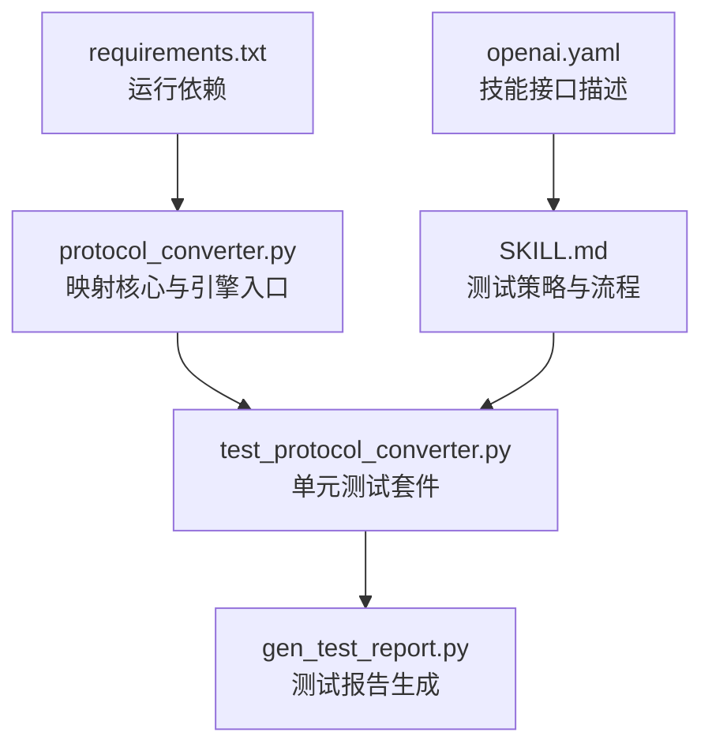
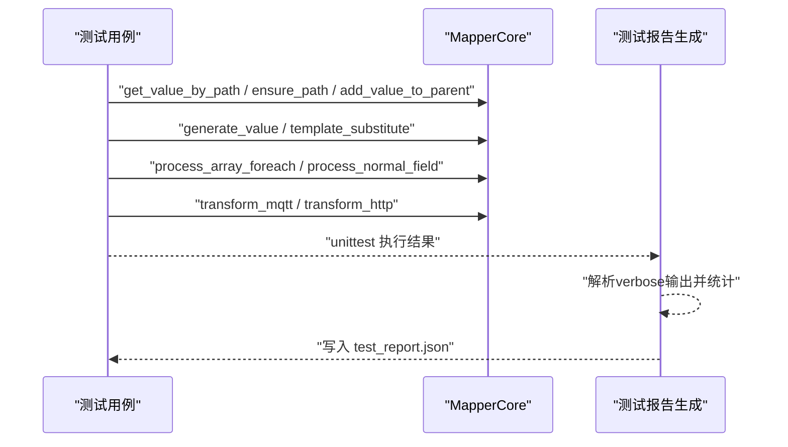
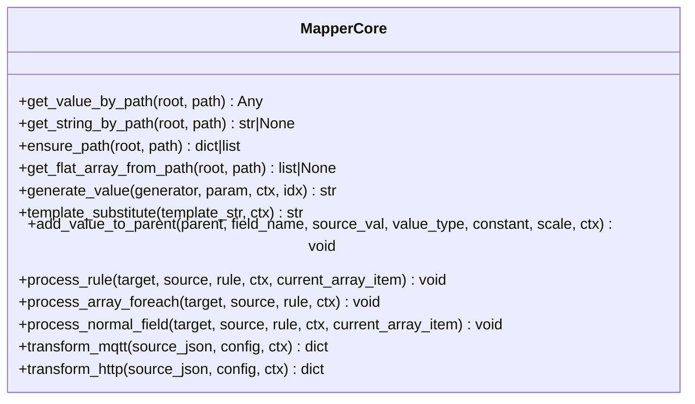
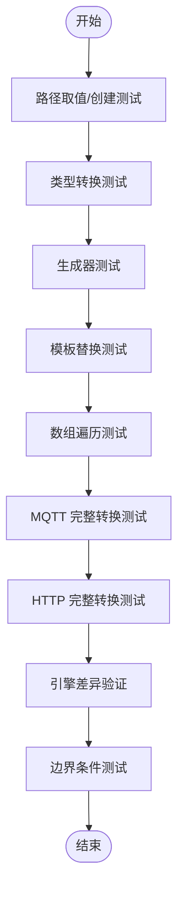
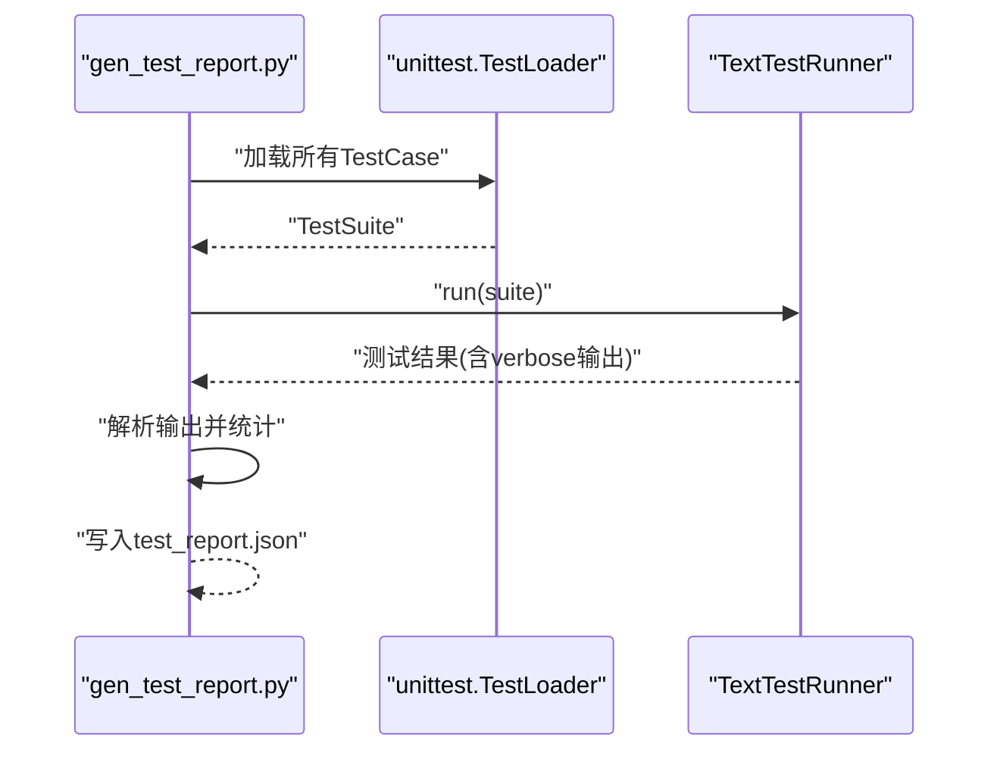
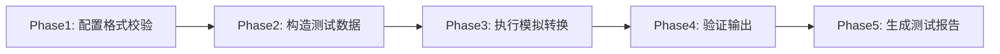
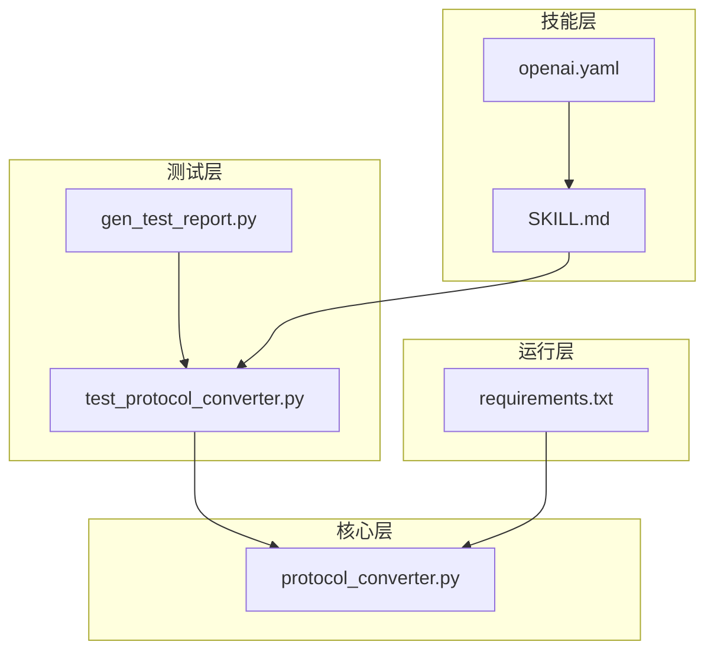

# 测试与验证

<cite>
**本文引用的文件**
- [protocol_converter.py](file://.trae/skills/protocol-conversion/scripts/protocol_converter.py)
- [test_protocol_converter.py](file://.trae/skills/protocol-conversion/scripts/test_protocol_converter.py)
- [gen_test_report.py](file://.trae/skills/protocol-conversion/scripts/gen_test_report.py)
- [SKILL.md](file://.trae/skills/test-validation/SKILL.md)
- [openai.yaml](file://.trae/skills/test-validation/agents/openai.yaml)
- [requirements.txt](file://mcp_server/requirements.txt)
</cite>

## 目录
1. [简介](#简介)
2. [项目结构](#项目结构)
3. [核心组件](#核心组件)
4. [架构总览](#架构总览)
5. [详细组件分析](#详细组件分析)
6. [依赖关系分析](#依赖关系分析)
7. [性能考虑](#性能考虑)
8. [故障排查指南](#故障排查指南)
9. [结论](#结论)
10. [附录](#附录)

## 简介
本文件面向“协议转换配置测试验证”技能包，系统化说明单元测试编写方法、集成测试策略与端到端测试流程；解释如何使用 test-validation 技能包进行自动化测试；覆盖用例设计原则、Mock 数据准备、测试环境搭建；并给出性能测试、负载与压力测试建议，以及测试报告生成、覆盖率分析与质量门禁配置思路。同时提供常见测试问题的诊断与解决方案。

## 项目结构
本项目围绕“统一协议映射引擎”的 Python 实现与配套测试展开：
- 映射核心与引擎入口位于 protocol_converter.py，提供 MQTT/HTTP 两类转换入口及路径解析、类型转换、数组遍历、模板替换等能力。
- 单元测试集中在 test_protocol_converter.py，覆盖路径取值、路径创建、类型转换、生成器、模板替换、数组遍历、MQTT/HTTP 完整转换、引擎差异与边界条件。
- 测试报告生成脚本 gen_test_report.py 基于 unittest 收集所有 TestCase，执行后输出结构化 JSON 报告。
- test-validation 技能包 SKILL.md 定义了测试策略矩阵、操作流程（格式校验→构造数据→模拟转换→验证输出→生成报告）与约束规则。
- mcp_server/requirements.txt 声明了运行期依赖（MCP 服务与 ASGI 服务器），为后续集成测试提供环境参考。

**图示来源**
- [protocol_converter.py:32-602](file://.trae/skills/protocol-conversion/scripts/protocol_converter.py#L32-L602)
- [test_protocol_converter.py:27-800](file://.trae/skills/protocol-conversion/scripts/test_protocol_converter.py#L27-L800)
- [gen_test_report.py:1-89](file://.trae/skills/protocol-conversion/scripts/gen_test_report.py#L1-L89)
- [SKILL.md:19-190](file://.trae/skills/test-validation/SKILL.md#L19-L190)
- [openai.yaml:1-3](file://.trae/skills/test-validation/agents/openai.yaml#L1-L3)
- [requirements.txt:1-3](file://mcp_server/requirements.txt#L1-L3)

**章节来源**
- [protocol_converter.py:32-602](file://.trae/skills/protocol-conversion/scripts/protocol_converter.py#L32-L602)
- [test_protocol_converter.py:27-800](file://.trae/skills/protocol-conversion/scripts/test_protocol_converter.py#L27-L800)
- [gen_test_report.py:1-89](file://.trae/skills/protocol-conversion/scripts/gen_test_report.py#L1-L89)
- [SKILL.md:19-190](file://.trae/skills/test-validation/SKILL.md#L19-L190)
- [openai.yaml:1-3](file://.trae/skills/test-validation/agents/openai.yaml#L1-L3)
- [requirements.txt:1-3](file://mcp_server/requirements.txt#L1-L3)

## 核心组件
- 映射核心 MapperCore：提供路径取值/创建、扁平化数组获取、值生成、模板替换、类型转换、普通字段处理、数组遍历处理，以及 MQTT/HTTP 引擎入口。
- 单元测试套件：按功能维度组织测试类，覆盖路径、类型、生成器、模板、数组遍历、MQTT/HTTP 完整转换、引擎差异与边界条件。
- 测试报告生成：自动发现 TestCase，执行并解析 verbose 输出，汇总统计并输出 JSON 报告。
- 测试验证技能：定义测试策略矩阵、五阶段流程与约束规则，指导如何对生成的转换配置进行冒烟测试与回归验证。

**章节来源**
- [protocol_converter.py:32-602](file://.trae/skills/protocol-conversion/scripts/protocol_converter.py#L32-L602)
- [test_protocol_converter.py:27-800](file://.trae/skills/protocol-conversion/scripts/test_protocol_converter.py#L27-L800)
- [gen_test_report.py:1-89](file://.trae/skills/protocol-conversion/scripts/gen_test_report.py#L1-L89)
- [SKILL.md:19-190](file://.trae/skills/test-validation/SKILL.md#L19-L190)

## 架构总览
下图展示了从测试驱动到映射核心再到报告产出的整体流程，体现单元测试如何通过调用 MapperCore 的不同方法验证映射逻辑，并由报告脚本汇总结果。

**图示来源**
- [protocol_converter.py:49-602](file://.trae/skills/protocol-conversion/scripts/protocol_converter.py#L49-L602)
- [test_protocol_converter.py:27-800](file://.trae/skills/protocol-conversion/scripts/test_protocol_converter.py#L27-L800)
- [gen_test_report.py:13-89](file://.trae/skills/protocol-conversion/scripts/gen_test_report.py#L13-L89)

## 详细组件分析

### 映射核心 MapperCore
- 路径工具：支持 a.b.c、a[0]、a[*]、"."（HTTP 返回根对象）等路径语法；提供字符串取值与扁平化数组获取。
- 值生成：支持 uuid、时间戳（秒/毫秒）、日期时间、随机串、MD5 签名、批次号、序列号等。
- 模板替换：$var$ 语法，支持嵌套路径变量替换。
- 类型转换：统一以 string 比较分支，覆盖 int/double/long/bool/object/substitute/string 七种类型，支持常量、源值、比例系数与上下文。
- 映射处理：统一入口 process_rule，区分数组遍历与普通字段；数组遍历支持 object/key_value、"." 源路径、MQTT 嵌套 [*] 展平与 $idx 变量替换。
- 引擎入口：transform_mqtt 与 transform_http 分别对应两套配置结构与执行范围。

**图示来源**
- [protocol_converter.py:32-602](file://.trae/skills/protocol-conversion/scripts/protocol_converter.py#L32-L602)

**章节来源**
- [protocol_converter.py:49-602](file://.trae/skills/protocol-conversion/scripts/protocol_converter.py#L49-L602)

### 单元测试套件
- 路径取值与创建：覆盖基本路径、嵌套路径、数组索引/通配符、越界与缺失路径、空路径等。
- 类型转换：覆盖 string/int/double/long/bool/object/substitute 多种输入来源与边界情况（空串跳过、常量注入、比例系数）。
- 生成器：验证 UUID、时间戳、日期时间、序列号、MD5、批次号、随机串等。
- 模板替换：简单/嵌套/多变量/无匹配场景。
- 数组遍历：object/key_value、嵌套遍历、"." 源路径、MQTT 嵌套 [*] 展平。
- 完整转换：使用真实配置样例验证 MQTT/HTTP 转换结果，包括常量、路径、context、substitute、数组遍历等。
- 引擎差异：验证 MQTT 不支持 context、HTTP 不支持 substitute 的行为差异。
- 边界条件：空值、越界、空数组、特殊字符等。

**图示来源**
- [test_protocol_converter.py:27-800](file://.trae/skills/protocol-conversion/scripts/test_protocol_converter.py#L27-L800)

**章节来源**
- [test_protocol_converter.py:27-800](file://.trae/skills/protocol-conversion/scripts/test_protocol_converter.py#L27-L800)

### 测试报告生成
- 自动发现模块内所有 TestCase 并组装测试套件。
- 使用 TextTestRunner 以 verbose 模式执行，捕获每行输出。
- 解析单行/多行两种格式，统计每个测试类的 total/passed/skipped/failed。
- 汇总全局统计（testsRun、failures、errors、skipped、status）并输出 JSON 报告。

**图示来源**
- [gen_test_report.py:13-89](file://.trae/skills/protocol-conversion/scripts/gen_test_report.py#L13-L89)

**章节来源**
- [gen_test_report.py:1-89](file://.trae/skills/protocol-conversion/scripts/gen_test_report.py#L1-L89)

### 测试验证技能（test-validation）
- 目标：对生成的 JSON 转换配置进行冒烟测试，验证字段映射正确性、数据类型转换、边界条件处理与错误恢复能力。
- 适用场景：配置验收、发布前质量门控、修改后回归、故障定位。
- 策略矩阵：通用测试策略（格式、映射、类型、数组、常量、生成器、钩子）+ 专项策略（MQTT/HTTP/Modbus）。
- 操作流程：Phase1 配置格式校验 → Phase2 构造测试数据 → Phase3 执行模拟转换 → Phase4 验证输出 → Phase5 生成测试报告。
- 约束规则：安全设计、全量测试、边界覆盖、报告格式、修复重测、MCP 兼容。

**图示来源**
- [SKILL.md:19-190](file://.trae/skills/test-validation/SKILL.md#L19-L190)

**章节来源**
- [SKILL.md:19-190](file://.trae/skills/test-validation/SKILL.md#L19-L190)
- [openai.yaml:1-3](file://.trae/skills/test-validation/agents/openai.yaml#L1-L3)

## 依赖关系分析
- 运行时依赖：mcp 与 uvicorn 用于 MCP 服务运行，为后续集成测试提供基础环境。
- 测试依赖：Python 标准库 unittest、json、re、io、os、sys；测试脚本通过 sys.path 导入被测模块与测试模块。
- 模块耦合：
  - 测试模块依赖映射核心（MapperCore）提供的静态方法与类方法。
  - 报告生成脚本依赖 unittest 框架与测试模块的 TestCase 命名约定。
  - 技能文档与代理描述作为流程与接口契约，指导测试设计与执行。

**图示来源**
- [test_protocol_converter.py:27-800](file://.trae/skills/protocol-conversion/scripts/test_protocol_converter.py#L27-L800)
- [gen_test_report.py:1-89](file://.trae/skills/protocol-conversion/scripts/gen_test_report.py#L1-L89)
- [protocol_converter.py:32-602](file://.trae/skills/protocol-conversion/scripts/protocol_converter.py#L32-L602)
- [SKILL.md:19-190](file://.trae/skills/test-validation/SKILL.md#L19-L190)
- [openai.yaml:1-3](file://.trae/skills/test-validation/agents/openai.yaml#L1-L3)
- [requirements.txt:1-3](file://mcp_server/requirements.txt#L1-L3)

**章节来源**
- [test_protocol_converter.py:27-800](file://.trae/skills/protocol-conversion/scripts/test_protocol_converter.py#L27-L800)
- [gen_test_report.py:1-89](file://.trae/skills/protocol-conversion/scripts/gen_test_report.py#L1-L89)
- [protocol_converter.py:32-602](file://.trae/skills/protocol-conversion/scripts/protocol_converter.py#L32-L602)
- [SKILL.md:19-190](file://.trae/skills/test-validation/SKILL.md#L19-L190)
- [openai.yaml:1-3](file://.trae/skills/test-validation/agents/openai.yaml#L1-L3)
- [requirements.txt:1-3](file://mcp_server/requirements.txt#L1-L3)

## 性能考虑
- 单元测试层面：
  - 路径解析与数组遍历的时间复杂度与路径长度和数组规模线性相关；避免在测试中构造超大数组，保持用例快速稳定。
  - 生成器与模板替换为常数或近似常数开销，适合高频断言。
- 集成测试层面：
  - 若引入外部依赖（如 HTTP/MQTT 客户端），建议使用 Mock 隔离网络 I/O，确保测试可重复且不受外部环境影响。
  - 批量转换场景下，关注内存占用与序列化开销，必要时分片处理。
- 负载与压力测试建议：
  - 使用并发 runner（如多线程或多进程）并行执行独立测试用例，缩短 CI 时间。
  - 针对映射核心的高频路径与数组遍历构造压测用例，评估 CPU 与内存峰值。
  - 结合日志与指标采集（如耗时、失败率）识别瓶颈。

[本节为通用性能建议，不直接分析具体文件]

## 故障排查指南
- 路径解析异常：
  - 检查路径是否包含非法字符或越界索引；确认数组通配符 [*] 使用位置与层级。
  - 参考路径取值与扁平化数组获取的实现逻辑，定位解析分支。
- 类型转换异常：
  - 确认 source_type 与 value_type 组合是否符合预期；注意空值与常量优先级。
  - 对于字符串转数字，检查格式与精度；对于布尔转换，确认 true/false/1/0 的判定。
- 数组遍历异常：
  - 检查 target 中的 @ 锚点与父路径是否正确；确认 item_type 与 sub_mappings 数量关系。
  - 对于 MQTT 嵌套 [*] 展平，确认剩余路径解析与递归逻辑。
- 引擎差异问题：
  - MQTT 不支持 context source_type；HTTP 通常不使用 substitute；确保配置与引擎匹配。
- 报告生成异常：
  - 检查 verbose 输出格式是否被正确解析；确认测试类命名与继承 unittest.TestCase。
  - 若用例未执行，确认 TestLoader 是否能发现 TestCase 类。

**章节来源**
- [protocol_converter.py:49-602](file://.trae/skills/protocol-conversion/scripts/protocol_converter.py#L49-L602)
- [test_protocol_converter.py:27-800](file://.trae/skills/protocol-conversion/scripts/test_protocol_converter.py#L27-L800)
- [gen_test_report.py:13-89](file://.trae/skills/protocol-conversion/scripts/gen_test_report.py#L13-L89)

## 结论
本项目提供了完整的协议转换配置测试验证能力：以 Python 实现的映射核心为基础，配合全面的单元测试与报告生成脚本，形成可重复、可扩展的测试体系；test-validation 技能包明确了测试策略与流程，便于在配置生成后快速进行冒烟与回归验证。建议在持续集成中固化测试执行与报告产出，并结合覆盖率与质量门禁提升交付质量。

[本节为总结性内容，不直接分析具体文件]

## 附录

### 单元测试编写方法
- 组织方式：按功能维度划分测试类（路径、类型、生成器、模板、数组遍历、完整转换、引擎差异、边界条件）。
- 断言策略：对关键路径、类型转换、数组遍历与生成器输出进行强断言；对缺失/越界/空值等边界进行负向断言。
- 数据准备：使用 setUp 构造典型与复杂数据结构，覆盖单元素、多元素、嵌套、空数组等场景。
- 可维护性：用例命名清晰，注释说明意图；避免硬编码敏感信息，使用常量或配置集中管理。

**章节来源**
- [test_protocol_converter.py:27-800](file://.trae/skills/protocol-conversion/scripts/test_protocol_converter.py#L27-L800)

### 集成测试策略
- 目标：验证映射核心在不同引擎（MQTT/HTTP）下的行为一致性，以及与外部依赖的交互。
- 方法：
  - 使用真实配置样例驱动 transform_mqtt/transform_http，断言输出结构与字段值。
  - 对 context/substitute 等特性进行差异化验证，确保引擎边界清晰。
  - 若涉及网络 I/O，采用 Mock 替代外部服务，保证测试稳定性。
- 执行：通过 unittest 套件统一编排，结合报告脚本输出结构化结果。

**章节来源**
- [test_protocol_converter.py:501-796](file://.trae/skills/protocol-conversion/scripts/test_protocol_converter.py#L501-L796)
- [protocol_converter.py:569-602](file://.trae/skills/protocol-conversion/scripts/protocol_converter.py#L569-L602)

### 端到端测试流程
- 步骤：
  1) 读取或生成转换配置（JSON）。
  2) 构造模拟输入数据（正常/边界/异常）。
  3) 调用映射核心执行转换（MQTT/HTTP）。
  4) 验证输出字段完整性、类型与值。
  5) 生成测试报告并归档。
- 工具链：unittest 执行测试，gen_test_report.py 生成报告，SKILL.md 指导流程与约束。

**章节来源**
- [SKILL.md:77-190](file://.trae/skills/test-validation/SKILL.md#L77-L190)
- [gen_test_report.py:13-89](file://.trae/skills/protocol-conversion/scripts/gen_test_report.py#L13-L89)

### 用例设计原则
- 充分性：覆盖所有映射项、类型转换、数组遍历与生成器。
- 边界性：空值、最大值、最小值、超长字符串、特殊字符。
- 独立性：每个用例仅验证一个职责，避免相互依赖。
- 可重复性：固定输入与期望输出，避免随机性影响断言（除生成器外）。
- 可读性：用例命名与注释清晰表达业务意图。

**章节来源**
- [SKILL.md:30-76](file://.trae/skills/test-validation/SKILL.md#L30-L76)

### Mock 数据准备
- 典型数据：基于文档示例构造，确保字段齐全、类型正确。
- 边界数据：空对象/数组、缺失字段、类型错误、越界索引。
- 数组数据：单元素、多元素、嵌套数组、空数组。
- 特殊字符：Unicode、符号、超长字符串，验证容错与截断行为。

**章节来源**
- [SKILL.md:93-104](file://.trae/skills/test-validation/SKILL.md#L93-L104)
- [test_protocol_converter.py:30-118](file://.trae/skills/protocol-conversion/scripts/test_protocol_converter.py#L30-L118)

### 测试环境搭建
- 依赖：安装 Python 环境与 requirements.txt 中声明的依赖。
- 执行：使用 unittest 运行测试套件；通过 gen_test_report.py 生成报告。
- 扩展：如需集成外部服务，配置 Mock 或本地桩服务，确保测试隔离。

**章节来源**
- [requirements.txt:1-3](file://mcp_server/requirements.txt#L1-L3)
- [gen_test_report.py:13-89](file://.trae/skills/protocol-conversion/scripts/gen_test_report.py#L13-L89)

### 性能测试、负载测试与压力测试
- 性能测试：聚焦路径解析、数组遍历与类型转换的性能；构造不同规模输入评估耗时与内存。
- 负载测试：并发执行大量用例，观察吞吐与资源占用；优化热点路径与序列化。
- 压力测试：逐步增加并发与数据规模，识别系统瓶颈与退化点；结合监控与日志分析。

[本节为通用测试建议，不直接分析具体文件]

### 测试报告生成、覆盖率分析与质量门禁
- 报告生成：使用 gen_test_report.py 输出结构化 JSON，包含总数、通过/失败/跳过与分类统计。
- 覆盖率分析：可在 unittest 基础上接入 coverage 工具，统计语句/分支覆盖率，纳入 CI 流水线。
- 质量门禁：设定通过率阈值与覆盖率阈值，未达标则阻断合并；结合报告归档与告警。

**章节来源**
- [gen_test_report.py:13-89](file://.trae/skills/protocol-conversion/scripts/gen_test_report.py#L13-L89)

### 常见问题诊断与解决方案
- 路径解析失败：检查路径语法与数组索引；确认是否存在 [*] 与嵌套层级。
- 类型转换错误：核对 source_type/value_type 组合；处理空值与常量优先级。
- 数组遍历遗漏：确认 target 中 @ 锚点与父路径；检查 item_type 与 sub_mappings。
- 引擎差异误用：MQTT 不使用 context；HTTP 不使用 substitute；确保配置与引擎匹配。
- 报告统计异常：检查 verbose 输出格式；确认 TestCase 继承与命名规范。

**章节来源**
- [protocol_converter.py:49-602](file://.trae/skills/protocol-conversion/scripts/protocol_converter.py#L49-L602)
- [test_protocol_converter.py:27-800](file://.trae/skills/protocol-conversion/scripts/test_protocol_converter.py#L27-L800)
- [gen_test_report.py:13-89](file://.trae/skills/protocol-conversion/scripts/gen_test_report.py#L13-L89)