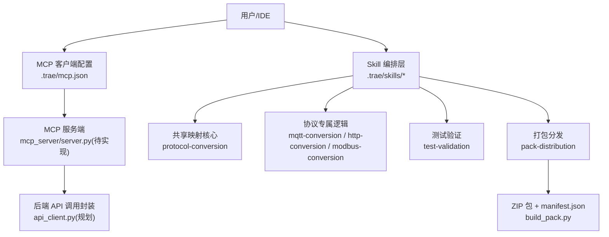
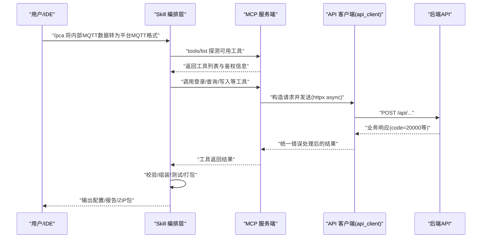
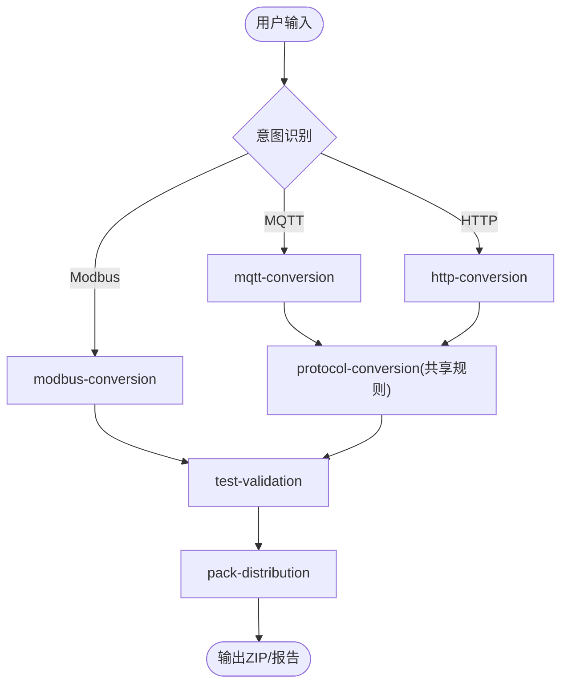
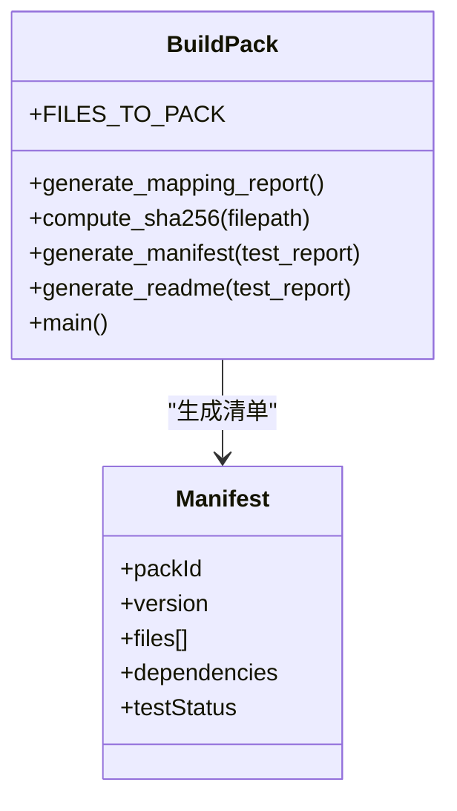
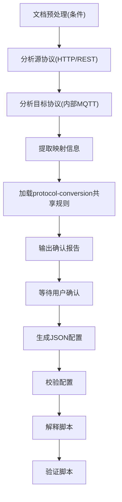
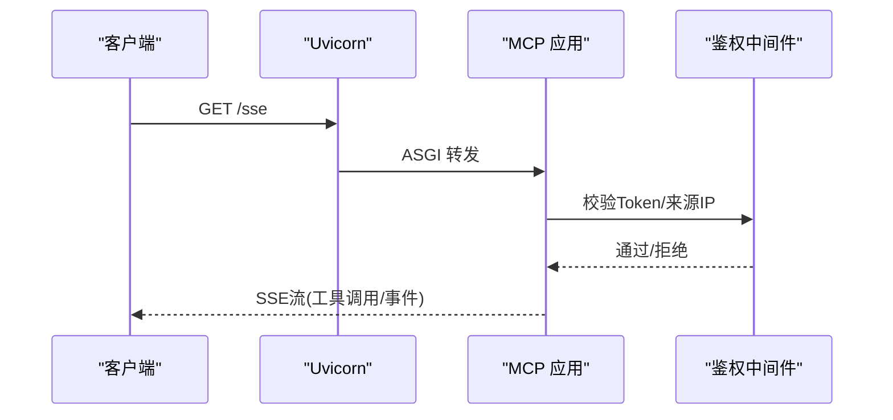
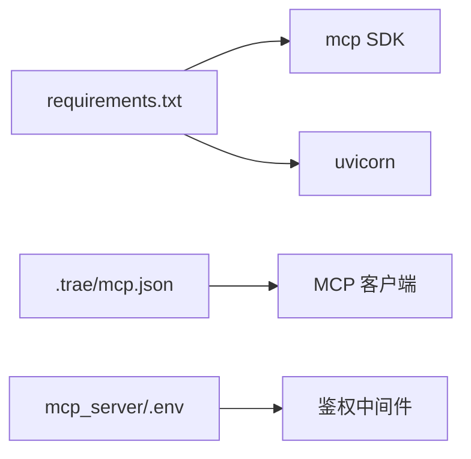
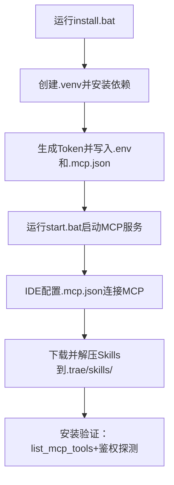

# 自定义技能开发

<cite>
**本文引用的文件**
- [mcp server部署.md](file://mcp server部署.md)
- [规约管理MCP服务化Spec.md](file://规约管理MCP服务化Spec.md)
- [.trae/mcp.json](file://.trae/mcp.json)
- [mcp_server/requirements.txt](file://mcp_server/requirements.txt)
- [mcp_server/install.bat](file://mcp_server/install.bat)
- [mcp_server/start.bat](file://mcp_server/start.bat)
- [mcp_server/static/access.html](file://mcp_server/static/access.html)
- [.trae/skills/pca/SKILL.md](file://.trae/skills/pca/SKILL.md)
- [.trae/skills/http-conversion/SKILL.md](file://.trae/skills/http-conversion/SKILL.md)
- [.trae/skills/protocol-conversion/scripts/build_pack.py](file://.trae/skills/protocol-conversion/scripts/build_pack.py)
</cite>

## 目录
1. [简介](#简介)
2. [项目结构](#项目结构)
3. [核心组件](#核心组件)
4. [架构总览](#架构总览)
5. [详细组件分析](#详细组件分析)
6. [依赖关系分析](#依赖关系分析)
7. [性能与可观测性](#性能与可观测性)
8. [测试与调试指南](#测试与调试指南)
9. [打包、分发与安装](#打包分发与安装)
10. [质量保证与版本管理](#质量保证与版本管理)
11. [常见问题排查](#常见问题排查)
12. [结论](#结论)

## 简介
本指南面向希望从零开始开发“自定义技能包”的工程师，结合仓库中已有的 MCP Server、Skills 体系与打包脚本，提供从项目初始化、SKILL.md 编写、Python 脚本实现，到测试、调试、优化、打包、分发、安装、质量保障与版本管理的完整实践路径。内容基于仓库内现有实现进行归纳与提炼，确保可直接落地执行。

## 项目结构
本项目围绕“MCP 服务端 + Skills 技能集 + 打包工具”组织：
- mcp_server：MCP 服务端代码、依赖声明、一键安装与启动脚本、静态接入页
- .trae/skills：按协议或能力划分的技能目录，每个技能包含 SKILL.md（AI 操作手册）、可选 agents 配置、scripts（Python/C 等实现）
- openspec：变更与规格文档（用于规范管理与演进）
- 根级文档：部署说明、MCP 服务化 Spec

图表来源
- [.trae/mcp.json:1-1](file://.trae/mcp.json#L1-L1)
- [mcp_server/requirements.txt:1-3](file://mcp_server/requirements.txt#L1-L3)
- [.trae/skills/protocol-conversion/scripts/build_pack.py:1-409](file://.trae/skills/protocol-conversion/scripts/build_pack.py#L1-L409)

章节来源
- [mcp server部署.md:25-126](file://mcp server部署.md#L25-L126)
- [mcp server部署.md:283-501](file://mcp server部署.md#L283-L501)

## 核心组件
- MCP 服务端（Uvicorn + MCP SDK）：负责 HTTP/SSE 接入、JSON-RPC 路由、工具注册与鉴权中间件
- 技能集合（Skills）：以 SKILL.md 描述 AI 行为与流程，通过 MCP 工具完成实际工作
- 打包脚本：聚合多技能与资源，生成 ZIP、清单与报告，便于分发与安装
- 接入页面：提供 Token 获取、MCP 配置与 Skills 下载入口

章节来源
- [mcp server部署.md:64-126](file://mcp server部署.md#L64-L126)
- [.trae/skills/pca/SKILL.md:1-170](file://.trae/skills/pca/SKILL.md#L1-L170)
- [.trae/skills/protocol-conversion/scripts/build_pack.py:1-120](file://.trae/skills/protocol-conversion/scripts/build_pack.py#L1-L120)

## 架构总览
下图展示从用户到 MCP 工具再到后端的端到端调用链，以及 Skill 如何编排多个原子工具完成复杂任务。

图表来源
- [.trae/skills/pca/SKILL.md:171-314](file://.trae/skills/pca/SKILL.md#L171-L314)
- [规约管理MCP服务化Spec.md:56-66](file://规约管理MCP服务化Spec.md#L56-L66)
- [规约管理MCP服务化Spec.md:295-319](file://规约管理MCP服务化Spec.md#L295-L319)

## 详细组件分析

### 技能入口与编排（pca）
- 职责：识别用户意图，路由到对应协议子技能；编排“分析→映射→测试→打包”全流程；在安装阶段完成 MCP 连接与鉴权探测
- 关键要点：
  - 安装时强制探测鉴权状态，分三种场景处理（无需鉴权/已配置Token/需配置Token）
  - 明确全局约束：最小权限、先查后改、幂等安全、严禁假完成
  - 支持单步执行与全流程编排两种模式

图表来源
- [.trae/skills/pca/SKILL.md:159-235](file://.trae/skills/pca/SKILL.md#L159-L235)
- [.trae/skills/pca/SKILL.md:237-314](file://.trae/skills/pca/SKILL.md#L237-L314)

章节来源
- [.trae/skills/pca/SKILL.md:1-170](file://.trae/skills/pca/SKILL.md#L1-L170)
- [.trae/skills/pca/SKILL.md:171-314](file://.trae/skills/pca/SKILL.md#L171-L314)
- [.trae/skills/pca/SKILL.md:348-373](file://.trae/skills/pca/SKILL.md#L348-L373)

### 协议转换共享核心（protocol-conversion）
- 职责：抽象路径解析、类型转换、数组遍历、模板替换、生成器等通用映射能力，供 MQTT/HTTP 等协议复用
- 产出：C 引擎核心（mapper_core.*）、Python 镜像与测试套件、默认协议定义、打包脚本
- 打包脚本功能：收集文件、生成设计报告、manifest.json、README.md，最终输出 ZIP

图表来源
- [.trae/skills/protocol-conversion/scripts/build_pack.py:1-120](file://.trae/skills/protocol-conversion/scripts/build_pack.py#L1-L120)
- [.trae/skills/protocol-conversion/scripts/build_pack.py:183-236](file://.trae/skills/protocol-conversion/scripts/build_pack.py#L183-L236)
- [.trae/skills/protocol-conversion/scripts/build_pack.py:348-409](file://.trae/skills/protocol-conversion/scripts/build_pack.py#L348-L409)

章节来源
- [.trae/skills/protocol-conversion/scripts/build_pack.py:1-120](file://.trae/skills/protocol-conversion/scripts/build_pack.py#L1-L120)
- [.trae/skills/protocol-conversion/scripts/build_pack.py:183-236](file://.trae/skills/protocol-conversion/scripts/build_pack.py#L183-L236)
- [.trae/skills/protocol-conversion/scripts/build_pack.py:348-409](file://.trae/skills/protocol-conversion/scripts/build_pack.py#L348-L409)

### HTTP 协议转换技能（http-conversion）
- 职责：分析第三方 HTTP/REST 源协议与目标内部 MQTT 协议，生成 JSON 配置
- 特有字段：context、key_value、"."源路径、preprocess、链式调用
- 工作流程：文档预处理→源/目标分析→提取映射→加载共享规则→确认→生成→校验→解释→验证

图表来源
- [.trae/skills/http-conversion/SKILL.md:77-104](file://.trae/skills/http-conversion/SKILL.md#L77-L104)

章节来源
- [.trae/skills/http-conversion/SKILL.md:77-104](file://.trae/skills/http-conversion/SKILL.md#L77-L104)

### MCP 服务端与鉴权
- 角色分工：Uvicorn 负责网络层（ASGI、HTTP/SSE），MCP 负责应用层（路由、工具、资源、JSON-RPC）
- 端点：/sse（SSE长连接）、/mcp（主端点）
- 鉴权：通过 Token 控制访问级别（localhost 系统级读写，其他 IP 用户级只读）
- 接入页：提供 Token 获取、MCP 配置、Skills 下载链接

图表来源
- [mcp server部署.md:64-126](file://mcp server部署.md#L64-L126)
- [mcp server部署.md:163-280](file://mcp server部署.md#L163-L280)
- [mcp_server/static/access.html:458-501](file://mcp_server/static/access.html#L458-L501)

章节来源
- [mcp server部署.md:64-126](file://mcp server部署.md#L64-L126)
- [mcp server部署.md:163-280](file://mcp server部署.md#L163-L280)
- [mcp_server/static/access.html:458-501](file://mcp_server/static/access.html#L458-L501)

## 依赖关系分析
- 运行时依赖：mcp、uvicorn（requirements.txt）
- 扩展依赖（规划）：httpx（用于异步后端 API 调用）
- 配置文件：.trae/mcp.json（MCP 客户端连接配置，含 URL 与 Authorization）
- 环境变量：mcp_server/.env（MCP_AUTH_TOKEN）

图表来源
- [mcp_server/requirements.txt:1-3](file://mcp_server/requirements.txt#L1-L3)
- [.trae/mcp.json:1-1](file://.trae/mcp.json#L1-L1)
- [mcp_server/install.bat:52-72](file://mcp_server/install.bat#L52-L72)

章节来源
- [mcp_server/requirements.txt:1-3](file://mcp_server/requirements.txt#L1-L3)
- [.trae/mcp.json:1-1](file://.trae/mcp.json#L1-L1)
- [mcp_server/install.bat:52-72](file://mcp_server/install.bat#L52-L72)

## 性能与可观测性
- 并发模型：Uvicorn 基于异步事件循环，I/O 等待期间可切换处理其他请求，适合高并发
- 工具粒度：细粒度工具（每个 API 一个工具）利于错误隔离与复用
- 错误处理：统一封装网络异常、业务错误码、认证失败等，便于追踪与重试策略
- 日志与审计：建议在生产环境启用日志审计，记录工具调用与认证尝试

章节来源
- [mcp server部署.md:265-280](file://mcp server部署.md#L265-L280)
- [规约管理MCP服务化Spec.md:123-131](file://规约管理MCP服务化Spec.md#L123-L131)

## 测试与调试指南
- 单元测试：使用 Python unittest 对映射核心进行测试（如 protocol_converter 测试套件）
- 集成测试：启动 MCP 服务端后调用 list_mcp_tools 验证工具可见性与鉴权状态
- 调试技巧：
  - 检查虚拟环境与依赖是否正确安装
  - 确认 .env 中的 MCP_AUTH_TOKEN 是否设置
  - 检查端口占用情况
  - 通过接入页面查看 Token 与权限说明
- 常见错误定位：网络异常、后端非 20000、Token 无效、HTTP 状态码异常

章节来源
- [.trae/skills/protocol-conversion/scripts/build_pack.py:154-178](file://.trae/skills/protocol-conversion/scripts/build_pack.py#L154-L178)
- [规约管理MCP服务化Spec.md:123-131](file://规约管理MCP服务化Spec.md#L123-L131)
- [mcp server部署.md:505-643](file://mcp server部署.md#L505-L643)

## 打包、分发与安装
- 打包：使用 build_pack.py 聚合多技能与资源，生成 ZIP、manifest.json、README.md 与设计报告
- 分发：通过接入页面提供 Skills ZIP 与 Markdown 导出接口
- 安装：
  - 首次运行 install.bat：创建虚拟环境、安装依赖、生成 Token、写入 .env 与 .trae/mcp.json
  - 日常启动 start.bat：激活虚拟环境、读取 Token、启动 MCP 服务
  - 在 IDE 中配置 .trae/mcp.json，指向本地 MCP 端点并携带 Authorization 头

图表来源
- [mcp_server/install.bat:1-85](file://mcp_server/install.bat#L1-L85)
- [mcp_server/start.bat:1-41](file://mcp_server/start.bat#L1-L41)
- [.trae/skills/pca/SKILL.md:97-158](file://.trae/skills/pca/SKILL.md#L97-L158)
- [mcp_server/static/access.html:475-501](file://mcp_server/static/access.html#L475-L501)

章节来源
- [mcp_server/install.bat:1-85](file://mcp_server/install.bat#L1-L85)
- [mcp_server/start.bat:1-41](file://mcp_server/start.bat#L1-L41)
- [.trae/skills/pca/SKILL.md:97-158](file://.trae/skills/pca/SKILL.md#L97-L158)
- [mcp_server/static/access.html:475-501](file://mcp_server/static/access.html#L475-L501)

## 质量保证与版本管理
- 质量保障：
  - 严格遵循全局约束：最小权限、先查后改、幂等安全、严禁假完成
  - 安装阶段强制鉴权探测，未通过不得声称安装完成
  - 写入操作前展示计划并经用户确认，失败不自动重试
- 版本管理：
  - 使用 manifest.json 记录 packId、version、文件清单与校验和
  - README.md 与 mapping_report.md 作为发布说明与设计依据
  - 测试报告纳入 manifest，体现测试通过率与跳过项

章节来源
- [.trae/skills/pca/SKILL.md:348-373](file://.trae/skills/pca/SKILL.md#L348-L373)
- [.trae/skills/protocol-conversion/scripts/build_pack.py:183-236](file://.trae/skills/protocol-conversion/scripts/build_pack.py#L183-L236)
- [.trae/skills/protocol-conversion/scripts/build_pack.py:240-345](file://.trae/skills/protocol-conversion/scripts/build_pack.py#L240-L345)

## 常见问题排查
- Python 未安装或版本过低：安装 Python 3.10+，并确保加入 PATH
- 虚拟环境创建失败：检查 Python 版本、权限与磁盘空间
- 依赖安装失败：检查网络或使用国内镜像源，升级 pip
- 启动时找不到虚拟环境：确保已运行 install.bat
- Token 未配置：运行 install.bat 或手动创建 .env
- 端口被占用：查找并结束占用进程，或修改端口
- 移动项目后虚拟环境失效：删除旧 .venv 并重新运行 install.bat

章节来源
- [mcp server部署.md:505-643](file://mcp server部署.md#L505-L643)

## 结论
本指南基于仓库现有实现，提供了从零开发自定义技能包的完整路径：以 SKILL.md 为 AI 操作手册，通过 MCP 工具编排复杂流程；借助打包脚本实现标准化分发与安装；配合严格的鉴权与质量约束，确保技能的可维护性与安全性。按照本指南实施，可在保证一致性与可观测性的前提下，快速构建可扩展的技能生态。