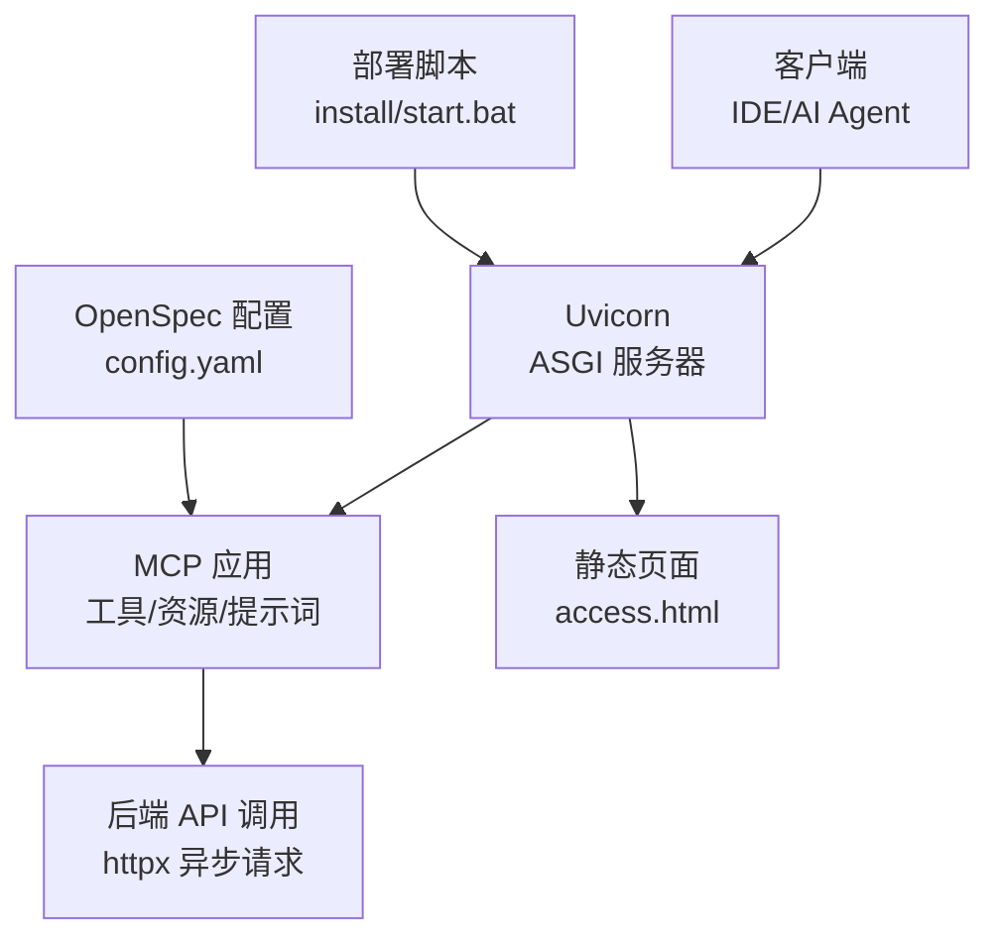
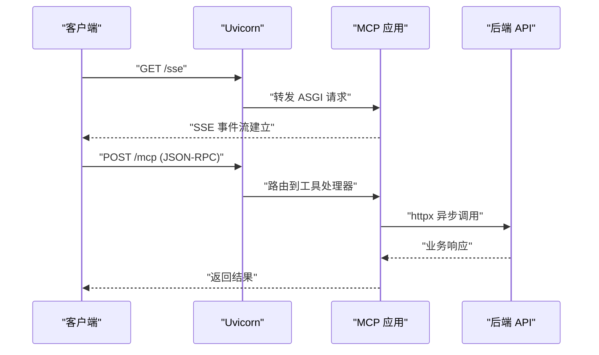
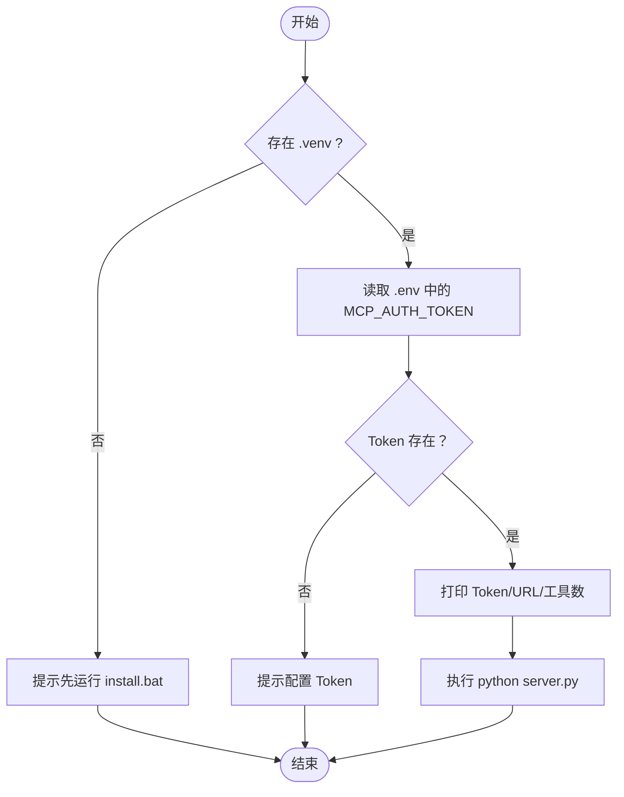
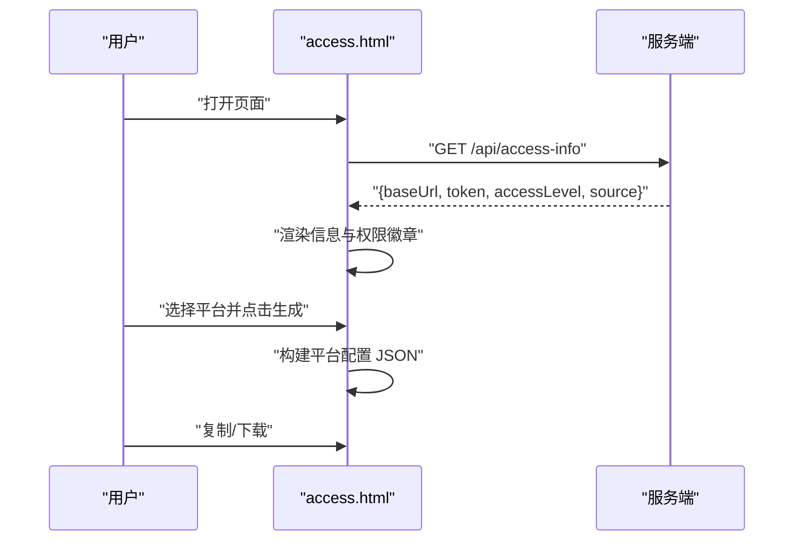
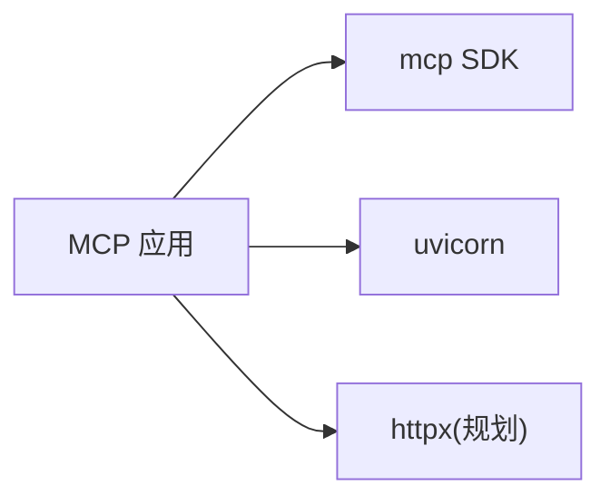

# 质量保证

<cite>
**本文引用的文件**
- [requirements.txt](file://mcp_server/requirements.txt)
- [start.bat](file://mcp_server/start.bat)
- [access.html](file://mcp_server/static/access.html)
- [mcp server部署.md](file://mcp server部署.md)
- [规约管理MCP服务化Spec.md](file://规约管理MCP服务化Spec.md)
- [config.yaml](file://openspec/config.yaml)
</cite>

## 目录
1. [引言](#引言)
2. [项目结构](#项目结构)
3. [核心组件](#核心组件)
4. [架构总览](#架构总览)
5. [详细组件分析](#详细组件分析)
6. [依赖分析](#依赖分析)
7. [性能与资源优化](#性能与资源优化)
8. [安全与合规](#安全与合规)
9. [持续集成与质量门禁](#持续集成与质量门禁)
10. [文档与API说明](#文档与api说明)
11. [故障排查与诊断](#故障排查与诊断)
12. [结论](#结论)

## 引言
本指南面向 PCA MCP Server 的质量保证，覆盖代码质量标准、静态分析与审查流程、性能优化与内存管理、安全扫描与最佳实践、文档维护与 API 文档生成、持续集成流水线与质量门禁、以及故障排查与调优方法。目标是帮助团队在本地开发到生产部署的全生命周期中稳定交付高质量能力。

## 项目结构
本项目以 MCP（Model Context Protocol）协议为核心，使用 Uvicorn 作为 ASGI 服务器提供 HTTP/SSE 能力；通过脚本完成环境初始化与启动；提供接入页面用于一键生成配置与 Skills 包下载；同时包含 OpenSpec 规范管理与变更流程配置。

图表来源
- [mcp server部署.md:110-180](file://mcp server部署.md#L110-L180)
- [access.html:401-417](file://mcp_server/static/access.html#L401-L417)
- [规约管理MCP服务化Spec.md:56-66](file://规约管理MCP服务化Spec.md#L56-L66)
- [config.yaml:1-33](file://openspec/config.yaml#L1-L33)

章节来源
- [mcp server部署.md:25-125](file://mcp server部署.md#L25-L125)
- [mcp_server/requirements.txt:1-3](file://mcp_server/requirements.txt#L1-L3)
- [mcp_server/static/access.html:1-562](file://mcp_server/static/access.html#L1-L562)
- [openspec/config.yaml:1-33](file://openspec/config.yaml#L1-L33)

## 核心组件
- 运行时依赖：MCP SDK 与 Uvicorn，定义协议处理与高性能 ASGI 服务。
- 启动与安装脚本：Windows 环境下的一键安装与环境激活、Token 注入与服务启动。
- 接入页面：自动检测服务器地址与 Token，按目标平台生成配置并支持下载。
- 规范与变更：OpenSpec 配置驱动规范化管理与变更归档。

章节来源
- [mcp_server/requirements.txt:1-3](file://mcp_server/requirements.txt#L1-L3)
- [mcp_server/start.bat:1-41](file://mcp_server/start.bat#L1-L41)
- [mcp_server/static/access.html:241-294](file://mcp_server/static/access.html#L241-L294)
- [openspec/config.yaml:1-33](file://openspec/config.yaml#L1-L33)

## 架构总览
MCP 应用通过 Uvicorn 暴露 /sse 与 /mcp 端点，SSE 长连接承载 JSON-RPC 消息；接入页面提供便捷配置生成；部署脚本负责环境准备与运行。

图表来源
- [mcp server部署.md:163-261](file://mcp server部署.md#L163-L261)
- [规约管理MCP服务化Spec.md:56-66](file://规约管理MCP服务化Spec.md#L56-L66)

## 详细组件分析

### 启动与安装脚本
- install/start.bat 负责虚拟环境激活、环境变量读取、服务启动与基础信息打印。
- 启动前校验 Token 是否存在，缺失时给出明确指引。

图表来源
- [mcp_server/start.bat:1-41](file://mcp_server/start.bat#L1-L41)
- [mcp server部署.md:415-439](file://mcp server部署.md#L415-L439)

章节来源
- [mcp_server/start.bat:1-41](file://mcp_server/start.bat#L1-L41)
- [mcp server部署.md:309-439](file://mcp server部署.md#L309-L439)

### 接入页面（access.html）
- 自动获取接入信息（服务器地址、Token、权限级别、来源 IP）。
- 根据目标平台生成对应配置，支持复制与下载 Markdown。
- 提供使用说明与安全注意事项。

图表来源
- [access.html:401-417](file://mcp_server/static/access.html#L401-L417)
- [access.html:445-503](file://mcp_server/static/access.html#L445-L503)

章节来源
- [mcp_server/static/access.html:241-294](file://mcp_server/static/access.html#L241-L294)
- [mcp_server/static/access.html:401-503](file://mcp_server/static/access.html#L401-L503)

### 规范与变更管理（OpenSpec）
- config.yaml 启用 spec-driven 模式，为提案、任务与归档提供规则与指导。
- 结合 skills 与命令，形成从探索到落地的闭环。

章节来源
- [openspec/config.yaml:1-33](file://openspec/config.yaml#L1-L33)

## 依赖分析
- 运行时依赖：MCP SDK（协议实现）、Uvicorn（ASGI 服务器）。
- 规划扩展：httpx（异步 HTTP 客户端），用于对接后端 API。

图表来源
- [mcp_server/requirements.txt:1-3](file://mcp_server/requirements.txt#L1-L3)
- [规约管理MCP服务化Spec.md:287-293](file://规约管理MCP服务化Spec.md#L287-L293)

章节来源
- [mcp_server/requirements.txt:1-3](file://mcp_server/requirements.txt#L1-L3)
- [规约管理MCP服务化Spec.md:287-293](file://规约管理MCP服务化Spec.md#L287-L293)

## 性能与资源优化
- 异步 I/O：基于 Uvicorn 的事件循环与 async/await，避免阻塞；对外部 API 调用采用 httpx 异步客户端，减少等待时间。
- 连接复用：httpx.AsyncClient 可复用连接，降低握手开销。
- 超时与重试：为外部请求设置合理超时，必要时增加重试与退避策略。
- 并发模型：SSE 长连接与 JSON-RPC 请求在高并发下保持低延迟；注意限制单连接数据量与节流。
- 资源监控：记录关键指标（QPS、P95/P99 延迟、错误率、连接数、内存占用），结合日志与告警。
- 内存管理：避免大对象常驻内存；对文件上传/导出采用流式处理；及时关闭客户端与连接。

[本节为通用指导，不直接分析具体文件]

## 安全与合规
- 认证与授权：
  - 使用 Token 进行鉴权，Token 由安装脚本生成并写入 .env，启动时加载。
  - 本地访问授予系统级权限（读写），非本地访问授予用户级权限（只读）。
- 传输安全：
  - 生产环境建议启用 HTTPS，使用反向代理或网关加密通信。
- 敏感信息管理：
  - .env 不应提交至版本库；Token 仅用于临时凭证，避免泄露。
- 安全扫描：
  - 引入依赖漏洞扫描（如 pip audit、Dependabot 等）与 SAST/DAST 工具，纳入流水线。
- 审计与日志：
  - 记录工具调用与认证尝试，脱敏敏感字段，保留必要上下文以便追溯。

章节来源
- [mcp server部署.md:645-674](file://mcp server部署.md#L645-L674)
- [mcp_server/start.bat:15-27](file://mcp_server/start.bat#L15-L27)

## 持续集成与质量门禁
建议的 CI/CD 流水线阶段：
- 代码检查：
  - 静态分析：ruff/flake8、mypy（类型检查）、bandit（安全扫描）。
  - 依赖扫描：pip-audit、Safety。
- 测试：
  - 单元测试与集成测试；对 MCP 工具与 API 客户端进行断言。
- 构建与打包：
  - 生成 Skills 包与接入文档；验证产物完整性。
- 质量门禁：
  - 覆盖率阈值、严重问题阻断合并、安全漏洞阻断发布。
- 部署：
  - 预发环境冒烟测试；灰度发布与回滚策略。

[本节为通用指导，不直接分析具体文件]

## 文档与API说明
- 文档维护：
  - 使用 OpenSpec 管理需求与变更，确保规格与实现一致。
  - 更新部署与操作手册，保持步骤可复现。
- API 文档生成：
  - 对 MCP 工具与后端 API 接口进行统一描述；结合 Spec 自动生成接口文档。
- 用户手册：
  - 接入页面已提供一键生成配置与下载功能；补充常见问题与最佳实践。

章节来源
- [mcp server部署.md:677-687](file://mcp server部署.md#L677-L687)
- [规约管理MCP服务化Spec.md:323-348](file://规约管理MCP服务化Spec.md#L323-L348)
- [mcp_server/static/access.html:306-318](file://mcp_server/static/access.html#L306-L318)

## 故障排查与诊断
常见问题与定位要点：
- Python 未安装或版本过低：检查版本要求并重新安装。
- 虚拟环境创建失败：确认权限与磁盘空间，必要时以管理员身份运行。
- 依赖安装失败：检查网络与镜像源，升级 pip。
- 启动找不到虚拟环境：先运行安装脚本创建环境。
- Token 未配置：运行安装脚本或手动设置环境变量。
- 端口被占用：查找并释放占用进程，或修改端口。
- 移动项目后虚拟环境失效：删除旧环境并重新安装。

章节来源
- [mcp server部署.md:505-643](file://mcp server部署.md#L505-L643)

## 结论
通过明确的代码标准、严格的静态分析与审查、完善的性能与安全管理、规范的文档与 API 说明、以及自动化 CI/CD 流水线，PCA MCP Server 能够在开发与生产环境中保持稳定、高效与安全地运行。建议持续完善监控与告警体系，定期复盘问题与优化点，推动质量持续提升。