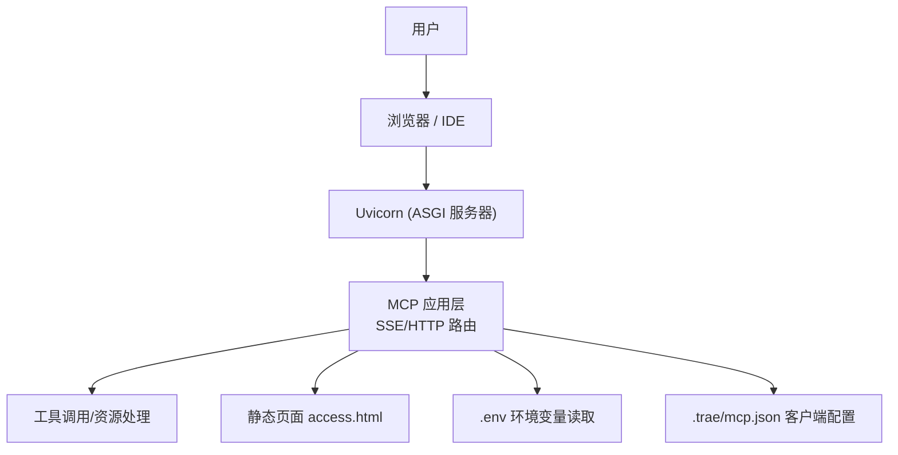
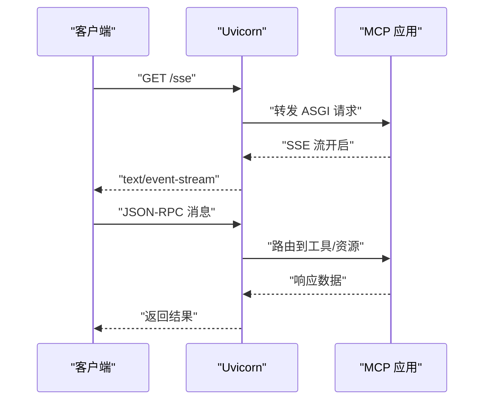
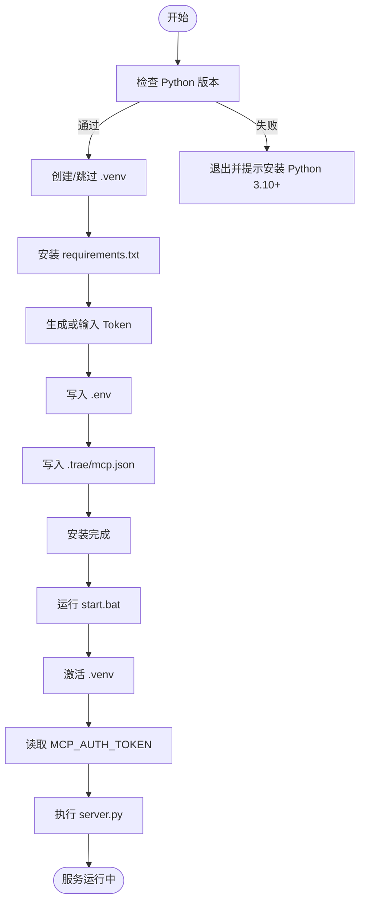
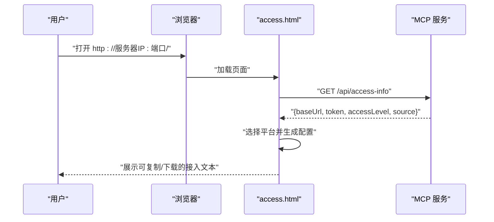
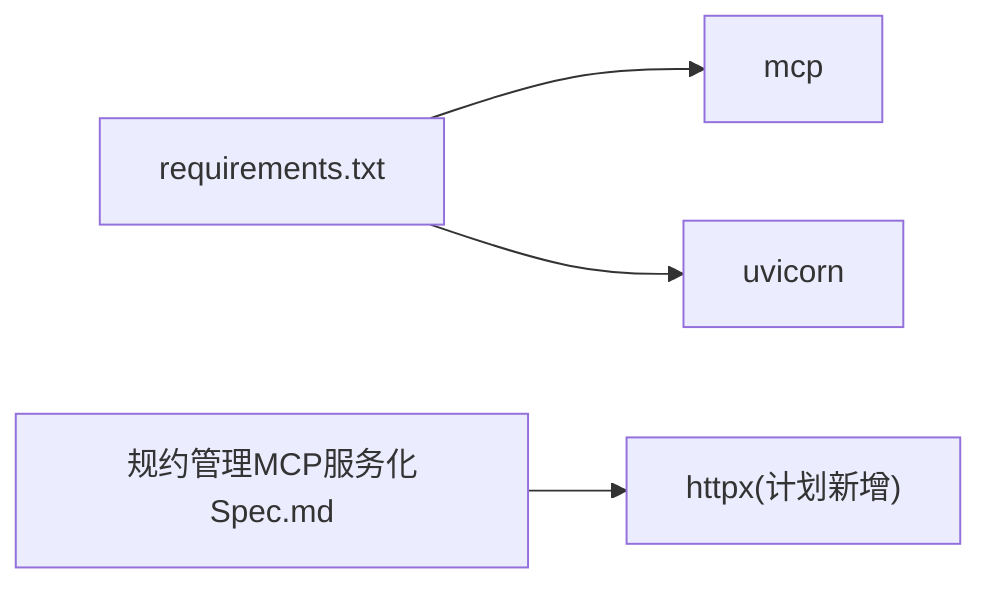

# 故障排除与常见问题

<cite>
**本文引用的文件**
- [mcp_server/requirements.txt](file://mcp_server/requirements.txt)
- [mcp_server/install.bat](file://mcp_server/install.bat)
- [mcp_server/start.bat](file://mcp_server/start.bat)
- [mcp server部署.md](file://mcp%20server%E9%83%A8%E7%BD%B2.md)
- [规约管理MCP服务化Spec.md](file://规约管理MCP服务化Spec.md)
- [.trae/mcp.json](file://.trae/mcp.json)
- [mcp_server/static/access.html](file://mcp_server/static/access.html)
</cite>

## 目录
1. [简介](#简介)
2. [项目结构](#项目结构)
3. [核心组件](#核心组件)
4. [架构总览](#架构总览)
5. [详细组件分析](#详细组件分析)
6. [依赖关系分析](#依赖关系分析)
7. [性能注意事项](#性能注意事项)
8. [故障排除指南](#故障排除指南)
9. [结论](#结论)
10. [附录](#附录)

## 简介
本文件面向安装、部署、运行与维护 PCA MCP Server 的工程师与使用者，聚焦“如何快速定位并解决问题”。内容覆盖：
- 安装部署阶段常见问题（依赖冲突、端口占用、权限问题等）
- 运行时错误诊断与修复（认证失败、工具调用异常、协议转换错误等）
- 性能问题分析与优化建议（内存泄漏、连接池配置、缓存策略等）
- 日志分析方法与调试技巧
- 社区支持与问题反馈方式

## 项目结构
本项目提供 Windows 一键安装与启动脚本，基于 Python 虚拟环境隔离依赖；服务端通过 Uvicorn 承载 MCP 协议的 HTTP/SSE 端点，并提供访问页面用于自动生成接入配置。

图示来源
- [mcp_server/start.bat:1-41](file://mcp_server/start.bat#L1-L41)
- [mcp_server/install.bat:1-85](file://mcp_server/install.bat#L1-L85)
- [mcp_server/static/access.html:1-562](file://mcp_server/static/access.html#L1-L562)
- [.trae/mcp.json:1-1](file://.trae/mcp.json#L1-L1)

章节来源
- [mcp_server/install.bat:1-85](file://mcp_server/install.bat#L1-L85)
- [mcp_server/start.bat:1-41](file://mcp_server/start.bat#L1-L41)
- [mcp server部署.md:283-461](file://mcp%20server%E9%83%A8%E7%BD%B2.md#L283-L461)

## 核心组件
- 依赖声明：仅依赖 mcp 与 uvicorn，版本约束清晰，便于环境一致性。
- 安装脚本：检查 Python 版本、创建虚拟环境、安装依赖、生成 Token、写入 .env 与 .trae/mcp.json。
- 启动脚本：激活虚拟环境、校验 Token、打印启动信息、执行 server.py。
- 访问页面：自动检测服务器地址与 Token，按目标平台生成接入配置文本，支持复制与下载。
- 客户端配置：.trae/mcp.json 指定 MCP 服务端点与鉴权头。

章节来源
- [mcp_server/requirements.txt:1-3](file://mcp_server/requirements.txt#L1-L3)
- [mcp_server/install.bat:12-85](file://mcp_server/install.bat#L12-L85)
- [mcp_server/start.bat:15-41](file://mcp_server/start.bat#L15-L41)
- [mcp_server/static/access.html:241-558](file://mcp_server/static/access.html#L241-L558)
- [.trae/mcp.json:1-1](file://.trae/mcp.json#L1-L1)

## 架构总览
MCP 与 Uvicorn 的职责分工明确：Uvicorn 负责网络层（监听端口、解析 HTTP、管理连接），MCP 负责应用层（路由、工具调用、资源管理）。完整流程包括：
- 启动服务：Uvicorn 加载 ASGI 应用，进入等待请求状态
- 建立 SSE 长连接：客户端 GET /sse，返回 text/event-stream 并保持连接
- 请求-响应循环：通过 JSON-RPC over HTTP/SSE 进行工具调用

图示来源
- [mcp server部署.md:163-261](file://mcp%20server%E9%83%A8%E7%BD%B2.md#L163-L261)

章节来源
- [mcp server部署.md:110-261](file://mcp%20server%E9%83%A8%E7%BD%B2.md#L110-L261)

## 详细组件分析

### 安装与启动流程
- install.bat：检查 Python、创建 .venv、安装依赖、生成 Token、写入 .env 与 .trae/mcp.json。
- start.bat：激活 .venv、读取 .env 中的 MCP_AUTH_TOKEN、打印启动信息、执行 server.py。

图示来源
- [mcp_server/install.bat:12-85](file://mcp_server/install.bat#L12-L85)
- [mcp_server/start.bat:1-41](file://mcp_server/start.bat#L1-L41)

章节来源
- [mcp_server/install.bat:12-85](file://mcp_server/install.bat#L12-L85)
- [mcp_server/start.bat:15-41](file://mcp_server/start.bat#L15-L41)

### 访问页面与接入配置
- 页面自动获取服务器地址、Token、权限级别与来源 IP。
- 根据目标平台（Trae/Cursor/VS Code/Claude/Windsurf/Cline/Kimi）生成对应配置文本。
- 支持复制到剪贴板与下载 Markdown。

图示来源
- [mcp_server/static/access.html:401-558](file://mcp_server/static/access.html#L401-L558)

章节来源
- [mcp_server/static/access.html:241-558](file://mcp_server/static/access.html#L241-L558)

### 客户端配置
- .trae/mcp.json 指定 MCP 服务端点与 Authorization 头，包含 Bearer Token。
- 该配置由 install.bat 自动生成，便于 IDE 直接连接服务。

章节来源
- [.trae/mcp.json:1-1](file://.trae/mcp.json#L1-L1)
- [mcp_server/install.bat:65-72](file://mcp_server/install.bat#L65-L72)

## 依赖关系分析
- 依赖最小化：仅 mcp 与 uvicorn，降低冲突概率。
- 版本约束：mcp 限定在 1.x 系列，避免大版本不兼容；uvicorn 允许后续更新。
- 扩展依赖：规约管理 Spec 中计划引入 httpx 作为异步 HTTP 客户端，需同步更新 requirements.txt。

图示来源
- [mcp_server/requirements.txt:1-3](file://mcp_server/requirements.txt#L1-L3)
- [规约管理MCP服务化Spec.md:287-293](file://规约管理MCP服务化Spec.md#L287-L293)

章节来源
- [mcp_server/requirements.txt:1-3](file://mcp_server/requirements.txt#L1-L3)
- [规约管理MCP服务化Spec.md:287-293](file://规约管理MCP服务化Spec.md#L287-L293)

## 性能注意事项
- 事件循环与并发：Uvicorn 基于异步事件循环，适合高并发 I/O 场景。
- 连接复用：若引入 httpx，建议使用 AsyncClient 并合理设置超时与连接池参数。
- 资源释放：确保关闭异步客户端与 SSE 连接，避免资源泄漏。
- 日志与监控：在生产环境启用结构化日志与指标采集，便于定位瓶颈。

[本节为通用指导，不直接分析具体文件]

## 故障排除指南

### 安装部署阶段

- Python 未安装或版本过低
  - 现象：install.bat 提示需要 Python 3.10+
  - 解决：安装 Python 3.10+，并确保加入 PATH；重新运行 install.bat
  - 参考路径
    - [mcp_server/install.bat:12-24](file://mcp_server/install.bat#L12-L24)

- 虚拟环境创建失败
  - 现象：提示虚拟环境创建失败
  - 可能原因：权限不足、磁盘空间不足、Python 版本过低
  - 解决：以管理员身份运行命令行，清理残留 .venv 后重试
  - 参考路径
    - [mcp_server/install.bat:26-38](file://mcp_server/install.bat#L26-L38)

- 依赖安装失败
  - 现象：提示依赖安装失败，检查网络
  - 可能原因：无法访问 PyPI、pip 版本过低
  - 解决：检查网络；使用国内镜像源；升级 pip 后重试
  - 参考路径
    - [mcp_server/install.bat:40-49](file://mcp_server/install.bat#L40-L49)

- 启动时找不到虚拟环境
  - 现象：提示请先运行 install.bat
  - 解决：确认已运行 install.bat 且存在 .venv；若被删除则重新安装
  - 参考路径
    - [mcp_server/start.bat:7-13](file://mcp_server/start.bat#L7-L13)

- Token 未配置
  - 现象：提示 MCP_AUTH_TOKEN 未设置
  - 解决：运行 install.bat 生成 Token；或手动创建 mcp_server/.env 并写入 MCP_AUTH_TOKEN
  - 参考路径
    - [mcp_server/start.bat:15-27](file://mcp_server/start.bat#L15-L27)
    - [mcp_server/install.bat:52-67](file://mcp_server/install.bat#L52-L67)

- 端口被占用
  - 现象：绑定 8765 端口失败
  - 解决：查找占用进程并结束；或修改 server.py 中的端口号
  - 参考路径
    - [mcp server部署.md:610-631](file://mcp%20server%E9%83%A8%E7%BD%B2.md#L610-L631)

- 移动项目文件夹后虚拟环境失效
  - 原因：activate.bat 硬编码绝对路径
  - 解决：删除旧 .venv 并重新运行 install.bat
  - 参考路径
    - [mcp server部署.md:634-642](file://mcp%20server%E9%83%A8%E7%BD%B2.md#L634-L642)

### 运行时错误

- 认证失败（Token 无效或未携带）
  - 现象：客户端连接后鉴权失败
  - 排查步骤：
    - 确认 .env 中存在 MCP_AUTH_TOKEN
    - 确认客户端配置（如 .trae/mcp.json）中 Authorization 头正确
    - 通过访问页面获取临时 Token 并验证
  - 参考路径
    - [mcp_server/start.bat:15-27](file://mcp_server/start.bat#L15-L27)
    - [.trae/mcp.json:1-1](file://.trae/mcp.json#L1-L1)
    - [mcp_server/static/access.html:401-443](file://mcp_server/static/access.html#L401-L443)

- 工具调用异常（后端 API 错误或网络异常）
  - 现象：工具返回业务错误码或网络错误
  - 排查步骤：
    - 检查后端 API 可达性与响应码
    - 核对 Token 是否有效
    - 查看统一错误处理返回格式（NETWORK_ERROR、API_ERROR、AUTH_ERROR、HTTP_ERROR）
  - 参考路径
    - [规约管理MCP服务化Spec.md:123-131](file://规约管理MCP服务化Spec.md#L123-L131)

- 协议转换错误（SSE/HTTP 链路问题）
  - 现象：SSE 连接建立失败或消息丢失
  - 排查步骤：
    - 确认 /sse 端点可用
    - 检查防火墙/代理对长连接的拦截
    - 观察 Uvicorn 日志与 MCP 应用日志
  - 参考路径
    - [mcp server部署.md:185-211](file://mcp%20server%E9%83%A8%E7%BD%B2.md#L185-L211)

### 性能问题

- 内存泄漏
  - 症状：进程内存持续增长
  - 排查：检查 SSE 连接是否正确关闭；异步客户端是否重复创建未释放
  - 建议：集中管理连接生命周期，定期回收资源

- 连接池配置
  - 症状：高并发下连接耗尽或超时
  - 排查：调整 httpx.AsyncClient 的连接池大小与超时参数
  - 建议：根据负载调优连接数与超时时间

- 缓存策略
  - 症状：频繁查询导致后端压力大
  - 建议：对只读接口增加本地缓存或反向代理缓存，注意缓存失效与一致性

[本节为通用指导，不直接分析具体文件]

### 日志分析与调试技巧

- 启动日志
  - 关注 Uvicorn 启动信息与端口绑定情况
  - 参考路径
    - [mcp server部署.md:441-459](file://mcp%20server%E9%83%A8%E7%BD%B2.md#L441-L459)

- 访问页面调试
  - 使用 access.html 获取服务器地址、Token、权限级别与来源 IP
  - 参考路径
    - [mcp_server/static/access.html:401-443](file://mcp_server/static/access.html#L401-L443)

- 客户端配置验证
  - 检查 .trae/mcp.json 中的 URL 与 Authorization 头
  - 参考路径
    - [.trae/mcp.json:1-1](file://.trae/mcp.json#L1-L1)

- 工具调用链路追踪
  - 从 Skill 调用 MCP 工具，逐步检查 server.py -> api_client -> 后端 API
  - 参考路径
    - [规约管理MCP服务化Spec.md:295-319](file://规约管理MCP服务化Spec.md#L295-L319)

### 安全与权限

- Token 管理
  - 风险：明文存储在 .env，可能被提交到仓库
  - 建议：生产环境替换为更强认证机制；确保 .env 不被提交
  - 参考路径
    - [mcp server部署.md:645-674](file://mcp%20server%E9%83%A8%E7%BD%B2.md#L645-L674)

- 权限模型
  - localhost 访问获得系统级权限（读写），其他 IP 为用户级（只读）
  - 参考路径
    - [mcp server部署.md:655-664](file://mcp%20server%E9%83%A8%E7%BD%B2.md#L655-L664)

### 社区支持与问题反馈

- 文档与规范
  - 项目部署文档与规约管理 Spec 提供了详细的架构与接口说明，可作为问题定位依据
  - 参考路径
    - [mcp server部署.md:1-692](file://mcp%20server%E9%83%A8%E7%BD%B2.md#L1-L692)
    - [规约管理MCP服务化Spec.md:1-800](file://规约管理MCP服务化Spec.md#L1-L800)

- 接入页面
  - 通过访问页面获取临时 Token 与接入文本，便于快速验证与分享
  - 参考路径
    - [mcp_server/static/access.html:241-558](file://mcp_server/static/access.html#L241-L558)

[本节为通用指导，不直接分析具体文件]

## 结论
本故障排除指南围绕安装部署、运行时错误、性能与安全等方面，结合项目脚本与文档，提供了系统化的排查思路与操作步骤。建议在遇到问题时优先通过访问页面与启动日志定位基础环境问题，再深入到工具调用链路与后端 API 进行细粒度排查。对于生产环境，应强化认证、加密、日志审计与资源管理，以提升稳定性与安全性。

## 附录

### 快速命令参考
- 首次安装：运行 mcp_server\install.bat
- 启动服务：运行 mcp_server\start.bat
- 停止服务：按 Ctrl+C
- 手动激活虚拟环境：.venv\Scripts\activate.bat
- 退出虚拟环境：deactivate
- 手动启动服务：python mcp_server\server.py

章节来源
- [mcp server部署.md:677-687](file://mcp%20server%E9%83%A8%E7%BD%B2.md#L677-L687)