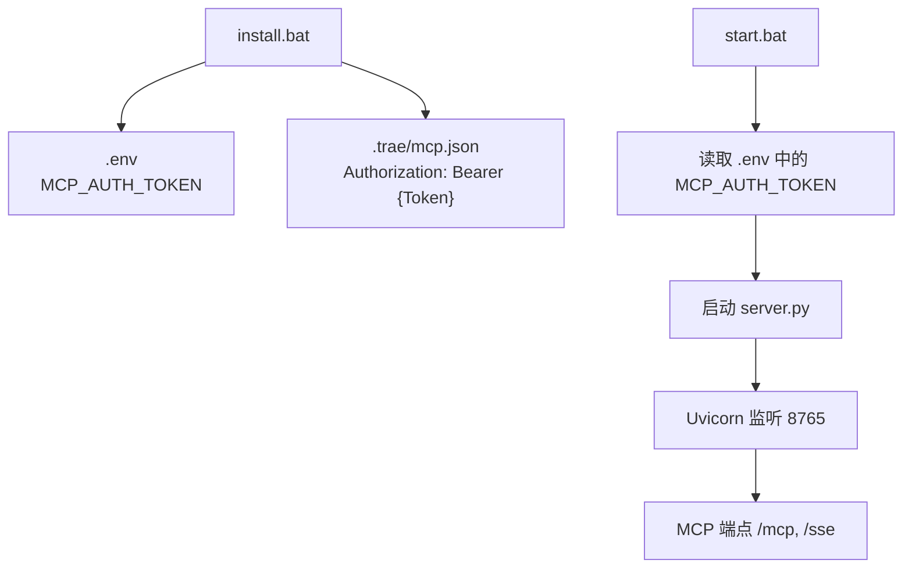
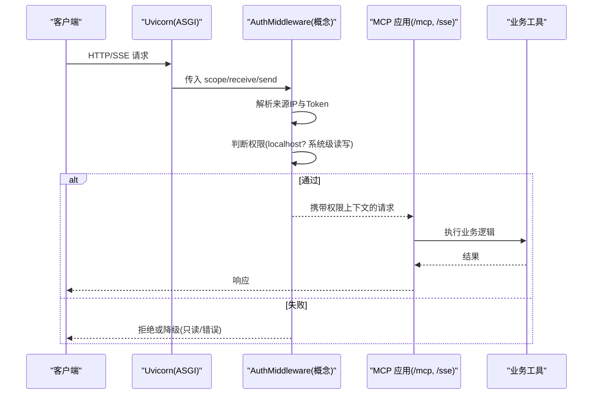
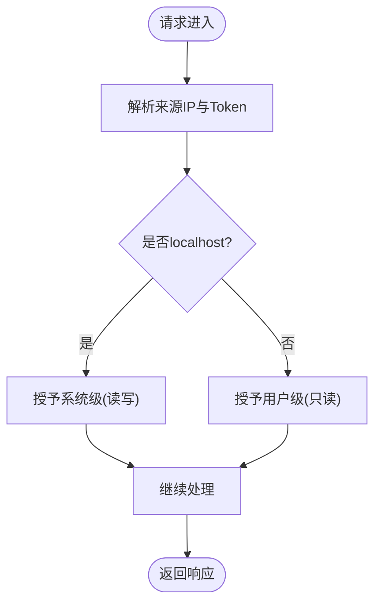
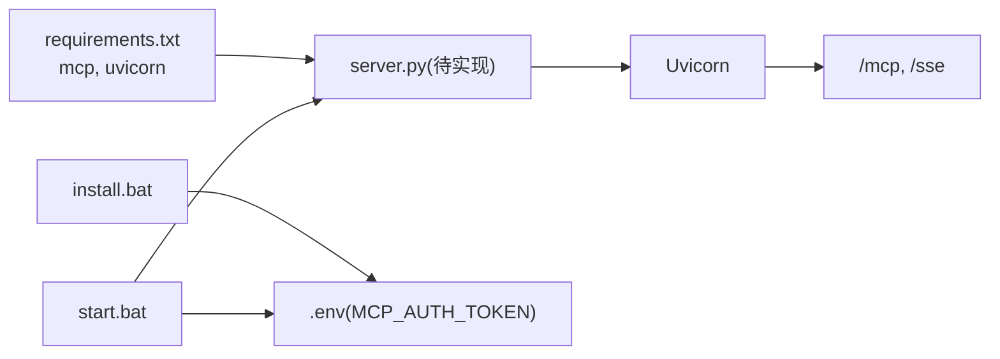

# 认证与授权系统

<cite>
**本文引用的文件**
- [mcp_server/install.bat](file://mcp_server/install.bat)
- [mcp_server/start.bat](file://mcp_server/start.bat)
- [mcp_server/requirements.txt](file://mcp_server/requirements.txt)
- [mcp server部署.md](file://mcp server部署.md)
- [规约管理MCP服务化Spec.md](file://规约管理MCP服务化Spec.md)
</cite>

## 目录
1. [简介](#简介)
2. [项目结构](#项目结构)
3. [核心组件](#核心组件)
4. [架构总览](#架构总览)
5. [详细组件分析](#详细组件分析)
6. [依赖关系分析](#依赖关系分析)
7. [性能考虑](#性能考虑)
8. [故障排查指南](#故障排查指南)
9. [结论](#结论)
10. [附录](#附录)

## 简介
本文件聚焦于该 MCP 服务的认证与授权机制，围绕以下目标展开：
- 解释 Token 管理机制（生成、验证、与访问来源的关联）
- 说明权限分级模型：本地 localhost 的系统级读写权限与非 localhost 的用户级只读权限
- 梳理 ASGI 中间件 AuthMiddleware 的职责边界与请求处理流程（基于仓库中已实现的脚本与文档）
- 提供 Token 管理最佳实践与安全注意事项
- 给出使用示例与调试技巧

注意：当前仓库未包含 Python 源代码实现（如 server.py），但通过安装与启动脚本以及部署文档，可以完整还原认证与授权的运行方式与策略。

## 项目结构
本项目采用“脚本驱动 + 文档规范”的组织方式：
- mcp_server/install.bat：首次安装时创建虚拟环境、安装依赖、交互式配置管理员 Token，并写入 .env 与 .trae/mcp.json
- mcp_server/start.bat：日常启动入口，读取 .env 中的 MCP_AUTH_TOKEN，校验后执行 server.py
- mcp_server/requirements.txt：声明运行时依赖（mcp、uvicorn）
- mcp server部署.md：详细说明 ASGI/MCP/Uvicorn 工作原理、端口、常见问题与安全建议
- 规约管理MCP服务化Spec.md：规划后续将后端 API 封装为 MCP 工具，并明确鉴权方式为自定义 Token 请求头

图表来源
- [mcp_server/install.bat:52-72](file://mcp_server/install.bat#L52-L72)
- [mcp_server/start.bat:15-27](file://mcp_server/start.bat#L15-L27)
- [mcp server部署.md:74-79](file://mcp server部署.md#L74-L79)

章节来源
- [mcp_server/install.bat:1-85](file://mcp_server/install.bat#L1-L85)
- [mcp_server/start.bat:1-41](file://mcp_server/start.bat#L1-L41)
- [mcp_server/requirements.txt:1-2](file://mcp_server/requirements.txt#L1-L2)
- [mcp server部署.md:74-79](file://mcp server部署.md#L74-L79)

## 核心组件
- Token 管理器（概念性）：负责管理员 Token 的生成、持久化与注入。在本项目中由 install.bat 完成生成与落盘，start.bat 负责读取与校验。
- 权限分级模型：根据访问来源 IP 决定权限级别
  - localhost：系统级，允许读/写
  - 非 localhost：用户级，仅允许读
- ASGI 中间件 AuthMiddleware（概念性）：在请求进入 MCP 应用前进行拦截、Token 校验、权限判定，并将上下文传递给后续处理器
- 外部依赖：mcp（协议层）、uvicorn（ASGI 服务器）

章节来源
- [mcp_server/install.bat:52-72](file://mcp_server/install.bat#L52-L72)
- [mcp_server/start.bat:15-27](file://mcp_server/start.bat#L15-L27)
- [mcp server部署.md:655-663](file://mcp server部署.md#L655-L663)
- [mcp_server/requirements.txt:1-2](file://mcp_server/requirements.txt#L1-L2)

## 架构总览
下图展示了从客户端到 MCP 服务的认证与授权路径，以及权限决策点：

图表来源
- [mcp server部署.md:110-160](file://mcp server部署.md#L110-L160)
- [mcp server部署.md:215-261](file://mcp server部署.md#L215-L261)
- [mcp server部署.md:655-663](file://mcp server部署.md#L655-L663)

## 详细组件分析

### Token 管理（生成、验证、与访问来源关联）
- 生成与管理
  - 首次运行 install.bat 会提示输入管理员 Token；若留空则自动生成形如 metam_pat_... 的随机字符串，并写入 .env 的 MCP_AUTH_TOKEN，同时更新 .trae/mcp.json 的 Authorization 头部
  - start.bat 启动时会读取 .env 中的 MCP_AUTH_TOKEN，若缺失则中止启动，避免无凭据运行
- 验证与关联
  - 根据部署文档，权限模型依据访问来源 IP 区分：localhost 视为系统级（可读写），其他 IP 为用户级（只读）
  - 对于“其他用户”，可通过访问页面自动分配 Token（见部署文档的安全与权限章节）
- 最佳实践
  - 仅在开发环境使用明文 .env；生产环境应替换为更安全的密钥管理方案
  - 确保 .env 被 .gitignore 忽略，防止泄露
  - 定期轮换 Token，并在共享项目时提醒重新生成

章节来源
- [mcp_server/install.bat:52-72](file://mcp_server/install.bat#L52-L72)
- [mcp_server/start.bat:15-27](file://mcp_server/start.bat#L15-L27)
- [mcp server部署.md:599-607](file://mcp server部署.md#L599-L607)
- [mcp server部署.md:645-663](file://mcp server部署.md#L645-L663)

### 权限分级模型（localhost vs 非 localhost）
- localhost（本地访问）
  - 权限级别：系统级
  - 操作能力：读/写
- 非 localhost（远程访问）
  - 权限级别：用户级
  - 操作能力：只读
- 自动分配 Token
  - 其他用户可通过访问页面获取自动分配的 Token，用于受限的只读访问

章节来源
- [mcp server部署.md:655-663](file://mcp server部署.md#L655-L663)

### ASGI 中间件 AuthMiddleware（请求拦截、Token 验证、权限上下文传递）
- 职责边界
  - 位于 Uvicorn 与 MCP 应用之间，统一拦截所有请求
  - 解析请求来源 IP 与 Token（来自请求头或会话）
  - 根据权限模型决定是否放行、降级或拒绝
  - 将权限上下文注入到后续处理链（例如标记为系统级/用户级）
- 典型流程
  - 接收 scope/receive/send
  - 提取来源 IP 与 Token
  - 校验 Token 有效性（结合后端或本地缓存）
  - 判定权限并设置上下文
  - 调用下一层处理器或返回错误响应

图表来源
- [mcp server部署.md:215-261](file://mcp server部署.md#L215-L261)
- [mcp server部署.md:655-663](file://mcp server部署.md#L655-L663)

### 与后端 API 的鉴权约定（后续实现参考）
- 鉴权方式：自定义 Token 请求头（非 Authorization: Bearer）
- Token 格式：32 位大写十六进制字符串
- 成功响应码：code === 20000
- 错误处理：网络异常、业务错误码、Token 无效/过期等统一封装

章节来源
- [规约管理MCP服务化Spec.md:68-78](file://规约管理MCP服务化Spec.md#L68-L78)
- [规约管理MCP服务化Spec.md:123-131](file://规约管理MCP服务化Spec.md#L123-L131)

## 依赖关系分析
- 运行时依赖
  - mcp：提供 MCP 协议支持与工具注册
  - uvicorn：ASGI 服务器，负责网络 I/O 与事件循环
- 启动链路
  - install.bat → 生成 Token → 写入 .env/.trae/mcp.json
  - start.bat → 读取 .env → 校验存在 → 启动 server.py → Uvicorn 监听端口

图表来源
- [mcp_server/requirements.txt:1-2](file://mcp_server/requirements.txt#L1-L2)
- [mcp_server/install.bat:52-72](file://mcp_server/install.bat#L52-L72)
- [mcp_server/start.bat:15-27](file://mcp_server/start.bat#L15-L27)
- [mcp server部署.md:74-79](file://mcp server部署.md#L74-L79)

章节来源
- [mcp_server/requirements.txt:1-2](file://mcp_server/requirements.txt#L1-L2)
- [mcp_server/install.bat:1-85](file://mcp_server/install.bat#L1-L85)
- [mcp_server/start.bat:1-41](file://mcp_server/start.bat#L1-L41)
- [mcp server部署.md:74-79](file://mcp server部署.md#L74-L79)

## 性能考虑
- Uvicorn 基于异步事件循环，适合高并发 I/O 场景
- 认证与鉴权应在中间件中尽早完成，减少不必要的业务处理
- 对 Token 校验可引入缓存（如内存缓存）以降低重复校验开销
- 生产环境建议使用多进程模式（Gunicorn + Uvicorn）提升吞吐

[本节为通用指导，不直接引用具体文件]

## 故障排查指南
- 无法启动服务
  - 现象：提示 MCP_AUTH_TOKEN 未设置
  - 处理：先运行 install.bat 生成 Token，或手动设置环境变量
- 端口占用
  - 现象：绑定 8765 端口失败
  - 处理：查找占用进程并结束，或修改端口
- Token 相关问题
  - 现象：认证失败或权限不足
  - 处理：检查 .env 是否正确、.trae/mcp.json 是否包含正确的 Authorization 头；必要时重新生成 Token
- 安全与合规
  - 确保 .env 不被提交到版本库
  - 生产环境更换更强认证机制（如 OAuth2/JWT），启用 HTTPS，限制访问来源

章节来源
- [mcp_server/start.bat:15-27](file://mcp_server/start.bat#L15-L27)
- [mcp server部署.md:599-607](file://mcp server部署.md#L599-L607)
- [mcp server部署.md:610-631](file://mcp server部署.md#L610-L631)
- [mcp server部署.md:645-663](file://mcp server部署.md#L645-L663)

## 结论
本项目的认证与授权以“脚本驱动 + 权限模型”为核心：
- 通过 install.bat 生成并持久化管理员 Token，start.bat 启动时强制校验
- 权限模型按访问来源 IP 划分：localhost 系统级读写，非 localhost 用户级只读
- 后续将基于 MCP 协议与 httpx 异步客户端对接后端 API，统一 Token 请求头与错误处理
- 建议在生产环境升级认证机制、启用加密传输与访问控制，完善日志审计

[本节为总结性内容，不直接引用具体文件]

## 附录
- 快速命令参考
  - 首次安装：mcp_server\install.bat
  - 启动服务：mcp_server\start.bat
  - 停止服务：Ctrl+C
  - 手动激活虚拟环境：.venv\Scripts\activate.bat
  - 退出虚拟环境：deactivate
  - 手动启动服务：python mcp_server\server.py

章节来源
- [mcp server部署.md:677-687](file://mcp server部署.md#L677-L687)