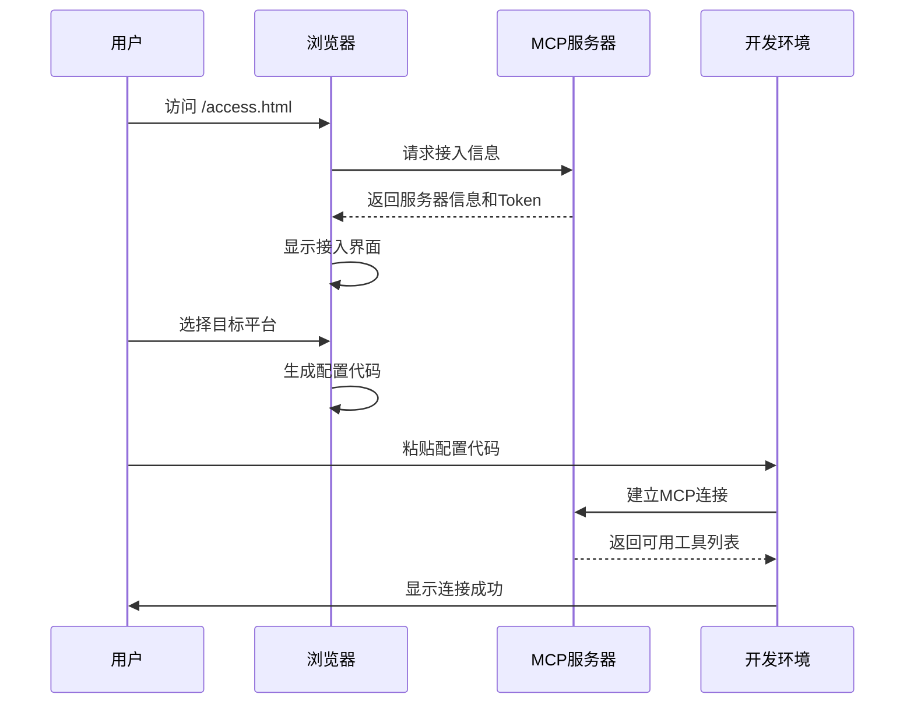

# 快速开始指南

<cite>
**本文档中引用的文件**
- [install.bat](file://mcp_server/install.bat)
- [start.bat](file://mcp_server/start.bat)
- [requirements.txt](file://mcp_server/requirements.txt)
- [access.html](file://mcp_server/static/access.html)
- [mcp server部署.md](file://mcp server部署.md)
- [规约管理MCP服务化Spec.md](file://规约管理MCP服务化Spec.md)
</cite>

## 目录
1. [简介](#简介)
2. [环境要求](#环境要求)
3. [安装步骤](#安装步骤)
4. [服务启动](#服务启动)
5. [基本配置](#基本配置)
6. [首次使用](#首次使用)
7. [常见问题](#常见问题)
8. [故障排除](#故障排除)

## 简介

PCA MCP Server 是一个基于 MCP（Model Context Protocol）协议构建的 Python 服务端项目，用于为 AI 客户端（如 Claude Desktop、Trae IDE 等）提供工具调用能力。本指南将帮助您在 5 分钟内完成服务的安装、配置和首次使用。

## 环境要求

在开始之前，请确保您的系统满足以下要求：

### 系统要求
- **操作系统**: Windows 10/11（支持 PowerShell 或命令提示符）
- **Python 版本**: 3.10 或更高版本
- **网络连接**: 需要访问 PyPI 包管理器

### 检查 Python 环境

打开命令提示符或 PowerShell，执行以下命令检查 Python 是否已安装：

```bash
python --version
```

如果显示 Python 版本信息（如 `Python 3.10.x`），则环境已就绪。如果没有安装 Python，请访问 [python.org](https://www.python.org/downloads/) 下载安装最新版本，并确保在安装时勾选 "Add Python to PATH" 选项。

**章节来源**
- [install.bat:12-24](file://mcp_server/install.bat#L12-L24)

## 安装步骤

### 第一步：运行安装脚本

在项目根目录下，双击运行 `mcp_server/install.bat` 或在命令行中执行：

```bash
cd mcp_server
install.bat
```

### 第二步：自动环境检查

安装脚本会自动执行以下步骤：

1. **检查 Python 环境** - 验证 Python 3.10+ 是否已安装并添加到 PATH
2. **创建虚拟环境** - 在项目根目录创建 `.venv` 文件夹作为隔离的 Python 环境
3. **安装依赖包** - 从 requirements.txt 安装所需的 Python 包
4. **配置认证 Token** - 自动生成或手动输入管理员 Token
5. **生成配置文件** - 创建 `.env` 文件和 `.trae/mcp.json` 配置文件

### 第三步：Token 配置

安装过程中会提示您输入管理员 Token：

- **直接回车**: 系统将自动生成一个安全的随机 Token（格式：`metam_pat_` + 32位十六进制字符串）
- **自定义输入**: 输入您自己的 Token 字符串

生成的 Token 将保存到 `mcp_server/.env` 文件中，用于服务认证。

### 第四步：验证安装

安装完成后，您将看到类似以下的输出：

```
============================================
  Installation Complete!
============================================

  Start server:  double-click mcp_server\start.bat
  Or command:    mcp_server\start.bat
```

**章节来源**
- [install.bat:26-85](file://mcp_server/install.bat#L26-L85)
- [mcp server部署.md:309-380](file://mcp server部署.md#L309-L380)

## 服务启动

### 启动服务

安装完成后，双击运行 `mcp_server/start.bat` 或在命令行中执行：

```bash
cd mcp_server
start.bat
```

### 启动流程

启动脚本会执行以下操作：

1. **激活虚拟环境** - 切换到项目专用的 Python 环境
2. **读取配置** - 从 `.env` 文件加载 MCP_AUTH_TOKEN
3. **验证配置** - 检查必要的配置项是否完整
4. **启动服务** - 运行 MCP 服务器进程

### 服务信息

成功启动后，您将看到类似以下信息：

```
============================================
  PCA MCP Server
============================================

  Token:  metam_pat_xxxxxxxxxxxxxxxx
  URL:    http://localhost:8765/mcp
  Tools:  7 (1 implemented + 6 stubs)

  Press Ctrl+C to stop
============================================
```

### 停止服务

要停止服务，请按 `Ctrl+C` 组合键。

**章节来源**
- [start.bat:7-41](file://mcp_server/start.bat#L7-L41)
- [mcp server部署.md:415-460](file://mcp server部署.md#L415-L460)

## 基本配置

### 环境变量配置

MCP Server 使用以下环境变量进行配置：

#### MCP_HOST
- **作用**: 设置服务器监听的主机地址
- **默认值**: localhost
- **用途**: 控制服务可访问的网络接口

#### MCP_PORT  
- **作用**: 设置服务器监听的端口号
- **默认值**: 8765
- **用途**: 指定服务对外提供的网络端口

#### MCP_AUTH_TOKEN
- **作用**: 设置服务认证令牌
- **必填**: 是
- **用途**: 客户端连接时必须提供的认证凭据
- **配置方式**: 
  - 通过 install.bat 自动生成
  - 手动编辑 `mcp_server/.env` 文件
  - 设置系统环境变量

### 配置文件说明

#### .env 文件
位于 `mcp_server/.env`，包含敏感的配置信息：

```
MCP_AUTH_TOKEN=your_generated_token_here
```

#### .trae/mcp.json 文件
位于项目根目录的 `.trae/mcp.json`，包含 IDE 集成配置：

```json
{
  "mcpServers": {
    "protocol-converter": {
      "url": "http://localhost:8765/mcp",
      "headers": {
        "Authorization": "Bearer your_token_here"
      }
    }
  }
}
```

**章节来源**
- [install.bat:52-73](file://mcp_server/install.bat#L52-L73)
- [start.bat:15-27](file://mcp_server/start.bat#L15-L27)

## 首次使用

### 访问接入页面

服务启动后，您可以通过浏览器访问接入页面：

```
http://localhost:8765/access.html
```

### 获取 Token

接入页面会自动检测您的服务器 IP 并分配相应的 Token：

1. **打开页面** - 访问上述 URL
2. **查看信息** - 页面会显示：
   - 服务器地址（自动检测）
   - 分配的 Token（自动生成）
   - 权限级别（系统级或用户级）
   - 来源 IP 地址

### 选择目标平台

在接入页面中选择您要集成的 AI 平台：

- **Trae（字节跳动）**
- **Cursor**
- **VS Code Copilot**
- **Claude Desktop**
- **Windsurf (Codeium)**
- **Cline**
- **Kimi Code（月之暗面）**

### 生成配置

点击 "生成接入文本" 按钮，页面会生成对应平台的配置代码：

1. **复制配置** - 点击 "复制到剪贴板" 或直接复制文本框中的内容
2. **下载文档** - 可选择下载 `.md` 格式的详细说明文档
3. **发送给使用者** - 将生成的配置发送给需要使用 MCP 服务的用户

### 验证连接

使用者收到配置后，可以按照以下步骤验证连接：

1. **粘贴配置** - 将配置粘贴到对应平台的 MCP 设置中
2. **重启 IDE** - 重新启动开发环境以加载新配置
3. **调用工具** - 使用 `list_mcp_tools` 工具验证连接状态
4. **检查权限** - 确认返回的 `auth.access_level` 字段是否符合预期

### 完整工作流程



**章节来源**
- [access.html:225-318](file://mcp_server/static/access.html#L225-L318)
- [access.html:401-558](file://mcp_server/static/access.html#L401-L558)

## 常见问题

### 问题1：Python 未找到

**错误信息**:
```
[X] Python not found, please install Python 3.10+
```

**解决方案**:
1. 下载并安装 Python 3.10+
2. 安装时务必勾选 "Add Python to PATH"
3. 重新打开命令提示符并运行安装脚本

### 问题2：虚拟环境创建失败

**错误信息**:
```
[X] Virtual environment creation failed
```

**可能原因**:
- Python 版本过低（低于 3.10）
- 权限不足（无法在项目目录创建文件夹）
- 磁盘空间不足

**解决方案**:
1. 检查 Python 版本：`python --version`
2. 以管理员身份运行命令提示符
3. 确保磁盘有足够空间

### 问题3：依赖安装失败

**错误信息**:
```
[X] Dependency installation failed, check network
```

**解决方案**:
1. 检查网络连接
2. 尝试使用国内镜像源：
   ```bash
   pip install -r requirements.txt -i https://pypi.tuna.tsinghua.edu.cn/simple
   ```
3. 升级 pip：
   ```bash
   python -m pip install --upgrade pip
   ```

### 问题4：启动时找不到虚拟环境

**错误信息**:
```
[X] Virtual environment not found, please run install.bat first
```

**解决方案**:
1. 确保已运行 `install.bat`
2. 检查项目根目录下是否存在 `.venv` 文件夹
3. 如果 `.venv` 被删除，重新运行 `install.bat`

### 问题5：Token 未配置

**错误信息**:
```
[X] MCP_AUTH_TOKEN not set
Please run install.bat first to configure Token
```

**解决方案**:
1. 运行 `install.bat` 生成 Token
2. 或手动创建 `mcp_server/.env` 文件，内容为：
   ```
   MCP_AUTH_TOKEN=your_custom_token_here
   ```

### 问题6：端口被占用

**错误信息**:
```
ERROR: [Errno 10048] error while attempting to bind on address ('0.0.0.0', 8765)
```

**解决方案**:
1. 查找占用 8765 端口的进程：
   ```bash
   netstat -ano | findstr :8765
   ```
2. 结束占用进程：
   ```bash
   taskkill /PID <进程ID> /F
   ```
3. 或修改 `server.py` 中的端口号

**章节来源**
- [mcp server部署.md:505-643](file://mcp server部署.md#L505-L643)

## 故障排除

### 权限模型说明

MCP Server 实现了基于访问来源的权限控制：

| 访问方式 | 权限级别 | 操作能力 |
|---------|---------|---------|
| localhost（本地访问） | 系统级 | 读/写操作 |
| 其他 IP 地址 | 用户级 | 只读操作 |
| 其他用户 | 自动分配 Token | 通过访问页面获取 |

### 安全注意事项

1. **Token 管理**
   - Token 明文存储在 `.env` 文件中
   - 仅用于本地开发环境，不要部署到生产环境
   - 确保 `.env` 在 `.gitignore` 中，避免意外提交到 Git

2. **权限控制**
   - localhost 访问获得系统级权限（读写）
   - 非 localhost 访问仅获得用户级权限（只读）
   - 其他用户需要通过访问页面获取临时 Token

3. **生产环境建议**
   - 更换更强的认证机制（如 OAuth2、JWT）
   - 启用 HTTPS 加密通信
   - 使用进程管理工具（Gunicorn + Uvicorn）
   - 添加日志审计功能
   - 限制访问来源 IP 范围

### 性能优化建议

1. **并发处理**
   - 服务基于异步事件循环，支持高并发请求
   - Uvicorn 使用 uvloop 提升性能
   - 适合 I/O 密集型任务

2. **资源管理**
   - 虚拟环境隔离依赖包
   - 轻量级启动，内存占用低
   - 支持多种协议（HTTP/1.1、WebSocket、SSE）

**章节来源**
- [mcp server部署.md:645-674](file://mcp server部署.md#L645-L674)
- [mcp server部署.md:265-280](file://mcp server部署.md#L265-L280)

## 总结

通过以上步骤，您已经成功完成了 PCA MCP Server 的安装、配置和首次使用。该服务提供了：

- ✅ 一键安装和启动
- ✅ 自动化的 Token 管理
- ✅ 多平台集成支持
- ✅ 灵活的权限控制
- ✅ 完善的错误处理

现在您可以开始使用 MCP 工具来增强您的 AI 应用功能了。如果遇到任何问题，请参考常见问题部分或查看详细的技术文档。

**快速命令参考**:

| 操作 | 命令 |
|------|------|
| 首次安装 | `mcp_server\install.bat` |
| 启动服务 | `mcp_server\start.bat` |
| 停止服务 | 按 `Ctrl+C` |
| 手动激活虚拟环境 | `.venv\Scripts\activate.bat` |
| 退出虚拟环境 | `deactivate` |
| 手动启动服务 | `python mcp_server\server.py` |