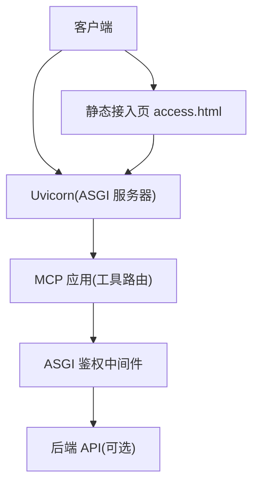
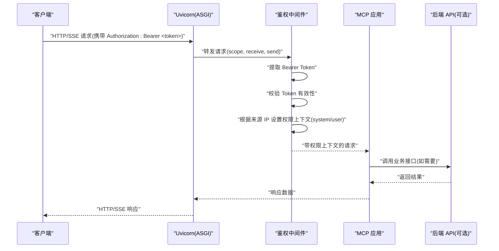
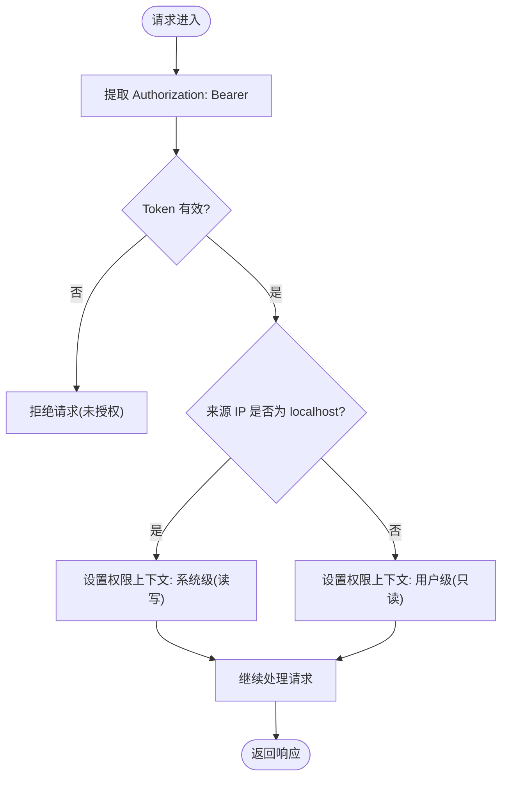
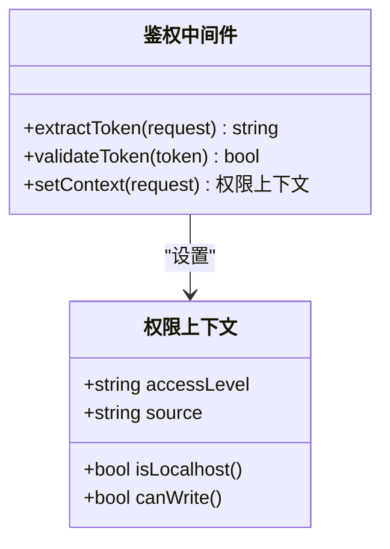
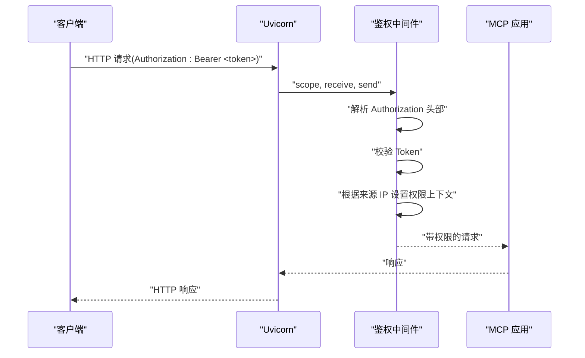
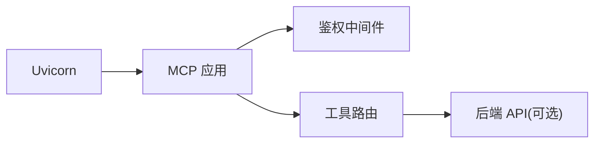

# 安全架构

<cite>
**本文引用的文件**
- [mcp server部署.md](file://mcp server部署.md)
- [规约管理MCP服务化Spec.md](file://规约管理MCP服务化Spec.md)
- [access.html](file://mcp_server/static/access.html)
- [requirements.txt](file://mcp_server/requirements.txt)
</cite>

## 目录
1. [简介](#简介)
2. [项目结构](#项目结构)
3. [核心组件](#核心组件)
4. [架构总览](#架构总览)
5. [详细组件分析](#详细组件分析)
6. [依赖关系分析](#依赖关系分析)
7. [性能与安全考量](#性能与安全考量)
8. [故障排除指南](#故障排除指南)
9. [结论](#结论)
10. [附录：配置与最佳实践](#附录配置与最佳实践)

## 简介
本安全架构文档面向协议转换 MCP 服务器，聚焦以下目标：
- Token 认证机制：自动生成策略、管理员 Token 配置、Token 验证流程。
- 权限控制模型：区分 localhost 系统级权限与远程用户级权限的差异。
- ASGI 中间件鉴权实现：Bearer Token 提取、有效性验证、权限上下文设置。
- 安全最佳实践：环境变量配置、IP 白名单、请求限制。
- 潜在安全风险与防护措施。
- 安全配置示例与故障排除指南。

## 项目结构
本项目采用“部署说明 + 静态接入页 + 轻量依赖”的极简结构，安全相关能力由部署脚本、ASGI 应用与静态页面协同完成：
- 部署与启动脚本负责环境初始化、Token 生成与注入、服务启动。
- ASGI 应用（MCP + Uvicorn）承载鉴权中间件与工具路由。
- 静态接入页提供一键生成接入信息的能力，并展示权限级别与来源 IP。

图表来源
- [mcp server部署.md:110-261](file://mcp server部署.md#L110-L261)
- [access.html:401-443](file://mcp_server/static/access.html#L401-L443)

章节来源
- [mcp server部署.md:25-127](file://mcp server部署.md#L25-L127)
- [mcp_server/requirements.txt:1-2](file://mcp_server/requirements.txt#L1-L2)

## 核心组件
- 部署脚本与 Token 管理
  - 安装脚本负责创建虚拟环境、安装依赖、生成并写入 Token，同时为 IDE 自动填充连接配置。
  - 启动脚本读取环境变量中的 Token，打印启动信息并启动服务。
- ASGI 鉴权中间件
  - 在请求进入 MCP 工具前，从请求头提取 Bearer Token，校验有效性，并设置权限上下文（系统级或用户级）。
- 权限控制模型
  - 本地访问（localhost）授予系统级权限（读写），远程访问授予用户级权限（只读）。
- 静态接入页
  - 通过 /api/access-info 获取服务器地址、Token、权限级别与来源 IP，辅助生成多平台接入文本。

章节来源
- [mcp server部署.md:309-380](file://mcp server部署.md#L309-L380)
- [mcp server部署.md:415-459](file://mcp server部署.md#L415-L459)
- [mcp server部署.md:645-674](file://mcp server部署.md#L645-L674)
- [access.html:401-443](file://mcp_server/static/access.html#L401-L443)

## 架构总览
下图展示了从客户端到 MCP 工具的完整鉴权路径，包括 Token 提取、验证与权限上下文设置。

图表来源
- [mcp server部署.md:163-261](file://mcp server部署.md#L163-L261)
- [mcp server部署.md:645-674](file://mcp server部署.md#L645-L674)

## 详细组件分析

### Token 认证机制
- 自动生成策略
  - 安装脚本使用密码学安全的随机数生成 Token，格式为固定前缀加随机十六进制字符串，确保唯一性与不可预测性。
  - 生成的 Token 写入环境变量文件，供启动脚本与服务读取。
- 管理员 Token 配置
  - 支持手动覆盖默认 Token，将自定义值写入环境变量文件；生产环境建议通过安全的环境变量注入方式管理。
- Token 验证流程
  - 鉴权中间件在每个请求中解析 Authorization 头部，提取 Bearer Token。
  - 与已配置的 Token 进行比对，失败则拒绝请求。
  - 成功时，结合来源 IP 设置权限上下文，用于后续工具执行时的权限判断。

图表来源
- [mcp server部署.md:309-380](file://mcp server部署.md#L309-L380)
- [mcp server部署.md:415-459](file://mcp server部署.md#L415-L459)
- [mcp server部署.md:645-674](file://mcp server部署.md#L645-L674)

章节来源
- [mcp server部署.md:309-380](file://mcp server部署.md#L309-L380)
- [mcp server部署.md:415-459](file://mcp server部署.md#L415-L459)
- [mcp server部署.md:645-674](file://mcp server部署.md#L645-L674)

### 权限控制模型
- 本地系统级权限（localhost）
  - 允许读写操作，适用于开发或受控环境下的本地调试。
- 远程用户级权限（非 localhost）
  - 仅允许只读操作，降低外部访问带来的风险。
- 接入页展示
  - 静态接入页通过 /api/access-info 获取权限级别与来源 IP，并在界面中以徽章形式显示，便于使用者理解当前权限范围。

图表来源
- [mcp server部署.md:645-674](file://mcp server部署.md#L645-L674)
- [access.html:401-443](file://mcp_server/static/access.html#L401-L443)

章节来源
- [mcp server部署.md:645-674](file://mcp server部署.md#L645-L674)
- [access.html:401-443](file://mcp_server/static/access.html#L401-L443)

### ASGI 中间件鉴权实现
- Bearer Token 提取
  - 从 HTTP 请求头的 Authorization 字段中提取 Bearer Token。
- 有效性验证
  - 与已配置的 Token 进行比对，支持环境变量注入与安装脚本生成两种来源。
- 权限上下文设置
  - 根据来源 IP 判定权限级别，写入请求上下文，供后续工具执行时读取。

图表来源
- [mcp server部署.md:163-261](file://mcp server部署.md#L163-L261)
- [mcp server部署.md:645-674](file://mcp server部署.md#L645-L674)

章节来源
- [mcp server部署.md:163-261](file://mcp server部署.md#L163-L261)
- [mcp server部署.md:645-674](file://mcp server部署.md#L645-L674)

### 静态接入页与权限展示
- 功能概述
  - 通过 /api/access-info 获取服务器地址、Token、权限级别与来源 IP。
  - 支持多平台接入文本生成与下载，便于快速分发。
- 权限展示
  - 以徽章形式显示“系统级（读写）”或“用户级（只读）”，帮助用户理解当前访问权限。

章节来源
- [access.html:401-443](file://mcp_server/static/access.html#L401-L443)

## 依赖关系分析
- 运行时依赖
  - MCP SDK：提供工具注册、协议解析与 SSE 支持。
  - Uvicorn：高性能 ASGI 服务器，承载 MCP 应用。
- 安全相关依赖
  - 无额外第三方鉴权库，依赖环境变量与中间件逻辑实现 Token 认证。
  - 如需增强，可引入 httpx 等异步 HTTP 客户端以调用后端 API（按规范设计）。

图表来源
- [mcp_server/requirements.txt:1-2](file://mcp_server/requirements.txt#L1-L2)
- [规约管理MCP服务化Spec.md:287-293](file://规约管理MCP服务化Spec.md#L287-L293)

章节来源
- [mcp_server/requirements.txt:1-2](file://mcp_server/requirements.txt#L1-L2)
- [规约管理MCP服务化Spec.md:287-293](file://规约管理MCP服务化Spec.md#L287-L293)

## 性能与安全考量
- 性能
  - Uvicorn 基于异步事件循环，适合高并发 I/O 场景。
  - 鉴权中间件应轻量高效，避免阻塞事件循环。
- 安全
  - 使用密码学安全的随机数生成 Token，防止预测与碰撞。
  - 严格区分本地与远程权限，减少外部攻击面。
  - 生产环境建议启用 HTTPS、进程管理与日志审计。

[本节为通用指导，不直接分析具体文件]

## 故障排除指南
- 常见问题
  - Python 未安装或版本过低：检查并安装 Python 3.10+。
  - 虚拟环境创建失败：确认权限与磁盘空间。
  - 依赖安装失败：检查网络与 pip 版本，必要时切换镜像源。
  - 启动时找不到虚拟环境：运行安装脚本重新创建。
  - Token 未配置：运行安装脚本或手动写入环境变量文件。
  - 端口被占用：查找并结束占用进程，或修改端口。
- 安全相关问题
  - Token 泄露：立即撤销并重新生成，检查日志与访问记录。
  - 权限异常：确认来源 IP 与权限上下文设置是否正确。

章节来源
- [mcp server部署.md:505-643](file://mcp server部署.md#L505-L643)
- [mcp server部署.md:645-674](file://mcp server部署.md#L645-L674)

## 结论
本协议转换 MCP 服务器通过“安装脚本生成 Token + ASGI 中间件鉴权 + 权限上下文控制”的组合，实现了简洁而有效的安全机制。本地系统级权限与远程用户级权限的区分，降低了外部访问的风险。配合静态接入页与部署脚本，能够快速完成安全接入与分发。生产环境建议进一步增强加密、进程管理与审计能力。

[本节为总结，不直接分析具体文件]

## 附录：配置与最佳实践
- 环境变量配置
  - 使用环境变量文件存储 MCP_AUTH_TOKEN，避免硬编码与意外提交。
  - 生产环境通过安全渠道注入环境变量，禁止明文存储于仓库。
- IP 白名单
  - 在生产环境中，结合反向代理或防火墙限制访问来源 IP。
- 请求限制
  - 使用限流策略防止滥用与暴力破解。
- 安全配置示例
  - 安装脚本生成 Token 并写入环境变量文件。
  - 启动脚本读取环境变量并启动服务。
- 故障排除
  - 参考“故障排除指南”逐项排查环境问题与安全问题。

章节来源
- [mcp server部署.md:309-380](file://mcp server部署.md#L309-L380)
- [mcp server部署.md:415-459](file://mcp server部署.md#L415-L459)
- [mcp server部署.md:645-674](file://mcp server部署.md#L645-L674)