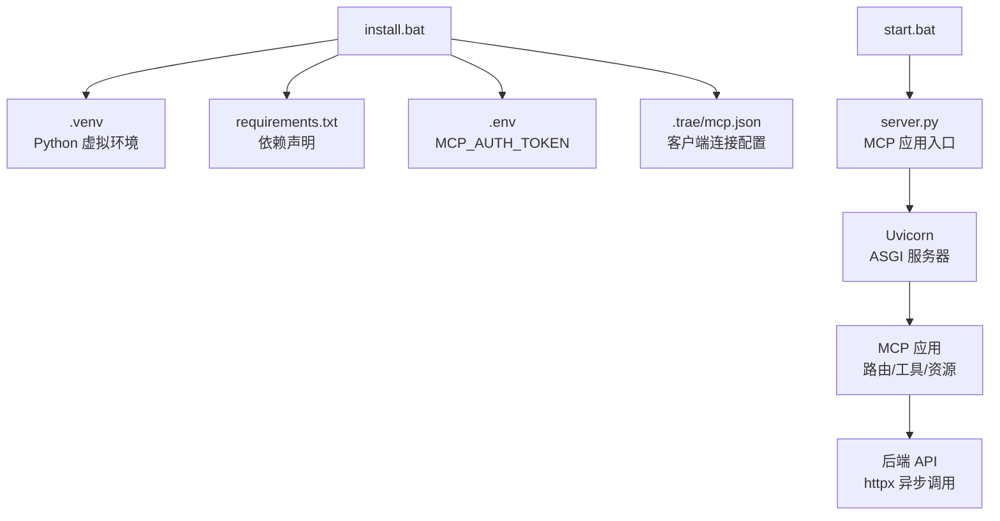
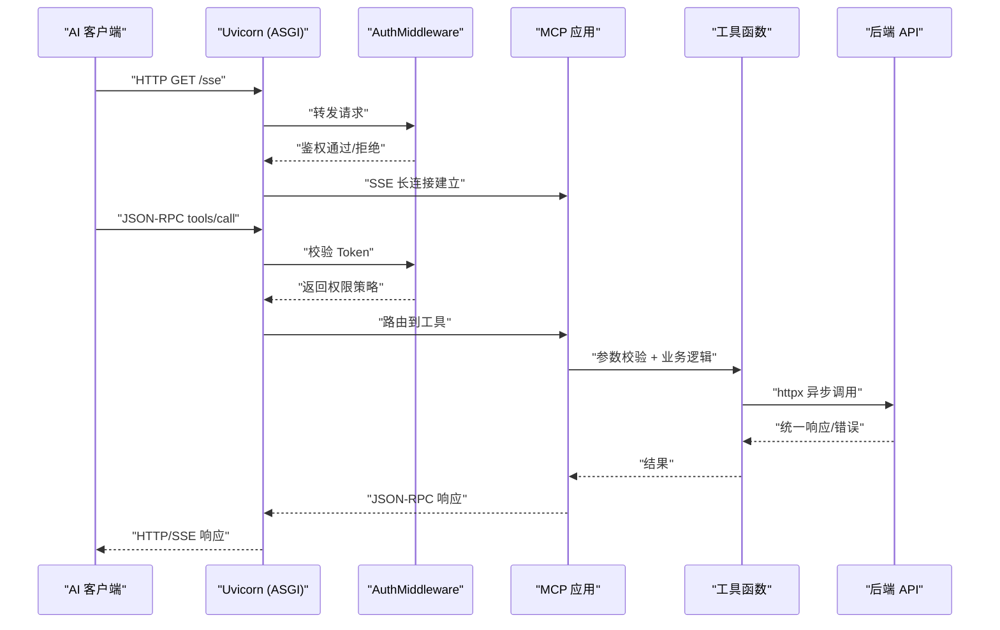
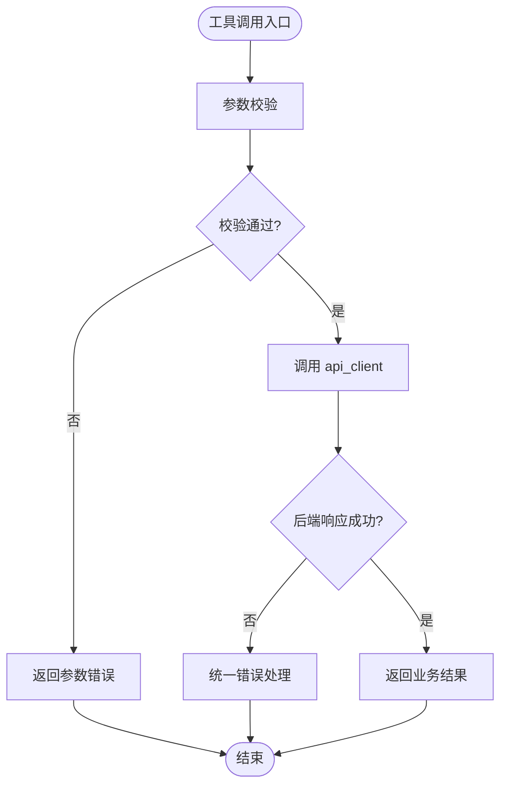
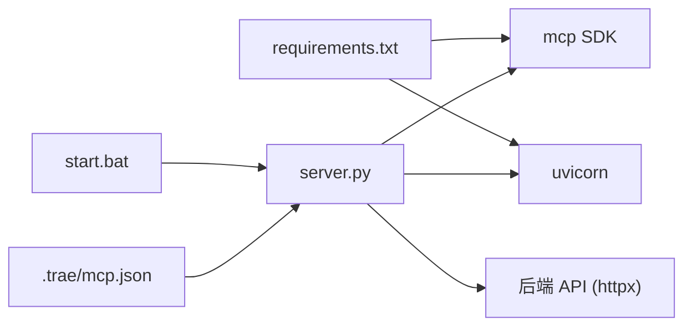

# 技术架构概览

<cite>
**本文引用的文件**
- [mcp server部署.md](file://mcp server部署.md)
- [规约管理MCP服务化Spec.md](file://规约管理MCP服务化Spec.md)
- [requirements.txt](file://mcp_server/requirements.txt)
- [install.bat](file://mcp_server/install.bat)
- [start.bat](file://mcp_server/start.bat)
- [mcp.json](file://.trae/mcp.json)
</cite>

## 目录
1. [引言](#引言)
2. [项目结构](#项目结构)
3. [核心组件](#核心组件)
4. [架构总览](#架构总览)
5. [详细组件分析](#详细组件分析)
6. [依赖关系分析](#依赖关系分析)
7. [性能考量](#性能考量)
8. [故障排查指南](#故障排查指南)
9. [结论](#结论)
10. [附录](#附录)

## 引言
本技术架构文档面向协议转换 MCP 服务器，基于 FastMCP（MCP Python SDK）与 Uvicorn 的 ASGI 应用模式，系统性地说明网络层、鉴权层、业务层与数据层的分层设计；阐述复合路由机制、Token 认证体系以及工具注册工厂模式、权限控制策略模式、Token 单例管理等关键设计模式；并给出系统边界、外部依赖与集成方式（后端 API、前端页面、AI 助手），配合架构图与数据流图展示请求处理流程与组件交互。

## 项目结构
- 运行环境由脚本驱动：install.bat 负责创建虚拟环境、安装依赖、生成 Token 并写入 .env 与 .trae/mcp.json；start.bat 负责激活环境、读取 Token 并启动 server.py。
- 依赖声明位于 requirements.txt，仅包含 mcp 与 uvicorn。
- 客户端配置位于 .trae/mcp.json，指定 MCP 服务端 URL 与鉴权头。
- 静态接入页位于 mcp_server/static/access.html（后续将迁移至 Vue）。

**图表来源**
- [install.bat:1-85](file://mcp_server/install.bat#L1-L85)
- [start.bat:1-41](file://mcp_server/start.bat#L1-L41)
- [requirements.txt:1-3](file://mcp_server/requirements.txt#L1-L3)
- [mcp.json:1-1](file://.trae/mcp.json#L1-L1)

**章节来源**
- [install.bat:1-85](file://mcp_server/install.bat#L1-L85)
- [start.bat:1-41](file://mcp_server/start.bat#L1-L41)
- [requirements.txt:1-3](file://mcp_server/requirements.txt#L1-L3)
- [mcp.json:1-1](file://.trae/mcp.json#L1-L1)

## 核心组件
- 网络层（ASGI 应用）：Uvicorn 作为高性能 ASGI 服务器，负责监听端口、解析 HTTP/SSE、事件循环调度与响应组装。
- 鉴权层（AuthMiddleware）：在 ASGI 中间件阶段对请求进行 Token 校验，区分本地回环地址的系统级权限与其他 IP 的用户级只读权限。
- 业务层（工具函数）：基于 MCP 工具装饰器注册的工具集合，每个工具对应一个细粒度操作，参数校验后委托给 api_client 调用后端 API。
- 数据层（外部 API）：通过 httpx.AsyncClient 统一封装后端接口，注入 Token 头，统一错误归一化。

**章节来源**
- [mcp server部署.md:110-160](file://mcp server部署.md#L110-L160)
- [规约管理MCP服务化Spec.md:44-79](file://规约管理MCP服务化Spec.md#L44-L79)
- [规约管理MCP服务化Spec.md:123-131](file://规约管理MCP服务化Spec.md#L123-L131)

## 架构总览
系统采用分层架构与中间件模式：
- 网络层：Uvicorn 接收 HTTP/SSE 请求，转发到 MCP 应用。
- 鉴权层：AuthMiddleware 拦截请求，校验 Token，按来源 IP 决定权限策略。
- 业务层：MCP 工具路由到具体实现，执行参数校验与编排。
- 数据层：api_client 使用 httpx 异步调用后端 API，统一错误处理。

**图表来源**
- [mcp server部署.md:163-282](file://mcp server部署.md#L163-L282)
- [规约管理MCP服务化Spec.md:56-79](file://规约管理MCP服务化Spec.md#L56-L79)

## 详细组件分析

### 网络层（ASGI 应用）
- Uvicorn 提供高性能异步事件循环，支持 HTTP/1.1、WebSocket、SSE。
- MCP 应用遵循 ASGI 标准，通过 __call__ 接收 scope/receive/send，完成 JSON-RPC 消息处理与工具路由。
- 选择 Uvicorn 的原因：轻量、高并发、原生异步，适合 I/O 密集型的 MCP 场景。

**章节来源**
- [mcp server部署.md:82-108](file://mcp server部署.md#L82-L108)
- [mcp server部署.md:129-160](file://mcp server部署.md#L129-L160)
- [mcp server部署.md:163-282](file://mcp server部署.md#L163-L282)

### 鉴权层（AuthMiddleware）
- 中间件在 ASGI 入口处检查请求头中的 Token，结合来源 IP 判定权限：
  - localhost 访问：系统级（读写）
  - 其他 IP：用户级（只读）
- 未通过鉴权的请求直接返回错误响应，避免进入业务层。
- 该策略体现了“策略模式”：根据请求上下文动态选择权限策略。

**章节来源**
- [mcp server部署.md:655-674](file://mcp server部署.md#L655-L674)

### 业务层（工具函数与工厂模式）
- 工具以 MCP 装饰器注册，形成统一的工具清单；新增工具时只需注册即可暴露给客户端，体现“工厂模式”的思想：集中注册、统一管理。
- 工具职责单一：参数校验、调用 api_client、返回标准化结果。
- 典型调用链：Skill → MCP 工具 → api_client → 后端 API。

**图表来源**
- [规约管理MCP服务化Spec.md:247-286](file://规约管理MCP服务化Spec.md#L247-L286)
- [规约管理MCP服务化Spec.md:295-319](file://规约管理MCP服务化Spec.md#L295-L319)

**章节来源**
- [规约管理MCP服务化Spec.md:247-286](file://规约管理MCP服务化Spec.md#L247-L286)
- [规约管理MCP服务化Spec.md:295-319](file://规约管理MCP服务化Spec.md#L295-L319)

### 数据层（外部 API 与错误处理）
- 使用 httpx.AsyncClient 构造异步 HTTP 客户端，统一注入 Token 请求头。
- 统一错误处理：网络异常、非 20000 业务码、Token 无效/过期、HTTP 状态异常等，均返回结构化错误对象。
- 后端 API 基地址与前端页面地址分离，便于解耦与独立部署。

**章节来源**
- [规约管理MCP服务化Spec.md:68-79](file://规约管理MCP服务化Spec.md#L68-L79)
- [规约管理MCP服务化Spec.md:123-131](file://规约管理MCP服务化Spec.md#L123-L131)

### 复合路由机制
- MCP 应用内部维护工具路由表，将 JSON-RPC method 映射到具体工具函数。
- 除 MCP 主端点外，还提供静态资源路由（如 access.html）与 Skills 下载路由，体现“复合路由”：同一 ASGI 应用承载多种路径与用途。

**章节来源**
- [mcp server部署.md:74-79](file://mcp server部署.md#L74-L79)
- [规约管理MCP服务化Spec.md:247-286](file://规约管理MCP服务化Spec.md#L247-L286)

### Token 管理（单例模式）
- Token 由 install.bat 生成并写入 .env，start.bat 读取并传递给 server.py。
- 运行时可通过单例对象集中管理 Token，避免重复加载与不一致问题。
- 客户端通过 .trae/mcp.json 配置 Authorization 头携带 Token。

**章节来源**
- [install.bat:52-72](file://mcp_server/install.bat#L52-L72)
- [start.bat:15-27](file://mcp_server/start.bat#L15-L27)
- [mcp.json:1-1](file://.trae/mcp.json#L1-L1)

## 依赖关系分析
- 运行时依赖：mcp（MCP Python SDK）、uvicorn（ASGI 服务器）。
- 开发/部署依赖：Windows 批处理脚本用于环境初始化与启动。
- 外部依赖：后端 API（https://18091.chinadny.com）、前端页面（https://18092.chinadny.com）。

**图表来源**
- [requirements.txt:1-3](file://mcp_server/requirements.txt#L1-L3)
- [start.bat:1-41](file://mcp_server/start.bat#L1-L41)
- [mcp.json:1-1](file://.trae/mcp.json#L1-L1)

**章节来源**
- [requirements.txt:1-3](file://mcp_server/requirements.txt#L1-L3)
- [mcp server部署.md:40-60](file://mcp server部署.md#L40-L60)

## 性能考量
- 异步 I/O：Uvicorn 的事件循环与 httpx 的异步客户端避免阻塞，提升并发能力。
- SSE 长连接：/sse 端点维持持久连接，降低握手开销，适合实时工具调用。
- 资源复用：AsyncClient 可复用连接池，减少 TCP 握手与 TLS 协商成本。
- 建议：生产环境考虑多进程模式（Gunicorn + Uvicorn）、限流与熔断、日志审计与指标采集。

[本节为通用指导，不直接分析具体文件]

## 故障排查指南
- Python 版本过低或未安装：确保 3.10+ 并加入 PATH。
- 虚拟环境创建失败：检查权限与磁盘空间。
- 依赖安装失败：检查网络或切换国内镜像源。
- 找不到虚拟环境：先运行 install.bat。
- Token 未配置：运行 install.bat 或手动设置 MCP_AUTH_TOKEN。
- 端口被占用：查找并结束占用进程或修改端口。
- 移动项目后虚拟环境失效：删除旧 .venv 并重新运行 install.bat。

**章节来源**
- [mcp server部署.md:505-643](file://mcp server部署.md#L505-L643)

## 结论
本协议转换 MCP 服务器以 Uvicorn 为网络层、AuthMiddleware 为鉴权层、MCP 工具为业务层、httpx 为数据层，形成了清晰的分层架构与职责边界。通过工厂模式集中注册工具、策略模式实现权限控制、单例模式管理 Token，系统在可扩展性、安全性与可维护性方面具备良好基础。未来可将接入页面迁移至 Vue，并与运维平台深度集成，进一步提升用户体验与运营效率。

## 附录
- 快速命令参考：
  - 首次安装：mcp_server\install.bat
  - 启动服务：mcp_server\start.bat
  - 停止服务：Ctrl+C
  - 手动激活虚拟环境：.venv\Scripts\activate.bat
  - 退出虚拟环境：deactivate
  - 手动启动服务：python mcp_server\server.py

**章节来源**
- [mcp server部署.md:677-687](file://mcp server部署.md#L677-L687)