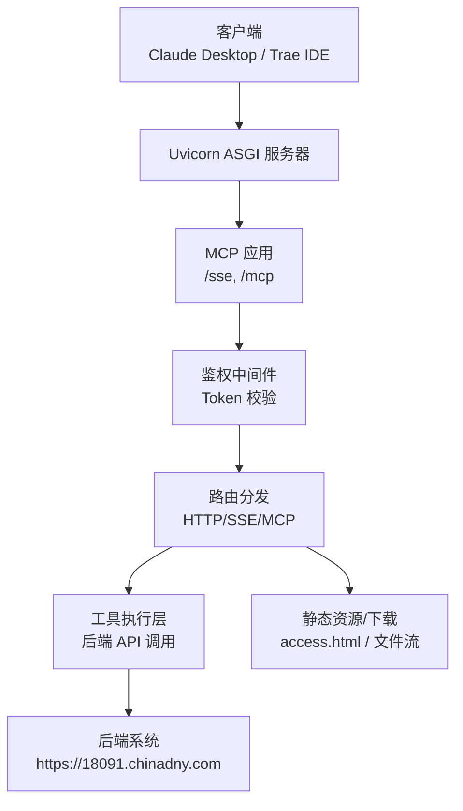
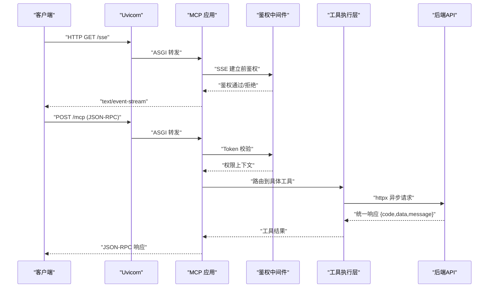
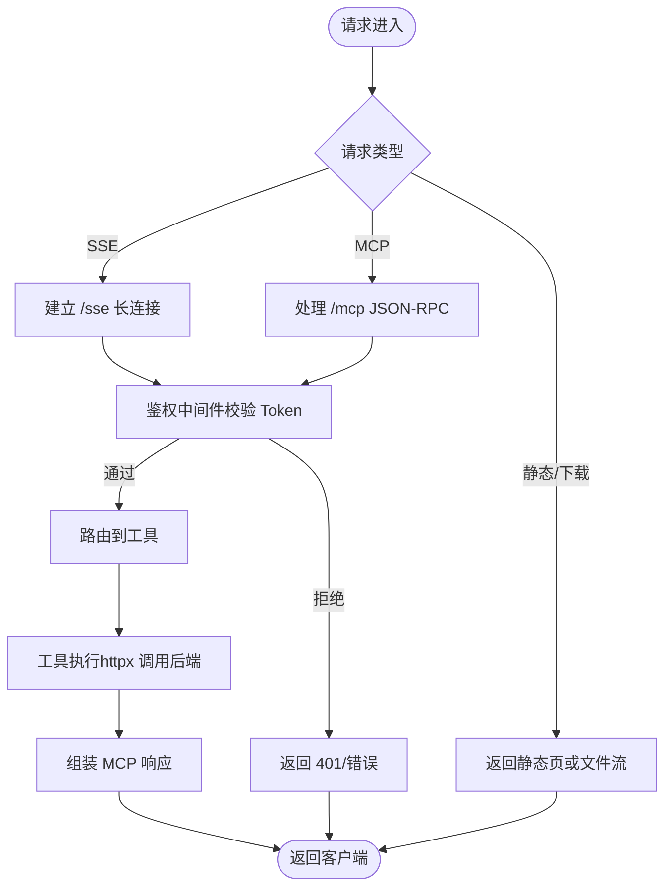
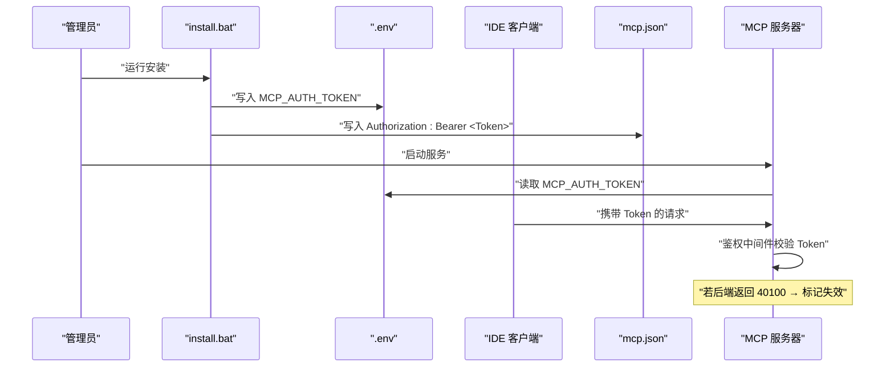
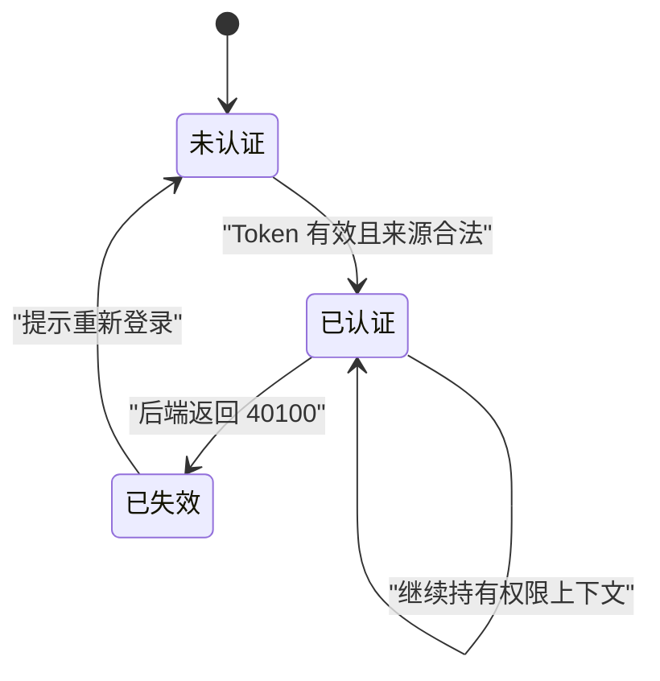
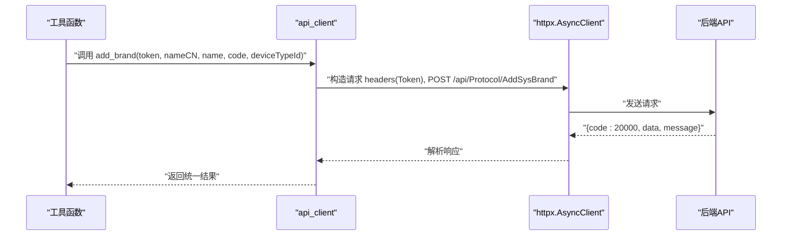
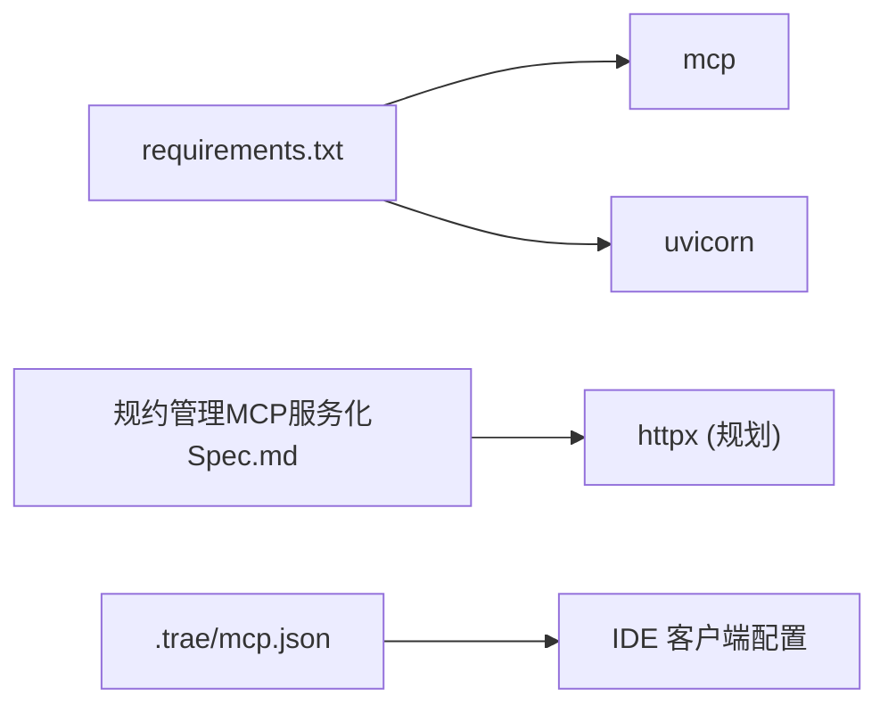

# 数据流分析

<cite>
**本文引用的文件**
- [mcp server部署.md](file://mcp server部署.md)
- [规约管理MCP服务化Spec.md](file://规约管理MCP服务化Spec.md)
- [install.bat](file://mcp_server/install.bat)
- [start.bat](file://mcp_server/start.bat)
- [requirements.txt](file://mcp_server/requirements.txt)
- [mcp.json](file://.trae/mcp.json)
</cite>

## 目录
1. [引言](#引言)
2. [项目结构](#项目结构)
3. [核心组件](#核心组件)
4. [架构总览](#架构总览)
5. [详细组件分析](#详细组件分析)
6. [依赖分析](#依赖分析)
7. [性能考虑](#性能考虑)
8. [故障排查指南](#故障排查指南)
9. [结论](#结论)
10. [附录](#附录)

## 引言
本文件面向协议转换 MCP 服务器，聚焦“请求处理完整生命周期”的数据流分析。内容覆盖从客户端请求进入、ASGI 中间件处理、鉴权验证、路由分发、工具执行到响应返回的全链路；并区分普通 HTTP 请求、MCP 协议请求与文件下载请求的处理差异；同时说明 Token 的生成、验证、存储与失效机制，以及权限信息在不同层级间的传递过程。文末提供时序图与状态图以可视化关键流程，并给出性能瓶颈分析与优化建议。

## 项目结构
当前仓库包含部署文档、规格说明、启动脚本与依赖声明等关键材料：
- 部署与工作原理说明：[mcp server部署.md](file://mcp server部署.md)
- MCP 服务化改造与接口规范：[规约管理MCP服务化Spec.md](file://规约管理MCP服务化Spec.md)
- Windows 一键安装与启动脚本：[install.bat](file://mcp_server/install.bat)、[start.bat](file://mcp_server/start.bat)
- 依赖声明：[requirements.txt](file://mcp_server/requirements.txt)
- IDE 客户端配置（含 Token）：[mcp.json](file://.trae/mcp.json)

图表来源
- [mcp server部署.md:110-261](file://mcp server部署.md#L110-L261)
- [mcp server部署.md:163-261](file://mcp server部署.md#L163-L261)
- [mcp server部署.md:283-501](file://mcp server部署.md#L283-L501)

章节来源
- [mcp server部署.md:110-261](file://mcp server部署.md#L110-L261)
- [mcp server部署.md:283-501](file://mcp server部署.md#L283-L501)

## 核心组件
- Uvicorn：ASGI 服务器，负责网络 I/O、协议解析、连接管理与事件循环调度。
- MCP 应用：实现 MCP 协议端点（/sse、/mcp），处理 JSON-RPC 消息、工具路由与生命周期。
- 鉴权中间件：基于 Token 的访问控制，支持本地系统级与其他 IP 用户级权限模型。
- 工具执行层：将 MCP 工具映射为对后端 API 的异步调用（httpx）。
- 静态与下载：提供接入页面 access.html 及文件下载能力（blob 流）。

章节来源
- [mcp server部署.md:110-160](file://mcp server部署.md#L110-L160)
- [mcp server部署.md:163-261](file://mcp server部署.md#L163-L261)
- [规约管理MCP服务化Spec.md:79-131](file://规约管理MCP服务化Spec.md#L79-L131)

## 架构总览
整体采用“ASGI + MCP + httpx”的分层架构：
- 网络层：Uvicorn 监听端口，解析 HTTP/SSE，封装 ASGI scope/receive/send。
- 应用层：MCP 应用注册工具、处理 JSON-RPC，按路径与方法路由。
- 业务层：工具函数参数校验后调用 api_client，统一构造请求头与错误处理。
- 外部依赖：后端 API 通过 httpx 异步调用，返回统一响应结构。

图表来源
- [mcp server部署.md:163-261](file://mcp server部署.md#L163-L261)
- [规约管理MCP服务化Spec.md:79-131](file://规约管理MCP服务化Spec.md#L79-L131)

章节来源
- [mcp server部署.md:163-261](file://mcp server部署.md#L163-L261)
- [规约管理MCP服务化Spec.md:79-131](file://规约管理MCP服务化Spec.md#L79-L131)

## 详细组件分析

### 请求处理生命周期（端到端）
- 入口：Uvicorn 接收 HTTP 请求，识别 SSE 或 JSON-RPC。
- 鉴权：中间件校验 Token，注入权限上下文（本地系统级/其他 IP 用户级）。
- 路由：MCP 根据 method/path 分派到对应工具。
- 执行：工具函数进行参数校验，调用 api_client 发起 httpx 异步请求。
- 响应：后端返回统一结构，工具层转换为 MCP 响应，经 Uvicorn 返回客户端。

图表来源
- [mcp server部署.md:163-261](file://mcp server部署.md#L163-L261)
- [mcp server部署.md:283-501](file://mcp server部署.md#L283-L501)
- [规约管理MCP服务化Spec.md:79-131](file://规约管理MCP服务化Spec.md#L79-L131)

章节来源
- [mcp server部署.md:163-261](file://mcp server部署.md#L163-L261)
- [规约管理MCP服务化Spec.md:79-131](file://规约管理MCP服务化Spec.md#L79-L131)

### 不同类型请求的数据流向差异
- 普通 HTTP 请求：如访问静态页面 access.html，直接由 Uvicorn/MCP 静态路由返回 HTML。
- MCP 协议请求：/mcp 端点处理 JSON-RPC，走鉴权→路由→工具→后端 API→响应的完整链路。
- 文件下载请求：导出类工具返回 blob 流，工具层设置正确的 Content-Type/Content-Disposition，MCP/Uvicorn 透传二进制流至客户端。

章节来源
- [mcp server部署.md:163-261](file://mcp server部署.md#L163-L261)
- [规约管理MCP服务化Spec.md:637-646](file://规约管理MCP服务化Spec.md#L637-L646)
- [规约管理MCP服务化Spec.md:783-790](file://规约管理MCP服务化Spec.md#L783-L790)

### Token 的生成、验证、存储与失效
- 生成：安装脚本使用密码学安全的随机源生成 Token，格式为前缀加十六进制串。
- 存储：写入 .env 环境变量文件，供启动脚本读取；IDE 客户端配置 mcp.json 中携带 Authorization: Bearer。
- 验证：启动时要求 MCP_AUTH_TOKEN 存在；运行时鉴权中间件校验请求中的 Token，结合来源 IP 决定权限级别。
- 失效：后端约定 40100 表示登录失效，工具层统一返回 AUTH_ERROR；服务端可据此提示重新登录。

图表来源
- [install.bat:52-72](file://mcp_server/install.bat#L52-L72)
- [start.bat:15-27](file://mcp_server/start.bat#L15-L27)
- [mcp.json:1-1](file://.trae/mcp.json#L1-L1)
- [mcp server部署.md:347-378](file://mcp server部署.md#L347-L378)
- [规约管理MCP服务化Spec.md:123-131](file://规约管理MCP服务化Spec.md#L123-L131)

章节来源
- [install.bat:52-72](file://mcp_server/install.bat#L52-L72)
- [start.bat:15-27](file://mcp_server/start.bat#L15-L27)
- [mcp.json:1-1](file://.trae/mcp.json#L1-L1)
- [mcp server部署.md:347-378](file://mcp server部署.md#L347-L378)
- [规约管理MCP服务化Spec.md:123-131](file://规约管理MCP服务化Spec.md#L123-L131)

### 权限信息在不同层级间的传递
- 来源判定：根据请求来源 IP（localhost 系统级，其他 IP 用户级）确定基础权限。
- 中间件注入：鉴权中间件校验 Token 后将权限上下文注入到请求处理链。
- 工具层使用：工具函数依据权限上下文限制写操作（仅读/读写），并在调用后端 API 时附带 Token。
- 后端反馈：后端返回 40100 时，工具层统一转换为 AUTH_ERROR，提示重新登录。

图表来源
- [mcp server部署.md:655-664](file://mcp server部署.md#L655-L664)
- [规约管理MCP服务化Spec.md:123-131](file://规约管理MCP服务化Spec.md#L123-L131)

章节来源
- [mcp server部署.md:655-664](file://mcp server部署.md#L655-L664)
- [规约管理MCP服务化Spec.md:123-131](file://规约管理MCP服务化Spec.md#L123-L131)

### 工具执行与后端 API 调用
- 工具清单：涵盖探测、登录、大类/设备类型/品牌/型号/规约/数据项/脚本/系数/感知/字典/功能项/导出/删除等。
- 调用方式：每个工具函数参数校验后，调用 api_client 的 httpx 异步方法，统一构造 headers（Token）、发送请求、解析响应。
- 错误处理：网络异常、非 20000、Token 无效/过期、HTTP 状态码异常均统一包装为 error/code/message/raw 结构。

图表来源
- [规约管理MCP服务化Spec.md:79-131](file://规约管理MCP服务化Spec.md#L79-L131)
- [规约管理MCP服务化Spec.md:132-246](file://规约管理MCP服务化Spec.md#L132-L246)

章节来源
- [规约管理MCP服务化Spec.md:79-131](file://规约管理MCP服务化Spec.md#L79-L131)
- [规约管理MCP服务化Spec.md:132-246](file://规约管理MCP服务化Spec.md#L132-L246)

## 依赖分析
- 运行时依赖：mcp（>=1.0.0,<2.0.0）、uvicorn（>=0.30.0）。
- 扩展依赖（规划）：httpx（>=0.27.0）用于异步后端 API 调用。
- 客户端配置：IDE 通过 mcp.json 指定 URL 与 Authorization 头。

图表来源
- [requirements.txt:1-3](file://mcp_server/requirements.txt#L1-L3)
- [规约管理MCP服务化Spec.md:287-293](file://规约管理MCP服务化Spec.md#L287-L293)
- [mcp.json:1-1](file://.trae/mcp.json#L1-L1)

章节来源
- [requirements.txt:1-3](file://mcp_server/requirements.txt#L1-L3)
- [规约管理MCP服务化Spec.md:287-293](file://规约管理MCP服务化Spec.md#L287-L293)
- [mcp.json:1-1](file://.trae/mcp.json#L1-L1)

## 性能考虑
- 并发模型：Uvicorn 基于 asyncio 事件循环，I/O 等待期间切换任务，适合高并发场景。
- 异步调用：工具层使用 httpx.AsyncClient，避免阻塞事件循环，提升吞吐。
- 连接复用：AsyncClient 内部维护连接池，减少握手开销。
- 超时与重试：为后端请求设置合理超时；对幂等读请求可增加重试策略。
- 日志与审计：记录工具调用与鉴权尝试，便于定位瓶颈与安全事件。
- 生产加固：多进程模式（Gunicorn+Uvicorn）、HTTPS、反向代理限流与 IP 白名单。

章节来源
- [mcp server部署.md:265-280](file://mcp server部署.md#L265-L280)
- [规约管理MCP服务化Spec.md:79-131](file://规约管理MCP服务化Spec.md#L79-L131)

## 故障排查指南
- Python 环境：检查版本与 PATH，确保 3.10+。
- 虚拟环境：确认 .venv 存在并可激活；若移动项目需重建。
- 依赖安装：网络问题可使用国内镜像源；升级 pip。
- Token 配置：确保 .env 存在且 MCP_AUTH_TOKEN 正确；IDE 配置 mcp.json 的 Authorization 头一致。
- 端口占用：查询并结束占用 8765 的进程，或修改端口。
- 鉴权失败：后端返回 40100 时，提示重新登录；检查 Token 是否泄露或过期。
- 下载失败：确认导出工具返回 blob，浏览器/客户端正确处理二进制流。

章节来源
- [mcp server部署.md:505-643](file://mcp server部署.md#L505-L643)
- [mcp server部署.md:645-674](file://mcp server部署.md#L645-L674)

## 结论
该 MCP 服务器以 Uvicorn 作为 ASGI 网关，结合 MCP 协议与 httpx 异步调用，实现了从请求进入到工具执行的完整数据流。通过 Token 鉴权与权限上下文注入，保障不同来源的访问安全；通过统一错误处理与 blob 流支持，满足多种请求类型的处理需求。建议在后续迭代中完善 httpx 集成、增加重试与监控、强化生产安全与可观测性。

## 附录
- 快速命令参考：
  - 首次安装：运行 install.bat
  - 启动服务：运行 start.bat
  - 手动启动：python mcp_server/server.py
  - 激活/退出虚拟环境：activate.bat / deactivate

章节来源
- [mcp server部署.md:677-687](file://mcp server部署.md#L677-L687)