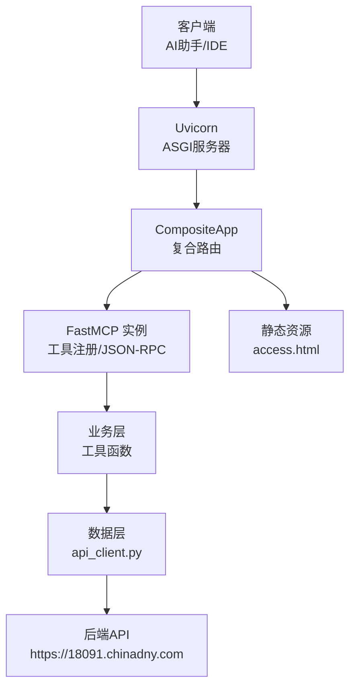
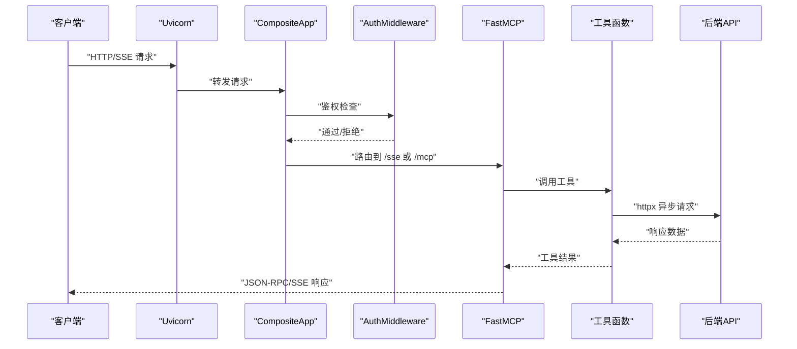
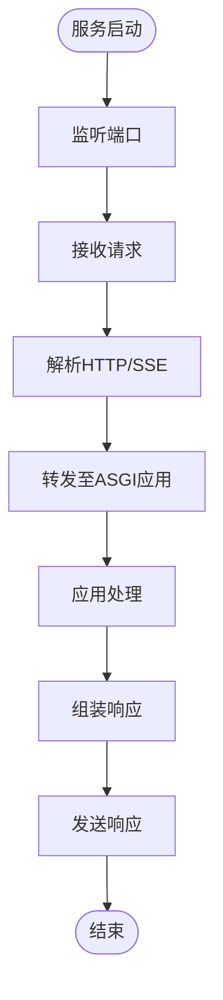
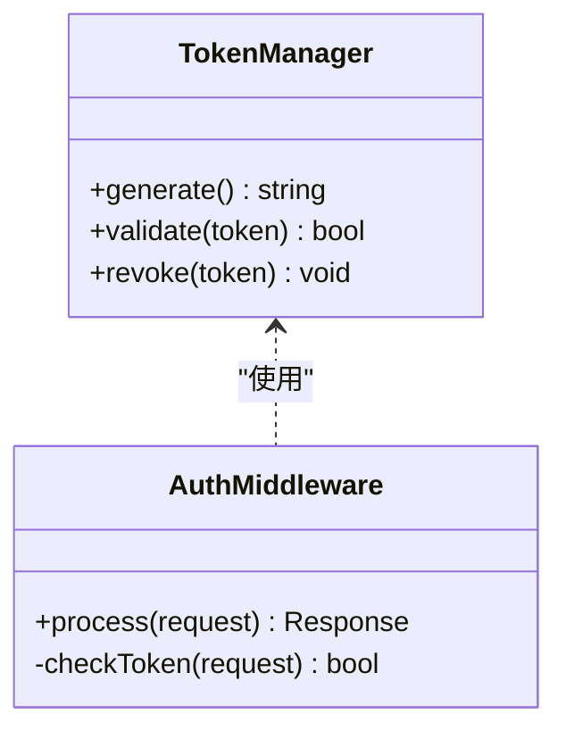
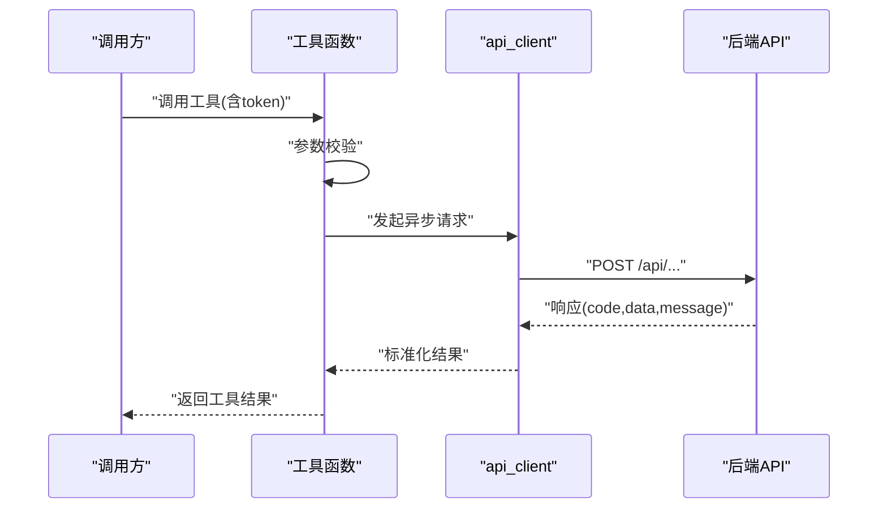
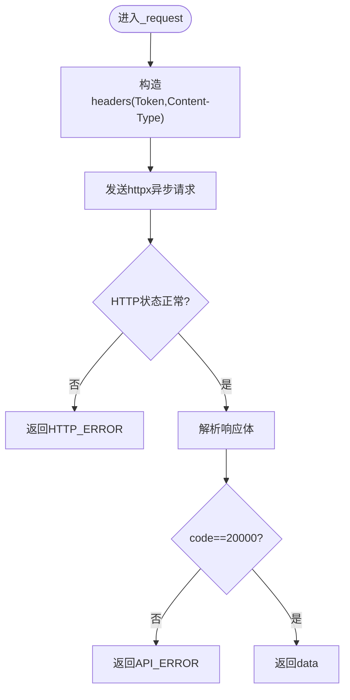
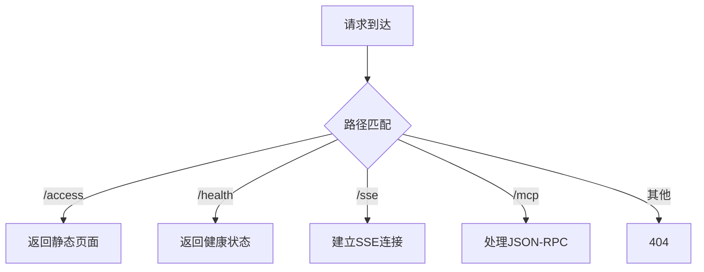
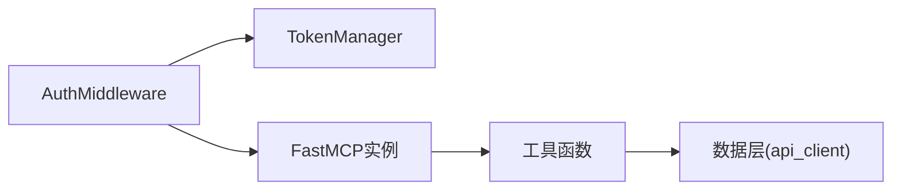
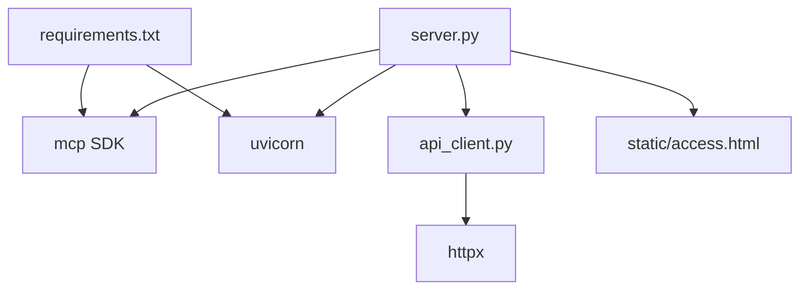

# 整体架构设计

<cite>
**本文引用的文件**
- [mcp_server/requirements.txt](file://mcp_server/requirements.txt)
- [mcp_server/install.bat](file://mcp_server/install.bat)
- [mcp_server/start.bat](file://mcp_server/start.bat)
- [mcp_server/static/access.html](file://mcp_server/static/access.html)
- [规约管理MCP服务化Spec.md](file://规约管理MCP服务化Spec.md)
- [mcp server部署.md](file://mcp server部署.md)
</cite>

## 目录
1. [简介](#简介)
2. [项目结构](#项目结构)
3. [核心组件](#核心组件)
4. [架构总览](#架构总览)
5. [详细组件分析](#详细组件分析)
6. [依赖关系分析](#依赖关系分析)
7. [性能考量](#性能考量)
8. [故障排查指南](#故障排查指南)
9. [结论](#结论)
10. [附录](#附录)

## 简介
本文件为“协议转换 MCP 服务器”的整体架构设计文档，面向希望理解并维护该服务的工程师与产品人员。文档基于仓库中的规范与设计说明，系统阐述分层架构（网络层、鉴权层、业务层、数据层）、复合路由机制 CompositeApp、以及 FastMCP 实例、TokenManager、AuthMiddleware 的协作方式；同时给出请求处理流程、外部依赖边界与集成模式，并提供架构图辅助理解。

## 项目结构
- 运行环境与依赖
  - Python 依赖由 requirements.txt 声明，包含 MCP SDK 与 ASGI 服务器 Uvicorn。
- 启动与安装脚本
  - install.bat：创建虚拟环境、安装依赖、生成 Token、写入 .env 与 IDE 配置。
  - start.bat：激活虚拟环境、读取 Token、打印启动信息、执行 server.py。
- 静态资源
  - static/access.html：接入页面（当前独立静态页，后续将迁移至 Vue）。
- 规范与部署文档
  - 规约管理MCP服务化Spec.md：定义工具清单、API 映射、错误处理策略、调用流程等。
  - mcp server部署.md：解释 MCP 与 Uvicorn 工作原理、ASGI 流程、部署脚本细节与常见问题。

图表来源
- [mcp server部署.md:110-261](file://mcp server部署.md#L110-L261)
- [规约管理MCP服务化Spec.md:44-78](file://规约管理MCP服务化Spec.md#L44-L78)

章节来源
- [mcp_server/requirements.txt:1-2](file://mcp_server/requirements.txt#L1-L2)
- [mcp_server/install.bat:1-85](file://mcp_server/install.bat#L1-L85)
- [mcp_server/start.bat:1-41](file://mcp_server/start.bat#L1-L41)
- [mcp_server/static/access.html](file://mcp_server/static/access.html)
- [规约管理MCP服务化Spec.md:44-78](file://规约管理MCP服务化Spec.md#L44-L78)
- [mcp server部署.md:110-261](file://mcp server部署.md#L110-L261)

## 核心组件
- 网络层（ASGI 应用）
  - 由 Uvicorn 提供高性能异步 HTTP/SSE 处理能力，负责监听端口、解析请求、转发给上层应用。
- 鉴权层（AuthMiddleware + TokenManager）
  - AuthMiddleware 在请求进入时校验 Token（来自请求头或访问页面分配），结合 TokenManager 进行令牌管理与权限判定。
- 业务层（工具函数）
  - 通过 FastMCP 注册的 MCP 工具，每个工具对应一个细粒度 API 操作，完成参数校验、调用 api_client、返回统一结果。
- 数据层（外部 API）
  - 使用 httpx 异步客户端封装对后端 API 的请求，统一构造请求头、处理响应与错误。

章节来源
- [规约管理MCP服务化Spec.md:44-78](file://规约管理MCP服务化Spec.md#L44-L78)
- [mcp server部署.md:110-161](file://mcp server部署.md#L110-L161)

## 架构总览
- 分层职责清晰：
  - 网络层：Uvicorn 接收 HTTP/SSE 请求，转交给 ASGI 应用。
  - 鉴权层：AuthMiddleware 校验 Token，必要时从访问页面获取临时 Token。
  - 业务层：FastMCP 工具函数实现具体业务逻辑。
  - 数据层：api_client 统一调用后端 API，处理网络与业务错误。
- 复合路由机制 CompositeApp：
  - 统一处理不同路径：接入页面（/access）、API 接口（如 /health）、MCP 端点（/sse、/mcp）。
  - 根据路径分发到对应的处理器，保证单一入口、集中路由。

图表来源
- [mcp server部署.md:163-261](file://mcp server部署.md#L163-L261)
- [规约管理MCP服务化Spec.md:295-319](file://规约管理MCP服务化Spec.md#L295-L319)

## 详细组件分析

### 网络层（ASGI 应用）
- 角色与职责
  - Uvicorn 作为 ASGI 服务器，负责高并发网络 I/O、协议解析与消息序列化。
  - 支持 SSE 长连接，满足 MCP 客户端持续通信需求。
- 关键流程
  - 启动后监听指定端口，等待请求。
  - 收到请求后封装为 ASGI scope/receive/send，交由应用处理。
  - 将应用响应组装为标准 HTTP 响应返回客户端。

图表来源
- [mcp server部署.md:163-261](file://mcp server部署.md#L163-L261)

章节来源
- [mcp server部署.md:110-161](file://mcp server部署.md#L110-L161)
- [mcp server部署.md:163-261](file://mcp server部署.md#L163-L261)

### 鉴权层（AuthMiddleware + TokenManager）
- 鉴权策略
  - 所有需要鉴权的请求需在头部携带自定义 Token。
  - 本地访问可赋予更高权限（读/写），远程访问默认只读。
  - 未登录用户可通过接入页面自动获取临时 Token。
- 协作方式
  - AuthMiddleware 在请求进入时提取并校验 Token。
  - TokenManager 负责令牌的生成、存储与生命周期管理。
  - 校验失败则返回鉴权错误，成功则放行至业务层。

图表来源
- [规约管理MCP服务化Spec.md:68-78](file://规约管理MCP服务化Spec.md#L68-L78)
- [mcp server部署.md:645-674](file://mcp server部署.md#L645-L674)

章节来源
- [mcp server部署.md:645-674](file://mcp server部署.md#L645-L674)
- [规约管理MCP服务化Spec.md:68-78](file://规约管理MCP服务化Spec.md#L68-L78)

### 业务层（工具函数）
- 工具粒度
  - 每个后端 API 对应一个 MCP 工具，遵循“原子操作、错误隔离、可复用”的原则。
- 典型流程
  - 参数校验 → 调用 api_client → 解析响应 → 返回统一格式。
- 错误处理
  - 网络异常、业务错误码、Token 无效、HTTP 状态异常均有统一返回结构。

图表来源
- [规约管理MCP服务化Spec.md:123-131](file://规约管理MCP服务化Spec.md#L123-L131)
- [规约管理MCP服务化Spec.md:295-319](file://规约管理MCP服务化Spec.md#L295-L319)

章节来源
- [规约管理MCP服务化Spec.md:123-131](file://规约管理MCP服务化Spec.md#L123-L131)
- [规约管理MCP服务化Spec.md:295-319](file://规约管理MCP服务化Spec.md#L295-L319)

### 数据层（外部 API）
- 客户端封装
  - 使用 httpx.AsyncClient，统一设置 base_url、超时、TLS 验证。
  - 统一注入 Token 请求头与 Content-Type。
- 错误策略
  - 网络异常：返回 NETWORK_ERROR。
  - 非 20000：返回 API_ERROR，附带原始响应。
  - Token 无效：返回 AUTH_ERROR。
  - HTTP 异常：返回 HTTP_ERROR。

图表来源
- [规约管理MCP服务化Spec.md:105-121](file://规约管理MCP服务化Spec.md#L105-L121)
- [规约管理MCP服务化Spec.md:123-131](file://规约管理MCP服务化Spec.md#L123-L131)

章节来源
- [规约管理MCP服务化Spec.md:105-121](file://规约管理MCP服务化Spec.md#L105-L121)
- [规约管理MCP服务化Spec.md:123-131](file://规约管理MCP服务化Spec.md#L123-L131)

### 复合路由机制 CompositeApp
- 目标
  - 统一入口，按路径分发到不同处理器：接入页面、API 接口、MCP 端点。
- 路由规则（概念性）
  - /access → 静态页面 access.html。
  - /health → 健康检查或其他内部 API。
  - /sse → MCP SSE 长连接建立。
  - /mcp → MCP JSON-RPC 主端点。
- 优势
  - 降低耦合，便于扩展新路由；集中鉴权与日志记录。

图表来源
- [mcp server部署.md:74-79](file://mcp server部署.md#L74-L79)
- [mcp server部署.md:185-211](file://mcp server部署.md#L185-L211)

章节来源
- [mcp server部署.md:74-79](file://mcp server部署.md#L74-L79)
- [mcp server部署.md:185-211](file://mcp server部署.md#L185-L211)

### 核心组件协作关系
- FastMCP 实例
  - 注册工具、处理 MCP 协议消息、调度工具执行。
- TokenManager
  - 生成、校验、撤销 Token，支撑鉴权层。
- AuthMiddleware
  - 拦截请求、校验 Token、决定放行或拒绝。
- 协作顺序
  - 请求进入 → AuthMiddleware 校验 → 路由到 FastMCP → 工具执行 → 数据层调用 → 返回响应。

图表来源
- [规约管理MCP服务化Spec.md:247-286](file://规约管理MCP服务化Spec.md#L247-L286)
- [mcp server部署.md:110-161](file://mcp server部署.md#L110-L161)

章节来源
- [规约管理MCP服务化Spec.md:247-286](file://规约管理MCP服务化Spec.md#L247-L286)
- [mcp server部署.md:110-161](file://mcp server部署.md#L110-L161)

## 依赖关系分析
- 外部依赖
  - MCP SDK：提供工具注册、协议处理、SSE 支持。
  - Uvicorn：ASGI 服务器，承载网络 I/O。
  - httpx：异步 HTTP 客户端，用于调用后端 API。
- 内部模块
  - server.py：MCP 工具注册与 ASGI 路由（CompositeApp）。
  - api_client.py：后端 API 调用封装。
  - static/access.html：接入页面。
- 依赖图

图表来源
- [mcp_server/requirements.txt:1-2](file://mcp_server/requirements.txt#L1-L2)
- [规约管理MCP服务化Spec.md:44-78](file://规约管理MCP服务化Spec.md#L44-L78)

章节来源
- [mcp_server/requirements.txt:1-2](file://mcp_server/requirements.txt#L1-L2)
- [规约管理MCP服务化Spec.md:44-78](file://规约管理MCP服务化Spec.md#L44-L78)

## 性能考量
- 异步 I/O
  - Uvicorn 基于事件循环，适合高并发 I/O 密集型任务。
  - httpx 异步客户端避免阻塞事件循环，提升吞吐。
- 连接复用
  - AsyncClient 可复用连接，减少握手开销。
- 超时与重试
  - 合理设置超时时间，避免长时间占用资源；必要时增加重试与退避策略。
- 鉴权成本
  - Token 校验尽量轻量，避免频繁 IO；缓存热点 Token 状态（注意安全性）。

[本节为通用指导，不直接分析具体文件]

## 故障排查指南
- 常见启动问题
  - Python 版本过低或未安装：确保 3.10+ 并加入 PATH。
  - 虚拟环境创建失败：检查权限与磁盘空间。
  - 依赖安装失败：检查网络或使用国内镜像源。
  - 端口被占用：查找并结束占用进程或更换端口。
- Token 相关问题
  - 未配置 Token：运行 install.bat 或手动设置环境变量。
  - Token 无效/过期：重新登录或刷新 Token。
- 网络与 API 问题
  - 后端不可达：检查网络连通性与防火墙。
  - 业务错误码非 20000：查看 message 与 raw 字段定位原因。

章节来源
- [mcp server部署.md:505-631](file://mcp server部署.md#L505-L631)
- [规约管理MCP服务化Spec.md:123-131](file://规约管理MCP服务化Spec.md#L123-L131)

## 结论
本架构以 Uvicorn 为网络层、AuthMiddleware 为鉴权层、FastMCP 工具为业务层、api_client 为数据层，形成清晰的分层与职责分离。CompositeApp 统一路由接入页面、API 与 MCP 端点，简化了入口与扩展。通过 TokenManager 与 AuthMiddleware 的协作，实现了灵活的鉴权模型。对外通过 MCP 协议与 AI 助手集成，对内通过 httpx 调用后端 API，具备良好的可扩展性与可维护性。

[本节为总结性内容，不直接分析具体文件]

## 附录
- 快速命令参考
  - 首次安装：运行 mcp_server\install.bat。
  - 启动服务：运行 mcp_server\start.bat。
  - 停止服务：Ctrl+C。
  - 手动启动：python mcp_server\server.py。

章节来源
- [mcp server部署.md:677-686](file://mcp server部署.md#L677-L686)