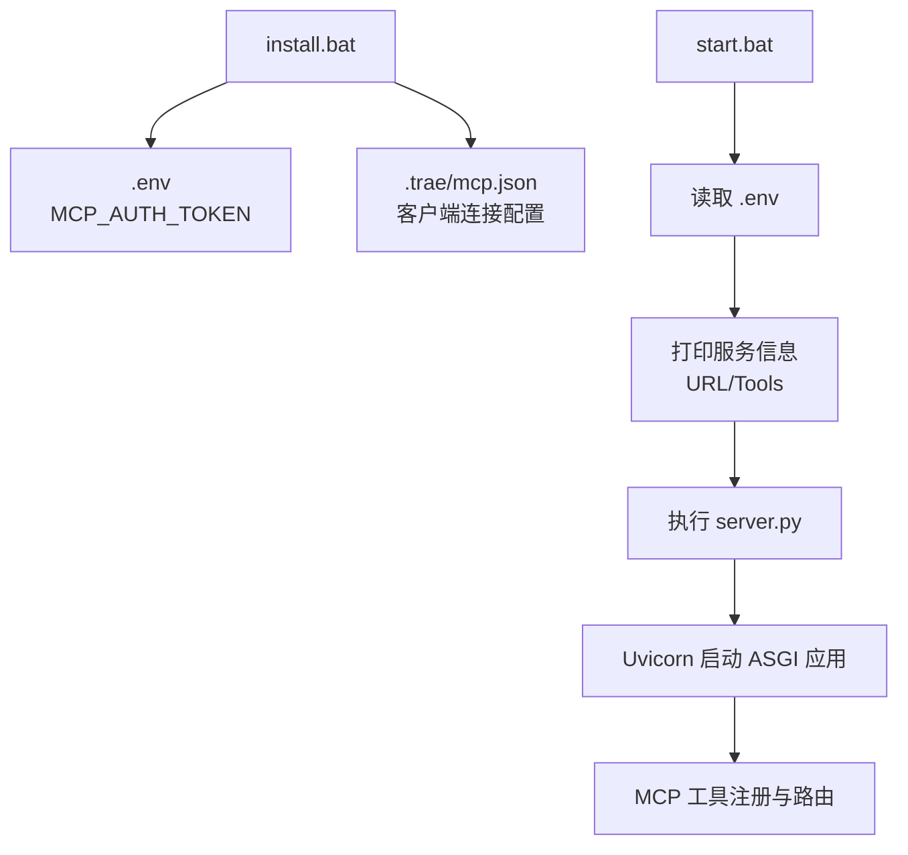
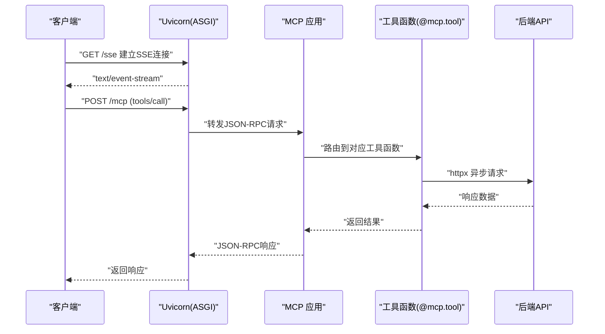
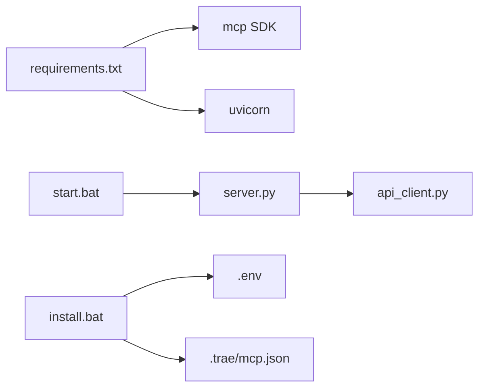

# FastMCP 实例配置

<cite>
**本文引用的文件**
- [mcp_server/requirements.txt](file://mcp_server/requirements.txt)
- [mcp server部署.md](file://mcp server部署.md)
- [规约管理MCP服务化Spec.md](file://规约管理MCP服务化Spec.md)
- [mcp_server/install.bat](file://mcp_server/install.bat)
</cite>

## 目录
1. [简介](#简介)
2. [项目结构](#项目结构)
3. [核心组件](#核心组件)
4. [架构总览](#架构总览)
5. [详细组件分析](#详细组件分析)
6. [依赖关系分析](#依赖关系分析)
7. [性能考虑](#性能考虑)
8. [故障排查指南](#故障排查指南)
9. [结论](#结论)
10. [附录](#附录)

## 简介
本文件面向“FastMCP 实例配置”主题，聚焦以下目标：
- 说明 FastMCP（基于 MCP SDK）实例初始化参数：name（协议转换器标识）、host（监听地址）、port（端口号）。
- 解释工具注册机制：@mcp.tool() 装饰器使用、工具函数定义、参数验证。
- 描述工具清单管理：TOOL_DEFINITIONS 数组结构、工具状态跟踪（implemented/stub）、工具分类（只读/写入）。
- 说明工具实现模式：完整实现与桩函数的区别、权限检查集成、错误处理统一。
- 提供具体的工具注册示例和调用方式，展示如何扩展新的 MCP 工具。

本项目通过 MCP SDK 暴露工具能力，由 Uvicorn 作为 ASGI 服务器承载；启动脚本负责环境准备、Token 配置与服务启动。

**章节来源**
- [mcp server部署.md:25-35](file://mcp server部署.md#L25-L35)
- [mcp server部署.md:163-181](file://mcp server部署.md#L163-L181)

## 项目结构
- mcp_server/requirements.txt：声明 MCP SDK 与 Uvicorn 依赖。
- mcp_server/start.bat：读取 .env 中的 Token，打印服务信息并执行 server.py。
- mcp_server/install.bat：创建虚拟环境、安装依赖、生成 Token 并写入 .env 与 .trae/mcp.json。
- 文档与规格：
  - mcp server部署.md：详细说明 MCP + Uvicorn 工作原理、启动流程、常见问题与安全建议。
  - 规约管理MCP服务化Spec.md：定义工具清单、工具分类、server.py 变更点、典型调用流程等。

**图表来源**
- [mcp_server/install.bat:52-72](file://mcp_server/install.bat#L52-L72)
- [mcp server部署.md:415-459](file://mcp server部署.md#L415-L459)
- [mcp server部署.md:463-501](file://mcp server部署.md#L463-L501)

**章节来源**
- [mcp_server/requirements.txt:1-3](file://mcp_server/requirements.txt#L1-L3)
- [mcp server部署.md:285-305](file://mcp server部署.md#L285-L305)
- [mcp server部署.md:415-459](file://mcp server部署.md#L415-L459)

## 核心组件
- MCP SDK（mcp）：提供工具注册、协议解析、JSON-RPC 消息处理。
- Uvicorn：ASGI 服务器，负责网络层、HTTP/SSE 通信。
- 启动脚本：
  - install.bat：环境初始化与 Token 配置。
  - start.bat：加载配置、启动服务。
- 工具层：
  - 工具函数：以 @mcp.tool() 装饰的异步函数，封装业务逻辑。
  - 工具清单：TOOL_DEFINITIONS 用于集中管理与统计工具状态与分类。
  - 权限与鉴权：ASGI 中间件对请求进行鉴权，区分系统级/用户级访问。

**章节来源**
- [mcp server部署.md:64-79](file://mcp server部署.md#L64-L79)
- [mcp server部署.md:110-126](file://mcp server部署.md#L110-L126)
- [mcp server部署.md:655-663](file://mcp server部署.md#L655-L663)
- [规约管理MCP服务化Spec.md:247-285](file://规约管理MCP服务化Spec.md#L247-L285)

## 架构总览
下图展示了从客户端到后端 API 的完整调用链：客户端通过 MCP 协议与 Uvicorn 建立 SSE 长连接，MCP 路由到具体工具函数，工具函数调用 api_client 完成 HTTP 请求，最终返回结果。

**图表来源**
- [mcp server部署.md:185-261](file://mcp server部署.md#L185-L261)
- [规约管理MCP服务化Spec.md:56-66](file://规约管理MCP服务化Spec.md#L56-L66)

**章节来源**
- [mcp server部署.md:163-261](file://mcp server部署.md#L163-L261)
- [规约管理MCP服务化Spec.md:56-66](file://规约管理MCP服务化Spec.md#L56-L66)

## 详细组件分析

### FastMCP 实例初始化参数
- name（协议转换器标识）：在客户端配置中体现为 mcpServers 下的键名，例如 “xl-protocol-agent”，用于标识该 MCP 服务。
- host（监听地址）：Uvicorn 绑定的 IP，通常为 0.0.0.0，表示对外暴露所有网卡。
- port（端口号）：Uvicorn 监听的端口，默认 8765。

这些参数由启动脚本与配置文件共同决定：
- install.bat 生成 .trae/mcp.json，其中包含 url 与 headers（Authorization: Bearer <TOKEN>）。
- start.bat 读取 .env 中的 MCP_AUTH_TOKEN，并在控制台输出 URL、Tools 数量等信息。
- 实际运行由 Uvicorn 启动 ASGI 应用，绑定 host 与 port。

**章节来源**
- [mcp_server/install.bat:52-72](file://mcp_server/install.bat#L52-L72)
- [mcp server部署.md:415-459](file://mcp server部署.md#L415-L459)
- [mcp server部署.md:463-501](file://mcp server部署.md#L463-L501)

### 工具注册机制：@mcp.tool() 装饰器
- 装饰器作用：将 Python 异步函数注册为 MCP 工具，供客户端通过 tools/call 调用。
- 工具函数定义：每个工具函数对应一个后端 API，函数签名包含参数校验与类型提示，便于自动生成交互式文档。
- 参数验证：建议在函数体内或借助类型提示进行基础校验；复杂校验可委托给 api_client 或独立校验模块。
- 典型模式：工具函数仅做参数校验与调用封装，真正业务逻辑在 api_client 中实现。

参考规范中对新增工具的说明与示例模式，新增工具需遵循统一的 async 函数结构与返回约定。

**章节来源**
- [规约管理MCP服务化Spec.md:247-285](file://规约管理MCP服务化Spec.md#L247-L285)
- [规约管理MCP服务化Spec.md:295-319](file://规约管理MCP服务化Spec.md#L295-L319)

### 工具清单管理：TOOL_DEFINITIONS、状态与分类
- TOOL_DEFINITIONS：集中维护工具元数据，包括名称、描述、类别、状态等，便于工具列表展示与统计。
- 工具状态跟踪：
  - implemented：已实现并调用后端 API。
  - stub：桩函数，仅返回占位响应，未接入真实逻辑。
- 工具分类：
  - 只读：查询类工具，不修改后端数据。
  - 写入：增删改类工具，涉及数据变更。
- 变更策略：根据需求演进，删除无用桩条目，保持工具清单整洁。

**章节来源**
- [规约管理MCP服务化Spec.md:247-255](file://规约管理MCP服务化Spec.md#L247-L255)
- [规约管理MCP服务化Spec.md:132-245](file://规约管理MCP服务化Spec.md#L132-L245)

### 工具实现模式：完整实现 vs 桩函数
- 完整实现：
  - 工具函数调用 api_client 发起 httpx 异步请求。
  - 统一错误处理：网络异常、HTTP 状态码异常、业务非 20000、认证失败等，均返回结构化错误对象。
  - 权限检查：ASGI 中间件根据来源 IP 与 Token 判定系统级/用户级权限，写入类工具需系统级权限。
- 桩函数：
  - 仅返回 not_implemented 或占位响应，用于开发阶段占位与测试。
  - 随着功能完善，逐步替换为完整实现并从清单中移除桩条目。

**章节来源**
- [规约管理MCP服务化Spec.md:123-131](file://规约管理MCP服务化Spec.md#L123-L131)
- [规约管理MCP服务化Spec.md:247-285](file://规约管理MCP服务化Spec.md#L247-L285)
- [mcp server部署.md:655-663](file://mcp server部署.md#L655-L663)

### 权限检查集成与错误处理统一
- 权限模型：
  - localhost（本地访问）：系统级，允许读写。
  - 其他 IP：用户级，仅读。
  - 其他用户：通过访问页面获取 Token，按角色限制操作。
- 写入保护：写入类工具需系统级权限，普通用户调用返回 FORBIDDEN。
- 错误处理：
  - 网络异常：返回 NETWORK_ERROR。
  - HTTP 异常：返回 HTTP_ERROR。
  - 业务异常：返回 API_ERROR，附带 message 与 raw。
  - 认证失败：返回 AUTH_ERROR，提示重新登录。

**章节来源**
- [mcp server部署.md:655-663](file://mcp server部署.md#L655-L663)
- [规约管理MCP服务化Spec.md:123-131](file://规约管理MCP服务化Spec.md#L123-L131)

### 工具注册示例与调用方式
- 注册示例：
  - 使用 @mcp.tool() 装饰异步函数。
  - 函数签名包含 token 等业务参数，类型提示明确。
  - 函数体调用 api_client 对应方法，返回其结果。
- 调用方式：
  - 客户端通过 MCP 协议发送 tools/call 请求，指定工具名与参数。
  - 典型流程：login 获取 Token → 查询列表 → 新增/更新/删除 → 生成脚本。

参考规范中的工具清单与典型调用流程，确保新增工具与现有体系一致。

**章节来源**
- [规约管理MCP服务化Spec.md:247-285](file://规约管理MCP服务化Spec.md#L247-L285)
- [规约管理MCP服务化Spec.md:295-319](file://规约管理MCP服务化Spec.md#L295-L319)

### 扩展新 MCP 工具的步骤
- 步骤概览：
  1. 在 server.py 中新增 @mcp.tool() 装饰的异步函数。
  2. 在 api_client.py 中实现对应的 httpx 异步请求方法。
  3. 在 TOOL_DEFINITIONS 中添加工具元数据（名称、描述、分类、状态）。
  4. 若为写入类工具，确保权限检查生效。
  5. 通过 list_mcp_tools 验证工具可见性与分类。
  6. 编写调用流程测试，覆盖成功与错误场景。
- 注意事项：
  - 保持工具粒度细，便于 Skill 编排。
  - 统一错误处理，避免隐藏异常。
  - 参数校验前置，减少无效请求。

**章节来源**
- [规约管理MCP服务化Spec.md:247-285](file://规约管理MCP服务化Spec.md#L247-L285)
- [规约管理MCP服务化Spec.md:295-319](file://规约管理MCP服务化Spec.md#L295-L319)

## 依赖关系分析
- 外部依赖：
  - mcp：MCP SDK，提供工具注册与协议支持。
  - uvicorn：ASGI 服务器，承载 MCP 应用。
- 内部依赖：
  - server.py：工具注册与路由。
  - api_client.py：后端 API 调用封装。
  - 启动脚本：install.bat、start.bat。

**图表来源**
- [mcp_server/requirements.txt:1-3](file://mcp_server/requirements.txt#L1-L3)
- [mcp_server/install.bat:52-72](file://mcp_server/install.bat#L52-L72)
- [mcp server部署.md:415-459](file://mcp server部署.md#L415-L459)

**章节来源**
- [mcp_server/requirements.txt:1-3](file://mcp_server/requirements.txt#L1-L3)
- [mcp server部署.md:415-459](file://mcp server部署.md#L415-L459)

## 性能考虑
- 异步 I/O：MCP 与 Uvicorn 原生支持 async/await，适合高并发 I/O 密集型任务。
- 连接复用：api_client 使用 httpx.AsyncClient，合理设置超时与连接池。
- 事件循环：避免阻塞调用，确保工具函数均为异步实现。
- 资源管理：在服务生命周期内管理客户端连接，必要时关闭连接释放资源。

[本节为通用指导，不直接分析具体文件]

## 故障排查指南
- 常见问题：
  - Python 未安装或版本过低：检查 Python 版本并重新安装。
  - 虚拟环境创建失败：确认权限与磁盘空间。
  - 依赖安装失败：检查网络或使用国内镜像源。
  - 找不到虚拟环境：运行 install.bat 重新创建。
  - Token 未配置：运行 install.bat 或手动创建 .env。
  - 端口被占用：查找并结束占用进程或修改端口。
- 安全建议：
  - 生产环境更换认证方式、启用 HTTPS、使用进程管理、添加日志审计、限制访问来源。

**章节来源**
- [mcp server部署.md:505-642](file://mcp server部署.md#L505-L642)
- [mcp server部署.md:645-673](file://mcp server部署.md#L645-L673)

## 结论
本项目基于 MCP SDK 与 Uvicorn 构建了可扩展的工具服务。通过规范的 @mcp.tool() 装饰器、统一的工具清单管理与权限控制，实现了清晰的工具注册与调用流程。配合完善的启动脚本与错误处理策略，便于快速迭代与稳定运行。后续可按规范持续扩展新工具，保持工具粒度细、职责单一、易于编排。

[本节为总结性内容，不直接分析具体文件]

## 附录
- 快速命令参考：
  - 首次安装：mcp_server\install.bat
  - 启动服务：mcp_server\start.bat
  - 停止服务：Ctrl+C
  - 手动激活虚拟环境：.venv\Scripts\activate.bat
  - 退出虚拟环境：deactivate
  - 手动启动服务：python mcp_server\server.py

**章节来源**
- [mcp server部署.md:677-687](file://mcp server部署.md#L677-L687)