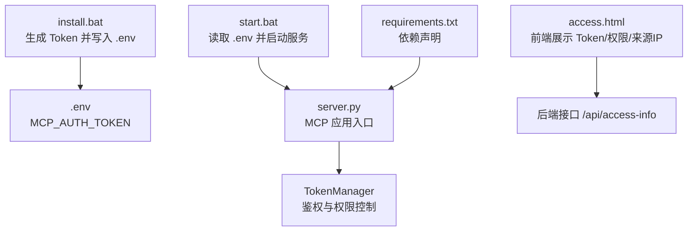
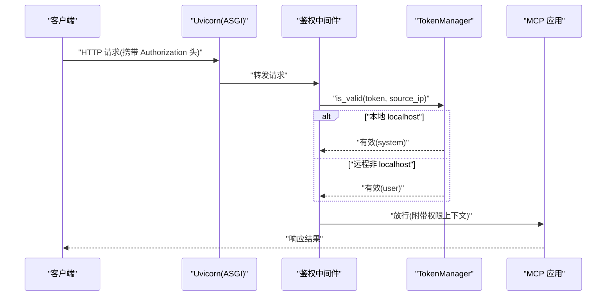
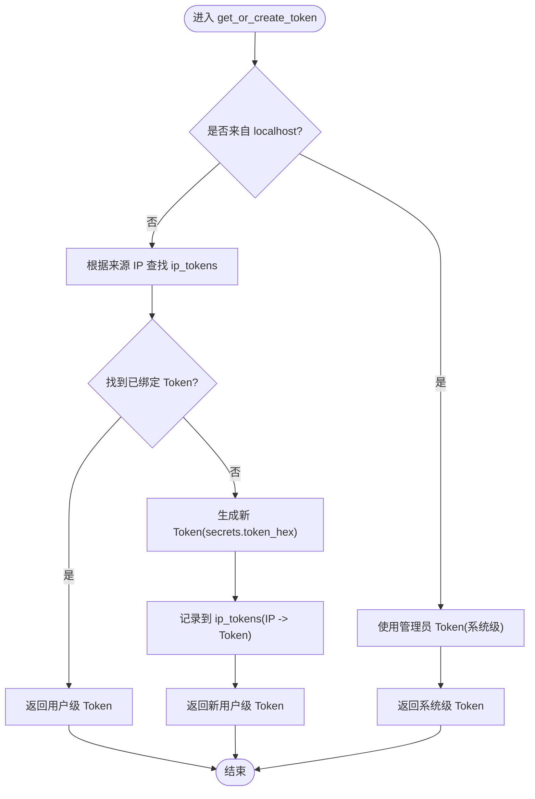
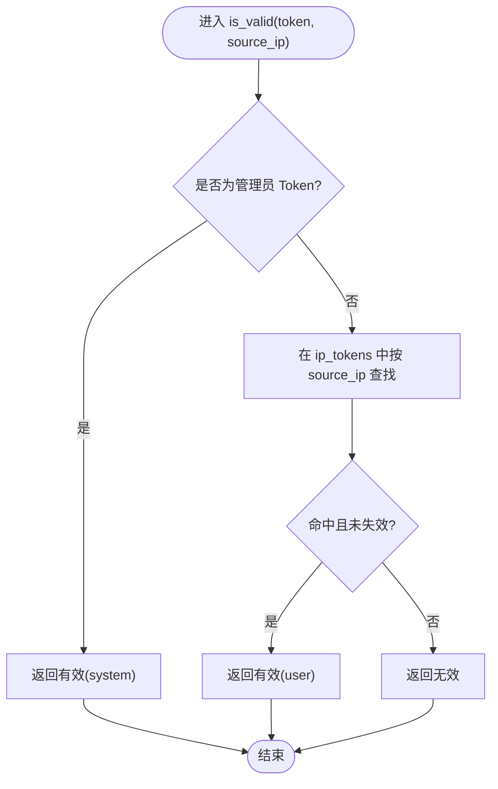
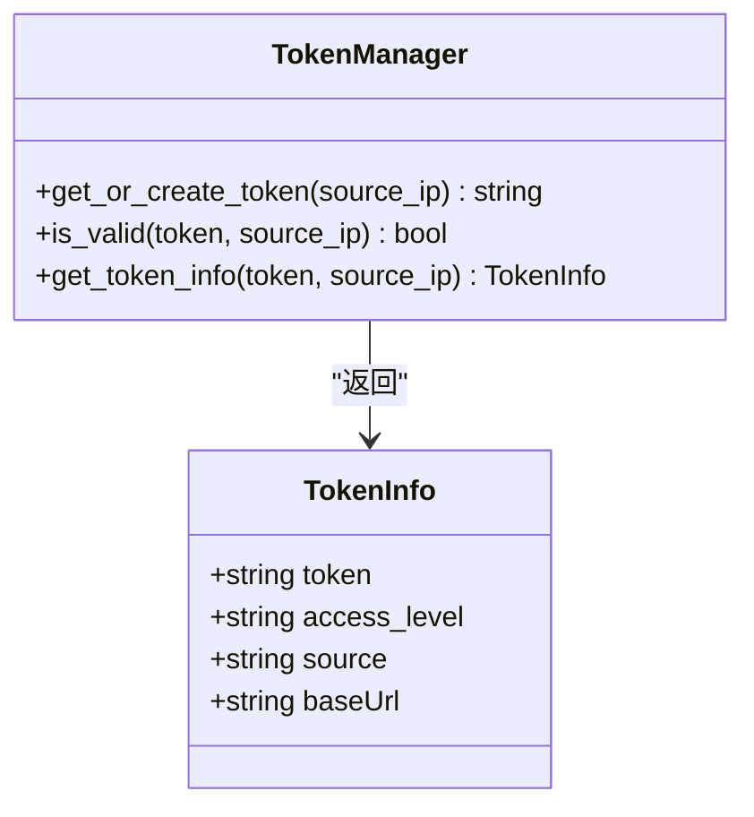
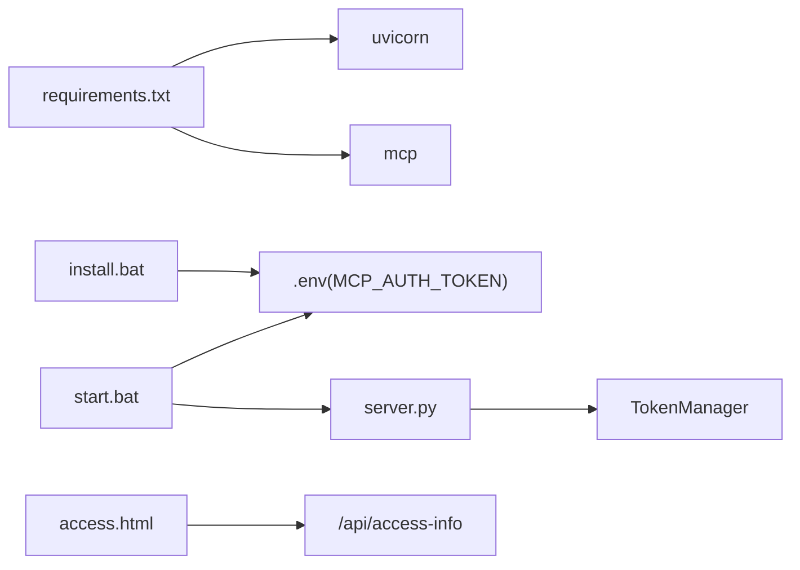

# Token 管理器

<cite>
**本文引用的文件**
- [mcp server部署.md](file://mcp server部署.md)
- [规约管理MCP服务化Spec.md](file://规约管理MCP服务化Spec.md)
- [access.html](file://mcp_server/static/access.html)
- [start.bat](file://mcp_server/start.bat)
- [install.bat](file://mcp_server/install.bat)
- [requirements.txt](file://mcp_server/requirements.txt)
</cite>

## 目录
1. [简介](#简介)
2. [项目结构](#项目结构)
3. [核心组件](#核心组件)
4. [架构总览](#架构总览)
5. [详细组件分析](#详细组件分析)
6. [依赖关系分析](#依赖关系分析)
7. [性能考虑](#性能考虑)
8. [故障排查指南](#故障排查指南)
9. [结论](#结论)
10. [附录](#附录)

## 简介
本文件围绕 TokenManager 类进行系统化文档说明，聚焦以下目标：
- 解释 Token 生成算法（基于 secrets.token_hex）与 IP 关联机制（ip_tokens 字典）。
- 阐述权限分级策略（system/user），以及本地访问与远程访问的差异。
- 详解 get_or_create_token 方法的工作流程：localhost 检测、管理员 Token 处理、自动 Token 生成。
- 详解 is_valid 方法的验证逻辑：管理员 Token 优先匹配、用户 Token 查找。
- 描述 get_token_info 方法如何返回完整的权限信息对象。
- 提供不同场景下的行为示例路径（本地系统级、远程用户级、Token 失效等）。

## 项目结构
本项目包含 MCP 服务器启动脚本、静态接入页面、需求规格与部署文档等。Token 相关能力由后端服务承载，并通过安装与启动脚本完成初始化与运行。

图表来源
- [install.bat:61-61](file://mcp_server/install.bat#L61-L61)
- [start.bat:15-27](file://mcp_server/start.bat#L15-L27)
- [access.html:263-294](file://mcp_server/static/access.html#L263-L294)
- [requirements.txt:1-2](file://mcp_server/requirements.txt#L1-L2)

章节来源
- [mcp server部署.md:340-379](file://mcp server部署.md#L340-L379)
- [mcp server部署.md:415-459](file://mcp server部署.md#L415-L459)
- [mcp server部署.md:599-663](file://mcp server部署.md#L599-L663)
- [规约管理MCP服务化Spec.md:270-285](file://规约管理MCP服务化Spec.md#L270-L285)
- [access.html:263-294](file://mcp_server/static/access.html#L263-L294)
- [start.bat:15-27](file://mcp_server/start.bat#L15-L27)
- [install.bat:61-61](file://mcp_server/install.bat#L61-L61)
- [requirements.txt:1-2](file://mcp_server/requirements.txt#L1-L2)

## 核心组件
- TokenManager：负责 Token 的生成、存储、校验与权限判定。
- ASGI 鉴权中间件：在请求进入业务前执行鉴权，依据 Token 与来源 IP 决定权限级别。
- 接入页面 access.html：向用户展示 Token、权限级别与来源 IP，并提供接入文本生成与下载。
- 启动脚本 start.bat/install.bat：负责环境准备、Token 生成与加载、服务启动。

章节来源
- [规约管理MCP服务化Spec.md:270-285](file://规约管理MCP服务化Spec.md#L270-L285)
- [mcp server部署.md:599-663](file://mcp server部署.md#L599-L663)
- [access.html:263-294](file://mcp_server/static/access.html#L263-L294)
- [start.bat:15-27](file://mcp_server/start.bat#L15-L27)
- [install.bat:61-61](file://mcp_server/install.bat#L61-L61)

## 架构总览
下图展示了从客户端到 TokenManager 的鉴权流程，包括本地与远程访问的权限差异。

图表来源
- [mcp server部署.md:215-261](file://mcp server部署.md#L215-L261)
- [mcp server部署.md:599-663](file://mcp server部署.md#L599-L663)

## 详细组件分析

### Token 生成算法与 IP 关联机制
- 生成算法：使用密码学安全的随机数生成器 secrets.token_hex(16)，拼接固定前缀形成 Token 字符串。该方式保证不可预测性与安全性。
- IP 关联：通过 ip_tokens 字典将来源 IP 与对应 Token 绑定，用于后续快速查找与权限判定。
- 权限分级：
  - system：本地 localhost 访问，具备读写权限。
  - user：远程访问，仅具备只读权限。

章节来源
- [mcp server部署.md:340-379](file://mcp server部署.md#L340-L379)
- [mcp server部署.md:599-663](file://mcp server部署.md#L599-L663)
- [access.html:490-490](file://mcp_server/static/access.html#L490-L490)

### get_or_create_token 方法工作流程
该方法负责“获取或创建”一个有效的 Token，并根据来源 IP 赋予相应权限。

图表来源
- [mcp server部署.md:599-663](file://mcp server部署.md#L599-L663)
- [access.html:263-294](file://mcp_server/static/access.html#L263-L294)

章节来源
- [mcp server部署.md:599-663](file://mcp server部署.md#L599-L663)
- [access.html:263-294](file://mcp_server/static/access.html#L263-L294)

### is_valid 方法验证逻辑
- 管理员 Token 优先匹配：若传入 Token 为管理员 Token，则直接判定有效并返回系统级权限。
- 用户 Token 查找：否则在 ip_tokens 中按来源 IP 查找对应 Token，若存在且未失效，则判定有效并返回用户级权限。
- 无效处理：若无法匹配或已失效，返回无效状态，阻止后续操作。

图表来源
- [mcp server部署.md:599-663](file://mcp server部署.md#L599-L663)

章节来源
- [mcp server部署.md:599-663](file://mcp server部署.md#L599-L663)

### get_token_info 方法返回权限信息对象
该方法返回包含完整权限信息的对象，便于上层组件展示与决策。典型字段包括：
- token：当前会话使用的 Token。
- access_level：权限级别（system 或 user）。
- source：来源 IP。
- baseUrl：服务端基础地址（用于前端生成接入配置）。

图表来源
- [access.html:263-294](file://mcp_server/static/access.html#L263-L294)
- [mcp server部署.md:599-663](file://mcp server部署.md#L599-L663)

章节来源
- [access.html:263-294](file://mcp_server/static/access.html#L263-L294)
- [mcp server部署.md:599-663](file://mcp server部署.md#L599-L663)

### 场景示例与行为说明
- 本地访问获取系统级权限：
  - 当请求来源为 localhost 时，get_or_create_token 返回管理员 Token；is_valid 判定为 system；get_token_info 返回 access_level=system。
  - 参考路径：[mcp server部署.md:599-663](file://mcp server部署.md#L599-L663)、[access.html:263-294](file://mcp_server/static/access.html#L263-L294)。
- 远程访问获取用户级权限：
  - 当请求来源为非 localhost 时，get_or_create_token 根据 ip_tokens 分配或查找用户 Token；is_valid 判定为 user；get_token_info 返回 access_level=user。
  - 参考路径：[mcp server部署.md:599-663](file://mcp server部署.md#L599-L663)、[access.html:263-294](file://mcp_server/static/access.html#L263-L294)。
- Token 失效处理：
  - 若 Token 不在 ip_tokens 中或已标记失效，is_valid 返回无效；上层应提示重新获取 Token。
  - 参考路径：[mcp server部署.md:599-663](file://mcp server部署.md#L599-L663)。

章节来源
- [mcp server部署.md:599-663](file://mcp server部署.md#L599-L663)
- [access.html:263-294](file://mcp_server/static/access.html#L263-L294)

## 依赖关系分析
- 运行时依赖：
  - mcp：MCP 协议实现。
  - uvicorn：ASGI 服务器，负责网络层与事件循环。
- 启动与配置：
  - install.bat：生成 Token 并写入 .env。
  - start.bat：读取 .env 中的 MCP_AUTH_TOKEN 并启动服务。
- 前端展示：
  - access.html：显示 Token、权限级别与来源 IP，辅助生成接入文本。

图表来源
- [requirements.txt:1-2](file://mcp_server/requirements.txt#L1-L2)
- [install.bat:61-61](file://mcp_server/install.bat#L61-L61)
- [start.bat:15-27](file://mcp_server/start.bat#L15-L27)
- [access.html:263-294](file://mcp_server/static/access.html#L263-L294)

章节来源
- [requirements.txt:1-2](file://mcp_server/requirements.txt#L1-L2)
- [install.bat:61-61](file://mcp_server/install.bat#L61-L61)
- [start.bat:15-27](file://mcp_server/start.bat#L15-L27)
- [access.html:263-294](file://mcp_server/static/access.html#L263-L294)

## 性能考虑
- 事件循环优化：Uvicorn 结合 uvloop 提升异步 I/O 性能，适合高并发场景。
- 内存占用：轻量级 ASGI 服务器，启动快、资源占用低。
- Token 查找：ip_tokens 字典查找时间复杂度 O(1)，适合高频鉴权。
- 建议：在高并发下关注 ip_tokens 的并发安全与清理策略（如过期回收）。

章节来源
- [mcp server部署.md:86-125](file://mcp server部署.md#L86-L125)
- [mcp server部署.md:215-261](file://mcp server部署.md#L215-L261)

## 故障排查指南
- 端口被占用：
  - 现象：启动时报错无法绑定端口。
  - 解决：查找占用进程并结束，或修改端口号。
  - 参考路径：[mcp server部署.md:610-631](file://mcp server部署.md#L610-L631)
- Token 未设置：
  - 现象：启动脚本提示未设置 MCP_AUTH_TOKEN。
  - 解决：运行 install.bat 生成 Token，或手动创建 .env 文件。
  - 参考路径：[mcp server部署.md:599-607](file://mcp server部署.md#L599-L607)、[start.bat:15-27](file://mcp_server/start.bat#L15-L27)
- 虚拟环境失效：
  - 现象：移动项目后 activate.bat 报错。
  - 解决：删除旧 .venv 并重新运行 install.bat。
  - 参考路径：[mcp server部署.md:634-642](file://mcp server部署.md#L634-L642)
- Token 安全注意事项：
  - 避免将 .env 提交至仓库；生产环境不要明文存储 Token。
  - 参考路径：[mcp server部署.md:645-663](file://mcp server部署.md#L645-L663)

章节来源
- [mcp server部署.md:599-663](file://mcp server部署.md#L599-L663)
- [start.bat:15-27](file://mcp_server/start.bat#L15-L27)

## 结论
TokenManager 通过安全的随机 Token 生成与 IP 绑定的映射机制，实现了灵活的权限分级策略。get_or_create_token、is_valid 与 get_token_info 共同构成了完整的鉴权与授权闭环，既支持本地系统级读写，也保障远程用户级只读的安全边界。配合启动脚本与接入页面，整体方案易于部署、易用且具备可扩展性。

## 附录
- 关键术语
  - 系统级（system）：本地 localhost 访问，具备读写权限。
  - 用户级（user）：远程访问，仅具备只读权限。
  - ip_tokens：来源 IP 到 Token 的映射表。
  - MCP_AUTH_TOKEN：环境变量中的管理员 Token。
- 参考路径
  - Token 生成与权限模型：[mcp server部署.md:340-379](file://mcp server部署.md#L340-L379)、[mcp server部署.md:599-663](file://mcp server部署.md#L599-L663)
  - 接入页面展示：[access.html:263-294](file://mcp_server/static/access.html#L263-L294)
  - 启动流程：[start.bat:15-27](file://mcp_server/start.bat#L15-L27)、[install.bat:61-61](file://mcp_server/install.bat#L61-L61)
  - 依赖声明：[requirements.txt:1-2](file://mcp_server/requirements.txt#L1-L2)