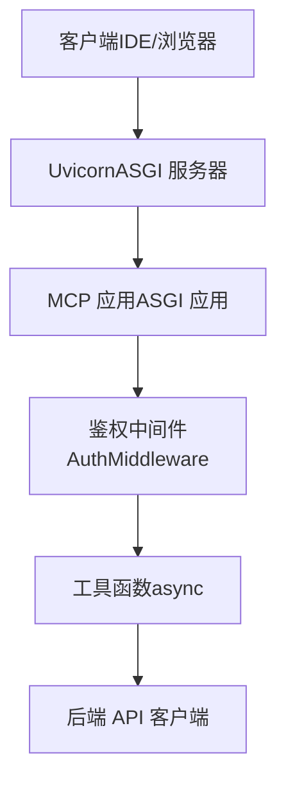
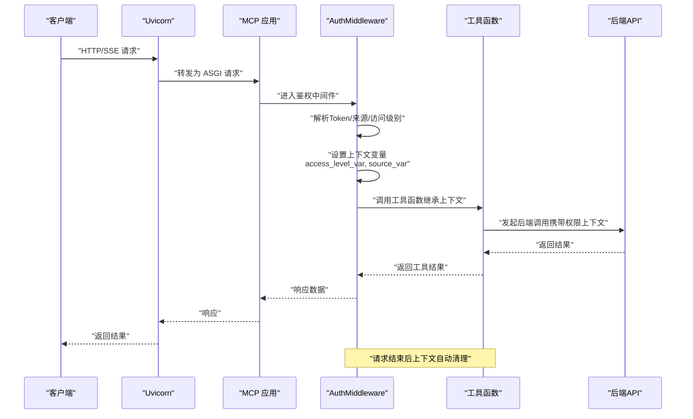
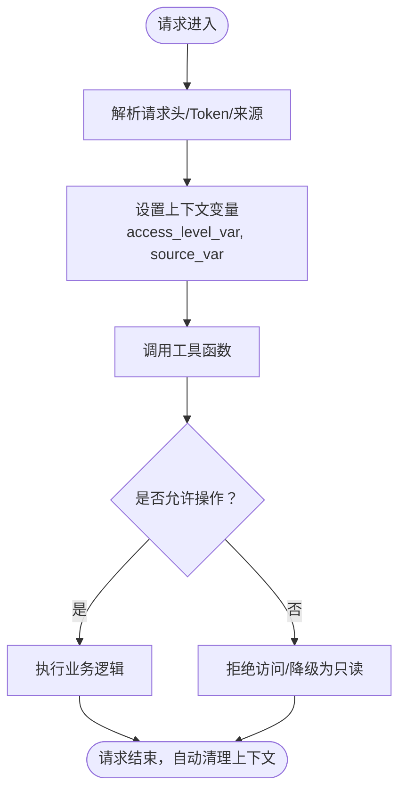
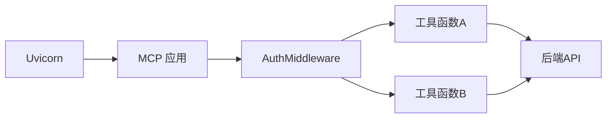

# 上下文变量传递

<cite>
**本文引用的文件**
- [mcp server部署.md](file://mcp server部署.md)
- [规约管理MCP服务化Spec.md](file://规约管理MCP服务化Spec.md)
</cite>

## 目录
1. [简介](#简介)
2. [项目结构](#项目结构)
3. [核心组件](#核心组件)
4. [架构总览](#架构总览)
5. [详细组件分析](#详细组件分析)
6. [依赖关系分析](#依赖关系分析)
7. [性能考量](#性能考量)
8. [故障排查指南](#故障排查指南)
9. [结论](#结论)
10. [附录](#附录)

## 简介
本文件围绕“基于 contextvars 的权限信息传递机制”进行系统化说明，重点覆盖异步环境中的上下文隔离、线程安全与任务隔离；解释访问级别与来源信息的变量设计与生命周期；给出在不同组件间安全传递权限信息的最佳实践与常见问题解决方案。文档同时结合仓库中已存在的 MCP/ASGI 运行模型与鉴权中间件概念，帮助读者理解在 ASGI 应用与工具调用链路中如何正确设置、传播与清理上下文变量。

## 项目结构
当前仓库包含部署说明与规范文档，未直接暴露 Python 源码。根据文档可知：
- 服务通过 Uvicorn 启动，遵循 ASGI 协议，提供 /sse 与 /mcp 等端点。
- 存在 TokenManager、AuthMiddleware、CompositeApp 等概念，用于认证与请求处理。
- 工具函数以 async 形式注册到 MCP，并在调用链中需要携带权限上下文。

图表来源
- [mcp server部署.md:110-160](file://mcp server部署.md#L110-L160)
- [mcp server部署.md:185-260](file://mcp server部署.md#L185-L260)

章节来源
- [mcp server部署.md:110-160](file://mcp server部署.md#L110-L160)
- [mcp server部署.md:185-260](file://mcp server部署.md#L185-L260)

## 核心组件
- 鉴权中间件（AuthMiddleware）：负责从请求中提取身份与权限信息，写入上下文变量，确保后续工具调用可读取。
- 上下文变量（contextvars）：用于在异步任务树中安全传递权限信息，避免全局状态污染。
- 工具函数（Tools）：以 async 方式实现，调用前后自动继承父任务的上下文，天然支持上下文传播。
- 后端 API 客户端：封装外部接口调用，使用上下文中的权限信息进行访问控制或审计。

章节来源
- [规约管理MCP服务化Spec.md:247-284](file://规约管理MCP服务化Spec.md#L247-L284)
- [mcp server部署.md:110-160](file://mcp server部署.md#L110-L160)

## 架构总览
下图展示一次工具调用的完整流程，包括上下文变量的设置、传播与清理。

图表来源
- [mcp server部署.md:185-260](file://mcp server部署.md#L185-L260)
- [规约管理MCP服务化Spec.md:247-284](file://规约管理MCP服务化Spec.md#L247-L284)

## 详细组件分析

### 上下文变量设计
- access_level_var（访问级别）：表示当前请求的访问级别（如系统级/用户级），用于决定读写能力。
- source_var（来源信息）：记录请求来源（如 localhost 或非本地 IP），辅助策略判断与审计。

作用域与传播
- 在 ASGI 请求进入时由 AuthMiddleware 设置。
- 所有后续异步任务（包括工具函数、子协程、并发任务）均能读取该上下文。
- 请求结束时由框架自动清理，避免跨请求污染。

线程安全与任务隔离
- contextvars 保证每个异步任务拥有独立的上下文副本，避免并发竞争。
- 不同请求之间互不干扰，即使在同一事件循环中也能保持隔离。

章节来源
- [规约管理MCP服务化Spec.md:247-284](file://规约管理MCP服务化Spec.md#L247-L284)
- [mcp server部署.md:110-160](file://mcp server部署.md#L110-L160)

### 变量生命周期
- 设置阶段：AuthMiddleware 在请求入口处解析 Token、来源与访问级别，并写入上下文变量。
- 读取阶段：工具函数与下游逻辑通过读取上下文变量获取权限信息，执行相应策略。
- 清理阶段：请求完成后由 ASGI 框架自动清理上下文，无需手动释放。

图表来源
- [mcp server部署.md:185-260](file://mcp server部署.md#L185-L260)
- [规约管理MCP服务化Spec.md:247-284](file://规约管理MCP服务化Spec.md#L247-L284)

### 在工具函数中的使用模式
- 工具函数以 async 方式注册，天然继承父任务的上下文。
- 在工具函数内部读取 access_level_var 与 source_var，决定读写权限或日志记录。
- 对敏感写操作进行二次校验，必要时结合来源信息限制。

示例路径（仅示意，不包含代码内容）
- 新增品牌工具：[规约管理MCP服务化Spec.md:262-275](file://规约管理MCP服务化Spec.md#L262-L275)
- 导出/删除工具：[规约管理MCP服务化Spec.md:239-246](file://规约管理MCP服务化Spec.md#L239-L246)

章节来源
- [规约管理MCP服务化Spec.md:239-275](file://规约管理MCP服务化Spec.md#L239-L275)

### 最佳实践
- 避免全局状态污染：始终通过 contextvars 传递权限，不要使用模块级可变状态。
- 确保上下文正确传播：不要在工具函数内创建独立事件循环或线程池，以免丢失上下文。
- 调试与日志记录：在关键路径记录 access_level_var 与 source_var，便于追踪问题。
- 最小权限原则：默认按只读处理，仅在满足条件时放开写权限。
- 显式边界：在工具函数入口与出口处统一检查与记录上下文，形成清晰边界。

章节来源
- [mcp server部署.md:645-674](file://mcp server部署.md#L645-L674)
- [规约管理MCP服务化Spec.md:247-284](file://规约管理MCP服务化Spec.md#L247-L284)

### 常见问题与解决方案
- 上下文未生效：确认请求已进入 AuthMiddleware，且工具函数未被新的事件循环隔离。
- 并发下权限错乱：检查是否存在共享可变状态；确保仅通过 contextvars 传递权限。
- 来源信息不准确：完善请求头解析与来源判定逻辑，区分 localhost 与非本地地址。
- 生产环境风险：替换弱认证机制，启用 HTTPS，增加审计日志与访问限制。

章节来源
- [mcp server部署.md:645-674](file://mcp server部署.md#L645-L674)

## 依赖关系分析
- Uvicorn 作为 ASGI 服务器，负责网络层与事件循环。
- MCP 应用负责路由与工具调用。
- AuthMiddleware 位于应用层，负责鉴权与上下文设置。
- 工具函数依赖上下文变量进行权限决策，并调用后端 API。

图表来源
- [mcp server部署.md:110-160](file://mcp server部署.md#L110-L160)
- [mcp server部署.md:185-260](file://mcp server部署.md#L185-L260)

章节来源
- [mcp server部署.md:110-160](file://mcp server部署.md#L110-L160)
- [mcp server部署.md:185-260](file://mcp server部署.md#L185-L260)

## 性能考量
- 上下文变量开销极低，适合在高并发场景中使用。
- 避免在工具函数中进行阻塞 I/O；如需阻塞，应使用异步封装或线程池隔离。
- 合理拆分工具函数，减少单次处理的复杂度，提升吞吐。
- 对写操作进行快速失败与限流，降低后端压力。

## 故障排查指南
- 检查请求是否经过 AuthMiddleware，确认上下文变量已设置。
- 在工具函数入口打印 access_level_var 与 source_var，验证是否正确传播。
- 若出现权限错乱，检查是否存在跨任务共享的可变状态。
- 在生产环境启用更严格的认证与审计日志，定位异常来源。

章节来源
- [mcp server部署.md:645-674](file://mcp server部署.md#L645-L674)

## 结论
通过 contextvars 在 ASGI 应用中传递权限信息，能够在异步环境下实现安全的上下文隔离与传播。配合 AuthMiddleware 的设置与工具函数的读取，可以构建清晰的权限边界与审计线索。遵循最小权限原则与最佳实践，可有效避免全局状态污染与并发问题，保障服务的稳定性与安全性。

## 附录
- 相关概念参考：
  - ASGI 协议与 Uvicorn 工作原理：[mcp server部署.md:110-160](file://mcp server部署.md#L110-L160)
  - 工具函数注册与调用：[规约管理MCP服务化Spec.md:247-284](file://规约管理MCP服务化Spec.md#L247-L284)
  - 权限模型与安全建议：[mcp server部署.md:645-674](file://mcp server部署.md#L645-L674)