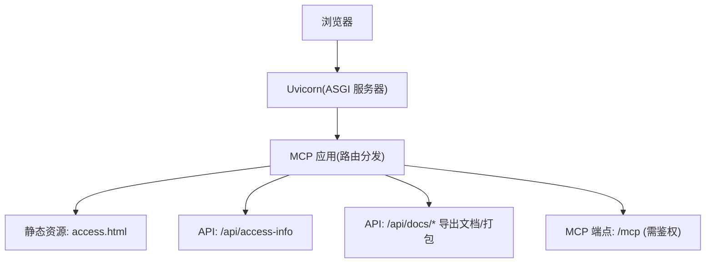
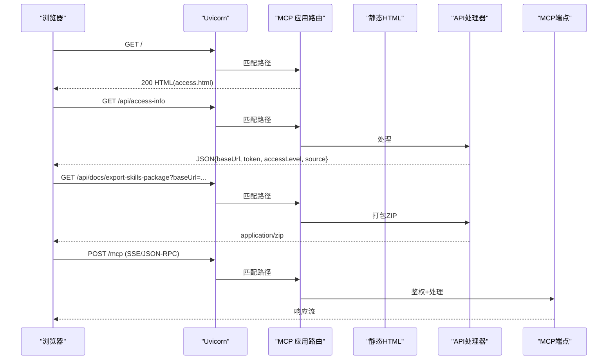
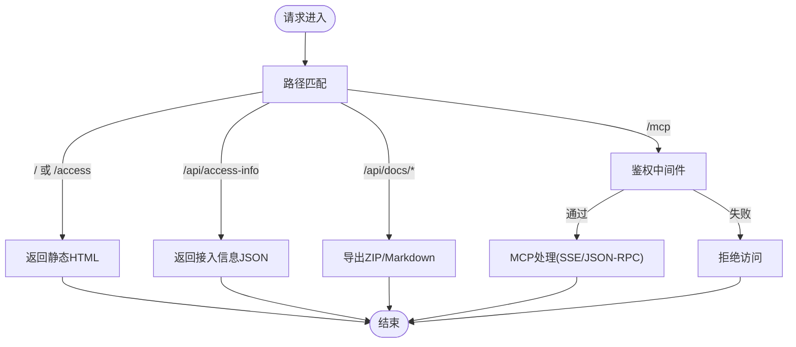
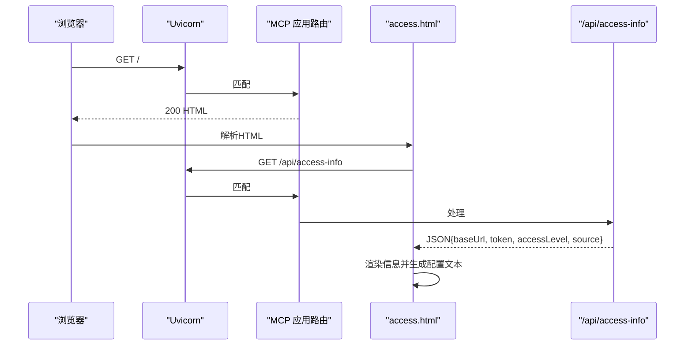
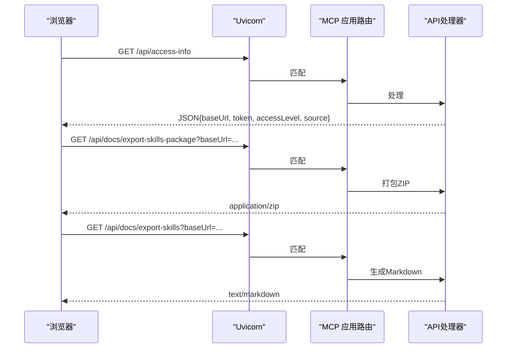
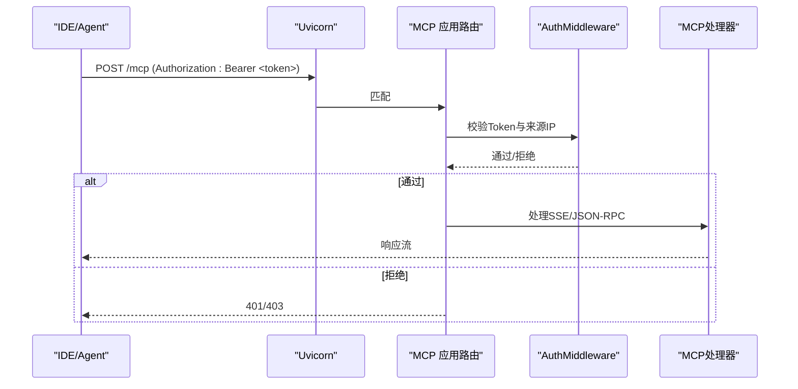
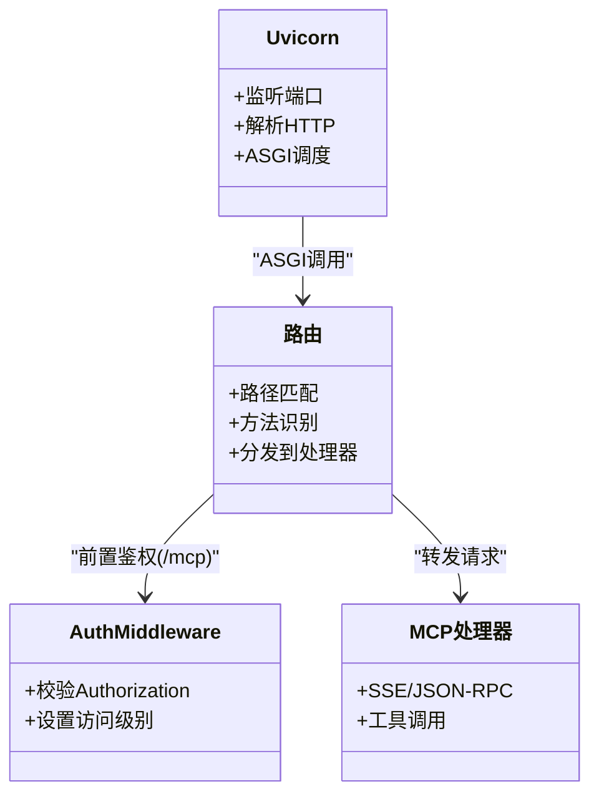
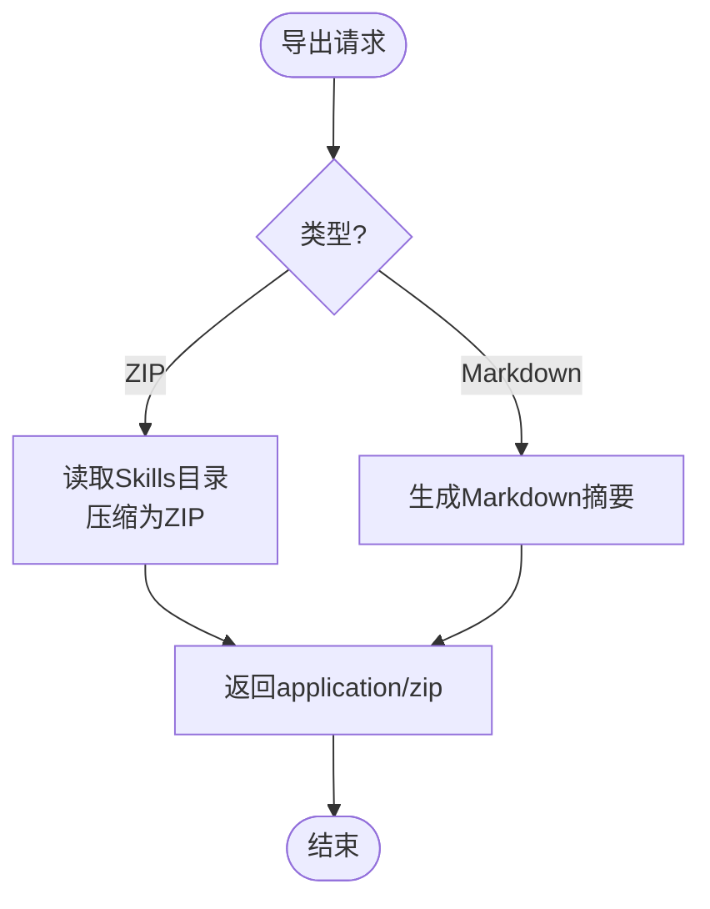
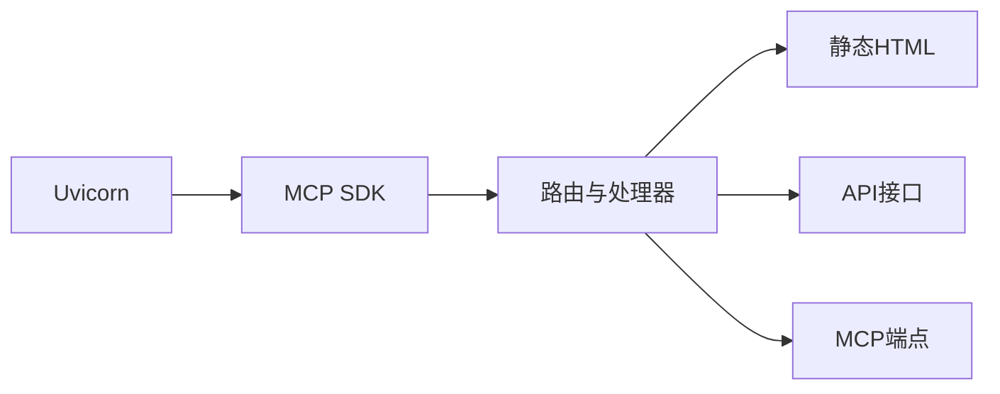

# 复合路由应用

<cite>
**本文引用的文件**
- [mcp_server/static/access.html](file://mcp_server/static/access.html)
- [mcp_server/requirements.txt](file://mcp_server/requirements.txt)
- [mcp server部署.md](file://mcp server部署.md)
- [规约管理MCP服务化Spec.md](file://规约管理MCP服务化Spec.md)
</cite>

## 目录
1. [简介](#简介)
2. [项目结构](#项目结构)
3. [核心组件](#核心组件)
4. [架构总览](#架构总览)
5. [详细组件分析](#详细组件分析)
6. [依赖分析](#依赖分析)
7. [性能考虑](#性能考虑)
8. [故障排查指南](#故障排查指南)
9. [结论](#结论)
10. [附录](#附录)

## 简介
本仓库提供“协议转换 MCP Server”的复合路由能力：在同一进程中同时承载接入页面、API 文档导出与 MCP 端点。其目标是通过统一入口，将静态 HTML 接入页、信息接口、文档资源打包下载以及受鉴权的 MCP 通信路径整合在一起，简化部署与使用流程。

## 项目结构
- mcp_server
  - static/access.html：接入页面，负责展示服务器地址、Token、权限级别，并生成各 IDE 平台的配置文本与 Skills 包链接
  - requirements.txt：声明运行依赖（MCP SDK、Uvicorn）
- 根目录文档
  - mcp server部署.md：说明 Uvicorn 启动方式、ASGI 工作原理、端口与安全建议
  - 规约管理MCP服务化Spec.md：定义 /api/access-info 等预期接口及整体实施计划

图表来源
- [mcp server部署.md:86-126](file://mcp server部署.md#L86-L126)
- [规约管理MCP服务化Spec.md:1206-1214](file://规约管理MCP服务化Spec.md#L1206-L1214)

章节来源
- [mcp_server/requirements.txt:1-3](file://mcp_server/requirements.txt#L1-L3)
- [mcp server部署.md:86-126](file://mcp server部署.md#L86-L126)
- [规约管理MCP服务化Spec.md:1206-1214](file://规约管理MCP服务化Spec.md#L1206-L1214)

## 核心组件
- 接入页面（/、/access）
  - 直接返回 HTML，页面内通过前端脚本调用 /api/access-info 获取 baseUrl、token、accessLevel、source 等信息，并据此生成不同 IDE 的配置文本与 Skills 包下载链接
- API 端点
  - /api/access-info：返回接入所需的基础信息与权限级别
  - /api/docs/*：用于导出 Skills 包或 Markdown 摘要（如 export-skills-package、export-skills）
- MCP 端点（/mcp 及其他）
  - 需要鉴权，通常通过 Authorization: Bearer <token> 头进行校验；根据来源 IP 判定系统级或用户级权限

章节来源
- [mcp_server/static/access.html:401-417](file://mcp_server/static/access.html#L401-L417)
- [mcp_server/static/access.html:475-478](file://mcp_server/static/access.html#L475-L478)
- [规约管理MCP服务化Spec.md:1206-1214](file://规约管理MCP服务化Spec.md#L1206-L1214)

## 架构总览
复合路由由 ASGI 服务器（Uvicorn）承载，内部按路径前缀与方法类型进行分发：
- 静态页面：/、/access → 返回 HTML
- 信息接口：/api/access-info → JSON
- 文档导出：/api/docs/export-skills-package?baseUrl=... → ZIP 包
- 文档导出：/api/docs/export-skills?baseUrl=... → Markdown
- MCP 通信：/mcp → SSE/HTTP JSON-RPC（需鉴权）

图表来源
- [mcp server部署.md:215-260](file://mcp server部署.md#L215-L260)
- [规约管理MCP服务化Spec.md:1206-1214](file://规约管理MCP服务化Spec.md#L1206-L1214)

## 详细组件分析

### 路由分发机制
- 路径匹配算法
  - 精确匹配优先：/、/access 直接命中静态页面
  - 前缀匹配次之：/api/* 进入 API 分支，再按子路径区分 access-info 与 docs 导出
  - 特殊路径：/mcp 作为 MCP 专用通道，独立于普通 HTTP 业务
- 请求类型识别
  - GET 用于页面与信息获取、文档导出
  - POST/流式用于 /mcp 的 MCP 通信（SSE/JSON-RPC）
- 中间件链式调用
  - 鉴权中间件在 /mcp 入口处执行，校验 Authorization 头与 Token 有效性，并根据来源 IP 设置访问级别
  - 日志/限流等通用中间件可置于最外层，对全部路径生效

图表来源
- [mcp server部署.md:215-260](file://mcp server部署.md#L215-L260)
- [规约管理MCP服务化Spec.md:1206-1214](file://规约管理MCP服务化Spec.md#L1206-L1214)

章节来源
- [mcp server部署.md:215-260](file://mcp server部署.md#L215-L260)
- [规约管理MCP服务化Spec.md:1206-1214](file://规约管理MCP服务化Spec.md#L1206-L1214)

### 接入页面（/、/access）
- 行为
  - 服务端直接返回 access.html
  - 页面加载后通过 fetch('/api/access-info') 获取 baseUrl、token、accessLevel、source 等信息
  - 根据选择的目标平台（Trae、Cursor、VS Code、Claude Desktop、Windsurf、Cline、Kimi）生成对应配置文本与 Skills 包链接
- 交互要点
  - 自动检测服务器地址与来源 IP
  - 支持复制与下载 .md 文件
  - 显示服务器网络地址提示，便于多网卡环境下的访问

图表来源
- [mcp_server/static/access.html:401-417](file://mcp_server/static/access.html#L401-L417)
- [mcp_server/static/access.html:445-504](file://mcp_server/static/access.html#L445-L504)

章节来源
- [mcp_server/static/access.html:401-417](file://mcp_server/static/access.html#L401-L417)
- [mcp_server/static/access.html:445-504](file://mcp_server/static/access.html#L445-L504)

### API 端点（/api/access-info、/api/docs/*）
- /api/access-info
  - 返回接入所需基础信息：baseUrl、token、accessLevel、source
  - 供接入页面渲染与配置生成使用
- /api/docs/export-skills-package?baseUrl=...
  - 将 Skills 目录打包为 ZIP 并返回二进制流
- /api/docs/export-skills?baseUrl=...
  - 生成 Markdown 摘要，包含安装步骤、注意事项与安全要求

图表来源
- [规约管理MCP服务化Spec.md:1206-1214](file://规约管理MCP服务化Spec.md#L1206-L1214)

章节来源
- [规约管理MCP服务化Spec.md:1206-1214](file://规约管理MCP服务化Spec.md#L1206-L1214)

### MCP 端点（/mcp 及其他）
- 鉴权
  - 通过 Authorization: Bearer <token> 头进行校验
  - 根据来源 IP 判定权限级别：localhost 为系统级（读写），其他 IP 为用户级（只读）
- 通信
  - 采用 SSE/JSON-RPC 模式，遵循 MCP 协议规范
- 错误处理
  - 鉴权失败返回 401/403
  - 参数错误或工具调用异常返回相应错误码与消息

图表来源
- [mcp server部署.md:215-260](file://mcp server部署.md#L215-L260)
- [规约管理MCP服务化Spec.md:1206-1214](file://规约管理MCP服务化Spec.md#L1206-L1214)

章节来源
- [mcp server部署.md:215-260](file://mcp server部署.md#L215-L260)
- [规约管理MCP服务化Spec.md:1206-1214](file://规约管理MCP服务化Spec.md#L1206-L1214)

### 中间件集成方式
- AuthMiddleware 包装
  - 在 /mcp 入口前置执行，校验 Authorization 头与 Token 有效性
  - 根据来源 IP 设置访问级别，影响后续工具调用的读写权限
- FastMCP 应用集成
  - 基于 MCP SDK 构建的应用对象，遵循 ASGI 协议，由 Uvicorn 托管
  - 路由层将 /mcp 请求转发至 MCP 处理器，其它路径交由业务处理器

图表来源
- [mcp server部署.md:110-126](file://mcp server部署.md#L110-L126)
- [mcp server部署.md:215-260](file://mcp server部署.md#L215-L260)

章节来源
- [mcp server部署.md:110-126](file://mcp server部署.md#L110-L126)
- [mcp server部署.md:215-260](file://mcp server部署.md#L215-L260)

### 静态资源处理
- HTML 内容缓存
  - 接入页面 access.html 可通过浏览器缓存减少重复请求
  - 建议在服务端启用静态资源缓存策略（Cache-Control）以提升性能
- ZIP 文件打包
  - /api/docs/export-skills-package 将 Skills 目录压缩为 ZIP，便于一键安装
- Markdown 摘要生成
  - /api/docs/export-skills 生成包含安装步骤与安全要求的 Markdown 文本

图表来源
- [规约管理MCP服务化Spec.md:1206-1214](file://规约管理MCP服务化Spec.md#L1206-L1214)

章节来源
- [规约管理MCP服务化Spec.md:1206-1214](file://规约管理MCP服务化Spec.md#L1206-L1214)

## 依赖分析
- 运行时依赖
  - mcp>=1.0.0,<2.0.0：MCP SDK，提供工具注册、资源管理与协议处理
  - uvicorn>=0.30.0：ASGI 服务器，负责网络 I/O 与事件循环
- 外部集成
  - 接入页面依赖后端 /api/access-info 与 /api/docs/* 接口
  - MCP 端点依赖鉴权中间件与 MCP 处理器

图表来源
- [mcp_server/requirements.txt:1-3](file://mcp_server/requirements.txt#L1-L3)
- [mcp server部署.md:86-126](file://mcp server部署.md#L86-L126)

章节来源
- [mcp_server/requirements.txt:1-3](file://mcp_server/requirements.txt#L1-L3)
- [mcp server部署.md:86-126](file://mcp server部署.md#L86-L126)

## 性能考虑
- 高并发模型
  - Uvicorn 基于异步事件循环，适合 I/O 密集型任务，可高效处理并发请求
- 静态资源优化
  - 启用浏览器缓存与 CDN 缓存策略，减少重复传输
- 打包与生成
  - ZIP 打包与 Markdown 生成应避免阻塞事件循环，建议使用异步或后台任务

[本节为通用指导，不直接分析具体文件]

## 故障排查指南
- 端口占用
  - 若启动时报端口占用错误，检查并释放占用进程或修改端口
- Token 安全
  - Token 为临时凭证，避免提交到仓库或写入日志；生产环境建议更换更强认证机制
- 权限问题
  - localhost 访问获得系统级权限（读写），其他 IP 仅用户级（只读）
- 常见问题定位
  - 确认通过服务器地址访问接入页面，而非直接打开本地文件
  - 检查 /api/access-info 是否可正常返回 JSON

章节来源
- [mcp server部署.md:599-631](file://mcp server部署.md#L599-L631)
- [mcp server部署.md:645-673](file://mcp server部署.md#L645-L673)

## 结论
该复合路由应用通过统一入口整合了接入页面、API 文档导出与 MCP 端点，借助 Uvicorn 与 MCP SDK 实现高性能、可扩展的服务能力。通过明确的鉴权与权限模型，确保不同来源的请求获得合适的操作能力。建议在生产环境中强化认证机制、启用 HTTPS 与审计日志，以进一步提升安全性与可观测性。

[本节为总结性内容，不直接分析具体文件]

## 附录
- 快速命令参考
  - 首次安装：mcp_server\install.bat
  - 启动服务：mcp_server\start.bat
  - 手动启动：python mcp_server\server.py

章节来源
- [mcp server部署.md:677-686](file://mcp server部署.md#L677-L686)