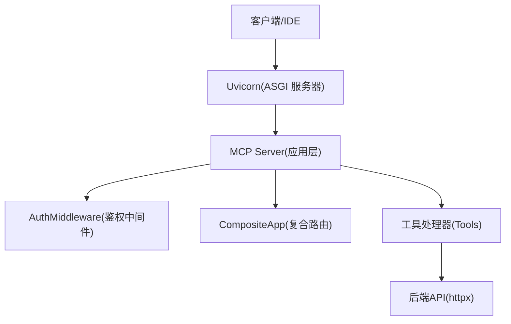
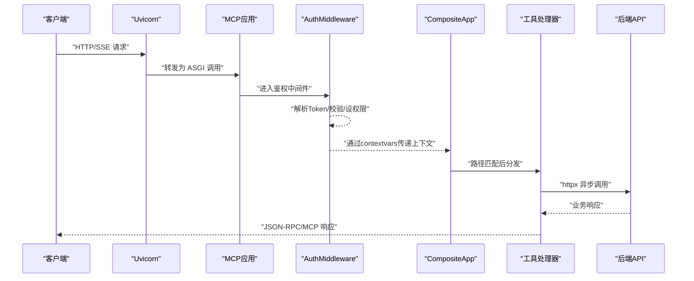
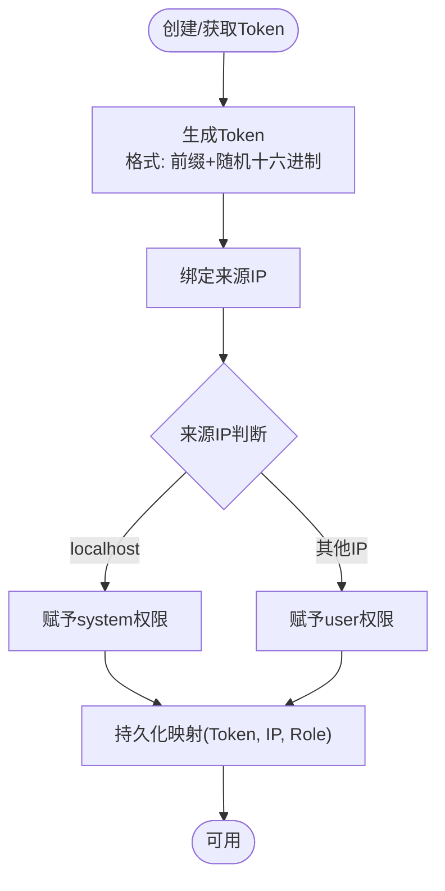
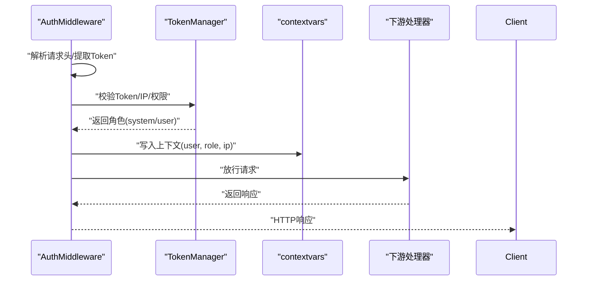
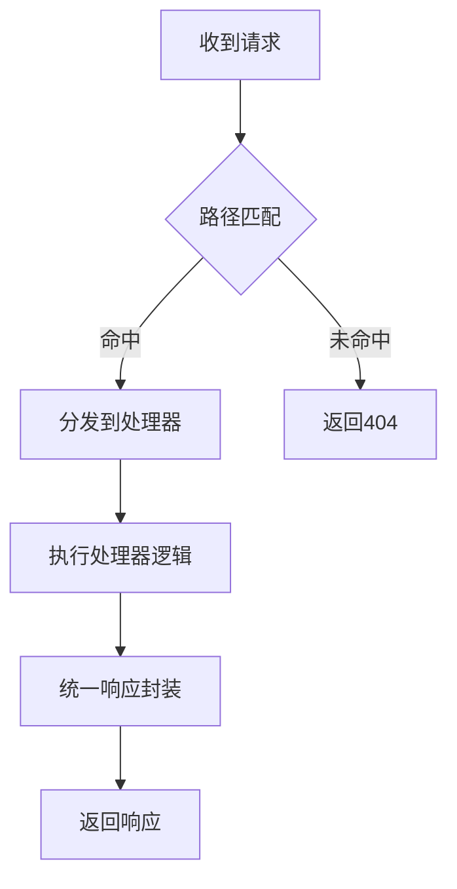
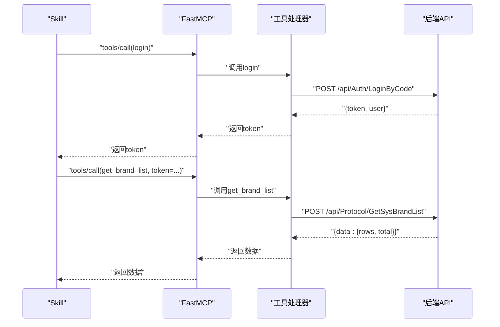
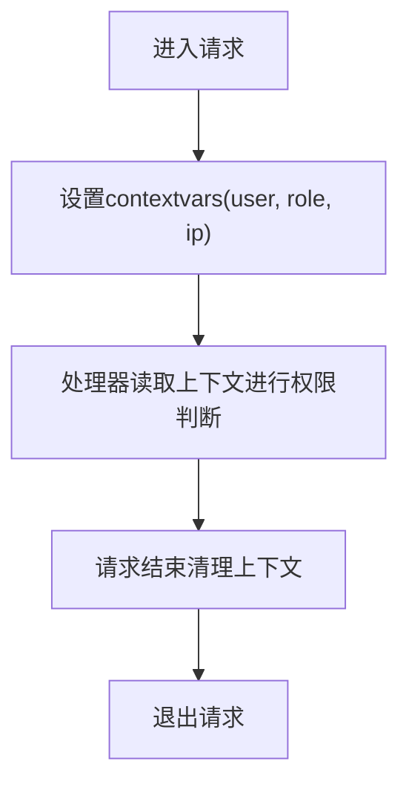

# 核心组件说明

<cite>
**本文引用的文件**
- [规约管理MCP服务化Spec.md](file://规约管理MCP服务化Spec.md)
- [mcp server部署.md](file://mcp server部署.md)
- [requirements.txt](file://mcp_server/requirements.txt)
- [protocol_converter.py](file://.trae/skills/protocol-conversion/scripts/protocol_converter.py)
- [SKILL.md（pca入口）](file://.trae/skills/pca/SKILL.md)
</cite>

## 目录
1. [简介](#简介)
2. [项目结构](#项目结构)
3. [核心组件](#核心组件)
4. [架构总览](#架构总览)
5. [详细组件分析](#详细组件分析)
6. [依赖关系分析](#依赖关系分析)
7. [性能考虑](#性能考虑)
8. [故障排查指南](#故障排查指南)
9. [结论](#结论)
10. [附录](#附录)

## 简介
本文件面向“协议转换 MCP 服务器”的核心组件，聚焦以下目标：
- TokenManager 类：Token 生成算法、IP 关联机制、权限分级策略（system/user）。
- AuthMiddleware ASGI 中间件：请求拦截、Token 验证、权限设置、上下文传递。
- CompositeApp 复合路由：路径匹配、请求分发、响应处理。
- FastMCP 实例配置与使用方式。
- contextvars 在异步环境中的权限信息传递机制。
- 提供调用流程图与代码片段路径指引。

说明：当前仓库未直接包含 server.py、api_client.py、FastMCP 实现等源码文件；本节基于规范文档与部署文档进行系统化梳理，并以“可追溯引用”的方式标注来源。

## 项目结构
- mcp_server：服务端运行目录，包含依赖声明与静态资源。
- .trae/skills：Skill 编排与工具定义，含协议转换共享引擎与入口技能。
- openspec：规格与变更归档。
- 根目录文档：MCP 服务化需求规格与部署说明。

图表来源
- [mcp server部署.md:110-126](file://mcp server部署.md#L110-L126)
- [mcp server部署.md:163-261](file://mcp server部署.md#L163-L261)

章节来源
- [mcp server部署.md:110-126](file://mcp server部署.md#L110-L126)
- [mcp server部署.md:163-261](file://mcp server部署.md#L163-L261)
- [requirements.txt:1-3](file://mcp_server/requirements.txt#L1-L3)

## 核心组件
- TokenManager：负责 Token 的生成、校验、过期管理与 IP 绑定，支撑 system/user 两级权限。
- AuthMiddleware：ASGI 中间件，统一拦截请求、解析 Token、校验权限、注入上下文。
- CompositeApp：复合路由容器，按路径匹配将请求分发到具体处理器，并统一封装响应。
- FastMCP：MCP 应用实例，注册工具、暴露 /mcp 端点、与 Uvicorn 协作。
- contextvars：在异步并发环境下安全传递用户身份、权限、租户等上下文。

章节来源
- [规约管理MCP服务化Spec.md:30-66](file://规约管理MCP服务化Spec.md#L30-L66)
- [mcp server部署.md:645-663](file://mcp server部署.md#L645-L663)

## 架构总览
整体采用“ASGI 中间件 + 复合路由 + 工具处理器”的分层设计：
- 网络层：Uvicorn 接收 HTTP/SSE，转交给 MCP 应用。
- 鉴权层：AuthMiddleware 完成 Token 校验与权限判定，写入 contextvars。
- 路由层：CompositeApp 根据路径选择处理器。
- 业务层：MCP Tools 调用后端 API（httpx 异步），返回结构化结果。

图表来源
- [mcp server部署.md:163-261](file://mcp server部署.md#L163-L261)
- [规约管理MCP服务化Spec.md:56-66](file://规约管理MCP服务化Spec.md#L56-L66)

## 详细组件分析

### TokenManager：Token 生成、IP 关联与权限分级
- Token 生成算法
  - 本地开发：使用密码学安全的随机字符串前缀 + 十六进制串，便于调试与隔离。
  - 生产建议：结合签名或加密存储，避免明文泄露。
- IP 关联机制
  - 记录 Token 与来源 IP 的映射，支持访问控制与审计。
  - 对非 localhost 访问限制为只读，降低风险。
- 权限分级策略
  - system：系统级权限，允许读写操作，通常仅限本地或受信任来源。
  - user：用户级权限，默认只读，需显式授权才可写。
- 生命周期与失效
  - 登录接口返回 Token，后续工具调用需携带 Token。
  - 失败场景：网络异常、业务错误码、Token 无效/过期、HTTP 状态异常。

图表来源
- [mcp server部署.md:347-363](file://mcp server部署.md#L347-L363)
- [mcp server部署.md:645-663](file://mcp server部署.md#L645-L663)

章节来源
- [mcp server部署.md:347-363](file://mcp server部署.md#L347-L363)
- [mcp server部署.md:645-663](file://mcp server部署.md#L645-L663)
- [规约管理MCP服务化Spec.md:123-131](file://规约管理MCP服务化Spec.md#L123-L131)

### AuthMiddleware：ASGI 中间件工作流程
- 请求拦截
  - 从请求头提取 Token（如 Authorization/Bearer 或自定义 Header）。
  - 若缺失或非法，直接返回 401/403。
- Token 验证
  - 查询 TokenManager 校验有效性、是否过期、是否与当前 IP 匹配。
  - 校验通过后读取角色（system/user）。
- 权限设置
  - 将权限写入 contextvars，供后续处理器读取。
  - 对写操作进行二次检查（仅 system 或显式授权）。
- 上下文传递
  - 使用 contextvars 保存用户标识、角色、租户等信息，确保异步并发安全。

图表来源
- [mcp server部署.md:163-261](file://mcp server部署.md#L163-L261)
- [mcp server部署.md:645-663](file://mcp server部署.md#L645-L663)

章节来源
- [mcp server部署.md:163-261](file://mcp server部署.md#L163-L261)
- [mcp server部署.md:645-663](file://mcp server部署.md#L645-L663)

### CompositeApp：复合路由实现原理
- 路径匹配
  - 维护路由表，按前缀或精确匹配选择处理器。
  - 支持动态参数与通配符，便于扩展新端点。
- 请求分发
  - 解析 scope 中的 path/method，定位处理器函数。
  - 将上下文（来自 contextvars）注入处理器。
- 响应处理
  - 统一包装 JSON 响应，处理错误码与消息。
  - 对 SSE/长连接做特殊处理（如 /sse）。

图表来源
- [mcp server部署.md:163-261](file://mcp server部署.md#L163-L261)

章节来源
- [mcp server部署.md:163-261](file://mcp server部署.md#L163-L261)

### FastMCP：实例配置与使用方式
- 实例创建
  - 初始化 MCP 应用，注册工具列表与资源。
  - 暴露标准端点：/mcp（JSON-RPC over HTTP/SSE）、/sse（SSE 长连接）。
- 工具注册
  - 每个后端 API 对应一个细粒度工具，便于 Skill 编排。
  - 工具函数负责参数校验与调用 api_client。
- 与 Uvicorn 集成
  - 通过 ASGI 协议启动，端口与主机由启动脚本配置。
- 典型调用流程（Skill 视角）
  - login → 获取 Token
  - 后续工具调用携带 Token
  - 返回结构化数据，错误统一处理

图表来源
- [规约管理MCP服务化Spec.md:56-66](file://规约管理MCP服务化Spec.md#L56-L66)
- [规约管理MCP服务化Spec.md:132-319](file://规约管理MCP服务化Spec.md#L132-L319)

章节来源
- [mcp server部署.md:110-126](file://mcp server部署.md#L110-L126)
- [mcp server部署.md:163-261](file://mcp server部署.md#L163-L261)
- [规约管理MCP服务化Spec.md:132-319](file://规约管理MCP服务化Spec.md#L132-L319)

### contextvars：异步环境中的权限信息传递
- 作用
  - 在异步并发下安全地传递用户身份、角色、租户等上下文。
  - 避免全局变量污染，保证请求隔离。
- 使用位置
  - AuthMiddleware 写入上下文。
  - 工具处理器读取上下文进行权限校验与日志审计。
- 最佳实践
  - 每次请求开始时设置，结束时清理。
  - 避免跨请求泄漏敏感信息。

图表来源
- [mcp server部署.md:163-261](file://mcp server部署.md#L163-L261)

章节来源
- [mcp server部署.md:163-261](file://mcp server部署.md#L163-L261)

## 依赖关系分析
- 运行时依赖
  - mcp：MCP 协议 SDK，用于工具注册与消息处理。
  - uvicorn：ASGI 服务器，承载 MCP 应用。
- 外部依赖
  - httpx：异步 HTTP 客户端，用于调用后端 API。
- Skill 与 MCP 的关系
  - Skill 通过 MCP 工具编排业务流程，工具内部调用后端 API。

图表来源
- [requirements.txt:1-3](file://mcp_server/requirements.txt#L1-L3)
- [规约管理MCP服务化Spec.md:56-66](file://规约管理MCP服务化Spec.md#L56-L66)

章节来源
- [requirements.txt:1-3](file://mcp_server/requirements.txt#L1-L3)
- [规约管理MCP服务化Spec.md:56-66](file://规约管理MCP服务化Spec.md#L56-L66)

## 性能考虑
- 高并发
  - Uvicorn 基于事件循环，适合 I/O 密集型任务。
  - 工具处理器应使用异步调用，避免阻塞事件循环。
- 连接复用
  - httpx.AsyncClient 复用连接，减少握手开销。
- 超时与重试
  - 合理设置超时时间，对网络异常进行重试与降级。
- 缓存
  - 对只读数据可引入缓存层，降低后端压力。

[本节为通用指导，不直接分析具体文件]

## 故障排查指南
- 常见问题
  - Python 未安装或版本过低：检查 Python 版本并重新安装。
  - 虚拟环境创建失败：权限不足或磁盘空间不足。
  - 依赖安装失败：网络问题或 pip 版本过低。
  - 启动时找不到虚拟环境：先运行安装脚本。
  - Token 未配置：运行安装脚本或手动创建 .env。
  - 端口被占用：查找并结束占用进程或修改端口。
- 鉴权问题
  - 401/403：检查 Token 是否有效、是否过期、是否匹配 IP。
  - 权限不足：确认角色是否为 system 或已授权写操作。
- 网络问题
  - 后端 API 不可达：检查网络与防火墙策略。
  - 超时：调整超时配置或优化后端响应。

章节来源
- [mcp server部署.md:505-642](file://mcp server部署.md#L505-L642)
- [mcp server部署.md:645-663](file://mcp server部署.md#L645-L663)

## 结论
本方案以 ASGI 中间件与复合路由为核心，结合 TokenManager 的权限模型与 contextvars 的上下文传递，构建了可扩展、高并发、易维护的协议转换 MCP 服务器。通过细粒度工具与 Skill 编排，实现了从登录鉴权到后端 API 调用的完整闭环。建议在生产环境中强化认证机制、启用 HTTPS、增加日志审计与访问控制。

[本节为总结性内容，不直接分析具体文件]

## 附录
- 快速命令参考
  - 首次安装：mcp_server\install.bat
  - 启动服务：mcp_server\start.bat
  - 停止服务：Ctrl+C
  - 手动激活虚拟环境：.venv\Scripts\activate.bat
  - 退出虚拟环境：deactivate
  - 手动启动服务：python mcp_server\server.py

章节来源
- [mcp server部署.md:677-686](file://mcp server部署.md#L677-L686)