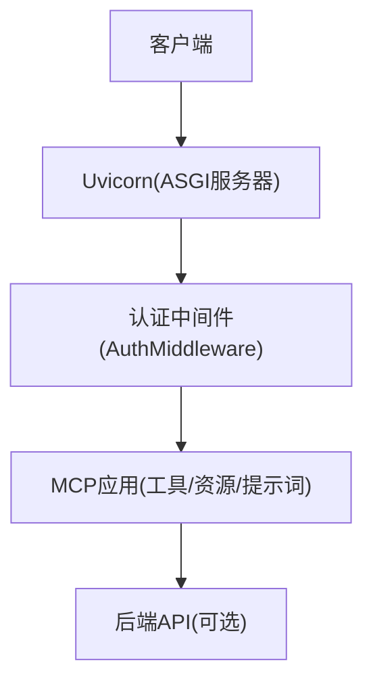
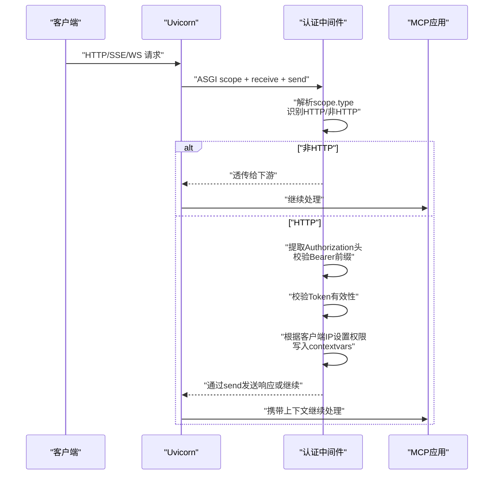
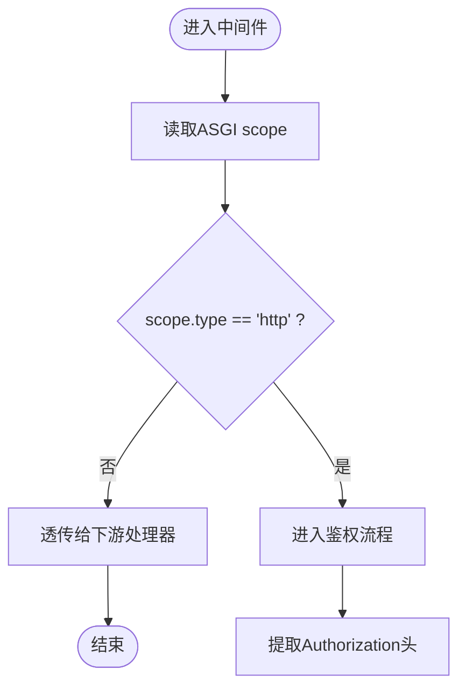
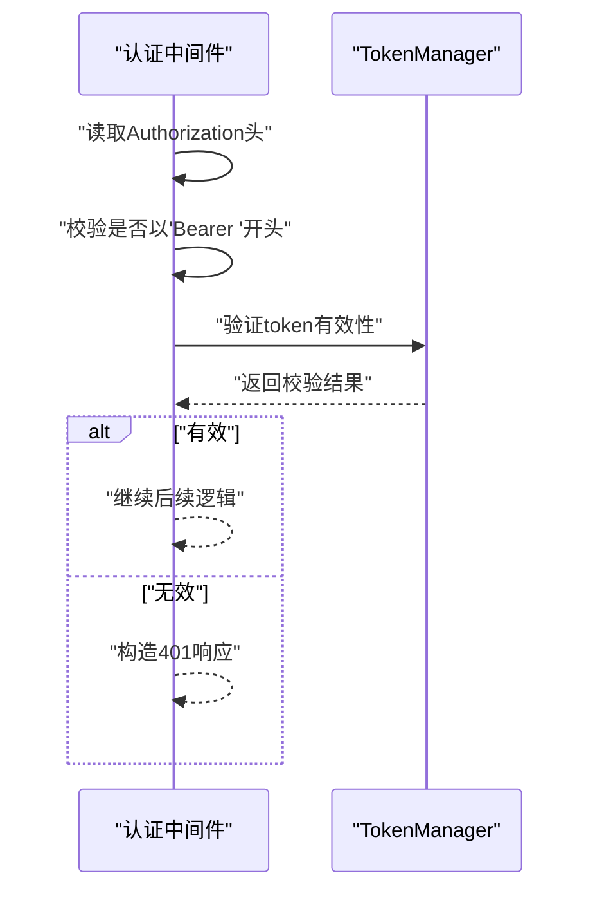
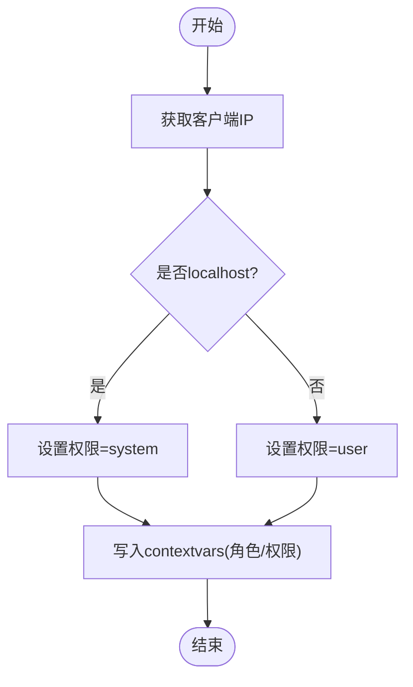
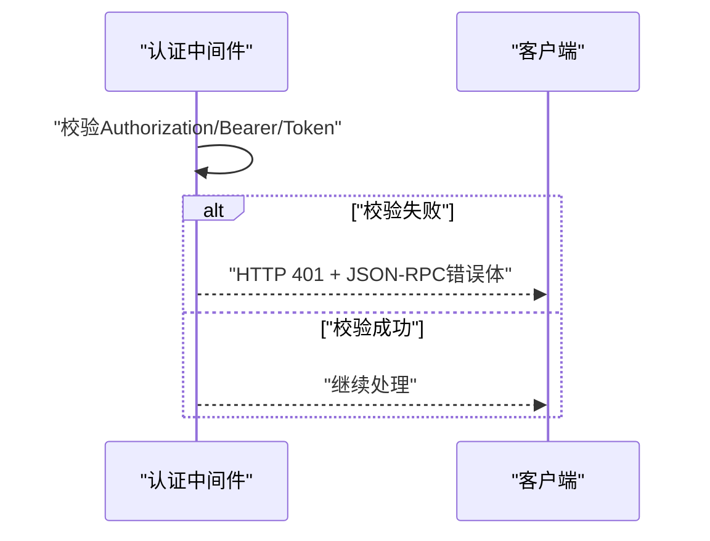
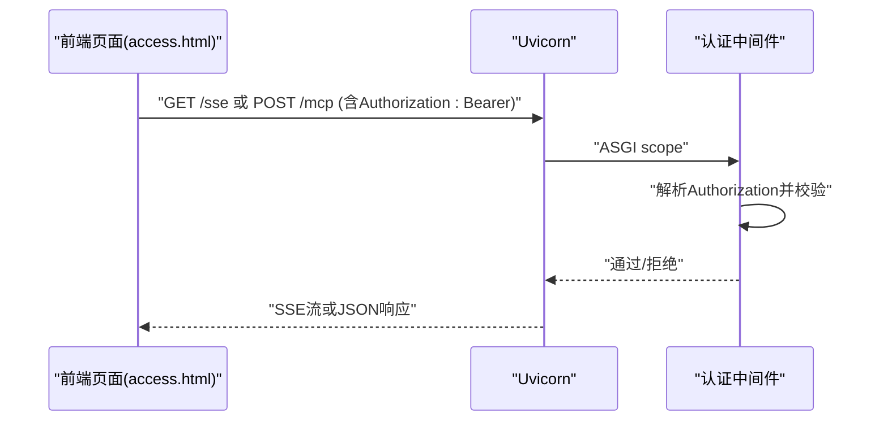
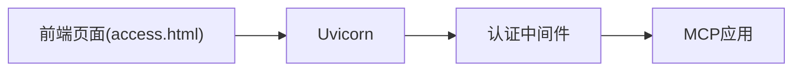

# 认证中间件

<cite>
**本文引用的文件**
- [mcp server部署.md](file://mcp server部署.md)
- [规约管理MCP服务化Spec.md](file://规约管理MCP服务化Spec.md)
- [access.html](file://mcp_server/static/access.html)
</cite>

## 目录
1. [简介](#简介)
2. [项目结构](#项目结构)
3. [核心组件](#核心组件)
4. [架构总览](#架构总览)
5. [详细组件分析](#详细组件分析)
6. [依赖关系分析](#依赖关系分析)
7. [性能考量](#性能考量)
8. [故障排查指南](#故障排查指南)
9. [结论](#结论)
10. [附录](#附录)

## 简介
本文件聚焦于 ASGI 中间件“认证中间件”的设计与实现说明，围绕以下目标展开：
- 请求拦截机制：ASGI scope 解析、HTTP 请求识别、非 HTTP 请求透传。
- Token 验证流程：Authorization header 提取、Bearer 前缀检查、Token 有效性验证。
- 权限设置机制：基于客户端 IP 的权限分级（localhost -> system，remote -> user），并通过 contextvars 注入上下文。
- 错误处理策略：401 未授权响应格式、JSON-RPC 错误结构。
- 提供完整的调用流程图与错误处理示例，展示从请求进入、鉴权到业务处理的链路。

## 项目结构
本项目采用 MCP + Uvicorn 的 ASGI 架构。Uvicorn 负责网络层（监听端口、解析 HTTP/WS/SSE、序列化/反序列化），MCP 应用负责路由、工具调用与协议解析（JSON-RPC）。认证中间件作为 ASGI 中间件，位于 Uvicorn 与 MCP 应用之间，统一进行鉴权与权限注入。

图表来源
- [mcp server部署.md:110-160](file://mcp server部署.md#L110-L160)
- [mcp server部署.md:215-261](file://mcp server部署.md#L215-L261)

章节来源
- [mcp server部署.md:110-160](file://mcp server部署.md#L110-L160)
- [mcp server部署.md:215-261](file://mcp server部署.md#L215-L261)

## 核心组件
- 认证中间件（AuthMiddleware）：实现 ASGI 中间件接口，完成请求拦截、鉴权、权限注入与错误响应。
- Token 管理器（TokenManager）：负责 Token 的加载、校验与缓存（如存在）。
- 上下文变量（contextvars）：在请求生命周期内传递当前用户角色与权限信息。
- 组合应用（CompositeApp）：将中间件链与 MCP 应用组合，形成完整 ASGI 应用。

章节来源
- [规约管理MCP服务化Spec.md:247-285](file://规约管理MCP服务化Spec.md#L247-L285)

## 架构总览
下图展示了认证中间件在 ASGI 请求链路中的位置与作用：Uvicorn 接收请求并封装为 ASGI scope，交由认证中间件判断是否为 HTTP 请求；若是，则执行 Authorization 头解析与 Bearer 校验，随后根据客户端 IP 设置权限级别，最终将带上下文的请求转发给 MCP 应用。

图表来源
- [mcp server部署.md:129-160](file://mcp server部署.md#L129-L160)
- [mcp server部署.md:215-261](file://mcp server部署.md#L215-L261)

## 详细组件分析

### 请求拦截机制（ASGI scope 解析、HTTP 识别、非 HTTP 透传）
- ASGI scope 解析：中间件读取 scope.type 字段以区分 HTTP、WebSocket、SSE 等类型。
- HTTP 请求识别：当 scope.type == "http" 时进入鉴权流程；否则直接透传给下游处理器。
- 非 HTTP 透传：对于 WebSocket 或 SSE 等长连接场景，跳过鉴权或按其他策略处理，确保实时通信不受阻断。

图表来源
- [mcp server部署.md:129-160](file://mcp server部署.md#L129-L160)

章节来源
- [mcp server部署.md:129-160](file://mcp server部署.md#L129-L160)

### Token 验证流程（Authorization 提取、Bearer 前缀、有效性校验）
- Authorization 头提取：从请求头中获取 Authorization 字段。
- Bearer 前缀检查：要求值形如 "Bearer <token>"，否则视为无效。
- Token 有效性验证：结合 TokenManager 对 token 进行校验（如格式、有效期、白名单等），失败则返回 401。

图表来源
- [mcp server部署.md:129-160](file://mcp server部署.md#L129-L160)
- [mcp server部署.md:215-261](file://mcp server部署.md#L215-L261)

章节来源
- [mcp server部署.md:129-160](file://mcp server部署.md#L129-L160)
- [mcp server部署.md:215-261](file://mcp server部署.md#L215-L261)

### 权限设置机制（基于客户端 IP 的权限分级、contextvars 注入）
- 权限分级规则：
  - localhost（本地访问）：系统级权限（system），允许读写操作。
  - remote（远程访问）：用户级权限（user），仅允许只读操作。
- 上下文变量（contextvars）：在请求生命周期内设置当前用户角色与权限，供后续工具函数使用。

图表来源
- [mcp server部署.md:655-663](file://mcp server部署.md#L655-L663)

章节来源
- [mcp server部署.md:655-663](file://mcp server部署.md#L655-L663)

### 错误处理策略（401 未授权、JSON-RPC 错误结构）
- 401 未授权响应：当 Authorization 缺失、Bearer 前缀错误或 Token 无效时，返回 HTTP 401，并在响应体中包含 JSON-RPC 风格的错误结构。
- JSON-RPC 错误结构：包含 code、message、data（可选）等字段，便于客户端统一处理错误。

图表来源
- [mcp server部署.md:215-261](file://mcp server部署.md#L215-L261)

章节来源
- [mcp server部署.md:215-261](file://mcp server部署.md#L215-L261)

### 前端接入与 Token 传递（access.html）
- 前端页面在发起 MCP 请求时，自动在请求头中注入 Authorization: Bearer <token>，确保中间件可正确解析。
- 支持多种传输模式（HTTP、SSE、Streamable HTTP），均携带相同鉴权头。

图表来源
- [access.html:341-395](file://mcp_server/static/access.html#L341-L395)

章节来源
- [access.html:341-395](file://mcp_server/static/access.html#L341-L395)

## 依赖关系分析
- Uvicorn：提供 ASGI 服务器能力，负责网络 I/O 与协议解析。
- MCP 应用：注册工具、资源与提示词，处理 JSON-RPC 消息。
- 认证中间件：依赖 TokenManager 与 contextvars，实现鉴权与权限注入。
- 前端页面：通过 access.html 生成并携带 Authorization 头。

图表来源
- [mcp server部署.md:110-160](file://mcp server部署.md#L110-L160)
- [access.html:341-395](file://mcp_server/static/access.html#L341-L395)

章节来源
- [mcp server部署.md:110-160](file://mcp server部署.md#L110-L160)
- [access.html:341-395](file://mcp_server/static/access.html#L341-L395)

## 性能考量
- 异步处理：Uvicorn 基于 uvloop 与 httptools，具备高并发处理能力，适合 I/O 密集型任务。
- 中间件开销：认证中间件应尽量轻量，避免阻塞事件循环；Token 校验建议引入缓存以减少重复计算。
- 长连接优化：对于 SSE/WS 等非 HTTP 请求，尽量快速透传，减少鉴权路径上的延迟。

章节来源
- [mcp server部署.md:86-100](file://mcp server部署.md#L86-L100)
- [mcp server部署.md:265-279](file://mcp server部署.md#L265-L279)

## 故障排查指南
- 401 未授权：检查 Authorization 头是否存在且格式正确（Bearer <token>），确认 Token 是否有效。
- JSON-RPC 错误：查看响应体中的 code 与 message，定位具体错误原因（如网络异常、业务错误码、HTTP 状态码异常）。
- 权限不足：确认客户端 IP 是否被识别为 localhost；远程访问默认仅具只读权限。
- 前端接入问题：确认 access.html 是否正确注入 Authorization 头，以及 URL 与传输模式配置是否正确。

章节来源
- [mcp server部署.md:645-674](file://mcp server部署.md#L645-L674)
- [access.html:341-395](file://mcp_server/static/access.html#L341-L395)

## 结论
认证中间件在 ASGI 链路中承担关键职责：统一拦截请求、解析 scope、执行鉴权与权限注入，并为 MCP 应用提供一致的上下文。通过严格的 Authorization 校验与基于 IP 的权限模型，既保障了安全性，又兼顾了开发便利性与生产可扩展性。配合前端 access.html 的自动鉴权头注入，形成了端到端的完整认证闭环。

## 附录
- 典型调用流程（Skill 视角）：登录获取 Token -> 工具调用携带 Token -> 后端 API 返回数据。
- 安全建议：生产环境建议使用更强认证机制（OAuth2/JWT）、启用 HTTPS、添加日志审计与访问限制。

章节来源
- [规约管理MCP服务化Spec.md:295-319](file://规约管理MCP服务化Spec.md#L295-L319)
- [mcp server部署.md:665-674](file://mcp server部署.md#L665-L674)