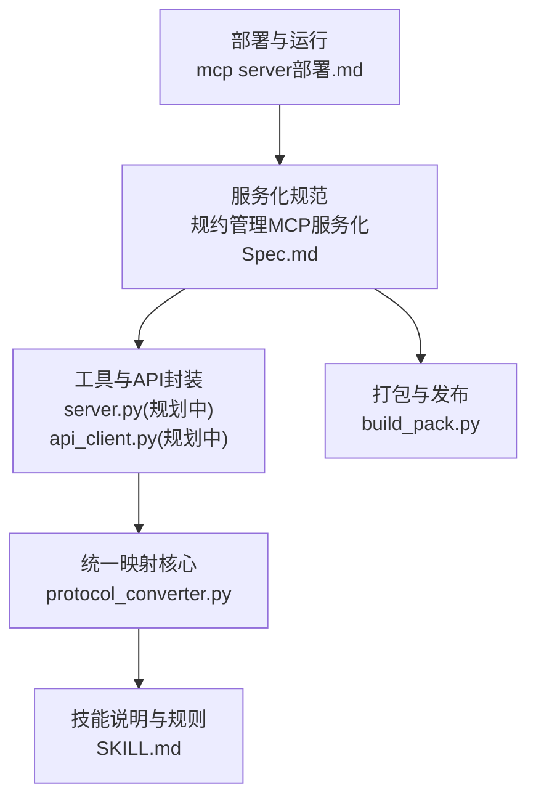
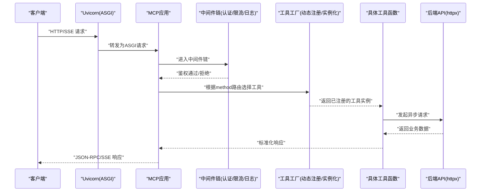
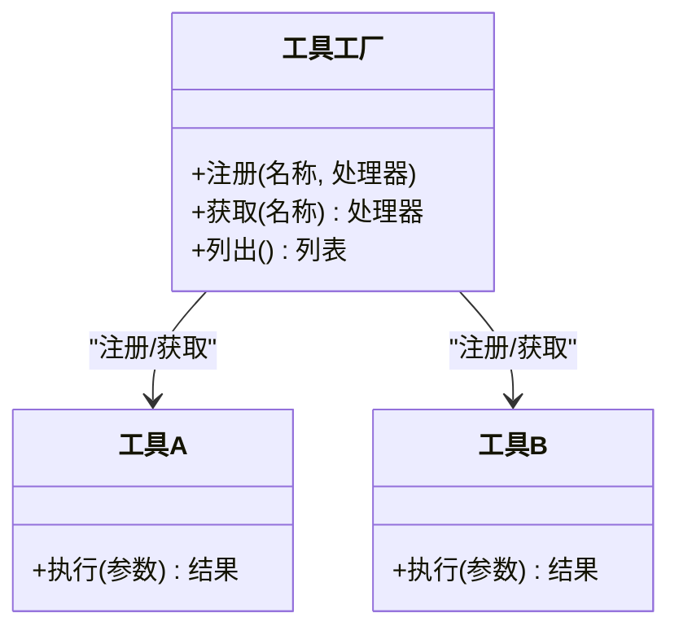
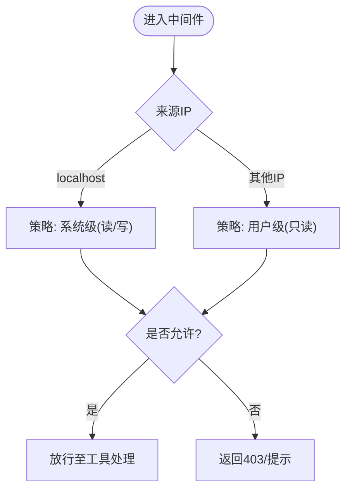
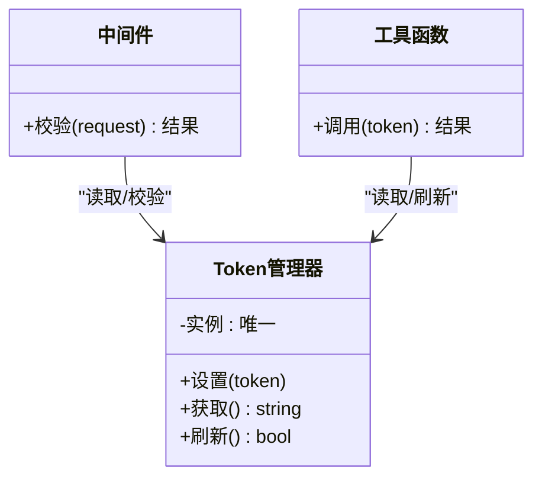
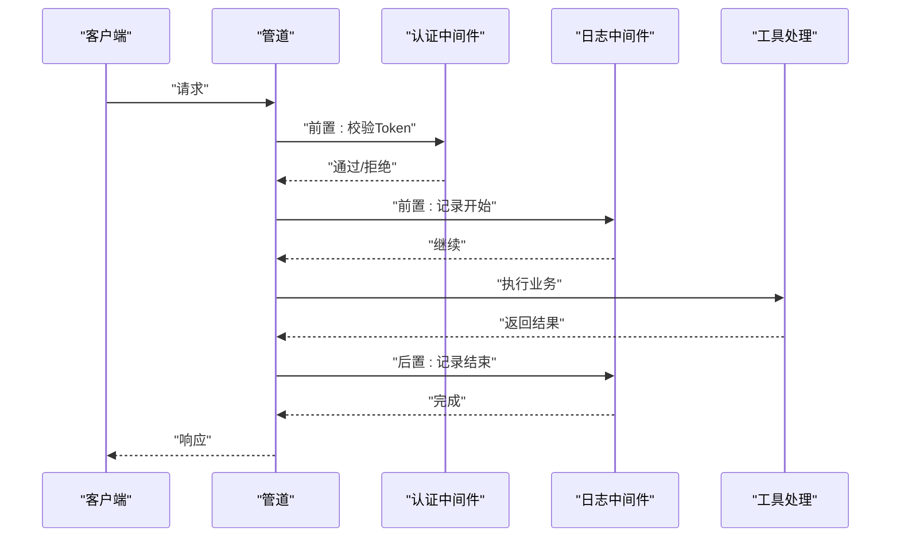
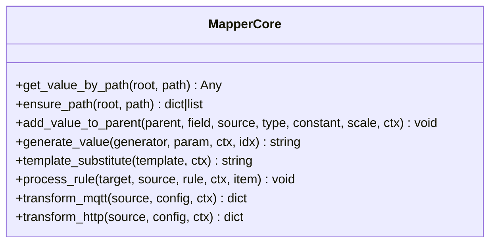
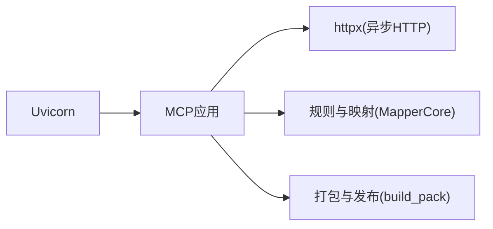

# 设计模式应用

<cite>
**本文引用的文件**
- [mcp server部署.md](file://mcp server部署.md)
- [规约管理MCP服务化Spec.md](file://规约管理MCP服务化Spec.md)
- [protocol_converter.py](file://.trae/skills/protocol-conversion/scripts/protocol_converter.py)
- [build_pack.py](file://.trae/skills/protocol-conversion/scripts/build_pack.py)
- [SKILL.md](file://.trae/skills/protocol-conversion/SKILL.md)
</cite>

## 目录
1. [引言](#引言)
2. [项目结构](#项目结构)
3. [核心组件](#核心组件)
4. [架构总览](#架构总览)
5. [详细组件分析](#详细组件分析)
6. [依赖关系分析](#依赖关系分析)
7. [性能考量](#性能考量)
8. [故障排查指南](#故障排查指南)
9. [结论](#结论)
10. [附录](#附录)

## 引言
本文件面向“协议转换 MCP 服务器”的设计模式应用文档，聚焦以下四种模式在系统中的落地与收益：
- 工厂模式：用于工具函数的动态注册与实例化（按协议或能力维度创建处理器）。
- 策略模式：用于不同权限级别的访问控制（本地系统级、远程用户级等）。
- 单例模式：用于 Token 管理器的全局共享（避免重复鉴权与状态不一致）。
- 中间件模式：用于请求处理链的构建（认证、限流、日志等横切逻辑）。

本文结合仓库中的部署说明与服务化规范，给出每种模式的实现思路、适用场景、扩展方式与可视化图示，帮助读者在不阅读全部源码的前提下理解并扩展系统。

## 项目结构
从仓库可见，本项目包含：
- 部署与运行脚本及说明：提供 MCP 服务启动、Token 配置、端口与依赖说明。
- 规约管理 MCP 服务化规范：定义工具粒度、鉴权传递、HTTP 客户端选型、API 封装与工具清单。
- 统一协议映射引擎（Python 镜像）：提供可复用的映射核心，支撑多协议转换。
- 打包与发布脚本：生成包清单、测试报告与 README，便于分发与版本管理。

图表来源
- [mcp server部署.md:110-180](file://mcp server部署.md#L110-L180)
- [规约管理MCP服务化Spec.md:44-66](file://规约管理MCP服务化Spec.md#L44-L66)
- [protocol_converter.py:32-602](file://.trae/skills/protocol-conversion/scripts/protocol_converter.py#L32-L602)
- [build_pack.py:18-55](file://.trae/skills/protocol-conversion/scripts/build_pack.py#L18-L55)
- [SKILL.md:23-35](file://.trae/skills/protocol-conversion/SKILL.md#L23-L35)

章节来源
- [mcp server部署.md:110-180](file://mcp server部署.md#L110-L180)
- [规约管理MCP服务化Spec.md:44-66](file://规约管理MCP服务化Spec.md#L44-L66)

## 核心组件
- 工具注册与调用层：通过 MCP 工具暴露细粒度 API 能力，遵循“每个后端 API 一个工具”的原则，便于 Skill 编排与错误隔离。
- 鉴权与中间件：基于 Token 的认证机制，支持本地系统级与远程用户级的差异化权限；通过中间件链对请求进行统一处理。
- 外部 API 客户端：使用异步 HTTP 客户端封装后端接口，统一错误处理与响应解析。
- 统一映射核心：跨 MQTT/HTTP 协议的 JSON 映射引擎，复用路径解析、类型转换、数组遍历与模板替换等通用能力。

章节来源
- [规约管理MCP服务化Spec.md:30-42](file://规约管理MCP服务化Spec.md#L30-L42)
- [mcp server部署.md:645-663](file://mcp server部署.md#L645-L663)
- [protocol_converter.py:32-602](file://.trae/skills/protocol-conversion/scripts/protocol_converter.py#L32-L602)

## 架构总览
下图展示从客户端到 MCP 服务再到后端 API 的请求链路，以及中间件、策略与工厂模式在其中的作用点。

图表来源
- [mcp server部署.md:110-180](file://mcp server部署.md#L110-L180)
- [规约管理MCP服务化Spec.md:56-66](file://规约管理MCP服务化Spec.md#L56-L66)

## 详细组件分析

### 工厂模式：工具函数的动态注册与实例化
- 目标：将“工具发现—参数校验—调用—响应”解耦，新增工具时只需注册，无需改动路由与调度核心。
- 实现要点：
  - 维护一个“工具注册表”，以工具名为键，值为可调用的异步函数或类方法。
  - 提供统一的“工具工厂”，根据请求中的 method 或 tool name 查找并返回对应处理器。
  - 支持按协议/能力维度分组注册，便于扩展与维护。
- 应用场景：
  - MCP 工具列表动态更新（如 list_mcp_tools）。
  - 新增后端 API 对应的工具时，仅需注册，不修改调度器。
- 扩展建议：
  - 增加“元数据”字段（描述、权限级别、是否写入），供前端展示与权限校验。
  - 增加“批量注册”能力，从配置文件或数据库加载工具定义。

图表来源
- [规约管理MCP服务化Spec.md:132-246](file://规约管理MCP服务化Spec.md#L132-L246)

章节来源
- [规约管理MCP服务化Spec.md:132-246](file://规约管理MCP服务化Spec.md#L132-L246)

### 策略模式：不同权限级别的访问控制
- 目标：将“权限判定策略”与“业务处理”解耦，支持本地系统级与远程用户级等不同策略。
- 实现要点：
  - 定义“权限策略接口”，包含“是否允许访问”“允许的读写范围”等方法。
  - 针对 localhost 与远程 IP 分别实现策略类。
  - 在中间件中注入策略选择器，依据请求来源动态选择策略。
- 应用场景：
  - 本地开发环境授予读/写权限，远程访问仅只读。
  - 未来可扩展更多策略（如按租户、角色、IP 白名单）。
- 扩展建议：
  - 策略可组合（如“白名单+角色”复合策略）。
  - 策略结果缓存，减少重复计算。

图表来源
- [mcp server部署.md:655-663](file://mcp server部署.md#L655-L663)

章节来源
- [mcp server部署.md:655-663](file://mcp server部署.md#L655-L663)

### 单例模式：Token 管理器的全局共享
- 目标：确保全进程内只有一个 Token 管理器实例，避免重复初始化与状态不一致。
- 实现要点：
  - 使用模块级单例或语言级单例机制，保证全局唯一。
  - 提供统一的“设置/获取/刷新”接口，供各工具与中间件调用。
  - 与 .env 或配置中心集成，支持热更新。
- 应用场景：
  - 登录成功后集中管理 Token，后续工具调用自动携带。
  - 中间件统一校验 Token 有效性，过期则引导重新登录。
- 扩展建议：
  - 支持多 Token（多租户/多账号）与上下文切换。
  - 增加 Token 生命周期管理与自动续期。

图表来源
- [mcp server部署.md:645-663](file://mcp server部署.md#L645-L663)
- [规约管理MCP服务化Spec.md:30-42](file://规约管理MCP服务化Spec.md#L30-L42)

章节来源
- [mcp server部署.md:645-663](file://mcp server部署.md#L645-L663)
- [规约管理MCP服务化Spec.md:30-42](file://规约管理MCP服务化Spec.md#L30-L42)

### 中间件模式：请求处理链的构建
- 目标：将认证、限流、日志、审计等横切逻辑模块化，按顺序串联形成处理链。
- 实现要点：
  - 定义“中间件接口”（前置处理、后置处理）。
  - 提供“管道组装器”，按配置顺序挂载中间件。
  - 每个中间件独立关注单一职责，易于测试与替换。
- 应用场景：
  - 认证中间件：校验 Token、权限策略。
  - 日志中间件：记录请求/响应、耗时、异常。
  - 限流中间件：限制每秒请求数，保护后端。
- 扩展建议：
  - 支持条件中间件（按路径/方法启用）。
  - 支持中间件间上下文传递（如 traceId、用户信息）。

图表来源
- [mcp server部署.md:110-180](file://mcp server部署.md#L110-L180)
- [规约管理MCP服务化Spec.md:56-66](file://规约管理MCP服务化Spec.md#L56-L66)

章节来源
- [mcp server部署.md:110-180](file://mcp server部署.md#L110-L180)
- [规约管理MCP服务化Spec.md:56-66](file://规约管理MCP服务化Spec.md#L56-L66)

### 统一映射核心（策略/工厂的支撑）
- 目标：为 MQTT/HTTP 两种协议提供一致的 JSON 映射能力，降低重复实现与维护成本。
- 关键能力：
  - 路径解析、对象/数组构造、类型转换、模板替换、数组遍历、生成器。
  - 统一的入口 transform_mqtt / transform_http，内部复用 process_rule 等核心方法。
- 价值：
  - 新增协议只需适配外层配置加载，复用映射核心。
  - 测试覆盖完善，保障稳定性。

图表来源
- [protocol_converter.py:32-602](file://.trae/skills/protocol-conversion/scripts/protocol_converter.py#L32-L602)

章节来源
- [protocol_converter.py:32-602](file://.trae/skills/protocol-conversion/scripts/protocol_converter.py#L32-L602)

## 依赖关系分析
- 运行时依赖：
  - MCP SDK：提供工具注册、SSE 长连接与 JSON-RPC 消息处理。
  - Uvicorn：ASGI 服务器，承载高并发请求。
- 业务依赖：
  - httpx：异步 HTTP 客户端，用于调用后端 API。
- 工程依赖：
  - 打包脚本：生成 manifest、README、ZIP 包，便于分发与版本管理。

图表来源
- [mcp server部署.md:64-108](file://mcp server部署.md#L64-L108)
- [规约管理MCP服务化Spec.md:79-121](file://规约管理MCP服务化Spec.md#L79-L121)
- [build_pack.py:18-55](file://.trae/skills/protocol-conversion/scripts/build_pack.py#L18-L55)

章节来源
- [mcp server部署.md:64-108](file://mcp server部署.md#L64-L108)
- [规约管理MCP服务化Spec.md:79-121](file://规约管理MCP服务化Spec.md#L79-L121)
- [build_pack.py:18-55](file://.trae/skills/protocol-conversion/scripts/build_pack.py#L18-L55)

## 性能考量
- 异步优先：MCP 服务运行于 asyncio 环境，所有 I/O（HTTP、数据库、文件）应使用异步接口，避免阻塞事件循环。
- 连接复用：HTTP 客户端应复用连接池，减少握手开销。
- 中间件轻量：认证、日志等中间件应避免重计算，必要时引入缓存。
- 映射核心优化：路径解析与类型转换尽量使用 O(1)/O(n) 操作，避免深层递归与频繁字符串拼接。

[本节为通用指导，不直接分析具体文件]

## 故障排查指南
- 常见问题定位：
  - 端口占用：检查 8765 端口占用情况，释放或更换端口。
  - Token 未配置：确认 .env 中 MCP_AUTH_TOKEN 已正确设置。
  - 虚拟环境问题：确保已运行安装脚本并激活虚拟环境。
- 建议措施：
  - 增加中间件日志：记录请求头、Token、来源 IP、耗时与异常堆栈。
  - 增加健康检查端点：便于容器编排与健康探测。
  - 错误码规范化：统一错误响应格式，便于前端与自动化处理。

章节来源
- [mcp server部署.md:505-631](file://mcp server部署.md#L505-L631)

## 结论
通过将工厂模式、策略模式、单例模式与中间件模式有机结合，本系统在工具注册、权限控制、Token 管理与请求处理链方面实现了高内聚、低耦合与易扩展。配合统一映射核心，进一步降低了多协议转换的复杂度与维护成本。建议在后续演进中持续完善策略组合、中间件条件化与 Token 多租户支持，以提升系统的灵活性与安全性。

[本节为总结性内容，不直接分析具体文件]

## 附录
- 快速命令参考：
  - 首次安装：运行 mcp_server\install.bat
  - 启动服务：运行 mcp_server\start.bat
  - 手动启动：python mcp_server\server.py
- 安全建议：
  - 生产环境建议使用更强认证机制（如 OAuth2/JWT）、HTTPS、进程管理与日志审计。
  - 限制访问来源，避免公网直连。

章节来源
- [mcp server部署.md:677-686](file://mcp server部署.md#L677-L686)
- [mcp server部署.md:665-674](file://mcp server部署.md#L665-L674)