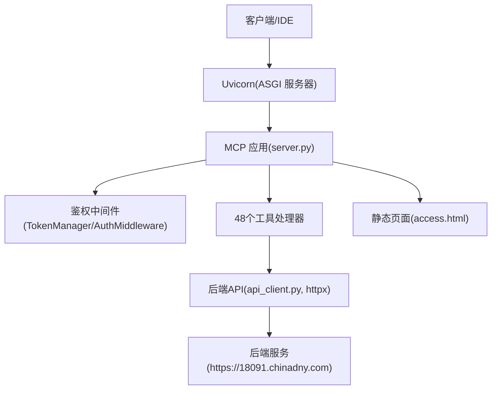
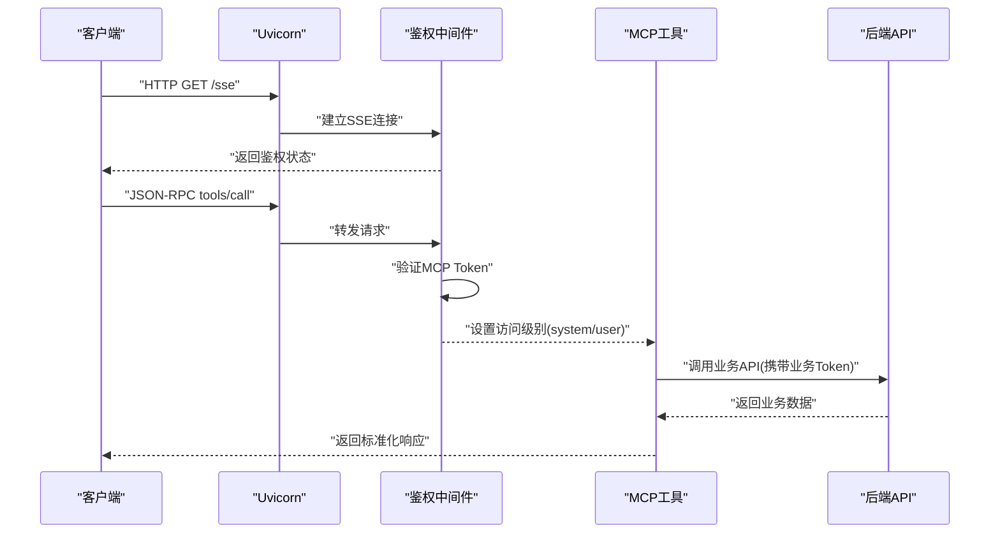
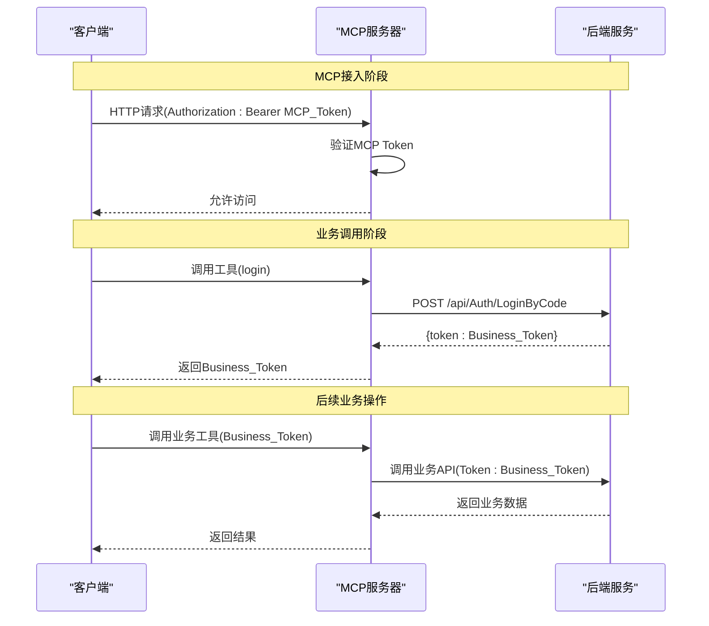
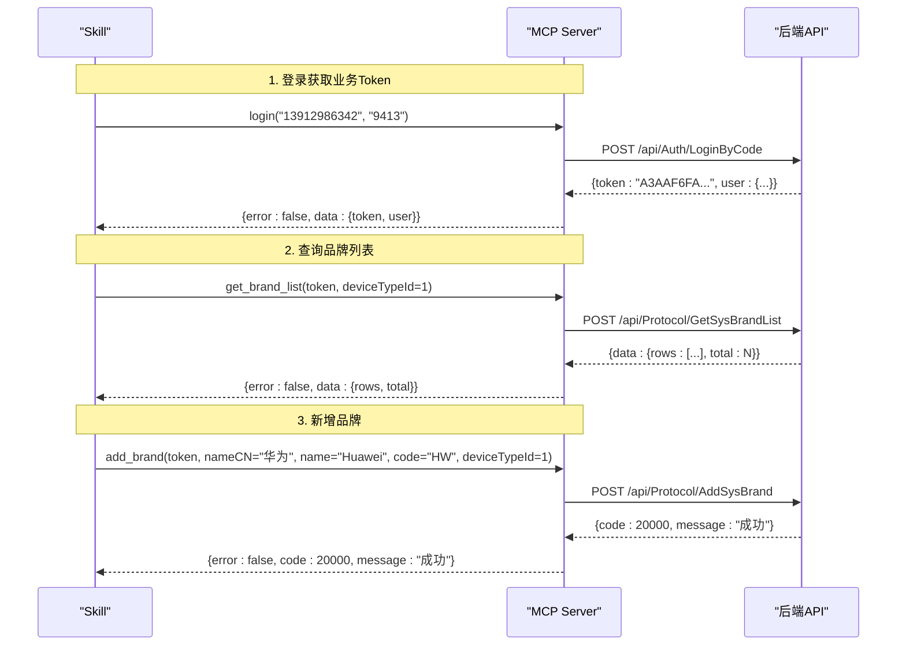
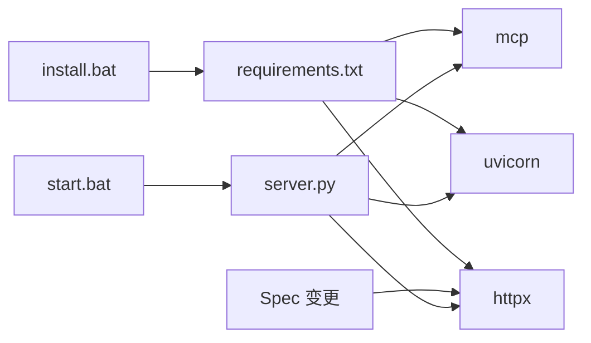

# MCP 工具集

<cite>
**本文引用的文件**
- [server.py](file://mcp_server/server.py)
- [api_client.py](file://mcp_server/api_client.py)
- [mcp server部署.md](file://mcp server部署.md)
- [规约管理MCP服务化Spec.md](file://规约管理MCP服务化Spec.md)
- [install.bat](file://mcp_server/install.bat)
- [start.bat](file://mcp_server/start.bat)
- [requirements.txt](file://mcp_server/requirements.txt)
- [access.html](file://mcp_server/static/access.html)
</cite>

## 更新摘要
**所做更改**
- 将原有的7个工具（1个实现 + 6个桩函数）扩展为48个完整实现的工具
- 新增login工具支持短信验证码认证，实现双令牌认证模型
- 实现了分类管理、设备类型管理、品牌管理、模型管理、协议信息管理、数据项管理、脚本管理、系数管理、感知结构管理、字典类型管理、功能项管理等完整CRUD操作
- 更新了工具注册机制和权限控制逻辑
- 增强了错误处理和统一响应格式

## 目录
1. [简介](#简介)
2. [项目结构](#项目结构)
3. [核心组件](#核心组件)
4. [架构总览](#架构总览)
5. [详细组件分析](#详细组件分析)
6. [依赖关系分析](#依赖关系分析)
7. [性能考虑](#性能考虑)
8. [故障排查指南](#故障排查指南)
9. [结论](#结论)
10. [附录](#附录)

## 简介
本参考文档面向 MCP 工具集的完整使用与扩展，重点说明：
- **48个完整工具**的完整能力：包括探测、登录、查询、写入等全生命周期操作
- **双令牌认证模型**：MCP接入Token与后端业务Token分离
- **完善的权限控制**：系统级（读写）与用户级（只读）权限分级
- **统一的API封装**：通过httpx异步客户端调用后端接口
- **标准化的错误处理**：网络异常、HTTP异常、业务错误的统一归一化

**重大更新**：从最初的7个工具（1个实现，6个桩函数）扩展到48个完整实现的工具，涵盖规约管理的完整业务流程。

## 项目结构
本项目提供完整的MCP服务端运行环境，包含48个已实现的工具函数和统一的后端API封装。关键目录与文件：
- mcp_server：包含服务器主程序、API客户端、安装启动脚本
- openspec：详细的工具规格定义和API映射
- 根目录文档：部署流程、工作原理与集成指南

**图表来源**
- [server.py:1509-1561](file://mcp_server/server.py#L1509-L1561)
- [api_client.py:34-174](file://mcp_server/api_client.py#L34-L174)

**章节来源**
- [mcp server部署.md:25-126](file://mcp server部署.md#L25-L126)
- [规约管理MCP服务化Spec.md:44-78](file://规约管理MCP服务化Spec.md#L44-L78)

## 核心组件
- **工具注册与路由**：由FastMCP框架在server.py中完成，将48个Python函数暴露为MCP Tools
- **双令牌鉴权**：TokenManager与AuthMiddleware负责MCP接入Token校验，业务Token用于后端API调用
- **后端API封装**：api_client.py使用httpx异步请求后端接口，统一错误归一化和响应格式化
- **权限控制系统**：基于IP地址的自动权限分配，localhost获得系统级权限，其他IP为用户级权限
- **资源包管理**：自动打包Skills目录，支持一键下载和配置生成

**章节来源**
- [server.py:203-243](file://mcp_server/server.py#L203-L243)
- [server.py:1304-1363](file://mcp_server/server.py#L1304-L1363)
- [api_client.py:34-174](file://mcp_server/api_client.py#L34-L174)

## 架构总览
MCP工具集通过ASGI协议由Uvicorn承载，实现了从简单的探测工具到完整的规约管理系统。双令牌认证模型确保了MCP接入安全与后端业务调用的分离。

**图表来源**
- [server.py:1304-1363](file://mcp_server/server.py#L1304-L1363)
- [api_client.py:105-174](file://mcp_server/api_client.py#L105-L174)

## 详细组件分析

### 工具概览（48个完整实现）

#### 探测与登录（2个工具）
- **list_mcp_tools**：列出所有可用工具及鉴权状态探测
- **login**：手机号+验证码登录，获取后端业务Token

#### 分类管理（4个工具）
- **get_classify_list**：查询大类列表
- **add_classify**：新增大类
- **update_classify**：更新大类  
- **del_classify**：删除大类

#### 设备类型管理（4个工具）
- **get_device_type_list**：查询设备类型列表
- **add_device_type**：新增设备类型
- **update_device_type**：更新设备类型
- **del_device_type**：删除设备类型

#### 品牌管理（4个工具）
- **get_brand_list**：查询品牌列表
- **add_brand**：新增品牌
- **update_brand**：更新品牌
- **del_brand**：删除品牌

#### 型号管理（5个工具）
- **get_model_list**：查询型号列表
- **add_model**：新增型号
- **update_model**：更新型号
- **del_model**：删除型号
- **export_model_data**：导出型号统计数据

#### 协议信息管理（5个工具）
- **get_protocol_info_list**：查询协议列表
- **add_protocol_info**：新增协议
- **update_protocol**：更新协议
- **del_protocol_info**：删除协议
- **upload_protocol_file**：上传协议文件

#### 数据项管理（4个工具）
- **get_data_item_list**：查询数据项列表
- **add_data_item**：新增数据项
- **update_data_item**：更新数据项
- **del_data_item**：删除数据项

#### 脚本管理（5个工具）
- **gen_script**：生成脚本
- **get_script_list**：查询脚本列表
- **get_json_detail**：获取脚本JSON内容
- **del_script**：删除脚本
- **export_data**：导出协议数据

#### 系数管理（4个工具）
- **get_coeff_list**：查询系数列表
- **add_coeff**：新增系数
- **update_coeff**：更新系数
- **del_coeff**：删除系数

#### 感知管理（4个工具）
- **get_sense_list**：查询感知结构列表
- **add_sense**：新增感知结构
- **update_sense**：更新感知结构
- **del_sense**：删除感知结构

#### 字典类型管理（3个工具）
- **get_protocol_type_list**：查询规约类型字典
- **save_protocol_type**：保存规约类型
- **del_protocol_type**：删除规约类型

#### 功能项管理（3个工具）
- **get_function_type_list**：查询功能项列表
- **save_function_item**：保存功能项
- **del_function_item**：删除功能项

### 双令牌认证模型

#### MCP接入Token
- **用途**：MCP协议通信的身份验证
- **生成方式**：自动根据IP地址生成或管理员配置
- **存储位置**：Authorization: Bearer头部
- **权限控制**：基于IP地址决定系统级或用户级权限

#### 后端业务Token
- **用途**：调用后端API的业务身份验证
- **获取方式**：通过login(phoneNum, code)获取
- **传递方式**：作为工具参数传递给后端API
- **有效期**：由后端服务控制

**图表来源**
- [server.py:471-483](file://mcp_server/server.py#L471-L483)
- [api_client.py:312-360](file://mcp_server/api_client.py#L312-L360)

### 权限控制系统

#### 自动权限分配
- **localhost访问**：自动授予系统级权限（读写操作）
- **远程访问**：默认用户级权限（只读操作）
- **管理员Token**：可通过环境变量配置固定管理员Token

#### 写入操作保护
所有写入类工具都经过权限检查，非系统级用户尝试执行写入操作将返回FORBIDDEN错误。

**章节来源**
- [server.py:94-127](file://mcp_server/server.py#L94-L127)
- [server.py:273-284](file://mcp_server/server.py#L273-L284)

### 典型调用流程

**图表来源**
- [规约管理MCP服务化Spec.md:295-319](file://规约管理MCP服务化Spec.md#L295-L319)

## 依赖关系分析

### 运行时依赖
- **mcp>=1.0.0,<2.0.0**：MCP协议SDK，提供工具注册和协议处理
- **uvicorn>=0.30.0**：ASGI服务器，高性能异步Web服务器
- **httpx>=0.27.0**：异步HTTP客户端，用于调用后端API

### 项目依赖关系图

**图表来源**
- [requirements.txt:1-3](file://mcp_server/requirements.txt#L1-L3)
- [install.bat:40-49](file://mcp_server/install.bat#L40-L49)
- [start.bat:7-13](file://mcp_server/start.bat#L7-L13)

**章节来源**
- [requirements.txt:1-3](file://mcp_server/requirements.txt#L1-L3)
- [install.bat:40-49](file://mcp_server/install.bat#L40-L49)
- [start.bat:7-13](file://mcp_server/start.bat#L7-L13)

## 性能考虑

### 异步I/O优化
- **MCP框架**：原生支持async/await，避免阻塞事件循环
- **httpx客户端**：使用AsyncClient进行异步HTTP请求
- **连接复用**：httpx.AsyncClient实例复用，减少TCP握手开销

### 并发处理能力
- **Uvicorn服务器**：基于uvloop的高性能异步事件循环
- **内存管理**：合理的对象生命周期管理，避免内存泄漏
- **超时控制**：为后端请求设置合理超时时间（默认30秒）

### 错误处理优化
- **统一错误格式**：所有错误统一为{error: true, code: "...", message: "..."}格式
- **错误分类**：NETWORK_ERROR、HTTP_ERROR、AUTH_ERROR、API_ERROR
- **降级策略**：网络异常时提供友好的错误提示

## 故障排查指南

### 常见部署问题

#### Python环境问题
- **现象**：install.bat报错提示Python未找到或版本过低
- **解决**：安装Python 3.10+，确保加入PATH环境变量

#### 虚拟环境创建失败
- **现象**：install.bat提示虚拟环境创建失败
- **解决**：检查权限与磁盘空间，以管理员身份重新运行

#### 依赖安装失败
- **现象**：pip安装依赖失败
- **解决**：检查网络连接或使用国内镜像源

#### 启动配置问题
- **现象**：start.bat提示MCP_AUTH_TOKEN未设置
- **解决**：运行install.bat生成Token或手动创建.env文件

#### 端口占用问题
- **现象**：启动时报端口占用错误
- **解决**：查找并结束占用进程，或修改server.py中的端口号

### 运行时问题

#### 鉴权失败
- **现象**：调用工具返回Unauthorized错误
- **解决**：检查MCP Token是否正确配置，确认IP地址是否在白名单

#### 业务Token失效
- **现象**：后端API返回40100错误
- **解决**：重新调用login工具获取新的业务Token

#### 网络超时
- **现象**：调用后端API超时
- **解决**：检查网络连接，调整超时配置或后端服务状态

**章节来源**
- [mcp server部署.md:505-632](file://mcp server部署.md#L505-L632)

## 结论
本次更新将MCP工具集从简单的7个工具（1个实现，6个桩函数）扩展为完整的48个工具系统，实现了规约管理的完整业务流程。通过双令牌认证模型、完善的权限控制和统一的API封装，提供了企业级的工具服务能力。

**主要成就**：
- 实现了完整的CRUD操作覆盖
- 建立了安全的双令牌认证机制
- 提供了统一的错误处理和响应格式
- 支持灵活的权限控制和访问控制
- 具备高并发和高性能的异步架构

**未来展望**：
- 可扩展更多业务模块的工具
- 支持更复杂的业务流程编排
- 增强监控和日志审计功能
- 优化性能和用户体验

## 附录

### 工具清单完整映射

| 模块 | 工具数量 | 主要功能 |
|------|----------|----------|
| 探测与登录 | 2 | 工具发现、用户认证 |
| 分类管理 | 4 | 大类CRUD操作 |
| 设备类型管理 | 4 | 设备类型CRUD操作 |
| 品牌管理 | 4 | 品牌信息CRUD操作 |
| 型号管理 | 5 | 型号信息CRUD及数据导出 |
| 协议信息管理 | 5 | 协议配置及文件管理 |
| 数据项管理 | 4 | 数据项CRUD操作 |
| 脚本管理 | 5 | 脚本生成、查询、删除 |
| 系数管理 | 4 | 数据项系数CRUD操作 |
| 感知管理 | 4 | 感知结构CRUD操作 |
| 字典类型管理 | 3 | 规约类型字典管理 |
| 功能项管理 | 3 | 功能项CRUD操作 |

### 集成方案

#### IDE集成
使用access.html生成的配置文件可直接粘贴到Claude Desktop、Trae IDE等支持MCP协议的编辑器中。

#### API集成
通过标准的MCP协议接口，任何支持JSON-RPC的客户端都可以调用这些工具。

#### 自动化流程
结合Skill概念，可以将多个工具组合成复杂的自动化工作流，如：
1. 登录认证 → 查询设备类型 → 创建品牌 → 添加型号 → 配置协议 → 生成脚本

**章节来源**
- [规约管理MCP服务化Spec.md:132-245](file://规约管理MCP服务化Spec.md#L132-L245)
- [access.html:445-503](file://mcp_server/static/access.html#L445-L503)