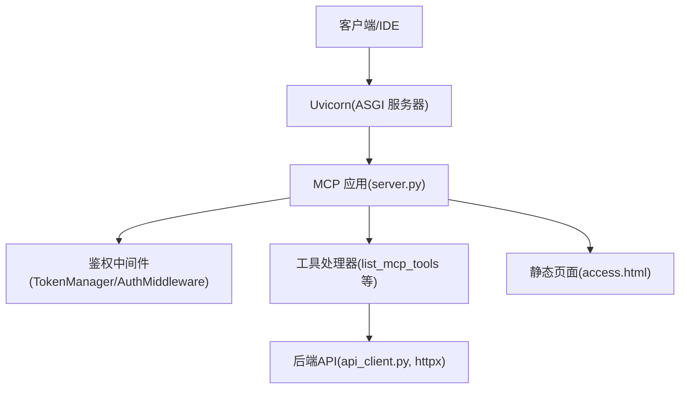
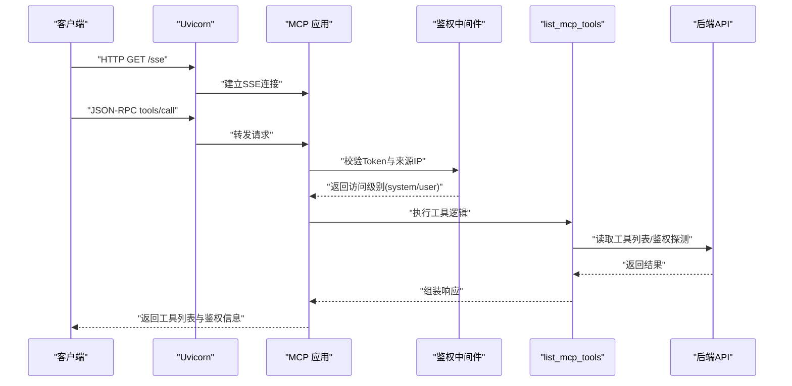
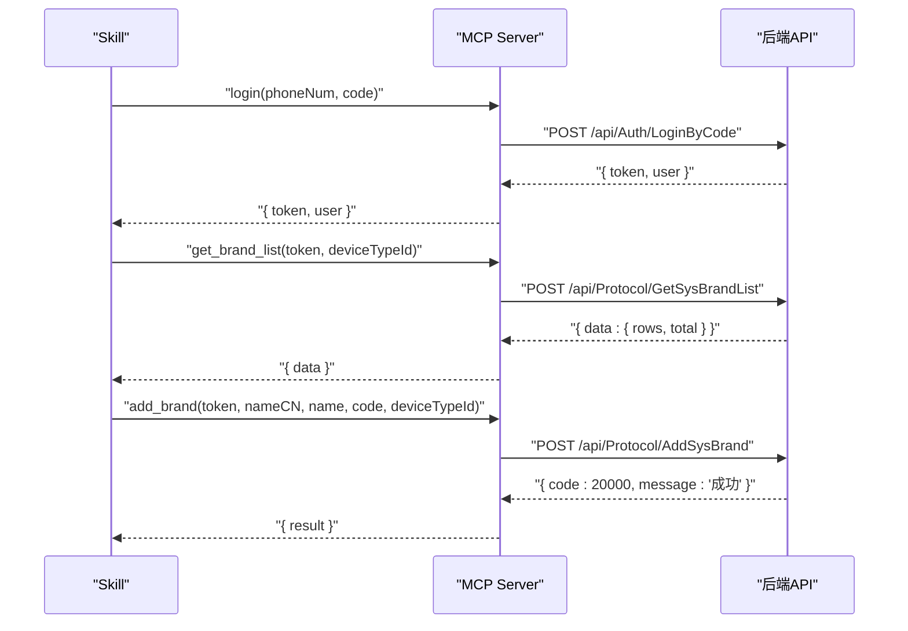
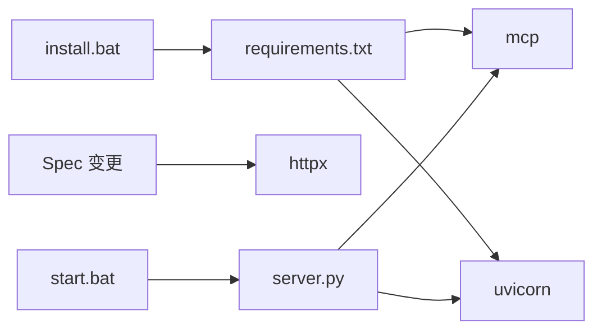

# MCP 工具集

<cite>
**本文引用的文件**
- [mcp server部署.md](file://mcp server部署.md)
- [规约管理MCP服务化Spec.md](file://规约管理MCP服务化Spec.md)
- [install.bat](file://mcp_server/install.bat)
- [start.bat](file://mcp_server/start.bat)
- [requirements.txt](file://mcp_server/requirements.txt)
- [access.html](file://mcp_server/static/access.html)
</cite>

## 目录
1. [简介](#简介)
2. [项目结构](#项目结构)
3. [核心组件](#核心组件)
4. [架构总览](#架构总览)
5. [详细组件分析](#详细组件分析)
6. [依赖关系分析](#依赖关系分析)
7. [性能考虑](#性能考虑)
8. [故障排查指南](#故障排查指南)
9. [结论](#结论)
10. [附录](#附录)

## 简介
本参考文档面向 MCP 工具集的使用与扩展，重点说明：
- list_mcp_tools 工具的完整能力：工具列表查询、鉴权状态探测、服务器信息获取。
- 6 个桩函数的设计意图与预期功能（当前为占位实现）：query_device_classes、update_protocol_file、add_device_class、check_script_exists、publish_work_log、publish_converted_script。
- 工具间的依赖关系与调用顺序。
- 工具注册机制的实现细节与扩展开发指南。
- 实际 API 调用示例与集成方案（基于仓库中的 Spec 与部署文档）。

## 项目结构
本项目提供 MCP 服务端运行所需的脚本与静态页面，并通过部署文档与 Spec 描述工具集与后端交互方式。关键目录与文件：
- mcp_server：包含安装与启动脚本、依赖声明与静态接入页。
- openspec：变更任务与规格说明，定义工具清单、鉴权策略与错误处理约定。
- 根目录文档：部署流程、工作原理与常见问题排查。

图表来源
- [mcp server部署.md:110-260](file://mcp server部署.md#L110-L260)
- [规约管理MCP服务化Spec.md:44-66](file://规约管理MCP服务化Spec.md#L44-L66)

章节来源
- [mcp server部署.md:25-126](file://mcp server部署.md#L25-L126)
- [规约管理MCP服务化Spec.md:44-78](file://规约管理MCP服务化Spec.md#L44-L78)

## 核心组件
- 工具注册与路由：由 MCP 框架在 server.py 中完成，将 Python 函数暴露为 MCP Tools。
- 鉴权与权限：TokenManager 与 AuthMiddleware 负责 Token 校验与访问级别判定（系统级/用户级）。
- 后端 API 封装：api_client.py 使用 httpx 异步请求后端接口，统一错误归一化。
- 接入页面：access.html 提供一键生成配置与 Skills 包下载入口，辅助快速接入。

章节来源
- [mcp server部署.md:110-260](file://mcp server部署.md#L110-L260)
- [规约管理MCP服务化Spec.md:79-131](file://规约管理MCP服务化Spec.md#L79-L131)
- [access.html:321-557](file://mcp_server/static/access.html#L321-L557)

## 架构总览
MCP 工具集通过 ASGI 协议由 Uvicorn 承载，MCP 应用负责工具路由与业务编排；鉴权中间件对请求进行 Token 校验并区分本地与远程访问的权限级别；工具处理器调用后端 API 完成数据操作；接入页面协助生成 IDE 配置与 Skills 包。

图表来源
- [mcp server部署.md:163-260](file://mcp server部署.md#L163-L260)
- [规约管理MCP服务化Spec.md:123-131](file://规约管理MCP服务化Spec.md#L123-L131)

## 详细组件分析

### list_mcp_tools 工具
- 功能概述
  - 列出所有可用工具名称、类型与说明。
  - 探测鉴权状态：返回 token_valid、access_level、source。
  - 获取服务器信息：返回 baseUrl、serverIPs 等。
- 参数
  - 无业务参数；鉴权由中间件注入。
- 返回值格式
  - 成功：{ tools: [...], auth: { token_valid, access_level, source }, server: { baseUrl, serverIPs } }
  - 失败：{ error: true, code: "...", message: "..." }
- 使用示例
  - 通过 MCP 客户端调用 tools/call，method 为 list_mcp_tools。
  - 在接入页生成的 Markdown 中，建议先调用该工具验证连接与鉴权。
- 错误处理
  - 网络异常：NETWORK_ERROR
  - 后端非 20000：API_ERROR
  - Token 无效/过期：AUTH_ERROR
  - HTTP 状态码异常：HTTP_ERROR
- 依赖关系
  - 依赖鉴权中间件与后端 API 探测端点。
- 调用顺序
  - 通常在登录成功后立即调用，用于确认可用工具与权限级别。

章节来源
- [规约管理MCP服务化Spec.md:132-139](file://规约管理MCP服务化Spec.md#L132-L139)
- [规约管理MCP服务化Spec.md:123-131](file://规约管理MCP服务化Spec.md#L123-L131)
- [access.html:487-494](file://mcp_server/static/access.html#L487-L494)

### 桩函数设计与预期功能
以下 6 个桩函数当前仅返回 not_implemented，用于占位与后续扩展。每个函数的设计意图如下：

- query_device_classes（设备类别查询）
  - 意图：查询设备类别列表，支持分页与筛选。
  - 输入：token、sysName、pageIndex、pageSize。
  - 输出：data.rows 列表与 total。
  - 错误：TOKEN 无效、网络异常、后端业务错误。
  - 依赖：后端 GetSysClassifyList。

- update_protocol_file（协议文件更新）
  - 意图：上传或更新协议文件，返回文件 ID 与路径。
  - 输入：token、protocolId、fileData。
  - 输出：fileId、filePath。
  - 错误：文件过大、类型不支持、上传失败。
  - 依赖：后端 UploadProtocolFile。

- add_device_class（设备类别添加）
  - 意图：新增设备类别，返回新记录 ID。
  - 输入：token、deviceTypeName、deviceTypeCode、sysId。
  - 输出：id。
  - 错误：重复编码、必填字段缺失。
  - 依赖：后端 AddProtocolDeviceType。

- check_script_exists（脚本存在性检查）
  - 意图：检查指定协议是否已生成脚本，返回存在性与脚本详情。
  - 输入：token、protocolId、protoType。
  - 输出：exists、scriptInfo。
  - 错误：协议不存在、查询失败。
  - 依赖：后端 GetDataScriptList。

- publish_work_log（工作日志发布）
  - 意图：发布工作日志到后端，便于审计与追踪。
  - 输入：token、logLevel、message、context。
  - 输出：logId。
  - 错误：日志过长、权限不足。
  - 依赖：后端日志写入接口。

- publish_converted_script（转换脚本发布）
  - 意图：发布转换后的脚本资源，供下游使用。
  - 输入：token、scriptId、version、payload。
  - 输出：publishId。
  - 错误：版本冲突、校验失败。
  - 依赖：后端脚本发布接口。

章节来源
- [规约管理MCP服务化Spec.md:247-255](file://规约管理MCP服务化Spec.md#L247-L255)
- [规约管理MCP服务化Spec.md:351-489](file://规约管理MCP服务化Spec.md#L351-L489)

### 工具注册机制与扩展指南
- 注册方式
  - 在 server.py 中使用 @mcp.tool() 装饰器将异步函数注册为 MCP 工具。
  - 每个工具对应一个后端 API，参数与返回结构遵循 Spec 约定。
- 鉴权与权限
  - TokenManager 与 AuthMiddleware 负责 Token 校验与访问级别判定。
  - 写入类工具需标记为 write，并在系统级权限下允许执行。
- 错误处理
  - api_client.py 统一封装网络异常、HTTP 异常与业务错误码，返回标准结构。
- 扩展步骤
  - 新增后端 API 后，在 api_client.py 中添加对应方法。
  - 在 server.py 中新增工具函数，调用 api_client 方法。
  - 更新 requirements.txt 与依赖安装脚本。
  - 通过 list_mcp_tools 验证新工具可见性与类型。

章节来源
- [规约管理MCP服务化Spec.md:247-293](file://规约管理MCP服务化Spec.md#L247-L293)
- [mcp server部署.md:283-336](file://mcp server部署.md#L283-L336)

### 典型调用流程（Skill 视角）

图表来源
- [规约管理MCP服务化Spec.md:295-319](file://规约管理MCP服务化Spec.md#L295-L319)

## 依赖关系分析
- 运行时依赖
  - mcp：提供 MCP 协议支持与工具注册。
  - uvicorn：ASGI 服务器，承载 MCP 应用。
- 新增依赖（按 Spec）
  - httpx：异步 HTTP 客户端，用于调用后端 API。
- 脚本依赖
  - install.bat：创建虚拟环境、安装依赖、生成 Token 与配置文件。
  - start.bat：激活虚拟环境、读取 Token、启动 server.py。

图表来源
- [requirements.txt:1-3](file://mcp_server/requirements.txt#L1-L3)
- [install.bat:40-49](file://mcp_server/install.bat#L40-L49)
- [start.bat:7-13](file://mcp_server/start.bat#L7-L13)
- [规约管理MCP服务化Spec.md:287-293](file://规约管理MCP服务化Spec.md#L287-L293)

章节来源
- [requirements.txt:1-3](file://mcp_server/requirements.txt#L1-L3)
- [install.bat:40-49](file://mcp_server/install.bat#L40-L49)
- [start.bat:7-13](file://mcp_server/start.bat#L7-L13)
- [规约管理MCP服务化Spec.md:287-293](file://规约管理MCP服务化Spec.md#L287-L293)

## 性能考虑
- 异步 I/O：MCP 与 httpx 均支持异步，避免阻塞事件循环。
- 连接复用：httpx.AsyncClient 可复用连接，减少握手开销。
- 超时设置：为后端请求设置合理超时，防止长尾请求影响服务。
- 并发模型：Uvicorn 基于事件循环，适合高并发 I/O 密集型场景。

[本节为通用指导，不直接分析具体文件]

## 故障排查指南
- Python 未安装或版本过低
  - 现象：install.bat 报错提示 Python 未找到或版本过低。
  - 解决：安装 Python 3.10+，并确保加入 PATH。
- 虚拟环境创建失败
  - 现象：install.bat 提示虚拟环境创建失败。
  - 解决：检查权限与磁盘空间，重新运行安装脚本。
- 依赖安装失败
  - 现象：pip 安装依赖失败。
  - 解决：检查网络或使用国内镜像源，升级 pip。
- 启动时找不到虚拟环境
  - 现象：start.bat 提示未找到虚拟环境。
  - 解决：确保已运行 install.bat，或手动创建 .venv。
- Token 未配置
  - 现象：start.bat 提示 MCP_AUTH_TOKEN 未设置。
  - 解决：运行 install.bat 生成 Token，或手动创建 .env。
- 端口被占用
  - 现象：启动时报端口占用错误。
  - 解决：查找并结束占用进程，或修改端口号。

章节来源
- [mcp server部署.md:505-632](file://mcp server部署.md#L505-L632)

## 结论
本 MCP 工具集以 list_mcp_tools 为核心探测与发现入口，结合鉴权中间件与后端 API 封装，提供细粒度、可扩展的工具能力。6 个桩函数为未来功能预留接口，便于逐步替换为真实实现。通过部署脚本与接入页面，可实现快速部署与一键接入，满足开发与生产环境的差异化需求。

[本节为总结，不直接分析具体文件]

## 附录
- 工具清单与 API 映射
  - 详见 Spec 中的工具清单与接口规格，涵盖大类、设备类型、品牌、型号、规约信息、数据项、脚本、系数、感知、字典、功能项、导出与文件删除等模块。
- 接入与集成
  - 使用 access.html 生成各 IDE 的配置文本与 Skills 包，粘贴至 AI Agent 完成自动接入。
  - 接入后调用 list_mcp_tools 验证连接与鉴权状态。

章节来源
- [规约管理MCP服务化Spec.md:132-245](file://规约管理MCP服务化Spec.md#L132-L245)
- [access.html:445-503](file://mcp_server/static/access.html#L445-L503)