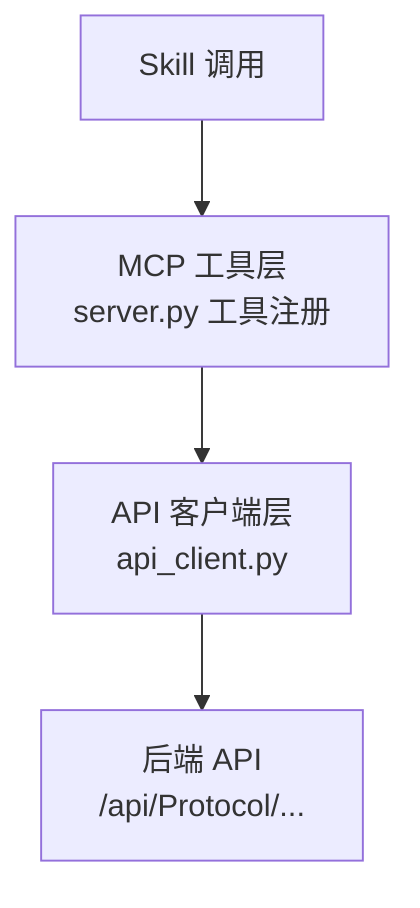
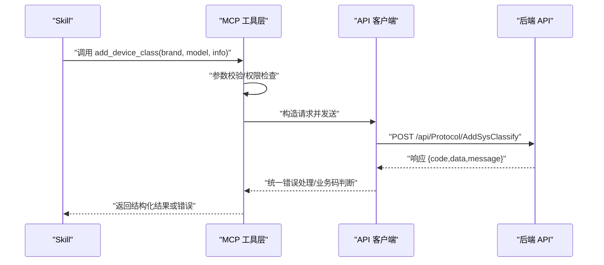
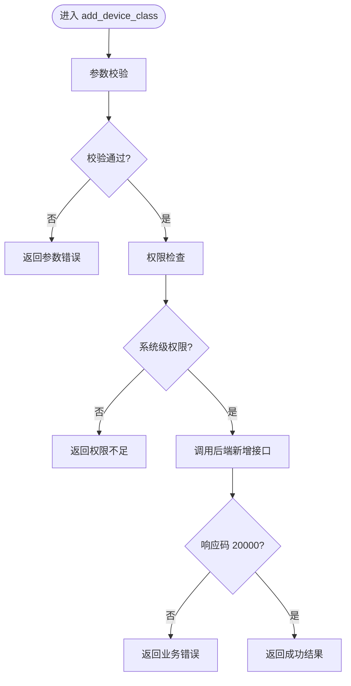
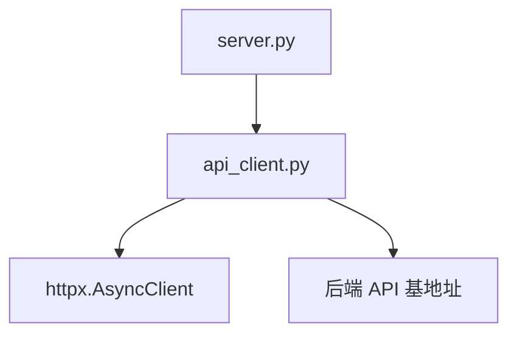

# add_device_class 工具

<cite>
**本文引用的文件**
- [规约管理MCP服务化Spec.md](file://规约管理MCP服务化Spec.md)
</cite>

## 目录
1. [简介](#简介)
2. [项目结构](#项目结构)
3. [核心组件](#核心组件)
4. [架构总览](#架构总览)
5. [详细组件分析](#详细组件分析)
6. [依赖关系分析](#依赖关系分析)
7. [性能考虑](#性能考虑)
8. [故障排查指南](#故障排查指南)
9. [结论](#结论)
10. [附录](#附录)

## 简介
本参考文档围绕“add_device_class”写入型工具进行说明。该工具用于向运维平台新增设备类别（大类）记录，属于规约管理模块中的基础数据维护能力。根据当前仓库规范，该工具在实现阶段已被移除为桩函数，并计划由细粒度的 MCP 原子工具替代；但在设计层面，仍需要明确其参数、权限、错误处理与集成方式，以便后续落地或迁移时保持一致性。

## 项目结构
- 本项目以“规约管理 MCP 服务化 + Vue 接入配置页面”为核心目标，将后端 API 封装为 MCP 工具，供 Skill 编排调用。
- 当前仓库中未包含 server.py、api_client.py 等实现代码，但规范文档明确了：
  - 删除 6 个桩工具，包括 add_device_class。
  - 新增 47 个异步工具函数，统一通过 httpx 异步客户端访问后端 API。
  - 鉴权采用自定义 Token 请求头，登录接口返回 Token 后由调用方传入后续工具。
  - 统一响应码约定：code=20000 表示成功，40100 表示登录失效，40000 表示业务异常。

图表来源
- [规约管理MCP服务化Spec.md:44-78](file://规约管理MCP服务化Spec.md#L44-L78)
- [规约管理MCP服务化Spec.md:247-285](file://规约管理MCP服务化Spec.md#L247-L285)

章节来源
- [规约管理MCP服务化Spec.md:44-78](file://规约管理MCP服务化Spec.md#L44-L78)
- [规约管理MCP服务化Spec.md:247-285](file://规约管理MCP服务化Spec.md#L247-L285)

## 核心组件
- 工具定位：add_device_class 为写入型工具，负责新增设备类别（大类）。
- 参数规范（建议）：
  - brand：品牌名称（必填）。用于关联品牌维度，便于后续按品牌筛选与管理。
  - model：型号名称（必填）。用于关联具体型号维度，支撑更细粒度分类。
  - info：附加信息（可选）。用于备注或扩展字段，便于审计与展示。
- 预期实现逻辑：
  - 校验必填参数与格式。
  - 检查是否已存在相同品牌+型号组合（去重策略）。
  - 构造请求体并调用后端新增大类接口。
  - 解析响应并返回结构化结果。
- 权限控制机制：
  - 系统级权限（localhost 访问）方可执行写入操作。
  - 普通用户仅具备只读权限，遇到写入步骤应停止并提示需系统级用户。
- 错误处理策略：
  - 重复数据：返回明确的重复标识与提示信息，避免静默失败。
  - 权限不足：返回认证/授权错误码，引导重新登录或切换账号。
  - 网络错误：捕获网络异常，返回标准化错误结构，支持上层重试或降级。
  - 业务错误：统一包装为 error=true 的结构，包含 code、message、raw。

章节来源
- [规约管理MCP服务化Spec.md:123-131](file://规约管理MCP服务化Spec.md#L123-L131)
- [规约管理MCP服务化Spec.md:247-285](file://规约管理MCP服务化Spec.md#L247-L285)

## 架构总览
下图展示了从 Skill 到后端 API 的完整调用链路，以及鉴权与错误处理的集中点。

图表来源
- [规约管理MCP服务化Spec.md:44-78](file://规约管理MCP服务化Spec.md#L44-L78)
- [规约管理MCP服务化Spec.md:123-131](file://规约管理MCP服务化Spec.md#L123-L131)
- [规约管理MCP服务化Spec.md:247-285](file://规约管理MCP服务化Spec.md#L247-L285)

## 详细组件分析

### 参数与校验
- 必填参数：
  - brand：品牌名称，字符串类型，非空且长度合理。
  - model：型号名称，字符串类型，非空且长度合理。
- 可选参数：
  - info：附加信息，字符串类型，允许为空。
- 校验规则：
  - 空值校验、长度限制、字符集限制（如禁止特殊字符）。
  - 若品牌或型号不存在于系统字典，应在调用前通过查询工具确认或提示补充。

章节来源
- [规约管理MCP服务化Spec.md:247-285](file://规约管理MCP服务化Spec.md#L247-L285)

### 权限控制
- 系统级权限：
  - localhost 访问可执行写入操作。
  - 普通用户仅能读取，遇到写入步骤应立即停止并提示需要系统级用户。
- 鉴权流程：
  - 使用 login 获取 Token，并在后续写入工具调用时携带 Token。
  - 若 Token 无效或过期，返回 AUTH_ERROR，要求重新登录。

章节来源
- [规约管理MCP服务化Spec.md:123-131](file://规约管理MCP服务化Spec.md#L123-L131)
- [规约管理MCP服务化Spec.md:247-285](file://规约管理MCP服务化Spec.md#L247-L285)

### 错误处理
- 网络错误：
  - 捕获连接超时、DNS 解析失败等异常，返回 NETWORK_ERROR。
- 业务错误：
  - 后端返回非 20000 状态码，包装为 API_ERROR，附带 message 与 raw。
- 权限错误：
  - 40100 表示登录失效，返回 AUTH_ERROR，提示重新登录。
- HTTP 异常：
  - 非 2xx 状态码，返回 HTTP_ERROR，包含具体原因。

图表来源
- [规约管理MCP服务化Spec.md:123-131](file://规约管理MCP服务化Spec.md#L123-L131)
- [规约管理MCP服务化Spec.md:247-285](file://规约管理MCP服务化Spec.md#L247-L285)

章节来源
- [规约管理MCP服务化Spec.md:123-131](file://规约管理MCP服务化Spec.md#L123-L131)
- [规约管理MCP服务化Spec.md:247-285](file://规约管理MCP服务化Spec.md#L247-L285)

### 与设备分类管理系统的集成
- 大类（Classify）作为四级分类的第一级，向下级联设备类型、品牌、型号、规约信息。
- 新增大类后，可通过查询工具验证是否生效，并继续创建设备类型、品牌、型号等下游实体。
- 级联清空规则：当上游分类变更时，下游相关字段需清空并重新加载选项。

图表来源
- [规约管理MCP服务化Spec.md:1022-1048](file://规约管理MCP服务化Spec.md#L1022-L1048)

章节来源
- [规约管理MCP服务化Spec.md:1022-1048](file://规约管理MCP服务化Spec.md#L1022-L1048)

### 使用示例与集成方案
- 典型调用流程（Skill 视角）：
  1. 登录获取 Token。
  2. 查询现有大类列表，确认目标大类是否存在。
  3. 调用 add_device_class 新增大类。
  4. 根据返回结果继续创建设备类型、品牌、型号等。
  5. 生成脚本或导出数据。
- 集成要点：
  - 所有写入操作必须先展示计划并经用户确认。
  - 写入后展示返回值，不自动重试。
  - 普通用户只读，遇到写入步骤必须停止并提示需要系统级用户。

章节来源
- [规约管理MCP服务化Spec.md:295-319](file://规约管理MCP服务化Spec.md#L295-L319)
- [规约管理MCP服务化Spec.md:247-285](file://规约管理MCP服务化Spec.md#L247-L285)

## 依赖关系分析
- 工具层依赖：
  - server.py 负责工具注册与路由，调用 api_client.py。
  - api_client.py 封装 httpx 异步客户端，统一构造请求与错误处理。
- 外部依赖：
  - httpx>=0.27.0，用于异步 HTTP 请求。
- 后端 API：
  - 基地址：https://18091.chinadny.com
  - 鉴权：自定义 Token 请求头
  - 成功码：20000

图表来源
- [规约管理MCP服务化Spec.md:44-78](file://规约管理MCP服务化Spec.md#L44-L78)
- [规约管理MCP服务化Spec.md:287-293](file://规约管理MCP服务化Spec.md#L287-L293)

章节来源
- [规约管理MCP服务化Spec.md:44-78](file://规约管理MCP服务化Spec.md#L44-L78)
- [规约管理MCP服务化Spec.md:287-293](file://规约管理MCP服务化Spec.md#L287-L293)

## 性能考虑
- 使用异步客户端（httpx.AsyncClient）避免阻塞事件循环。
- 设置合理的超时时间（默认 30s），防止长时间挂起。
- 复用连接池，减少握手开销。
- 对列表查询使用分页参数，避免一次性拉取大量数据。
- 对写入操作增加幂等性检查（如重复数据检测），减少无效请求。

[本节提供通用指导，无需特定文件引用]

## 故障排查指南
- 常见错误与处理：
  - 网络异常：检查网络连通性与 DNS 解析，查看 NETWORK_ERROR 详情。
  - 业务错误：查看 API_ERROR 的 message 与 raw，定位后端返回的具体问题。
  - 权限错误：确认 Token 是否有效，必要时重新登录。
  - HTTP 异常：检查状态码与请求路径是否正确。
- 调试建议：
  - 打印请求 URL、Headers、Body 与响应内容。
  - 使用 list_mcp_tools 探测可用工具与鉴权状态。
  - 逐步缩小范围，先调用只读工具验证连通性，再执行写入工具。

章节来源
- [规约管理MCP服务化Spec.md:123-131](file://规约管理MCP服务化Spec.md#L123-L131)
- [规约管理MCP服务化Spec.md:247-285](file://规约管理MCP服务化Spec.md#L247-L285)

## 结论
- add_device_class 作为写入型工具，承担新增设备类别的职责，需在权限、参数、错误处理方面严格把控。
- 当前规范已将其从桩工具中移除，并通过细粒度 MCP 工具实现统一的后端 API 封装。
- 建议在实施时遵循统一的鉴权、错误处理与级联规则，确保与设备分类管理系统的良好集成。

[本节为总结性内容，无需特定文件引用]

## 附录
- 四级分类级联关系与清空规则详见“与设备分类管理系统的集成”部分。
- 典型调用流程与权限控制详见“使用示例与集成方案”部分。
- 错误处理策略与统一响应码详见“错误处理”与“架构总览”部分。

[本节为补充说明，无需特定文件引用]