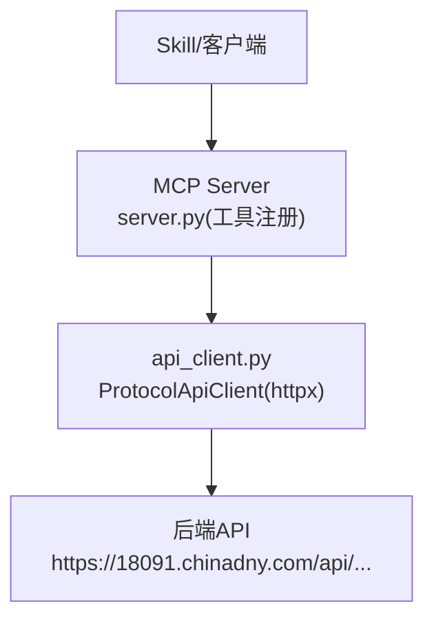
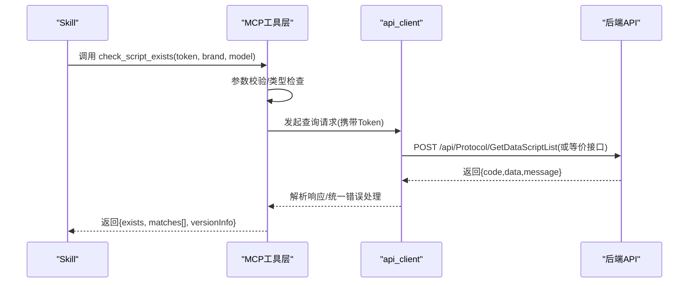
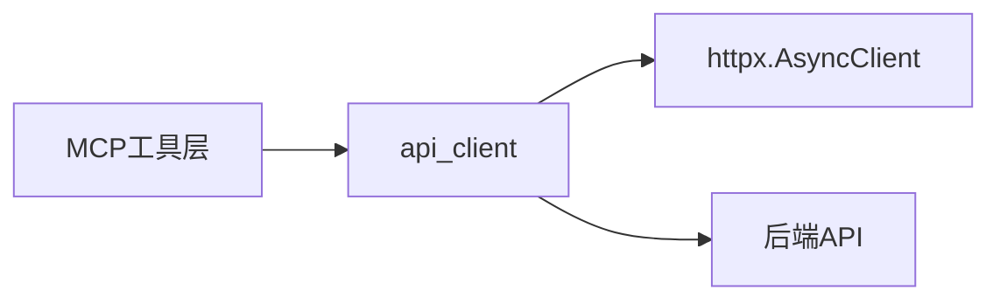
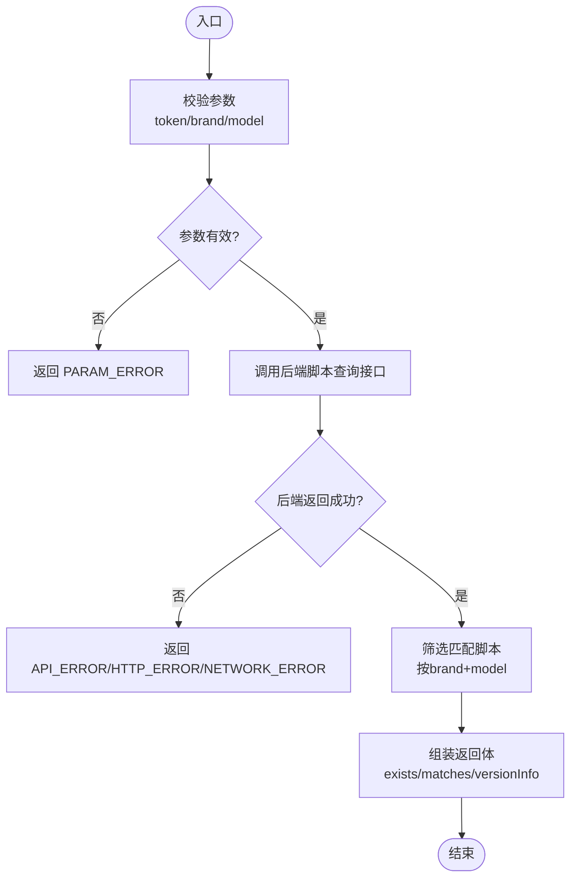

# check_script_exists 工具

<cite>
**本文引用的文件**
- [规约管理MCP服务化Spec.md](file://规约管理MCP服务化Spec.md)
- [mcp server部署.md](file://mcp server部署.md)
- [protocol_converter.py](file://.trae/skills/protocol-conversion/scripts/protocol_converter.py)
</cite>

## 目录
1. [简介](#简介)
2. [项目结构](#项目结构)
3. [核心组件](#核心组件)
4. [架构总览](#架构总览)
5. [详细组件分析](#详细组件分析)
6. [依赖关系分析](#依赖关系分析)
7. [性能考虑](#性能考虑)
8. [故障排查指南](#故障排查指南)
9. [结论](#结论)
10. [附录](#附录)

## 简介
本参考文档围绕只读工具 check_script_exists 的设计与实现进行说明。该工具用于在脚本库中查询是否存在与指定品牌、型号匹配的转换脚本，返回存在性标志、匹配详情与脚本版本等元信息。当前仓库处于“桩函数替换为真实后端调用”的演进阶段：规范文档明确将删除旧桩并新增基于 httpx 的异步 API 客户端封装；因此本文以规范为依据，给出参数规范、预期实现逻辑、返回值设计、错误处理策略、使用示例与集成方案，以及与脚本管理系统的协作关系。

## 项目结构
本项目采用 MCP（Model Context Protocol）服务化架构，通过 Uvicorn 提供 ASGI 服务，暴露工具供 Skill 编排调用。与 check_script_exists 相关的改造集中在：
- 删除旧的桩工具（包含 check_script_exists 的桩），避免无意义的 not_implemented 响应
- 新增统一的 api_client 模块封装后端 HTTP 调用
- 新增对应 MCP 工具函数，转发到 api_client 完成实际查询

图表来源
- [规约管理MCP服务化Spec.md:44-66](file://规约管理MCP服务化Spec.md#L44-L66)
- [规约管理MCP服务化Spec.md:79-121](file://规约管理MCP服务化Spec.md#L79-L121)

章节来源
- [规约管理MCP服务化Spec.md:44-66](file://规约管理MCP服务化Spec.md#L44-L66)
- [mcp server部署.md:283-305](file://mcp server部署.md#L283-L305)

## 核心组件
- MCP 工具层：负责参数校验、鉴权上下文传递、调用 api_client
- API 客户端层：统一构造请求头（Token）、发送异步请求、统一错误处理
- 后端接口层：提供脚本列表查询或按条件检索脚本的能力（由后端实现）

关键要点
- 工具粒度细：每个后端 API 对应一个 MCP 工具，便于编排和错误隔离
- 鉴权透明：Token 由调用方传入，服务端不维护会话状态
- 异步优先：使用 httpx.AsyncClient，避免阻塞事件循环

章节来源
- [规约管理MCP服务化Spec.md:32-41](file://规约管理MCP服务化Spec.md#L32-L41)
- [规约管理MCP服务化Spec.md:79-121](file://规约管理MCP服务化Spec.md#L79-L121)

## 架构总览
check_script_exists 的典型调用链路如下：

图表来源
- [规约管理MCP服务化Spec.md:56-66](file://规约管理MCP服务化Spec.md#L56-L66)
- [规约管理MCP服务化Spec.md:105-121](file://规约管理MCP服务化Spec.md#L105-L121)

## 详细组件分析

### 工具定义与参数规范
- 工具名：check_script_exists
- 类型：只读
- 必填参数：
  - token：登录后获取的 Token（字符串，32位大写十六进制）
  - brand：品牌名称（字符串，必填）
  - model：型号名称（字符串，必填）
- 可选参数（建议）：
  - protoType：规约类型（数字，如 1=Modbus, 2=BACnet, 3=OPC-UA）
  - pageIndex/pageSize：分页参数（当后端返回列表时使用）

说明
- 参数校验失败应尽早返回结构化错误，避免无效网络请求
- 若后端支持按品牌+型号精确筛选，则优先使用该能力；否则可先拉取脚本列表再本地过滤

章节来源
- [规约管理MCP服务化Spec.md:68-77](file://规约管理MCP服务化Spec.md#L68-L77)
- [规约管理MCP服务化Spec.md:132-139](file://规约管理MCP服务化Spec.md#L132-L139)

### 预期实现逻辑
- 步骤1：校验 token、brand、model 是否为空及格式是否符合要求
- 步骤2：调用后端脚本查询接口（例如 GetDataScriptList），携带 protocolId/protoType 等必要参数
- 步骤3：从返回结果中筛选与 brand + model 匹配的脚本条目
- 步骤4：组装返回体，包含存在性标志、匹配详情、脚本版本信息等

注意
- 若后端未提供按 brand/model 直接筛选的接口，可在 MCP 工具层对列表结果做二次过滤
- 对于大列表场景，建议结合分页参数减少传输开销

章节来源
- [规约管理MCP服务化Spec.md:56-66](file://规约管理MCP服务化Spec.md#L56-L66)
- [规约管理MCP服务化Spec.md:769-782](file://规约管理MCP服务化Spec.md#L769-L782)

### 返回值设计
建议返回结构（JSON）：
- exists：布尔值，表示是否存在匹配脚本
- matches：数组，包含匹配到的脚本条目详情（如 id、name、version、protoType、brandId、modelId 等）
- versionInfo：对象，包含脚本版本相关元数据（如 version、buildTime、author 等）
- error：可选，仅在发生错误时出现，包含 code、message、raw（原始响应）

说明
- 成功且未找到匹配时：exists=false，matches=[]，versionInfo=null
- 成功且找到匹配时：exists=true，matches=[...]，versionInfo 可为首个匹配项的版本信息或汇总信息

章节来源
- [规约管理MCP服务化Spec.md:123-131](file://规约管理MCP服务化Spec.md#L123-L131)

### 错误处理策略
统一错误分类与返回格式：
- 参数验证失败：code="PARAM_ERROR"，message 描述具体缺失或非法字段
- 网络异常：code="NETWORK_ERROR"，message 包含底层异常摘要
- 后端业务错误：code="API_ERROR"，message 来自后端 message，raw 保留原始响应
- Token 无效/过期：code="AUTH_ERROR"，message 提示重新登录
- HTTP 状态码异常：code="HTTP_ERROR"，message 包含状态码与原因

处理原则
- 所有异常均包装为标准错误结构，便于上层统一处理
- 区分网络层与业务层错误，便于定位问题来源
- 日志记录需脱敏，避免泄露敏感信息

章节来源
- [规约管理MCP服务化Spec.md:123-131](file://规约管理MCP服务化Spec.md#L123-L131)

### 使用示例与集成方案
典型调用流程（Skill 视角）：
1. 调用 login 获取 token
2. 调用 get_brand_list/get_model_list 确认 brandId/modelId（可选）
3. 调用 check_script_exists(token, brand, model) 查询是否存在匹配脚本
4. 根据 exists 与 matches 决定后续动作（生成新脚本/复用已有脚本/提示用户）

集成要点
- 将 check_script_exists 作为原子工具嵌入 Skill 编排流程
- 与其他工具（如 gen_script、get_script_list）组合，形成“先查后建”的幂等流程
- 在 UI 侧展示匹配结果与版本信息，辅助用户决策

章节来源
- [规约管理MCP服务化Spec.md:295-319](file://规约管理MCP服务化Spec.md#L295-L319)

### 与脚本管理系统的协作关系
- 脚本生成：gen_script 负责创建脚本文件，check_script_exists 用于避免重复生成
- 脚本查询：get_script_list 可用于列出某规约下的全部脚本，check_script_exists 聚焦于品牌+型号维度的存在性判断
- 脚本详情：get_json_detail 可进一步查看脚本内容，配合 versionInfo 进行版本比对
- 脚本删除：del_script 清理废弃脚本，保持脚本库整洁

章节来源
- [规约管理MCP服务化Spec.md:196-203](file://规约管理MCP服务化Spec.md#L196-L203)

## 依赖关系分析
- MCP 工具层依赖 api_client 进行网络请求
- api_client 依赖 httpx 异步客户端，统一封装请求头、超时、重试（可选）
- 后端 API 遵循统一约定：POST 方法、Token 请求头、code 20000 表示成功

图表来源
- [规约管理MCP服务化Spec.md:79-121](file://规约管理MCP服务化Spec.md#L79-L121)

章节来源
- [规约管理MCP服务化Spec.md:79-121](file://规约管理MCP服务化Spec.md#L79-L121)

## 性能考虑
- 使用异步 HTTP 客户端，避免阻塞事件循环
- 合理设置超时时间，防止长连接占用资源
- 对大列表查询启用分页，减少单次响应体积
- 在工具层缓存热点查询结果（如品牌/型号映射），降低重复请求

[本节为通用性能建议，无需特定文件引用]

## 故障排查指南
常见问题与处理建议：
- 参数缺失或类型错误：检查 token、brand、model 是否传参正确，必要时增加前端校验
- Token 无效：提示重新登录，确保后续请求携带有效 Token
- 网络异常：检查网络连通性与后端地址，必要时启用重试与退避
- 后端业务错误：根据 code 与 message 定位问题，必要时记录 raw 响应以便调试

章节来源
- [规约管理MCP服务化Spec.md:123-131](file://规约管理MCP服务化Spec.md#L123-L131)

## 结论
check_script_exists 作为只读工具，旨在以最小成本完成“是否存在匹配脚本”的判断，并为后续“生成/复用/对比”提供依据。通过规范的参数校验、统一的错误处理与清晰的返回值设计，该工具可与脚本管理系统良好协作，提升自动化编排的可控性与可观测性。

[本节为总结性内容，无需特定文件引用]

## 附录

### 流程图：check_script_exists 内部处理

图表来源
- [规约管理MCP服务化Spec.md:105-121](file://规约管理MCP服务化Spec.md#L105-L121)

### 相关代码片段路径
- 协议映射核心（用于理解脚本内容与映射规则）：[protocol_converter.py:32-602](file://.trae/skills/protocol-conversion/scripts/protocol_converter.py#L32-L602)

章节来源
- [protocol_converter.py:32-602](file://.trae/skills/protocol-conversion/scripts/protocol_converter.py#L32-L602)