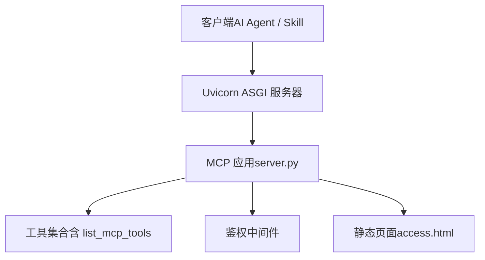
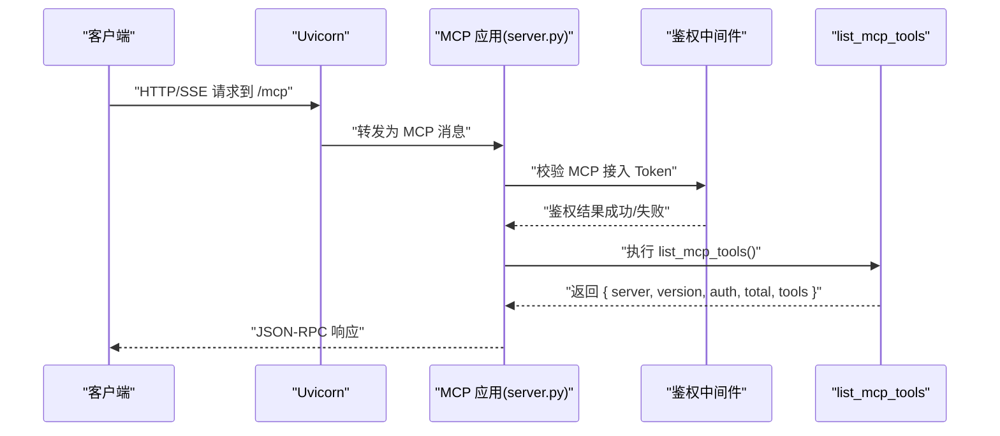
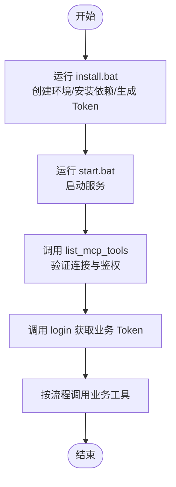
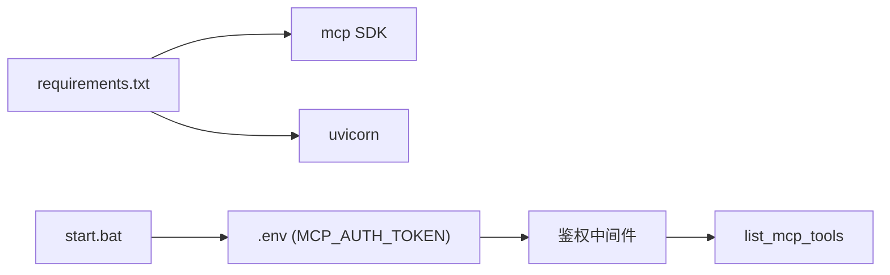

# list_mcp_tools 工具

<cite>
**本文引用的文件**
- [规约管理MCP服务化Spec.md](file://规约管理MCP服务化Spec.md)
- [mcp server部署.md](file://mcp server部署.md)
- [start.bat](file://mcp_server/start.bat)
- [access.html](file://mcp_server/static/access.html)
</cite>

## 目录
1. [简介](#简介)
2. [项目结构](#项目结构)
3. [核心组件](#核心组件)
4. [架构总览](#架构总览)
5. [详细组件分析](#详细组件分析)
6. [依赖关系分析](#依赖关系分析)
7. [性能与可用性](#性能与可用性)
8. [故障排查指南](#故障排查指南)
9. [结论](#结论)
10. [附录](#附录)

## 简介
list_mcp_tools 是 MCP Server 提供的“探测 + 功能”型工具，用于：
- 列出当前服务器暴露的所有工具（名称、类型、说明等）
- 探测 MCP 接入鉴权状态（是否已配置 Token、是否可建立连接）
- 获取服务器基本信息（如服务器名称、版本号）

该工具无参数，调用后返回统一的结构体，包含服务器信息、鉴权状态、工具总数与工具定义数组。它既是能力清单工具，也是连接/鉴权健康检查工具，常用于集成流程的“握手”步骤。

**章节来源**
- [规约管理MCP服务化Spec.md:132-139](file://规约管理MCP服务化Spec.md#L132-L139)
- [mcp server部署.md:25-35](file://mcp server部署.md#L25-L35)

## 项目结构
本项目采用“协议层 + 应用层”的分层组织方式：
- 协议层：基于 MCP SDK 提供工具注册与 JSON-RPC/SSE 通信
- 应用层：server.py 负责工具注册、鉴权中间件、路由；api_client.py 封装后端 API 调用
- 部署脚本：install.bat、start.bat 负责环境准备与服务启动
- 文档与规范：规约管理MCP服务化Spec.md 描述工具清单、数据流与错误策略

**图表来源**
- [mcp server部署.md:110-126](file://mcp server部署.md#L110-L126)
- [mcp server部署.md:163-200](file://mcp server部署.md#L163-L200)

**章节来源**
- [mcp server部署.md:25-35](file://mcp server部署.md#L25-L35)
- [mcp server部署.md:110-126](file://mcp server部署.md#L110-L126)
- [mcp server部署.md:163-200](file://mcp server部署.md#L163-L200)

## 核心组件
- list_mcp_tools 工具：无参工具，返回服务器信息、鉴权状态、工具清单
- 鉴权中间件：校验 MCP 接入 Token，影响鉴权探测结果
- 工具注册机制：server.py 中通过装饰器注册工具，维护工具元数据（名称、类型、说明）
- 静态接入页：access.html 提供可视化引导，并提示调用 list_mcp_tools 验证连接与鉴权

**章节来源**
- [规约管理MCP服务化Spec.md:132-139](file://规约管理MCP服务化Spec.md#L132-L139)
- [mcp server部署.md:25-35](file://mcp server部署.md#L25-L35)
- [access.html:314](file://mcp_server/static/access.html#L314)
- [access.html:487](file://mcp_server/static/access.html#L487)

## 架构总览
list_mcp_tools 的典型调用链路如下：

**图表来源**
- [mcp server部署.md:163-200](file://mcp server部署.md#L163-L200)
- [mcp server部署.md:110-126](file://mcp server部署.md#L110-L126)

## 详细组件分析

### list_mcp_tools 工具
- 作用
  - 列出所有可用工具（名称、类型、说明）
  - 探测 MCP 接入鉴权状态（token_required、token_valid、access_level、source）
  - 返回服务器名称与版本信息
- 参数
  - 无
- 返回值字段
  - server：字符串，服务器名称
  - version：字符串，版本号
  - auth：对象
    - token_required：布尔，是否需要 Token
    - token_valid：布尔，Token 是否有效
    - access_level：字符串，访问级别（例如普通用户/系统级）
    - source：字符串，鉴权来源（例如 Header、环境变量等）
  - total：整数，工具总数
  - tools：数组，每个元素为工具定义（名称、类型、说明等）
- 行为特性
  - 不依赖后端业务 API，仅读取本地注册的工具元数据与鉴权上下文
  - 可用于集成流程的“握手”与健康检查
- 使用示例
  - 在 Skill 或自动化流程中，先调用 list_mcp_tools 验证连接与鉴权，再执行后续工具
- 错误处理
  - 若 MCP 接入未配置 Token，auth.token_valid 为 false，应提示重新配置
  - 若网络异常或 SSE 断开，上层重试并记录日志

**章节来源**
- [规约管理MCP服务化Spec.md:132-139](file://规约管理MCP服务化Spec.md#L132-L139)
- [mcp server部署.md:25-35](file://mcp server部署.md#L25-L35)
- [access.html:487](file://mcp_server/static/access.html#L487)

### 鉴权探测与访问控制
- 鉴权来源
  - MCP 接入 Token 由 start.bat 读取 .env 中的 MCP_AUTH_TOKEN 注入
- 探测逻辑
  - list_mcp_tools 根据鉴权中间件的结果填充 auth 字段
  - token_required 表示是否要求 Token
  - token_valid 表示当前 Token 是否通过校验
  - access_level 表示当前访问级别（普通用户/系统级）
  - source 表示鉴权来源（如 HTTP Header）
- 对写入类工具的影响
  - 写入类工具受系统级权限保护，普通用户将被拒绝
  - 查询类工具在普通用户和系统级用户下均可调用

**章节来源**
- [start.bat:15-27](file://mcp_server/start.bat#L15-L27)
- [规约管理MCP服务化Spec.md:132-139](file://规约管理MCP服务化Spec.md#L132-L139)
- [mcp server部署.md:25-35](file://mcp server部署.md#L25-L35)

### 工具注册机制
- 注册方式
  - 通过 MCP 装饰器将函数注册为工具，维护工具元数据（名称、类型、说明）
- 变更要点
  - 删除无用桩工具，保留 list_mcp_tools
  - 新增大量业务工具（登录、大类、设备类型、品牌、型号、规约信息等）
- 验证方式
  - 通过调用 list_mcp_tools 验证工具名称、类型、说明可见且正确

**章节来源**
- [规约管理MCP服务化Spec.md:247-285](file://规约管理MCP服务化Spec.md#L247-L285)
- [规约管理MCP服务化Spec.md:132-139](file://规约管理MCP服务化Spec.md#L132-L139)

### 典型集成方案
- 初始化阶段
  - 运行 install.bat 创建虚拟环境、安装依赖、生成 Token 并写入 .env 与 mcp.json
  - 运行 start.bat 启动服务，打印 Token 与 URL
- 连接验证
  - 调用 list_mcp_tools 验证 MCP 连接与鉴权状态
- 业务编排
  - 使用 login 获取业务 Token，随后按顺序调用各业务工具完成流程

**图表来源**
- [mcp server部署.md:463-500](file://mcp server部署.md#L463-L500)
- [mcp server部署.md:677-686](file://mcp server部署.md#L677-L686)

**章节来源**
- [mcp server部署.md:463-500](file://mcp server部署.md#L463-L500)
- [mcp server部署.md:677-686](file://mcp server部署.md#L677-L686)

## 依赖关系分析
- 运行时依赖
  - mcp：提供 MCP 协议实现与工具注册能力
  - uvicorn：ASGI 服务器，承载 MCP 应用
- 启动与环境
  - start.bat 读取 .env 中的 MCP_AUTH_TOKEN，作为 MCP 接入鉴权依据
- 外部接口
  - 其他工具可能调用后端 API（httpx），但 list_mcp_tools 本身不依赖后端

**图表来源**
- [mcp server部署.md:40-60](file://mcp server部署.md#L40-L60)
- [start.bat:15-27](file://mcp_server/start.bat#L15-L27)

**章节来源**
- [mcp server部署.md:40-60](file://mcp server部署.md#L40-L60)
- [start.bat:15-27](file://mcp_server/start.bat#L15-L27)

## 性能与可用性
- 低开销：list_mcp_tools 仅读取本地元数据与鉴权上下文，不发起后端请求
- 高并发：基于 Uvicorn 异步事件循环，适合高频探测
- 可用性建议
  - 在 Skill 启动时调用一次 list_mcp_tools 进行握手
  - 定期轮询以检测连接中断或鉴权失效
  - 结合日志记录鉴权状态变化，便于问题定位

[本节为通用指导，不直接分析具体文件]

## 故障排查指南
- 无法建立 MCP 连接
  - 检查 start.bat 是否正确读取 MCP_AUTH_TOKEN
  - 确认服务已在 8765 端口监听
- 鉴权失败
  - 检查 .env 中 MCP_AUTH_TOKEN 是否存在且格式正确
  - 查看 list_mcp_tools 返回的 auth.token_valid 是否为 true
- 工具列表为空或不完整
  - 确认 server.py 已完成工具注册
  - 通过 list_mcp_tools 验证工具数量与类型是否符合预期
- 网络异常
  - 检查防火墙与代理设置
  - 重试并记录错误码与消息

**章节来源**
- [start.bat:15-27](file://mcp_server/start.bat#L15-L27)
- [mcp server部署.md:463-500](file://mcp server部署.md#L463-L500)
- [mcp server部署.md:665-686](file://mcp server部署.md#L665-L686)

## 结论
list_mcp_tools 是 MCP Server 的关键入口工具，兼具“能力清单”和“鉴权探测”双重职责。通过无参调用即可快速验证连接、鉴权与工具可用性，是 Skill 与自动化流程的必备第一步。配合鉴权中间件与工具注册机制，可实现安全、透明、可观测的工具调用体系。

[本节为总结性内容，不直接分析具体文件]

## 附录
- 常见调用序列
  - 启动服务 → 调用 list_mcp_tools → 调用 login → 调用业务工具
- 参考路径
  - 工具清单与数据流：见规约管理MCP服务化Spec.md
  - 启动与部署：见 mcp server部署.md 与 start.bat
  - 接入引导：见 access.html

[本节为补充信息，不直接分析具体文件]