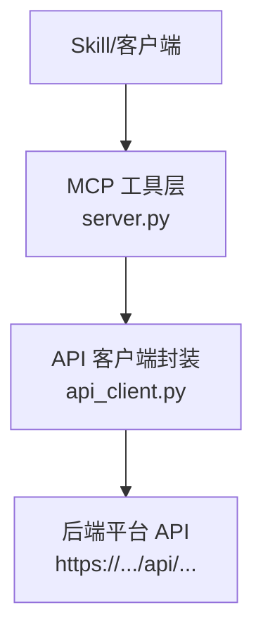
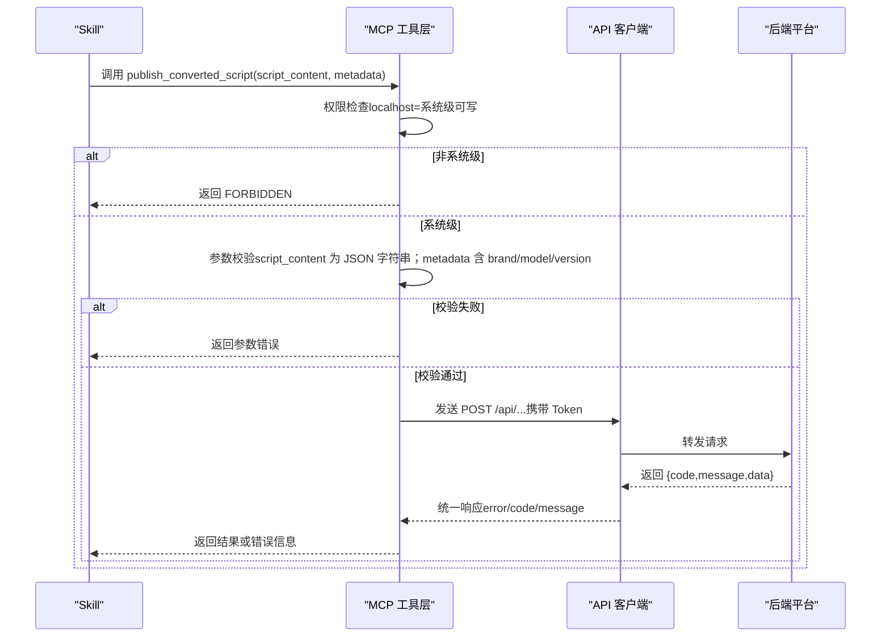
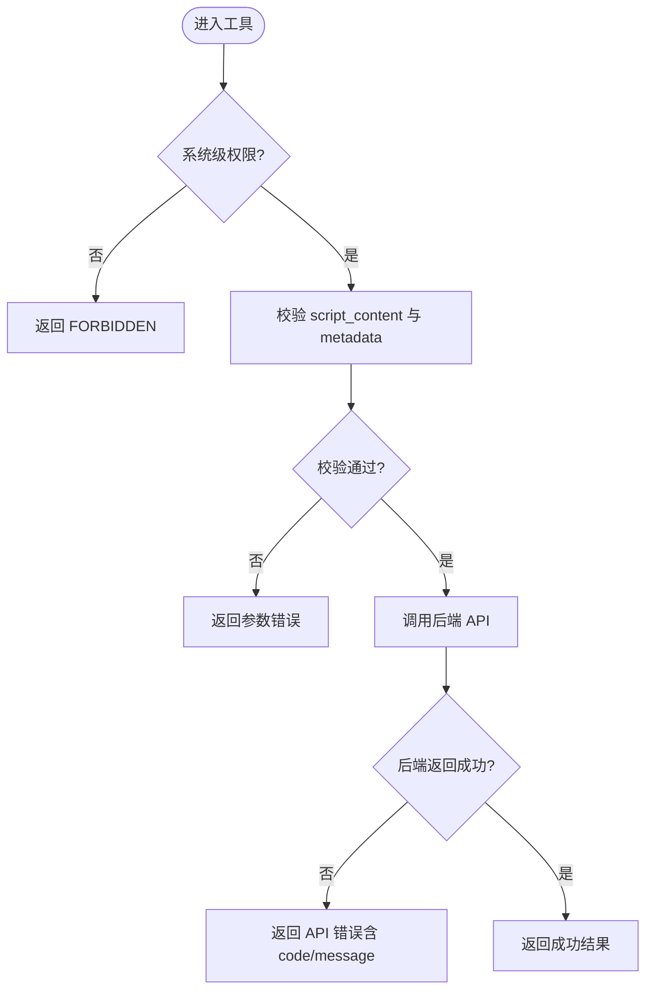
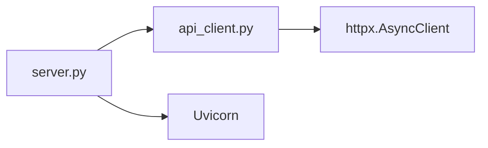

# publish_converted_script 工具

<cite>
**本文引用的文件**
- [规约管理MCP服务化Spec.md](file://规约管理MCP服务化Spec.md)
- [mcp server部署.md](file://mcp server部署.md)
- [access.html](file://mcp_server/static/access.html)
- [tasks.md](file://openspec/changes/enhance-modbus-mcp-workflow/tasks.md)
</cite>

## 目录
1. [简介](#简介)
2. [项目结构](#项目结构)
3. [核心组件](#核心组件)
4. [架构总览](#架构总览)
5. [详细组件分析](#详细组件分析)
6. [依赖关系分析](#依赖关系分析)
7. [性能考虑](#性能考虑)
8. [故障排查指南](#故障排查指南)
9. [结论](#结论)
10. [附录](#附录)

## 简介
本参考文档面向“发布生成的转换脚本到平台”的写入操作桩函数：publish_converted_script。该工具用于将已生成的协议转换脚本及其元数据提交至后端平台存储，供后续打包、分发与安装使用。当前仓库处于规划与改造阶段，server.py 中的旧桩将被删除并替换为基于 httpx 的异步 API 调用封装；权限模型要求系统级（localhost）才能执行写入类工具，普通用户仅具备只读能力。

## 项目结构
- MCP Server 提供工具接口，通过 ASGI 服务器运行，支持 SSE 长连接与 JSON-RPC 消息处理。
- 规范文档定义了从 Skill 调用 MCP 工具，再到 api_client 发起后端 HTTP 请求的整体数据流。
- 权限模型由访问来源决定：本地访问为系统级（读写），其他 IP 为用户级（只读）。

图表来源
- [规约管理MCP服务化Spec.md:44-66](file://规约管理MCP服务化Spec.md#L44-L66)

章节来源
- [规约管理MCP服务化Spec.md:44-66](file://规约管理MCP服务化Spec.md#L44-L66)
- [mcp server部署.md:64-79](file://mcp server部署.md#L64-L79)

## 核心组件
- 工具入口：publish_converted_script（写入类工具，待实现）
- API 客户端：ProtocolApiClient（统一构造请求、注入 Token、超时与错误归一化）
- 鉴权中间件：ASGI 鉴权，区分 localhost（系统级）与其他 IP（用户级）
- 后端平台：负责脚本内容校验、元数据完整性检查与持久化存储

职责边界
- MCP 工具层：参数校验、权限判定、调用 api_client
- api_client：网络 I/O、HTTP 状态码与业务码统一处理
- 后端平台：业务规则校验、存储与版本管理

章节来源
- [规约管理MCP服务化Spec.md:79-131](file://规约管理MCP服务化Spec.md#L79-L131)
- [mcp server部署.md:655-663](file://mcp server部署.md#L655-L663)

## 架构总览
下图展示了从 Skill 调用到后端平台存储的完整流程，包含权限检查、参数校验与错误处理。

图表来源
- [规约管理MCP服务化Spec.md:56-66](file://规约管理MCP服务化Spec.md#L56-L66)
- [规约管理MCP服务化Spec.md:123-131](file://规约管理MCP服务化Spec.md#L123-L131)

## 详细组件分析

### 参数规范
- script_content
  - 类型：JSON 字符串
  - 必填：是
  - 说明：转换脚本的内容，需符合平台期望的 JSON Schema（键名、嵌套结构、数据类型等）
- metadata
  - 类型：对象
  - 必填：是
  - 字段：
    - brand：品牌标识（字符串）
    - model：型号标识（字符串）
    - version：版本号（字符串，建议语义化版本）
  - 说明：用于脚本归属与版本管理

章节来源
- [规约管理MCP服务化Spec.md:123-131](file://规约管理MCP服务化Spec.md#L123-L131)

### 预期实现逻辑
- 权限控制
  - 仅允许系统级（localhost）访问写入类工具；普通用户调用返回 FORBIDDEN
- 参数校验
  - 校验 script_content 是否为合法 JSON 字符串
  - 校验 metadata 是否包含 brand、model、version 且值非空
- 发布到平台
  - 通过 api_client 以异步方式调用后端 API
  - 统一错误处理：网络异常、HTTP 异常、业务码非成功、认证失败
- 幂等与重试
  - 工具不自动重试；由上层 Skill 根据返回码决定是否重试

图表来源
- [mcp server部署.md:655-663](file://mcp server部署.md#L655-L663)
- [规约管理MCP服务化Spec.md:123-131](file://规约管理MCP服务化Spec.md#L123-L131)

### 权限控制机制
- 访问来源判断
  - localhost：系统级，允许读写
  - 其他 IP：用户级，仅允许只读
- 工具分类
  - 写入类工具标记为 write，覆盖 add/update/del/save/upload/gen_script 等
- 前端展示
  - access.html 中根据 accessLevel 显示“系统级（读写）”或“用户级（只读）”

章节来源
- [mcp server部署.md:655-663](file://mcp server部署.md#L655-L663)
- [access.html:419-431](file://mcp_server/static/access.html#L419-L431)
- [tasks.md:9-14](file://openspec/changes/enhance-modbus-mcp-workflow/tasks.md#L9-L14)

### 错误处理策略
- 参数错误
  - script_content 不是合法 JSON
  - metadata 缺少必要字段或为空
- 权限错误
  - 非系统级调用写入工具，返回 FORBIDDEN
- 网络/HTTP 错误
  - 网络异常、超时、HTTP 状态码异常
- 业务错误
  - 后端返回非成功码（如 40000/40100）
- 统一响应格式
  - error: 布尔
  - code: 错误码（NETWORK_ERROR/API_ERROR/AUTH_ERROR/HTTP_ERROR/VALIDATION_ERROR）
  - message: 人类可读的错误描述
  - raw: 可选，原始响应体（便于调试）

章节来源
- [规约管理MCP服务化Spec.md:123-131](file://规约管理MCP服务化Spec.md#L123-L131)

### 使用示例与集成方案
- 典型调用序列（Skill 视角）
  - 登录获取 token
  - 查询/配置相关资源
  - 生成脚本
  - 调用 publish_converted_script 发布脚本
- 集成要点
  - 在 Skill 中编排原子工具，确保先完成前置步骤（如 gen_script）
  - 对返回码进行分支处理：成功继续、失败提示并重试或回滚
  - 将 token 作为工具参数传入，避免在服务端缓存

章节来源
- [规约管理MCP服务化Spec.md:295-319](file://规约管理MCP服务化Spec.md#L295-L319)

### 与脚本发布管理系统的协作关系
- 角色分工
  - MCP 工具层：负责参数校验、权限控制与调用封装
  - API 客户端：负责网络通信与错误归一化
  - 后端平台：负责脚本内容校验、元数据完整性检查与持久化存储
- 数据契约
  - 请求：script_content（JSON 字符串）、metadata（brand/model/version）
  - 响应：统一结构 {code, data, message}，成功码为 20000
- 版本与归档
  - 通过 metadata.version 进行版本管理
  - 平台侧可结合打包与分发流程（ZIP 包、manifest.json）进行归档与安装

章节来源
- [规约管理MCP服务化Spec.md:327-335](file://规约管理MCP服务化Spec.md#L327-L335)

## 依赖关系分析
- 外部依赖
  - httpx：异步 HTTP 客户端，用于调用后端 API
- 内部模块
  - server.py：注册工具、鉴权中间件、路由
  - api_client.py：封装所有后端 API 调用
- 运行时
  - Uvicorn：ASGI 服务器，承载 MCP 应用

图表来源
- [规约管理MCP服务化Spec.md:44-66](file://规约管理MCP服务化Spec.md#L44-L66)
- [mcp server部署.md:64-79](file://mcp server部署.md#L64-L79)

章节来源
- [规约管理MCP服务化Spec.md:44-66](file://规约管理MCP服务化Spec.md#L44-L66)
- [mcp server部署.md:64-79](file://mcp server部署.md#L64-L79)

## 性能考虑
- 异步 I/O：使用 httpx.AsyncClient 避免阻塞事件循环
- 超时设置：为网络请求设置合理超时，防止长时间挂起
- 连接复用：保持 AsyncClient 生命周期，减少握手开销
- 错误快速失败：在网络或认证失败时尽早返回，降低无效重试

[本节为通用指导，无需特定文件引用]

## 故障排查指南
- 无法调用写入工具
  - 检查访问来源是否为 localhost；否则会被识别为用户级并拒绝写入
- 参数校验失败
  - 确认 script_content 为合法 JSON 字符串
  - 确认 metadata 包含 brand、model、version 且非空
- 网络或认证错误
  - 检查 Token 是否正确注入
  - 检查后端可达性与证书配置
- 业务错误
  - 查看后端返回的 code 与 message，定位具体原因

章节来源
- [mcp server部署.md:655-663](file://mcp server部署.md#L655-L663)
- [规约管理MCP服务化Spec.md:123-131](file://规约管理MCP服务化Spec.md#L123-L131)

## 结论
publish_converted_script 作为写入类工具，应在 MCP 工具层完成权限校验与参数校验，再通过 api_client 调用后端平台进行脚本发布与存储。权限模型严格限制为非系统级不可写，错误处理采用统一结构，便于上游 Skill 进行流程编排与重试决策。实施时应遵循规范文档的数据契约与错误约定，确保与脚本发布管理系统的良好协作。

[本节为总结性内容，无需特定文件引用]

## 附录
- 关键任务清单
  - 新增 api_client 并实现统一返回结构
  - 在 server.py 注册新工具并移除旧桩
  - 为写入类工具接入系统级权限检查
  - 验证查询工具在普通用户与系统级用户下均可用

章节来源
- [tasks.md:1-14](file://openspec/changes/enhance-modbus-mcp-workflow/tasks.md#L1-L14)