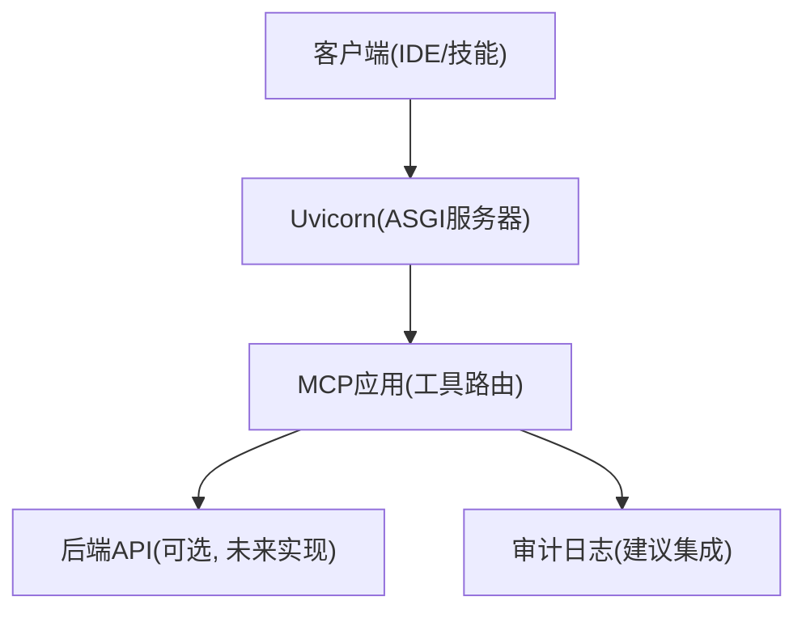
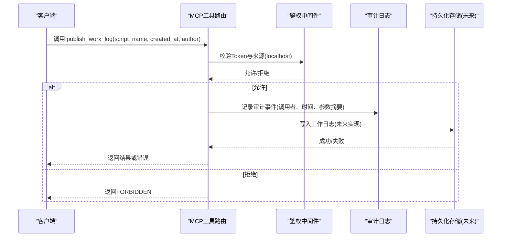
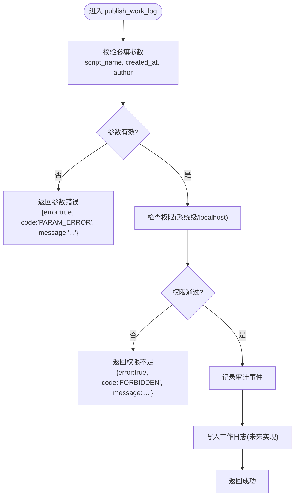
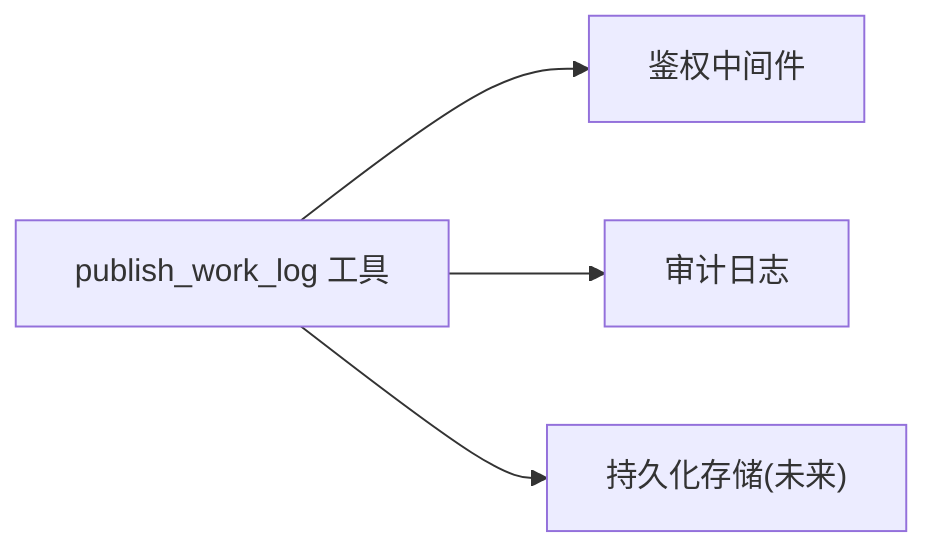

# publish_work_log 工具

<cite>
**本文引用的文件**
- [规约管理MCP服务化Spec.md](file://规约管理MCP服务化Spec.md)
- [mcp server部署.md](file://mcp server部署.md)
- [tasks.md](file://openspec/changes/enhance-modbus-mcp-workflow/tasks.md)
</cite>

## 目录
1. [简介](#简介)
2. [项目结构](#项目结构)
3. [核心组件](#核心组件)
4. [架构总览](#架构总览)
5. [详细组件分析](#详细组件分析)
6. [依赖关系分析](#依赖关系分析)
7. [性能考虑](#性能考虑)
8. [故障排查指南](#故障排查指南)
9. [结论](#结论)
10. [附录](#附录)

## 简介
本参考文档围绕 MCP 工具 `publish_work_log` 的桩函数设计展开，说明其作为“写入操作”的定位：用于在脚本创建记录时生成工作日志，支撑审计追踪。当前仓库中该工具以桩形式存在，后续实现应遵循统一的参数规范、权限控制与错误处理策略，并与审计日志系统对接。

## 项目结构
- 本项目为基于 MCP（Model Context Protocol）的服务端，使用 Uvicorn 提供 ASGI 服务，暴露工具调用接口。
- 当前仓库未包含实际的 Python 服务端代码文件；关于 `publish_work_log` 的信息来自规格文档与任务清单，明确其为桩工具之一，并将在改造中被删除或替换为真实实现。
- 部署与运行通过 Windows 批处理脚本完成，支持本地开发环境一键安装与启动。

[本节为概念性说明，不直接分析具体文件]

## 核心组件
- 工具定义与注册：MCP 工具以装饰器方式注册，`publish_work_log` 属于写入类工具，需标记为写操作并在权限层进行系统级校验。
- 鉴权中间件：服务提供 Token 认证机制，结合访问来源限制（如 localhost），对写入操作实施更严格的权限控制。
- 错误处理：统一返回结构化错误，区分网络异常、业务错误、认证失败等场景。

**章节来源**
- [规约管理MCP服务化Spec.md:247-286](file://规约管理MCP服务化Spec.md#L247-L286)
- [mcp server部署.md:645-674](file://mcp server部署.md#L645-L674)

## 架构总览
下图展示 `publish_work_log` 从调用到落库/审计的端到端流程。当前阶段为桩实现，仅返回占位响应；未来实现将接入后端 API 或持久化存储，并输出审计事件。

**图表来源**
- [mcp server部署.md:645-674](file://mcp server部署.md#L645-L674)
- [规约管理MCP服务化Spec.md:247-286](file://规约管理MCP服务化Spec.md#L247-L286)

## 详细组件分析

### 工具定义与参数规范
- 工具名称：`publish_work_log`
- 工具类型：写入（write）
- 必填参数：
  - script_name：字符串，脚本名称
  - created_at：时间戳或ISO格式时间，创建时间
  - author：字符串，创建者标识
- 预期行为：
  - 参数校验通过后，记录一条工作日志，供后续审计与分析
  - 若处于桩阶段，返回占位成功或待实现提示

**图表来源**
- [规约管理MCP服务化Spec.md:247-286](file://规约管理MCP服务化Spec.md#L247-L286)
- [tasks.md:9-14](file://openspec/changes/enhance-modbus-mcp-workflow/tasks.md#L9-L14)

**章节来源**
- [规约管理MCP服务化Spec.md:247-286](file://规约管理MCP服务化Spec.md#L247-L286)
- [tasks.md:9-14](file://openspec/changes/enhance-modbus-mcp-workflow/tasks.md#L9-L14)

### 权限控制机制
- 访问来源限制：仅允许本地访问（localhost）执行写入操作，其他IP地址视为普通用户，仅具备只读能力。
- 工具级别保护：所有写入类工具（含 `publish_work_log`）需标记为 write，并在中间件层进行系统级权限校验。
- 失败响应：普通用户尝试调用写入工具时，应返回明确的 FORBIDDEN 错误。

**章节来源**
- [mcp server部署.md:645-674](file://mcp server部署.md#L645-L674)
- [tasks.md:9-14](file://openspec/changes/enhance-modbus-mcp-workflow/tasks.md#L9-L14)

### 错误处理策略
- 参数验证失败：返回结构化错误，包含 error=true、code=PARAM_ERROR、message 描述问题。
- 权限不足：返回 error=true、code=FORBIDDEN、message 提示权限不足。
- 存储错误（未来实现）：返回 error=true、code=STORE_ERROR、message 描述存储异常。
- 网络/后端错误（若调用外部API）：返回 error=true、code=NETWORK_ERROR 或 HTTP_ERROR，附带原始信息以便排查。

**章节来源**
- [规约管理MCP服务化Spec.md:123-131](file://规约管理MCP服务化Spec.md#L123-L131)
- [mcp server部署.md:645-674](file://mcp server部署.md#L645-L674)

### 使用示例与集成方案
- 调用入口：通过 MCP 工具调用，传入 script_name、created_at、author。
- 典型流程：
  1) 客户端发起工具调用
  2) 鉴权中间件校验来源与权限
  3) 参数校验通过后记录审计事件
  4) 写入工作日志（未来实现）
  5) 返回结果
- 集成建议：
  - 与现有 MCP 鉴权中间件集成，复用 Token 校验逻辑
  - 将审计事件写入独立日志表或日志系统，便于后续检索与分析
  - 在工具清单中标注该工具为写入类型，便于前端或Skill编排识别

**章节来源**
- [规约管理MCP服务化Spec.md:247-286](file://规约管理MCP服务化Spec.md#L247-L286)
- [mcp server部署.md:645-674](file://mcp server部署.md#L645-L674)

### 与审计日志系统的集成方式
- 触发点：每次调用 `publish_work_log` 均记录审计事件，包括调用者、时间、参数摘要、来源IP、是否成功。
- 存储位置：建议写入独立的审计日志表或集中式日志系统，避免与业务数据混存。
- 查询与分析：提供按 script_name、author、created_at 等维度的查询能力，支持导出与告警。
- 安全要求：审计日志不可被普通用户修改或删除，仅系统管理员可维护。

**章节来源**
- [mcp server部署.md:645-674](file://mcp server部署.md#L645-L674)

## 依赖关系分析
- 运行时依赖：MCP SDK、Uvicorn
- 未来依赖（实现阶段）：httpx（异步HTTP客户端）、数据库驱动或日志系统SDK
- 模块耦合：
  - 工具层与鉴权中间件强耦合（权限校验）
  - 工具层与审计日志弱耦合（事件上报）
  - 工具层与持久化存储弱耦合（数据落库）

**图表来源**
- [规约管理MCP服务化Spec.md:247-286](file://规约管理MCP服务化Spec.md#L247-L286)
- [mcp server部署.md:645-674](file://mcp server部署.md#L645-L674)

**章节来源**
- [规约管理MCP服务化Spec.md:247-286](file://规约管理MCP服务化Spec.md#L247-L286)
- [mcp server部署.md:645-674](file://mcp server部署.md#L645-L674)

## 性能考虑
- 异步处理：MCP 服务基于 asyncio，工具实现应保持非阻塞，避免长时间同步I/O。
- 批量写入：未来若涉及批量日志写入，建议使用队列或批量接口降低数据库压力。
- 超时与重试：对外部API或存储的调用应设置合理超时，避免拖慢事件循环；谨慎重试幂等写入。
- 资源隔离：审计日志与业务数据分离，避免相互影响。

[本节为通用指导，不直接分析具体文件]

## 故障排查指南
- 参数错误：检查 script_name、created_at、author 是否为空或类型不符。
- 权限不足：确认请求来源为 localhost，且具备系统级权限；普通用户无法执行写入。
- 存储错误：检查数据库连接、磁盘空间、权限配置；查看审计日志中的错误码与消息。
- 网络错误：若调用外部API，检查网络连通性与后端状态码。

**章节来源**
- [mcp server部署.md:645-674](file://mcp server部署.md#L645-L674)

## 结论
`publish_work_log` 在当前仓库中以桩形式存在，定位为写入类工具，用于脚本创建记录的审计追踪。实现时应严格遵循参数规范、权限控制与错误处理策略，并与审计日志系统集成，确保可追溯、可分析、可告警。未来实现需保持异步与非阻塞，保障服务高可用与高性能。

[本节为总结性内容，不直接分析具体文件]

## 附录
- 相关任务与规划：
  - 将写入类工具标记为 write，并接入系统级权限检查
  - 验证普通用户调用写入工具返回 FORBIDDEN
  - 保留 list_mcp_tools 工具，更新工具列表内容
- 部署与运行：
  - 使用 install.bat 初始化环境与Token
  - 使用 start.bat 启动服务，监听本地端口

**章节来源**
- [tasks.md:9-14](file://openspec/changes/enhance-modbus-mcp-workflow/tasks.md#L9-L14)
- [mcp server部署.md:309-439](file://mcp server部署.md#L309-L439)