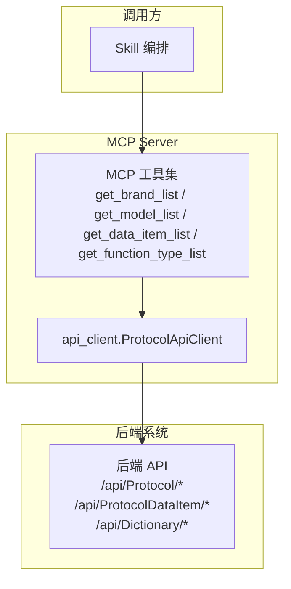
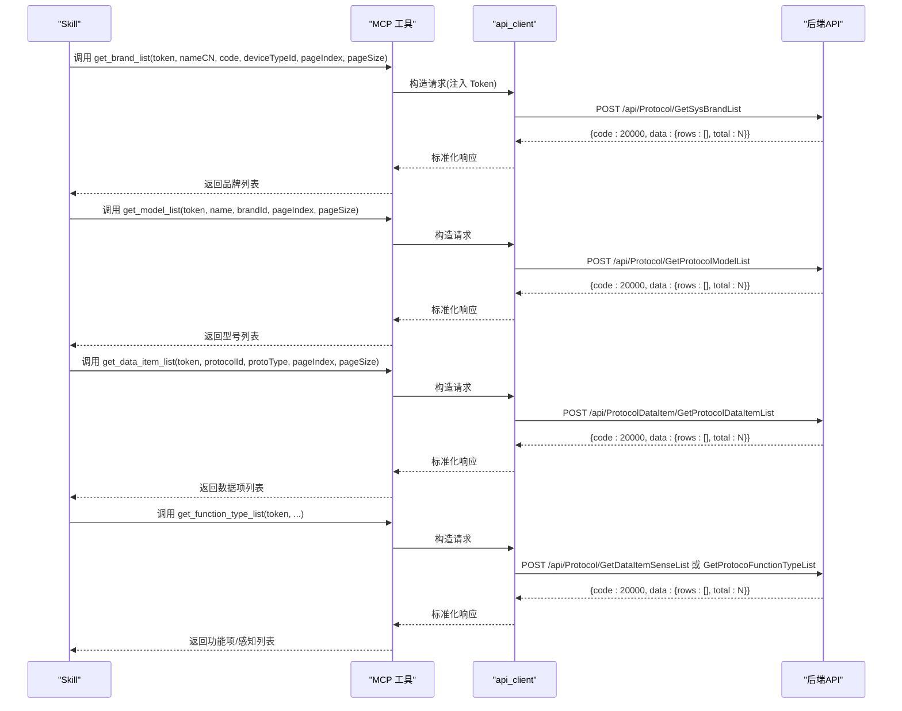
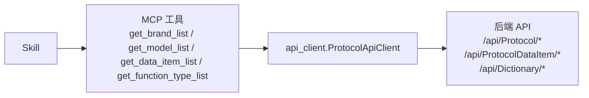

# query_device_classes 工具

<cite>
**本文引用的文件**
- [规约管理MCP服务化Spec.md](file://规约管理MCP服务化Spec.md)
- [规约管理基础数据模块Spec.md](file://规约管理基础数据模块Spec.md)
</cite>

## 目录
1. [简介](#简介)
2. [项目结构](#项目结构)
3. [核心组件](#核心组件)
4. [架构总览](#架构总览)
5. [详细组件分析](#详细组件分析)
6. [依赖关系分析](#依赖关系分析)
7. [性能考虑](#性能考虑)
8. [故障排查指南](#故障排查指南)
9. [结论](#结论)
10. [附录](#附录)

## 简介
本参考文档面向“query_device_classes”工具的桩函数设计意图与使用规范。该工具用于查询运维平台中的品牌、型号、原子标签（数据项/功能项）三类基础数据，供 Skill 在自动化流程中完成参数确认、复用与推荐。根据当前仓库的变更清单，该桩工具已被删除并替换为细粒度 MCP 工具（如 get_brand_list、get_model_list、get_data_item_list、get_function_type_list 等），因此本文档以“替代方案 + 集成方式”的形式给出等价能力说明，帮助使用者理解如何在不使用该桩的前提下完成相同目标。

- 设计意图：统一入口查询品牌、型号、原子标签，支撑后续新增/配置/生成脚本等流程的参数来源确认。
- 参数规范（原桩约定）：brand（品牌名称，可选）、model（型号名称，可选）、tag（原子标签，可选）。为空时返回全部。
- 返回值格式（建议）：分页列表 data.rows 数组，每项包含 id、名称、编码、所属上级 ID 等字段；错误时返回 error/code/message/raw。
- 权限控制：只读操作，仅读取基础数据，不修改任何业务对象。
- 集成方式：通过 MCP 工具链调用后端 API，Skill 编排组合多个原子工具实现“查询—复用—推荐—写入”的闭环。

**章节来源**
- [规约管理MCP服务化Spec.md:247-254](file://规约管理MCP服务化Spec.md#L247-L254)

## 项目结构
本项目采用“MCP Server 暴露细粒度工具 + api_client 封装 HTTP 调用”的分层结构。与设备类别相关的数据分布在以下模块：
- 大类/设备类型/品牌/型号：协议管理页面与接口
- 数据项/系数/感知：协议数据项与相关列表
- 功能项/字典：功能项管理与规约类型字典

**图表来源**
- [规约管理MCP服务化Spec.md:44-78](file://规约管理MCP服务化Spec.md#L44-L78)

**章节来源**
- [规约管理MCP服务化Spec.md:44-78](file://规约管理MCP服务化Spec.md#L44-L78)

## 核心组件
- 工具层（MCP 工具）：提供细粒度的只读查询能力，分别对应品牌、型号、数据项、功能项等后端接口。
- 客户端层（api_client）：统一构造请求头（Token）、发送异步 HTTP 请求、解析响应、统一错误处理。
- 后端接口层：按页面/模块划分，提供分页列表、导出、字典等能力。

关键职责边界：
- 工具层只做参数校验与转发，不承载复杂业务逻辑。
- 客户端层负责网络与错误处理，屏蔽底层差异。
- 后端接口层提供稳定契约，前端/Skill 通过 MCP 工具间接消费。

**章节来源**
- [规约管理MCP服务化Spec.md:79-131](file://规约管理MCP服务化Spec.md#L79-L131)

## 架构总览
从 Skill 视角看，原本由“query_device_classes”一次性完成的查询，现拆分为多个原子工具的组合调用。典型流程如下：

**图表来源**
- [规约管理MCP服务化Spec.md:132-245](file://规约管理MCP服务化Spec.md#L132-L245)
- [规约管理MCP服务化Spec.md:490-635](file://规约管理MCP服务化Spec.md#L490-L635)
- [规约管理MCP服务化Spec.md:753-800](file://规约管理MCP服务化Spec.md#L753-L800)

## 详细组件分析

### 品牌查询（替代 query_device_classes.brand）
- 工具：get_brand_list
- 后端接口：POST /api/Protocol/GetSysBrandList
- 请求参数：nameCN（模糊搜索）、code、deviceTypeId（-1=全部）、pageIndex、pageSize
- 响应数据：data.rows 每项含 id、nameCN、name、code、deviceTypeId、deviceTypeName
- 用途：确定品牌是否存在、获取品牌ID以便后续创建型号/规约

**章节来源**
- [规约管理MCP服务化Spec.md:490-519](file://规约管理MCP服务化Spec.md#L490-L519)

### 型号查询（替代 query_device_classes.model）
- 工具：get_model_list
- 后端接口：POST /api/Protocol/GetProtocolModelList
- 请求参数：name（模糊搜索）、brandId（-1=全部）、pageIndex、pageSize
- 响应数据：data.rows 每项含 id、name、brandId、brandName
- 用途：确定型号是否存在、获取型号ID以便后续创建规约

**章节来源**
- [规约管理MCP服务化Spec.md:568-594](file://规约管理MCP服务化Spec.md#L568-L594)

### 原子标签/数据项查询（替代 query_device_classes.tag）
- 工具：get_data_item_list
- 后端接口：POST /api/ProtocolDataItem/GetProtocolDataItemList
- 请求参数：protocolId、protoType、pageIndex、pageSize
- 响应数据：data.rows 每项为数据项定义（具体字段以实际接口为准）
- 用途：确认数据项/原子标签是否已存在，避免重复配置

**章节来源**
- [规约管理MCP服务化Spec.md:753-768](file://规约管理MCP服务化Spec.md#L753-L768)

### 功能项/感知查询（补充原子标签维度）
- 工具：get_function_type_list / get_sense_list
- 后端接口：GET/POST /api/Protocol/GetDataItemSenseList 或 /api/Protocol/GetProtocoFunctionTypeList
- 用途：获取功能项与感知结构元数据，辅助数据项配置

**章节来源**
- [规约管理MCP服务化Spec.md:196-221](file://规约管理MCP服务化Spec.md#L196-L221)

### 参数规范与行为约定
- 品牌/型号/标签查询均为可选过滤条件，未传入时默认返回全部（结合分页）。
- 分页必填：pageIndex、pageSize；建议合理设置 pageSize 以避免过大响应。
- 模糊搜索：nameCN/name 支持模糊匹配，便于用户输入部分名称快速定位。
- 空结果处理：当查询结果为空时，Skill 应提示“未命中”，并可回退到本地 references 或询问用户。

**章节来源**
- [规约管理MCP服务化Spec.md:327-335](file://规约管理MCP服务化Spec.md#L327-L335)
- [规约管理MCP服务化Spec.md:490-519](file://规约管理MCP服务化Spec.md#L490-L519)
- [规约管理MCP服务化Spec.md:568-594](file://规约管理MCP服务化Spec.md#L568-L594)
- [规约管理MCP服务化Spec.md:753-768](file://规约管理MCP服务化Spec.md#L753-L768)

### 返回值格式设计
- 成功：{ code: 20000, data: { rows: [...], total: N }, message: "成功" }
- 失败：{ error: True, code: "NETWORK_ERROR"/"API_ERROR"/"AUTH_ERROR"/"HTTP_ERROR", message: "...", raw: {...} }
- 注意：所有列表接口遵循统一分页结构 data.rows。

**章节来源**
- [规约管理MCP服务化Spec.md:123-131](file://规约管理MCP服务化Spec.md#L123-L131)
- [规约管理MCP服务化Spec.md:327-335](file://规约管理MCP服务化Spec.md#L327-L335)

### 使用示例（步骤式）
- 步骤1：先登录获取 token（login）
- 步骤2：查询品牌（get_brand_list），若存在则复用其 id
- 步骤3：查询型号（get_model_list），若存在则复用其 id
- 步骤4：查询数据项/功能项（get_data_item_list / get_function_type_list），判断是否已配置
- 步骤5：如需新增，再调用对应的写入工具（add_brand / add_model / add_protocol_info / add_data_item 等）

**章节来源**
- [规约管理MCP服务化Spec.md:295-319](file://规约管理MCP服务化Spec.md#L295-L319)

### 错误处理策略
- 网络异常：捕获并返回 NETWORK_ERROR，提示重试或检查网络
- 业务错误：非 20000 码时返回 API_ERROR，附带 message 与 raw 便于诊断
- 鉴权失败：40100 码返回 AUTH_ERROR，提示重新登录
- HTTP 异常：状态码异常返回 HTTP_ERROR，记录原始响应

**章节来源**
- [规约管理MCP服务化Spec.md:123-131](file://规约管理MCP服务化Spec.md#L123-L131)

### 权限控制说明
- 本工具集为只读操作，仅用于查询基础数据，不涉及写入。
- 普通用户具备只读权限；涉及写入的步骤需系统级用户授权。
- 登录成功后，后续工具调用均需携带有效 Token。

**章节来源**
- [规约管理MCP服务化Spec.md:12-24](file://规约管理MCP服务化Spec.md#L12-L24)
- [规约管理MCP服务化Spec.md:295-319](file://规约管理MCP服务化Spec.md#L295-L319)

### 与其他工具的依赖关系与数据流转
- 依赖 login 获取 Token，后续查询/写入均需要 Token。
- 依赖 get_classify_list / get_device_type_list 获取大类/设备类型，作为品牌/型号的上级分类。
- 依赖 get_protocol_info_list 获取规约信息，以便关联品牌/型号/数据项。
- 数据流转：Skill → MCP 工具 → api_client → 后端 API → 返回结构化数据 → Skill 编排决策。

**章节来源**
- [规约管理MCP服务化Spec.md:132-245](file://规约管理MCP服务化Spec.md#L132-L245)
- [规约管理MCP服务化Spec.md:295-319](file://规约管理MCP服务化Spec.md#L295-L319)

## 依赖关系分析

**图表来源**
- [规约管理MCP服务化Spec.md:44-78](file://规约管理MCP服务化Spec.md#L44-L78)

**章节来源**
- [规约管理MCP服务化Spec.md:44-78](file://规约管理MCP服务化Spec.md#L44-L78)

## 性能考虑
- 分页查询：合理使用 pageIndex 与 pageSize，避免一次拉取过多数据。
- 模糊搜索：优先使用精确或半精确条件缩小范围，减少无效数据。
- 并发调用：对互不依赖的查询（如品牌与型号）可并行发起，缩短整体耗时。
- 缓存策略：对热点基础数据（如品牌/型号下拉）可在 Skill 侧做短期缓存，降低重复查询。
- 超时与重试：网络异常时设置合理超时与重试次数，避免长时间阻塞。

[本节为通用指导，无需特定文件引用]

## 故障排查指南
- 无法登录：检查手机号与验证码是否正确，确认 Token 是否过期。
- 查询无结果：确认过滤条件是否过严；尝试放宽条件或清空条件查看全量。
- 鉴权失败：收到 AUTH_ERROR 时重新执行 login 获取新 Token。
- 业务错误：查看 API_ERROR 的 message 与 raw，定位后端具体错误原因。
- 网络异常：检查网络连通性与代理设置，必要时增加重试。

**章节来源**
- [规约管理MCP服务化Spec.md:123-131](file://规约管理MCP服务化Spec.md#L123-L131)

## 结论
虽然“query_device_classes”桩工具已在当前版本中被删除，但其查询品牌、型号、原子标签的目标可通过一组细粒度 MCP 工具实现。Skill 应基于这些原子工具进行编排，遵循“优先查询、命中复用、为空可推荐、失败不新增”的原则，确保流程稳健且可追溯。同时，严格遵循只读权限与错误处理策略，保障用户体验与系统稳定性。

[本节为总结性内容，无需特定文件引用]

## 附录
- 相关页面与接口映射：详见“规约管理基础数据模块Spec.md”，涵盖大类、设备类型、品牌、型号、规约信息等页面的业务逻辑与接口规格。
- 工具清单：详见“规约管理MCP服务化Spec.md”，包含 47 个 MCP 工具及其对应后端 API。

**章节来源**
- [规约管理基础数据模块Spec.md:1-16](file://规约管理基础数据模块Spec.md#L1-L16)
- [规约管理MCP服务化Spec.md:132-245](file://规约管理MCP服务化Spec.md#L132-L245)