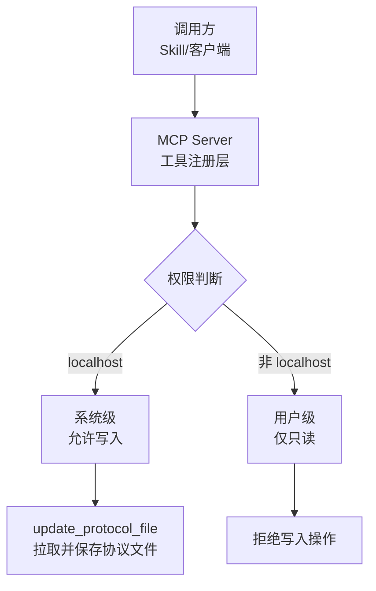
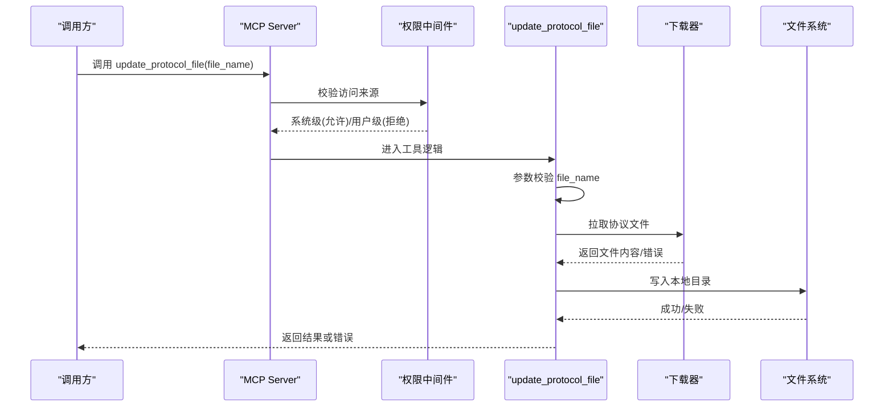
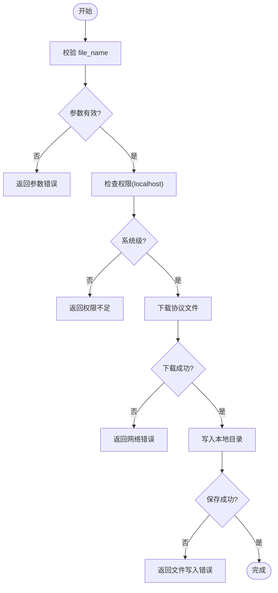
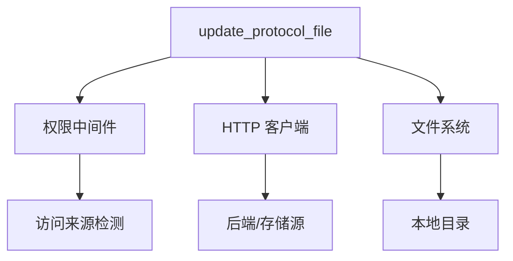

# update_protocol_file 工具

<cite>
**本文引用的文件**
- [规约管理MCP服务化Spec.md](file://规约管理MCP服务化Spec.md)
- [mcp server部署.md](file://mcp server部署.md)
- [access.html](file://mcp_server/static/access.html)
</cite>

## 目录
1. [简介](#简介)
2. [项目结构](#项目结构)
3. [核心组件](#核心组件)
4. [架构总览](#架构总览)
5. [详细组件分析](#详细组件分析)
6. [依赖关系分析](#依赖关系分析)
7. [性能考虑](#性能考虑)
8. [故障排查指南](#故障排查指南)
9. [结论](#结论)
10. [附录](#附录)

## 简介
本参考文档围绕写入类桩工具 `update_protocol_file`，说明其设计目标与预期实现：将服务器端的最新协议参考文件拉取并保存到本地目录。该工具用于在自动化流程中同步协议参考文件，确保本地转换配置与平台侧保持一致。当前仓库中该工具为桩函数（占位实现），后续需按规范接入后端 API 或文件下载能力，并遵循权限控制与错误处理策略。

## 项目结构
- MCP Server 提供工具注册与路由，当前存在若干桩工具，其中包含 `update_protocol_file`。
- 权限模型基于访问来源区分系统级与用户级：本地访问具备读写能力，其他 IP 仅只读。
- 前端页面展示访问级别与 Token，辅助理解权限边界。

图表来源
- [mcp server部署.md:655-663](file://mcp server部署.md#L655-L663)
- [access.html:419-431](file://mcp_server/static/access.html#L419-L431)

章节来源
- [mcp server部署.md:655-663](file://mcp server部署.md#L655-L663)
- [access.html:419-431](file://mcp_server/static/access.html#L419-L431)

## 核心组件
- 工具定义与清单：当前仓库明确列出 `update_protocol_file` 为桩工具之一，并在变更任务中将其归类为写入类工具。
- 权限控制：通过访问来源判定系统级/用户级，系统级可执行写入，用户级禁止写入。
- 错误处理：统一网络异常、业务错误码、鉴权失败等场景的返回格式，便于上层 Skill 编排与重试。

章节来源
- [规约管理MCP服务化Spec.md:247-255](file://规约管理MCP服务化Spec.md#L247-L255)
- [规约管理MCP服务化Spec.md:123-131](file://规约管理MCP服务化Spec.md#L123-L131)
- [mcp server部署.md:655-663](file://mcp server部署.md#L655-L663)

## 架构总览
`update_protocol_file` 的预期调用链如下：
- 调用方通过 MCP 工具调用 `update_protocol_file(file_name)`。
- 工具进行参数校验与权限检查（仅 localhost）。
- 从后端或指定源拉取协议文件内容。
- 将文件写入本地目录（受权限控制）。
- 返回结果或错误信息。

图表来源
- [mcp server部署.md:655-663](file://mcp server部署.md#L655-L663)
- [规约管理MCP服务化Spec.md:123-131](file://规约管理MCP服务化Spec.md#L123-L131)

## 详细组件分析

### 参数规范
- file_name（必填）：要更新的协议文件名。应为字符串类型，且需符合服务端命名约定（例如后缀、路径安全字符限制）。
- 建议校验规则：
  - 非空与长度限制
  - 仅允许字母、数字、下划线、连字符及扩展名
  - 避免路径穿越（如包含“..”、“/”、“\”）

章节来源
- [规约管理MCP服务化Spec.md:247-255](file://规约管理MCP服务化Spec.md#L247-L255)

### 权限控制机制
- 系统级权限：仅当访问来源为 localhost 时允许写入操作。
- 用户级权限：非 localhost 访问仅允许只读，禁止任何写入行为。
- 前端展示：页面会显示当前访问级别（系统级/用户级），便于诊断权限问题。

章节来源
- [mcp server部署.md:655-663](file://mcp server部署.md#L655-L663)
- [access.html:419-431](file://mcp_server/static/access.html#L419-L431)

### 预期实现逻辑
- 步骤概览：
  1) 接收并校验 file_name。
  2) 检查权限（仅 localhost）。
  3) 构造下载请求（从后端文件或对象存储获取协议文件）。
  4) 下载文件内容并校验完整性（可选：校验和/大小）。
  5) 写入本地目录（确保目录存在、权限足够）。
  6) 返回成功结果或错误信息。
- 并发与幂等：
  - 同一 file_name 多次调用应保证幂等（覆盖或跳过更新）。
  - 大文件下载建议使用分块读取与超时控制。

图表来源
- [规约管理MCP服务化Spec.md:123-131](file://规约管理MCP服务化Spec.md#L123-L131)
- [mcp server部署.md:655-663](file://mcp server部署.md#L655-L663)

### 错误处理策略
- 参数错误：返回明确的参数错误信息，提示修正 file_name。
- 权限不足：当访问来源非 localhost 时，返回权限错误，指示无法执行写入。
- 文件不存在：若服务端未找到对应协议文件，返回文件缺失错误。
- 网络错误：连接超时、DNS 解析失败、HTTP 状态异常等，返回网络错误并附带原因。
- 写入失败：磁盘空间不足、权限不足、路径非法等，返回文件系统错误。
- 统一响应格式：遵循规范中的错误返回结构（error、code、message、raw）。

章节来源
- [规约管理MCP服务化Spec.md:123-131](file://规约管理MCP服务化Spec.md#L123-L131)

### 使用示例
- 基本调用：
  - 调用方式：通过 MCP 工具调用 `update_protocol_file`。
  - 参数：传入 file_name（例如 "modbus_rtuv2.json"）。
  - 环境：必须在 localhost 上运行以具备写入权限。
- 集成方案：
  - 在 Skill 编排中，先登录获取 Token（如需），再调用 `update_protocol_file`。
  - 结合其他工具（如脚本生成、数据项配置）形成完整工作流。
  - 对错误进行捕获与重试（网络错误可指数退避重试）。

章节来源
- [规约管理MCP服务化Spec.md:247-255](file://规约管理MCP服务化Spec.md#L247-L255)
- [mcp server部署.md:655-663](file://mcp server部署.md#L655-L663)

### 与协议转换引擎的协作关系
- 角色分工：
  - `update_protocol_file`：负责同步协议参考文件到本地，供转换引擎读取。
  - 协议转换引擎：读取本地协议文件，执行映射与转换逻辑。
- 协作流程：
  1) 通过 `update_protocol_file` 拉取最新协议文件。
  2) 将文件放置于引擎可访问的目录。
  3) 触发引擎加载配置并执行转换。
- 注意事项：
  - 文件版本一致性：确保引擎读取的是最新版本。
  - 回滚策略：保留历史版本以便快速回滚。
  - 缓存与失效：必要时清理引擎缓存以避免旧配置生效。

图表来源
- [规约管理MCP服务化Spec.md:247-255](file://规约管理MCP服务化Spec.md#L247-L255)

## 依赖关系分析
- 外部依赖：
  - HTTP 客户端（异步）：用于拉取协议文件。
  - 文件系统：用于写入本地目录。
- 内部依赖：
  - 权限中间件：依据访问来源判定是否允许写入。
  - 错误处理模块：统一错误返回格式。
- 耦合度：
  - 工具与权限模块低耦合，便于替换权限策略。
  - 工具与下载器解耦，支持多种下载源（后端 API、对象存储）。

图表来源
- [mcp server部署.md:655-663](file://mcp server部署.md#L655-L663)
- [规约管理MCP服务化Spec.md:123-131](file://规约管理MCP服务化Spec.md#L123-L131)

章节来源
- [mcp server部署.md:655-663](file://mcp server部署.md#L655-L663)
- [规约管理MCP服务化Spec.md:123-131](file://规约管理MCP服务化Spec.md#L123-L131)

## 性能考虑
- 网络优化：
  - 设置合理的超时与重试策略。
  - 使用连接池减少握手开销。
- 文件 I/O：
  - 大文件分块写入，降低内存占用。
  - 原子写入（先写临时文件再重命名）避免部分写入导致损坏。
- 并发控制：
  - 对同一 file_name 的请求进行去重或排队，避免重复下载。
- 监控与日志：
  - 记录下载耗时、文件大小、错误堆栈，便于定位瓶颈。

[本节为通用指导，不直接分析具体文件]

## 故障排查指南
- 权限不足：
  - 现象：返回权限错误。
  - 排查：确认访问来源是否为 localhost；检查前端显示的访问级别。
- 文件不存在：
  - 现象：返回文件缺失错误。
  - 排查：核对 file_name 与服务端命名；确认文件已上传至后端。
- 网络错误：
  - 现象：返回网络错误。
  - 排查：检查网络连通性、DNS、代理设置；查看后端服务状态。
- 写入失败：
  - 现象：返回文件系统错误。
  - 排查：检查磁盘空间、目录权限、路径合法性。

章节来源
- [规约管理MCP服务化Spec.md:123-131](file://规约管理MCP服务化Spec.md#L123-L131)
- [mcp server部署.md:655-663](file://mcp server部署.md#L655-L663)

## 结论
`update_protocol_file` 作为写入类桩工具，旨在自动化同步协议参考文件至本地，支撑协议转换引擎的稳定运行。实现时需严格遵循权限模型（仅 localhost 可写）、完善参数校验与错误处理，并与转换引擎形成清晰的数据流与职责边界。建议在实施阶段加入版本管理与回滚机制，以提升系统的可靠性与可维护性。

[本节为总结性内容，不直接分析具体文件]

## 附录
- 相关工具清单：
  - 写入类工具包括 `upload_protocol_file`、`gen_script` 等，`update_protocol_file` 亦属于写入类。
- 典型调用流程：
  - 登录获取 Token → 调用 `update_protocol_file` → 触发引擎加载配置 → 执行转换。

章节来源
- [规约管理MCP服务化Spec.md:247-255](file://规约管理MCP服务化Spec.md#L247-L255)