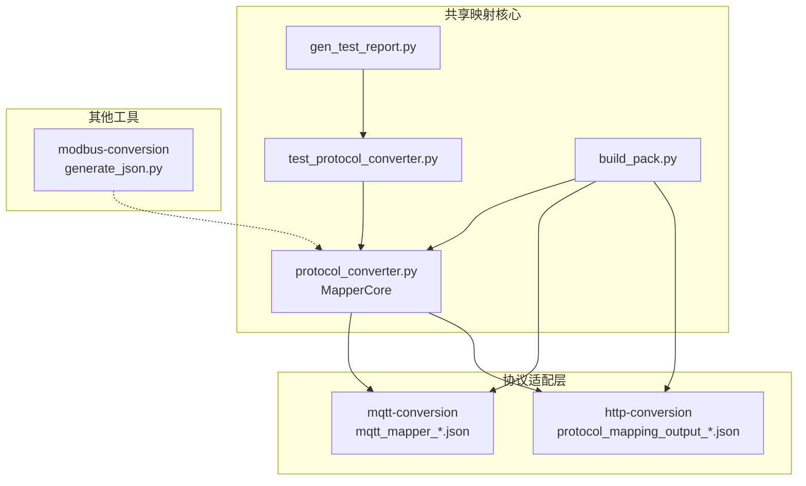
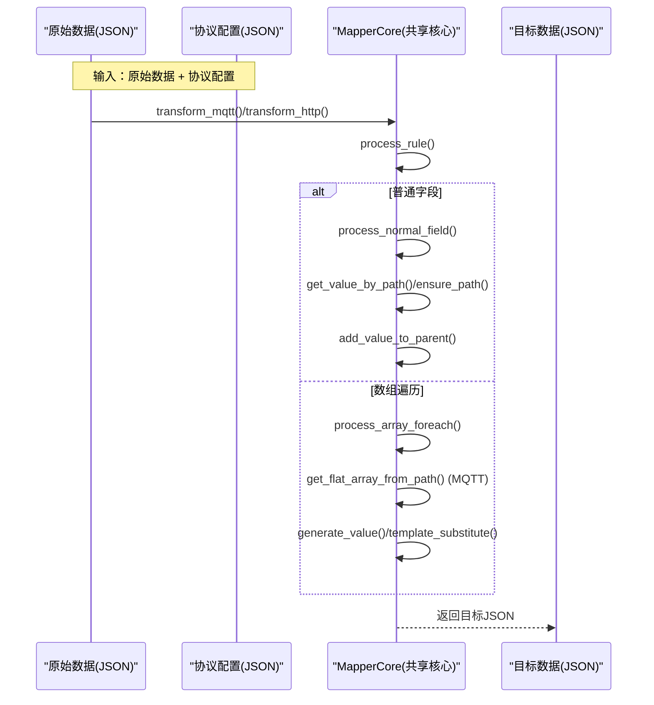
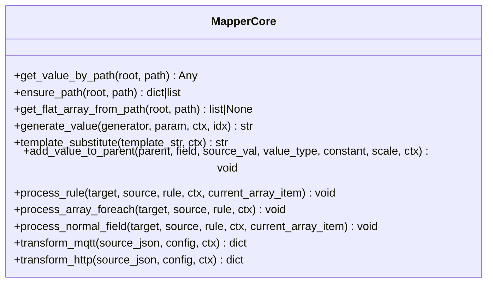
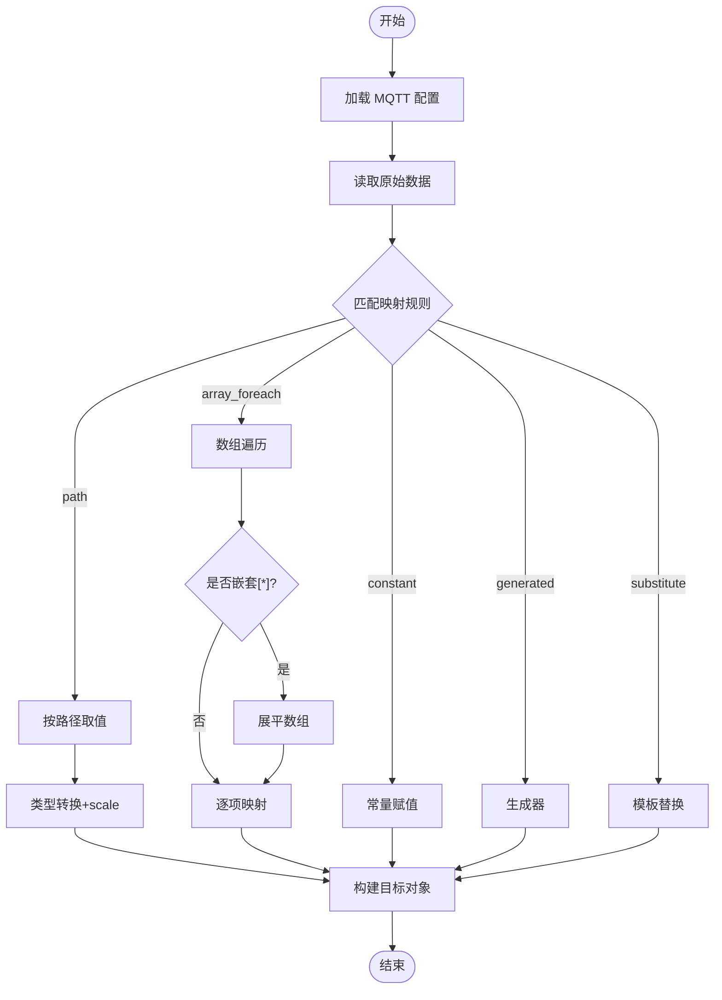
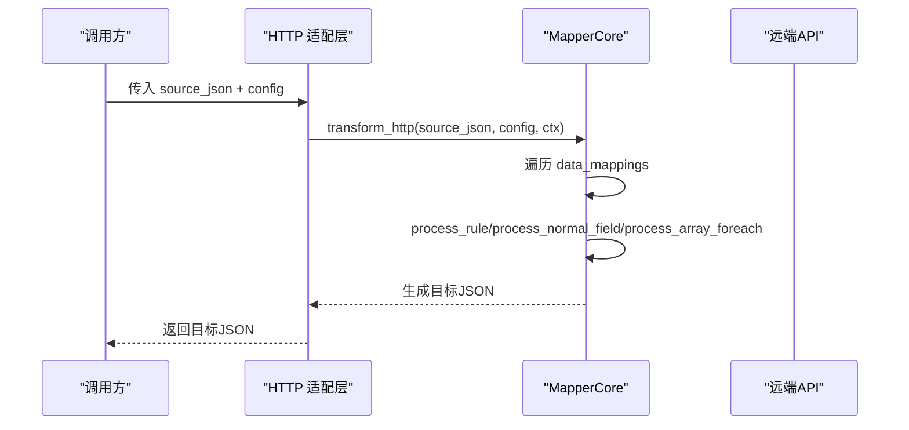
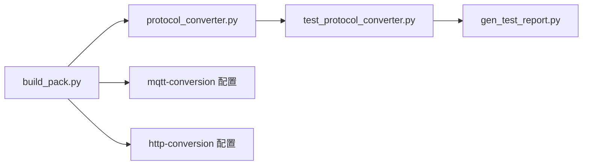

# 协议转换引擎

<cite>
**本文引用的文件**
- [protocol_converter.py](file://.trae/skills/protocol-conversion/scripts/protocol_converter.py)
- [test_protocol_converter.py](file://.trae/skills/protocol-conversion/scripts/test_protocol_converter.py)
- [gen_test_report.py](file://.trae/skills/protocol-conversion/scripts/gen_test_report.py)
- [build_pack.py](file://.trae/skills/protocol-conversion/scripts/build_pack.py)
- [mqtt_mapper_202608261100.json](file://.trae/skills/mqtt-conversion/scripts/mqtt_mapper_202608261100.json)
- [protocol_mapping_output_20260827_113000.json](file://.trae/skills/http-conversion/scripts/protocol_mapping_output_20260827_113000.json)
- [generate_json.py](file://.trae/skills/modbus-conversion/temp/generate_json.py)
- [mcp server部署.md](file://mcp server部署.md)
- [规约管理MCP服务化Spec.md](file://规约管理MCP服务化Spec.md)
</cite>

## 目录
1. [简介](#简介)
2. [项目结构](#项目结构)
3. [核心组件](#核心组件)
4. [架构总览](#架构总览)
5. [详细组件分析](#详细组件分析)
6. [依赖关系分析](#依赖关系分析)
7. [性能考虑](#性能考虑)
8. [故障排查指南](#故障排查指南)
9. [结论](#结论)
10. [附录](#附录)

## 简介
本技术文档面向“协议转换引擎”，聚焦于将多种工业与网络协议（如 MQTT、HTTP，以及通过配置映射的 Modbus、BACnet、OPC-UA 等）数据统一转换为内部或目标格式。引擎以“共享映射核心”为中心，提供：
- 统一的 JSON 路径解析语法
- 类型系统与缩放系数
- 数组遍历与嵌套展平
- 模板变量替换机制
- 生成器（时间戳、UUID、序列号等）
- 针对 MQTT 与 HTTP 的差异能力封装

同时提供完整的测试套件、打包脚本与真实配置文件示例，帮助开发者快速理解、扩展与维护协议转换功能。

## 项目结构
仓库围绕“共享映射核心 + 协议适配层 + 工具链”组织：
- 共享映射核心：Python 镜像实现与 C 引擎头/源文件（由打包脚本声明），负责路径解析、类型转换、规则执行、数组遍历、模板替换等通用逻辑
- 协议适配层：MQTT 与 HTTP 各自持有协议特有配置与加载逻辑，调用共享核心完成映射
- 工具链：测试用例、测试报告生成、打包脚本、Modbus 标签生成脚本等
- 文档与规范：部署说明、MCP 服务化规范等

图表来源
- [protocol_converter.py:1-602](file://.trae/skills/protocol-conversion/scripts/protocol_converter.py#L1-L602)
- [test_protocol_converter.py:1-800](file://.trae/skills/protocol-conversion/scripts/test_protocol_converter.py#L1-L800)
- [gen_test_report.py:1-89](file://.trae/skills/protocol-conversion/scripts/gen_test_report.py#L1-L89)
- [build_pack.py:1-409](file://.trae/skills/protocol-conversion/scripts/build_pack.py#L1-L409)
- [mqtt_mapper_202608261100.json:1-98](file://.trae/skills/mqtt-conversion/scripts/mqtt_mapper_202608261100.json#L1-L98)
- [protocol_mapping_output_20260827_113000.json:1-118](file://.trae/skills/http-conversion/scripts/protocol_mapping_output_20260827_113000.json#L1-L118)
- [generate_json.py:1-109](file://.trae/skills/modbus-conversion/temp/generate_json.py#L1-L109)

章节来源
- [build_pack.py:23-54](file://.trae/skills/protocol-conversion/scripts/build_pack.py#L23-L54)
- [mcp server部署.md:25-35](file://mcp server部署.md#L25-L35)

## 核心组件
- MapperCore（共享映射核心）
  - 路径取值与创建：get_value_by_path、ensure_path
  - 扁平化数组：get_flat_array_from_path（支持嵌套 [*]）
  - 值生成器：generate_value（uuid、时间戳、日期、随机串、md5、批次ID、sequence）
  - 模板替换：template_substitute（$var$ 语法，支持嵌套路径）
  - 类型转换：add_value_to_parent（string/int/double/long/bool/object/substitute，含 scale）
  - 规则处理：process_rule → process_normal_field / process_array_foreach
  - 引擎入口：transform_mqtt、transform_http

- 测试与报告
  - test_protocol_converter.py：覆盖路径、类型、生成器、模板、数组遍历、MQTT/HTTP 完整转换、差异验证、边界条件
  - gen_test_report.py：运行测试并输出结构化报告 JSON

- 打包与发布
  - build_pack.py：收集文件、生成设计报告、清单 manifest.json、README、ZIP 包

- 协议配置示例
  - MQTT：platform_name + mappings[]，支持 substitute、$item/$idx、嵌套 [*]
  - HTTP：base_url + token + apis[]，支持 context source_type、key_value item_type、“.”源路径

章节来源
- [protocol_converter.py:32-602](file://.trae/skills/protocol-conversion/scripts/protocol_converter.py#L32-L602)
- [test_protocol_converter.py:27-800](file://.trae/skills/protocol-conversion/scripts/test_protocol_converter.py#L27-L800)
- [gen_test_report.py:1-89](file://.trae/skills/protocol-conversion/scripts/gen_test_report.py#L1-L89)
- [build_pack.py:58-180](file://.trae/skills/protocol-conversion/scripts/build_pack.py#L58-L180)
- [mqtt_mapper_202608261100.json:1-98](file://.trae/skills/mqtt-conversion/scripts/mqtt_mapper_202608261100.json#L1-L98)
- [protocol_mapping_output_20260827_113000.json:1-118](file://.trae/skills/http-conversion/scripts/protocol_mapping_output_20260827_113000.json#L1-L118)

## 架构总览
共享映射核心被 MQTT 与 HTTP 两个协议层复用，差异仅在配置加载与协议特有字段：
- MQTT 层：使用 platform_name 与 mappings[]，支持 substitute、$item/$idx、嵌套 [*] 展平
- HTTP 层：使用 base_url、token、apis[]，支持 context source_type、key_value item_type、“.”源路径

图表来源
- [protocol_converter.py:379-602](file://.trae/skills/protocol-conversion/scripts/protocol_converter.py#L379-L602)
- [mqtt_mapper_202608261100.json:1-98](file://.trae/skills/mqtt-conversion/scripts/mqtt_mapper_202608261100.json#L1-L98)
- [protocol_mapping_output_20260827_113000.json:1-118](file://.trae/skills/http-conversion/scripts/protocol_mapping_output_20260827_113000.json#L1-L118)

## 详细组件分析

### 共享映射核心（MapperCore）
- 路径解析
  - 支持 a.b.c、a[0]、a[*]、"."（HTTP 根对象）
  - ensure_path 自动创建缺失层级与数组槽位
- 数组遍历
  - 支持 object 与 key_value 两种 item_type
  - 支持 “.” 作为当前项源（HTTP）
  - 支持嵌套 [*] 展平（MQTT）
  - 支持 $idx 变量替换（MQTT）
- 类型系统
  - string/int/double/long/bool/object/substitute
  - 支持 scale 缩放（数值型）
- 生成器
  - uuid、current_timestamp/timestamp_sec、timestamp_ms、datetime_compact、datetime_str、random_string、md5_sign、batch_id、sequence
- 模板替换
  - $var$ 语法，支持嵌套路径（如 ssl_mqtt_server.gatewayID）

图表来源
- [protocol_converter.py:32-602](file://.trae/skills/protocol-conversion/scripts/protocol_converter.py#L32-L602)

章节来源
- [protocol_converter.py:49-118](file://.trae/skills/protocol-conversion/scripts/protocol_converter.py#L49-L118)
- [protocol_converter.py:120-202](file://.trae/skills/protocol-conversion/scripts/protocol_converter.py#L120-L202)
- [protocol_converter.py:206-265](file://.trae/skills/protocol-conversion/scripts/protocol_converter.py#L206-L265)
- [protocol_converter.py:269-376](file://.trae/skills/protocol-conversion/scripts/protocol_converter.py#L269-L376)
- [protocol_converter.py:379-602](file://.trae/skills/protocol-conversion/scripts/protocol_converter.py#L379-L602)

### MQTT 转换流程
- 配置结构：platform_name + mappings[]
- 特性：substitute 模板替换、$item/$idx 变量、嵌套 [*] 展平
- 典型流程：读取业务对象列表 → 遍历 itemBody → 映射电压/电流/功率/时间等字段

图表来源
- [protocol_converter.py:569-583](file://.trae/skills/protocol-conversion/scripts/protocol_converter.py#L569-L583)
- [mqtt_mapper_202608261100.json:1-98](file://.trae/skills/mqtt-conversion/scripts/mqtt_mapper_202608261100.json#L1-L98)

章节来源
- [mqtt_mapper_202608261100.json:1-98](file://.trae/skills/mqtt-conversion/scripts/mqtt_mapper_202608261100.json#L1-L98)
- [protocol_converter.py:569-583](file://.trae/skills/protocol-conversion/scripts/protocol_converter.py#L569-L583)

### HTTP 转换流程
- 配置结构：base_url + token + apis[]，每个 API 包含 body_params 与 data_mappings
- 特性：context source_type、key_value item_type、“.”源路径
- 典型流程：构造请求体参数 → 调用 API → 映射响应数据到目标格式

图表来源
- [protocol_converter.py:585-602](file://.trae/skills/protocol-conversion/scripts/protocol_converter.py#L585-L602)
- [protocol_mapping_output_20260827_113000.json:1-118](file://.trae/skills/http-conversion/scripts/protocol_mapping_output_20260827_113000.json#L1-L118)

章节来源
- [protocol_mapping_output_20260827_113000.json:1-118](file://.trae/skills/http-conversion/scripts/protocol_mapping_output_20260827_113000.json#L1-L118)
- [protocol_converter.py:585-602](file://.trae/skills/protocol-conversion/scripts/protocol_converter.py#L585-L602)

### 数据类型系统与缩放
- 类型：string、int、double、long、bool、object、substitute
- 行为：
  - 字符串：空值不添加；布尔转 true/false；数字转字符串
  - 整数/长整型：支持从数字或字符串转换，可应用 scale
  - 浮点：支持 scale
  - 布尔：true/1 为真，false/0 为假
  - 对象：深拷贝字典或解析 JSON 字符串
  - 模板替换：仅 MQTT 常用，HTTP 一般不使用

章节来源
- [protocol_converter.py:269-376](file://.trae/skills/protocol-conversion/scripts/protocol_converter.py#L269-L376)
- [test_protocol_converter.py:161-286](file://.trae/skills/protocol-conversion/scripts/test_protocol_converter.py#L161-L286)

### 数组遍历准则
- 支持两种 item_type：
  - object：每项生成一个对象
  - key_value：每项根据 sub_mappings 生成多个键值对条目
- 支持 “.” 作为当前项源（HTTP）
- 支持嵌套 [*] 展平（MQTT）
- 支持 $idx 变量替换（MQTT）

章节来源
- [protocol_converter.py:395-479](file://.trae/skills/protocol-conversion/scripts/protocol_converter.py#L395-L479)
- [test_protocol_converter.py:384-499](file://.trae/skills/protocol-conversion/scripts/test_protocol_converter.py#L384-L499)

### 模板变量替换机制
- 语法：$var$，支持嵌套路径（如 ssl_mqtt_server.gatewayID）
- 上下文：ctx 中查找变量，找不到则保留原占位符
- 适用：MQTT 常用，HTTP 通常不使用

章节来源
- [protocol_converter.py:240-265](file://.trae/skills/protocol-conversion/scripts/protocol_converter.py#L240-L265)
- [test_protocol_converter.py:354-382](file://.trae/skills/protocol-conversion/scripts/test_protocol_converter.py#L354-L382)

### 生成器
- 支持：uuid、current_timestamp、timestamp_sec、current_timestamp_ms、timestamp_ms、datetime_compact、datetime_str、random_string、md5_sign、batch_id、sequence
- sequence：支持基于 idx 或 ctx 计数器递增

章节来源
- [protocol_converter.py:206-236](file://.trae/skills/protocol-conversion/scripts/protocol_converter.py#L206-L236)
- [test_protocol_converter.py:288-352](file://.trae/skills/protocol-conversion/scripts/test_protocol_converter.py#L288-L352)

### 配置示例与编写指南
- MQTT 配置要点
  - mappings[]：每条规则指定 target、source_type、type，必要时携带 source/constant/generator
  - array_foreach：target 使用 @ 锚点，source 使用 [*] 或 “.”，sub_mappings 定义子规则
  - substitute：使用 $var$ 从 ctx 取变量
- HTTP 配置要点
  - apis[].data_mappings[]：同 MQTT 规则，但支持 context source_type
  - array_foreach：item_type 可为 object 或 key_value
  - “.” 源路径：在数组遍历中表示当前项

章节来源
- [mqtt_mapper_202608261100.json:1-98](file://.trae/skills/mqtt-conversion/scripts/mqtt_mapper_202608261100.json#L1-L98)
- [protocol_mapping_output_20260827_113000.json:1-118](file://.trae/skills/http-conversion/scripts/protocol_mapping_output_20260827_113000.json#L1-L118)
- [test_protocol_converter.py:501-765](file://.trae/skills/protocol-conversion/scripts/test_protocol_converter.py#L501-L765)

### Modbus、BACnet、OPC-UA 的支持说明
- 本项目通过“配置驱动”的方式支持多协议：
  - Modbus：通过标签配置与寄存器表达式（如 DPT/DCT/DPQ、PT*CT）进行数据换算与映射
  - BACnet、OPC-UA：可通过类似的数据项与表达式配置接入（在本仓库中以配置与规范描述为主）
- 实际转换仍经由共享核心完成 JSON 层面的映射与类型转换

章节来源
- [generate_json.py:1-109](file://.trae/skills/modbus-conversion/temp/generate_json.py#L1-L109)
- [规约管理MCP服务化Spec.md:647-686](file://规约管理MCP服务化Spec.md#L647-L686)

## 依赖关系分析
- 模块内依赖
  - protocol_converter.py 为核心，被测试与打包脚本引用
  - test_protocol_converter.py 依赖 protocol_converter.py
  - gen_test_report.py 动态加载测试类并生成报告
  - build_pack.py 聚合所有相关文件并生成发布包
- 外部依赖
  - Python 标准库：json、re、uuid、time、hashlib
  - MCP/Uvicorn（服务端部署相关）

图表来源
- [protocol_converter.py:1-602](file://.trae/skills/protocol-conversion/scripts/protocol_converter.py#L1-L602)
- [test_protocol_converter.py:1-800](file://.trae/skills/protocol-conversion/scripts/test_protocol_converter.py#L1-L800)
- [gen_test_report.py:1-89](file://.trae/skills/protocol-conversion/scripts/gen_test_report.py#L1-L89)
- [build_pack.py:1-409](file://.trae/skills/protocol-conversion/scripts/build_pack.py#L1-L409)

章节来源
- [build_pack.py:23-54](file://.trae/skills/protocol-conversion/scripts/build_pack.py#L23-L54)
- [mcp server部署.md:40-55](file://mcp server部署.md#L40-L55)

## 性能考虑
- 路径解析与数组遍历
  - 避免过深的嵌套与过多通配符，减少递归与展平开销
  - 合理使用 [*] 与索引，优先精确索引
- 类型转换与缩放
  - 尽量在源头保证数据类型正确，减少运行时转换成本
  - 批量处理时复用上下文（如 sequence 计数器）
- 生成器与模板替换
  - 控制生成器调用频率，避免频繁时间戳/哈希计算
  - 模板变量集中管理，减少重复替换
- I/O 与并发
  - HTTP 场景下结合异步客户端（如 httpx）提升并发能力
  - 合理设置超时与重试策略

[本节为通用指导，不直接分析具体文件]

## 故障排查指南
- 常见问题定位
  - 路径不存在或越界：检查 source 路径与数据结构一致性
  - 类型转换失败：确认 source_type 与 type 匹配，必要时增加预处理
  - 数组遍历为空：检查 source 是否为数组，是否存在 [*] 或 “.” 用法错误
  - 模板替换未生效：确认 ctx 中存在对应变量且路径正确
- 测试与调试
  - 运行单元测试：python -m unittest test_protocol_converter -v
  - 生成测试报告：python gen_test_report.py
  - 使用真实配置进行集成测试：参考 mqtt_mapper_*.json 与 protocol_mapping_output_*.json
- 部署与服务
  - 确保虚拟环境安装与 Token 配置正确
  - 端口占用、网络异常等按部署文档排查

章节来源
- [test_protocol_converter.py:1-800](file://.trae/skills/protocol-conversion/scripts/test_protocol_converter.py#L1-L800)
- [gen_test_report.py:1-89](file://.trae/skills/protocol-conversion/scripts/gen_test_report.py#L1-L89)
- [mcp server部署.md:505-632](file://mcp server部署.md#L505-L632)

## 结论
本引擎通过“共享映射核心”实现了 MQTT 与 HTTP 协议的统一映射能力，并提供完善的类型系统、数组遍历、模板替换与生成器机制。借助丰富的测试用例与真实配置示例，开发者可以快速上手、灵活扩展，并将 Modbus、BACnet、OPC-UA 等多协议纳入同一转换框架。建议在生产环境中结合异步 I/O、合理的超时与重试策略，持续优化性能与稳定性。

[本节为总结性内容，不直接分析具体文件]

## 附录
- 快速命令参考
  - 首次安装：mcp_server\install.bat
  - 启动服务：mcp_server\start.bat
  - 运行测试：cd protocol-conversion/scripts && python -m unittest test_protocol_converter -v
  - 生成报告：python gen_test_report.py

章节来源
- [mcp server部署.md:677-686](file://mcp server部署.md#L677-L686)