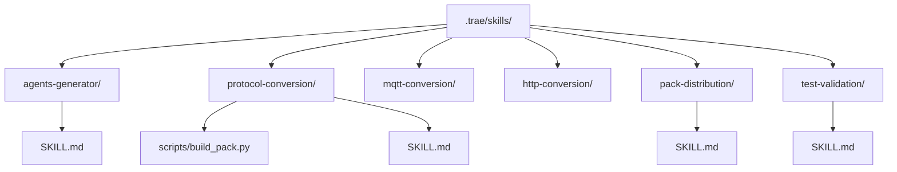
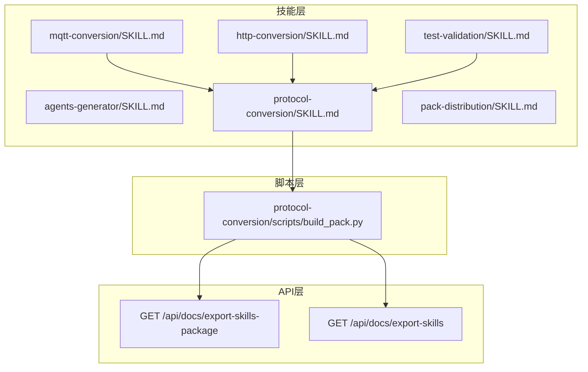
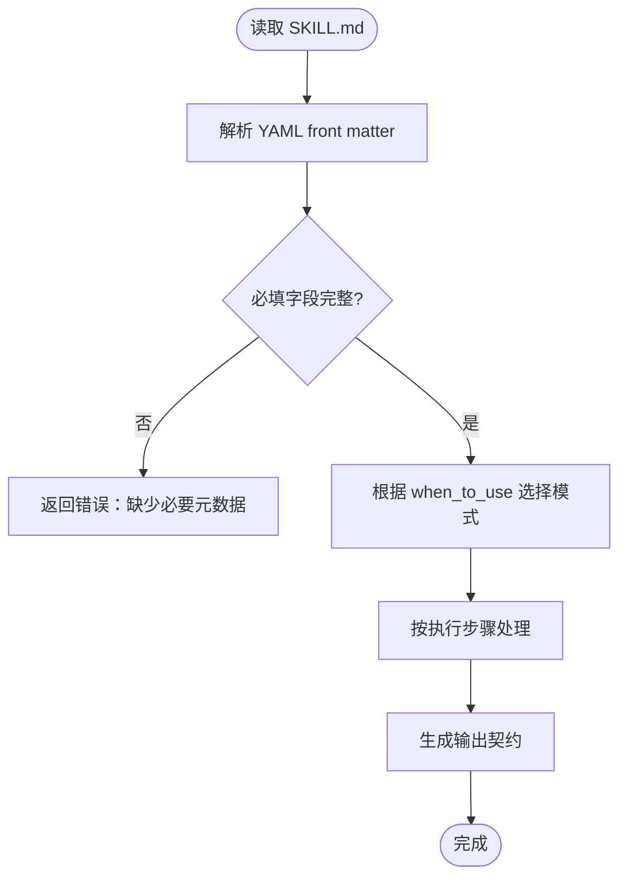
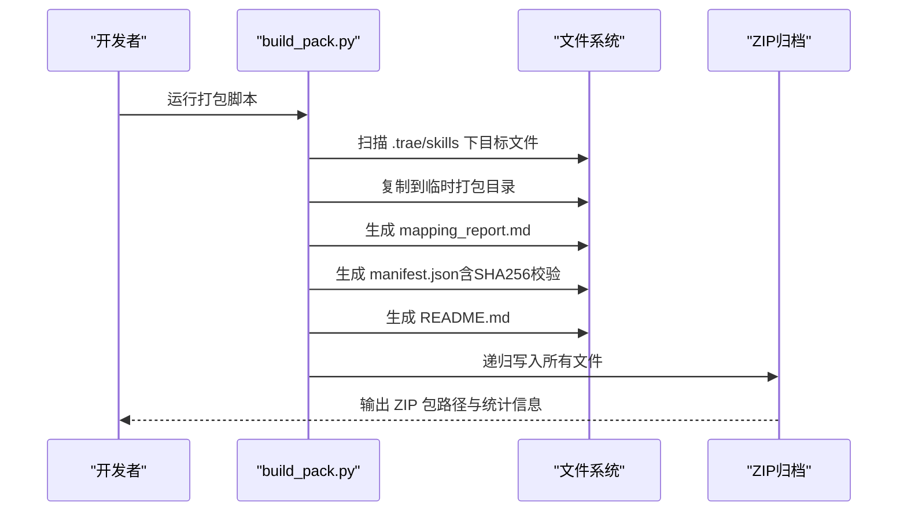
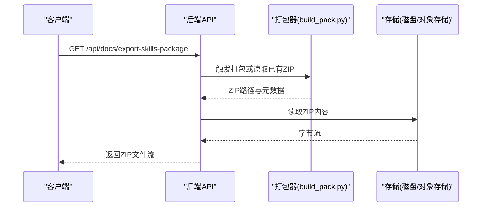
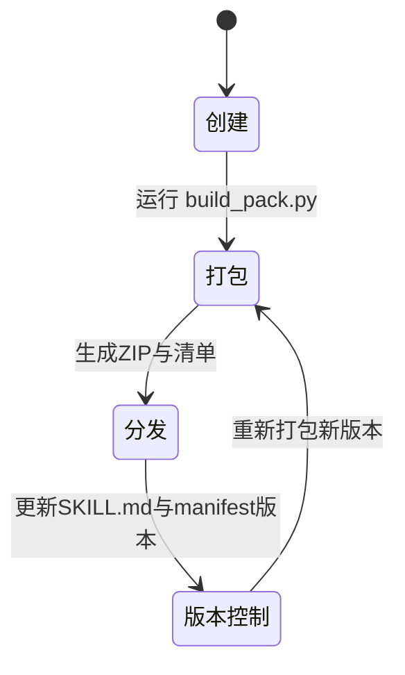
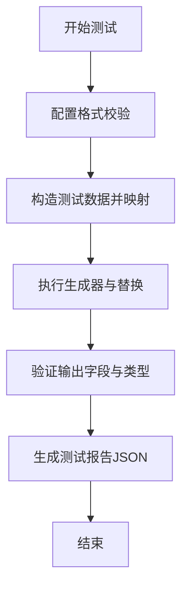
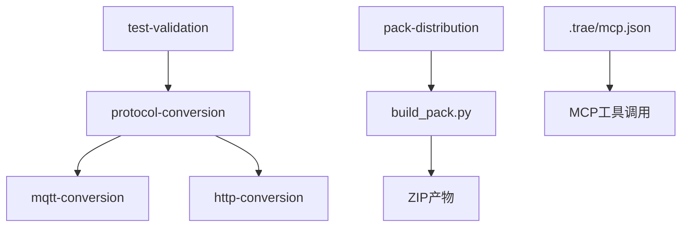

# 技能包系统

<cite>
**本文引用的文件**
- [.trae/skills/agents-generator/SKILL.md](file://.trae/skills/agents-generator/SKILL.md)
- [.trae/skills/protocol-conversion/SKILL.md](file://.trae/skills/protocol-conversion/SKILL.md)
- [.trae/skills/test-validation/SKILL.md](file://.trae/skills/test-validation/SKILL.md)
- [.trae/skills/pack-distribution/SKILL.md](file://.trae/skills/pack-distribution/SKILL.md)
- [.trae/skills/protocol-conversion/scripts/build_pack.py](file://.trae/skills/protocol-conversion/scripts/build_pack.py)
- [规约管理MCP服务化Spec.md](file://规约管理MCP服务化Spec.md)
- [.trae/mcp.json](file://.trae/mcp.json)
</cite>

## 目录
1. [简介](#简介)
2. [项目结构](#项目结构)
3. [核心组件](#核心组件)
4. [架构总览](#架构总览)
5. [详细组件分析](#详细组件分析)
6. [依赖关系分析](#依赖关系分析)
7. [性能与打包特性](#性能与打包特性)
8. [故障排查指南](#故障排查指南)
9. [结论](#结论)
10. [附录：模板与最佳实践](#附录模板与最佳实践)

## 简介
本技术文档面向“技能包系统”，围绕 .trae/skills/ 下的技能组织、SKILL.md 元数据规范、脚本与资源组织、自动打包机制、Skills 下载 API、生命周期管理与版本控制、质量检查与测试方法，以及自定义技能集成进行系统化说明。目标是帮助开发者快速理解并高质量地开发、打包、分发和迭代技能包。

## 项目结构
仓库中与技能包相关的核心位置如下：
- .trae/skills/：技能包集合，每个子目录为一个独立技能（如 agents-generator、protocol-conversion、mqtt-conversion、http-conversion、pack-distribution、test-validation 等）
- .trae/skills/<skill>/SKILL.md：技能的入口文档与元数据定义
- .trae/skills/<skill>/scripts/：可执行脚本或工具（例如 protocol-conversion/scripts/build_pack.py）
- .trae/skills/<skill>/assets/、defaults/、agents/：资源、默认配置、Agent 配置等
- .trae/mcp.json：MCP 服务器连接配置（用于 Skill 调用 MCP 工具）

**图示来源**
- [.trae/skills/protocol-conversion/scripts/build_pack.py:1-40](file://.trae/skills/protocol-conversion/scripts/build_pack.py#L1-L40)
- [.trae/skills/protocol-conversion/SKILL.md:1-20](file://.trae/skills/protocol-conversion/SKILL.md#L1-L20)
- [.trae/skills/agents-generator/SKILL.md:1-15](file://.trae/skills/agents-generator/SKILL.md#L1-L15)
- [.trae/skills/test-validation/SKILL.md:1-17](file://.trae/skills/test-validation/SKILL.md#L1-L17)
- [.trae/skills/pack-distribution/SKILL.md:1-20](file://.trae/skills/pack-distribution/SKILL.md#L1-L20)

**章节来源**
- [.trae/skills/protocol-conversion/scripts/build_pack.py:1-40](file://.trae/skills/protocol-conversion/scripts/build_pack.py#L1-L40)
- [.trae/skills/protocol-conversion/SKILL.md:1-20](file://.trae/skills/protocol-conversion/SKILL.md#L1-L20)
- [.trae/skills/agents-generator/SKILL.md:1-15](file://.trae/skills/agents-generator/SKILL.md#L1-L15)
- [.trae/skills/test-validation/SKILL.md:1-17](file://.trae/skills/test-validation/SKILL.md#L1-L17)
- [.trae/skills/pack-distribution/SKILL.md:1-20](file://.trae/skills/pack-distribution/SKILL.md#L1-L20)

## 核心组件
- 技能元数据与规范：通过 SKILL.md 的 YAML front matter 描述 name、description、category、risk、tags、tools、license、version、author、order 等，作为技能识别、排序、权限与分发的依据。
- 协议映射核心：protocol-conversion 提供共享映射规则与引擎接口说明，被 mqtt-conversion、http-conversion 引用。
- 打包脚本：build_pack.py 负责收集文件、生成 manifest.json、README.md、mapping_report.md，并输出 ZIP 包。
- 测试验证：test-validation 提供冒烟测试策略与流程，确保转换配置正确性。
- 分发能力：pack-distribution 提供打包与分发流程指导；结合后端导出接口实现统一下载。

**章节来源**
- [.trae/skills/protocol-conversion/SKILL.md:1-20](file://.trae/skills/protocol-conversion/SKILL.md#L1-L20)
- [.trae/skills/protocol-conversion/scripts/build_pack.py:1-40](file://.trae/skills/protocol-conversion/scripts/build_pack.py#L1-L40)
- [.trae/skills/test-validation/SKILL.md:1-17](file://.trae/skills/test-validation/SKILL.md#L1-L17)
- [.trae/skills/pack-distribution/SKILL.md:1-20](file://.trae/skills/pack-distribution/SKILL.md#L1-L20)

## 架构总览
技能包系统由“技能定义 + 脚本工具 + 打包分发 + API 导出”构成。Skill 以 SKILL.md 为契约，脚本实现具体逻辑，打包脚本产出可分发的 ZIP，API 端点对外提供下载与摘要。

**图示来源**
- [.trae/skills/protocol-conversion/scripts/build_pack.py:1-40](file://.trae/skills/protocol-conversion/scripts/build_pack.py#L1-L40)
- [.trae/skills/protocol-conversion/SKILL.md:1-20](file://.trae/skills/protocol-conversion/SKILL.md#L1-L20)
- [规约管理MCP服务化Spec.md:1206-1214](file://规约管理MCP服务化Spec.md#L1206-L1214)

## 详细组件分析

### SKILL.md 文件格式与元数据定义
- 头部元数据（YAML front matter）包含：name、description、when_to_use、compatibility、metadata（tags、order、author、version）、category、risk、source、source_repo、source_type、date_added、author、tags、tools、license 等。
- 正文部分定义使用场景、激活契约、执行步骤、输出契约、限制与参考文件。
- 示例：agents-generator 展示了完整的元数据与执行流程；protocol-conversion 定义了共享映射规则与字段语法；test-validation 定义了测试策略与报告格式。

**图示来源**
- [.trae/skills/agents-generator/SKILL.md:1-15](file://.trae/skills/agents-generator/SKILL.md#L1-L15)
- [.trae/skills/protocol-conversion/SKILL.md:1-20](file://.trae/skills/protocol-conversion/SKILL.md#L1-L20)
- [.trae/skills/test-validation/SKILL.md:1-17](file://.trae/skills/test-validation/SKILL.md#L1-L17)

**章节来源**
- [.trae/skills/agents-generator/SKILL.md:1-15](file://.trae/skills/agents-generator/SKILL.md#L1-L15)
- [.trae/skills/protocol-conversion/SKILL.md:1-20](file://.trae/skills/protocol-conversion/SKILL.md#L1-L20)
- [.trae/skills/test-validation/SKILL.md:1-17](file://.trae/skills/test-validation/SKILL.md#L1-L17)

### 脚本文件组织与打包机制
- build_pack.py 将多个 skill 的相关文件收集到临时目录，生成 mapping_report.md、manifest.json、README.md，最后打包为 ZIP。
- 清单 manifest.json 包含 packId、version、conversionType、sourceProtocol、targetProtocol、createdAt、files（含 size 与 checksum）、dependencies、testStatus、testSummary、changes 等。
- 打包过程会清理输出目录、复制文件、写入报告与清单、压缩为 ZIP，并统计大小与数量。

**图示来源**
- [.trae/skills/protocol-conversion/scripts/build_pack.py:1-40](file://.trae/skills/protocol-conversion/scripts/build_pack.py#L1-L40)
- [.trae/skills/protocol-conversion/scripts/build_pack.py:183-236](file://.trae/skills/protocol-conversion/scripts/build_pack.py#L183-L236)
- [.trae/skills/protocol-conversion/scripts/build_pack.py:352-409](file://.trae/skills/protocol-conversion/scripts/build_pack.py#L352-L409)

**章节来源**
- [.trae/skills/protocol-conversion/scripts/build_pack.py:1-40](file://.trae/skills/protocol-conversion/scripts/build_pack.py#L1-L40)
- [.trae/skills/protocol-conversion/scripts/build_pack.py:183-236](file://.trae/skills/protocol-conversion/scripts/build_pack.py#L183-L236)
- [.trae/skills/protocol-conversion/scripts/build_pack.py:352-409](file://.trae/skills/protocol-conversion/scripts/build_pack.py#L352-L409)

### Skills 下载 API 的实现
- 后端规格中预期提供 GET /api/docs/export-skills-package 用于复用现有 Skills 包下载接口。
- 前端或外部客户端可通过该接口获取 ZIP 包；同时可配合 /api/docs/export-skills 生成 Markdown 摘要（当前仓库未包含该端点的具体实现代码）。
- 建议实现要点：
  - 校验请求参数与权限
  - 触发打包脚本或读取已构建的 ZIP
  - 设置正确的 Content-Type 与 Content-Disposition
  - 支持断点续传与缓存控制

**图示来源**
- [规约管理MCP服务化Spec.md:1206-1214](file://规约管理MCP服务化Spec.md#L1206-L1214)
- [.trae/skills/protocol-conversion/scripts/build_pack.py:352-409](file://.trae/skills/protocol-conversion/scripts/build_pack.py#L352-L409)

**章节来源**
- [规约管理MCP服务化Spec.md:1206-1214](file://规约管理MCP服务化Spec.md#L1206-L1214)

### 技能包的生命周期管理
- 创建：在 .trae/skills/ 下新建目录，编写 SKILL.md 元数据与正文，组织 scripts/assets/defaults/agents 等资源。
- 打包：运行 build_pack.py 生成 ZIP，包含 manifest.json、README.md、mapping_report.md 及所有必需文件。
- 分发：通过 /api/docs/export-skills-package 提供下载；也可将 ZIP 上传至制品库或发布平台。
- 版本控制：SKILL.md 的 metadata.version 与 manifest.json 的 version 保持一致；变更日志记录于 manifest.changes 与 README 的版本历史。

**图示来源**
- [.trae/skills/protocol-conversion/scripts/build_pack.py:183-236](file://.trae/skills/protocol-conversion/scripts/build_pack.py#L183-L236)
- [.trae/skills/protocol-conversion/SKILL.md:1-20](file://.trae/skills/protocol-conversion/SKILL.md#L1-L20)

**章节来源**
- [.trae/skills/protocol-conversion/scripts/build_pack.py:183-236](file://.trae/skills/protocol-conversion/scripts/build_pack.py#L183-L236)
- [.trae/skills/protocol-conversion/SKILL.md:1-20](file://.trae/skills/protocol-conversion/SKILL.md#L1-L20)

### 质量检查与测试方法
- test-validation 提供冒烟测试策略：配置格式校验、字段映射验证、类型转换、数组遍历、常量与生成器、钩子函数执行等。
- 测试流程包括构造模拟输入、执行转换、验证输出、生成测试报告 JSON。
- 对于协议映射核心，protocol-conversion 提供了 Python 镜像与单元测试套件，可用于本地验证映射逻辑一致性。

**图示来源**
- [.trae/skills/test-validation/SKILL.md:77-168](file://.trae/skills/test-validation/SKILL.md#L77-L168)
- [.trae/skills/protocol-conversion/SKILL.md:301-338](file://.trae/skills/protocol-conversion/SKILL.md#L301-L338)

**章节来源**
- [.trae/skills/test-validation/SKILL.md:77-168](file://.trae/skills/test-validation/SKILL.md#L77-L168)
- [.trae/skills/protocol-conversion/SKILL.md:301-338](file://.trae/skills/protocol-conversion/SKILL.md#L301-L338)

### 自定义技能集成指南
- 在 .trae/skills/ 下创建新目录，编写 SKILL.md 元数据与正文，明确 when_to_use、compatibility、metadata.tags/order/version。
- 如需脚本工具，放入 scripts/ 目录并在 SKILL.md 中说明调用方式与依赖。
- 若需引用 MCP 工具，确保 .trae/mcp.json 配置正确（URL、Headers 等），以便 Skill 在执行时能连接到 MCP Server。
- 使用 build_pack.py 将新技能纳入打包范围（修改 FILES_TO_PACK 列表），并更新 manifest 与 README。

**图示来源**
- [.trae/mcp.json:1-1](file://.trae/mcp.json#L1-L1)
- [.trae/skills/protocol-conversion/scripts/build_pack.py:27-55](file://.trae/skills/protocol-conversion/scripts/build_pack.py#L27-L55)

**章节来源**
- [.trae/mcp.json:1-1](file://.trae/mcp.json#L1-L1)
- [.trae/skills/protocol-conversion/scripts/build_pack.py:27-55](file://.trae/skills/protocol-conversion/scripts/build_pack.py#L27-L55)

## 依赖关系分析
- 技能之间：protocol-conversion 作为共享映射核心，被 mqtt-conversion 与 http-conversion 引用；pack-distribution 依赖打包脚本；test-validation 依赖映射规则与测试工具。
- 脚本依赖：build_pack.py 依赖 Python 标准库（hashlib、json、os、zipfile、shutil、datetime）。
- 运行时依赖：MCP 客户端通过 .trae/mcp.json 指定服务端地址与鉴权头。

**图示来源**
- [.trae/skills/protocol-conversion/SKILL.md:1-20](file://.trae/skills/protocol-conversion/SKILL.md#L1-L20)
- [.trae/skills/protocol-conversion/scripts/build_pack.py:1-40](file://.trae/skills/protocol-conversion/scripts/build_pack.py#L1-L40)
- [.trae/mcp.json:1-1](file://.trae/mcp.json#L1-L1)

**章节来源**
- [.trae/skills/protocol-conversion/SKILL.md:1-20](file://.trae/skills/protocol-conversion/SKILL.md#L1-L20)
- [.trae/skills/protocol-conversion/scripts/build_pack.py:1-40](file://.trae/skills/protocol-conversion/scripts/build_pack.py#L1-L40)
- [.trae/mcp.json:1-1](file://.trae/mcp.json#L1-L1)

## 性能与打包特性
- 打包效率：build_pack.py 使用 shutil.copy2 保留元数据，zipfile.ZIP_DEFLATED 压缩输出，减少体积。
- 完整性保障：manifest.json 对每个文件计算 SHA256 校验和，便于安装后校验。
- 可扩展性：FILES_TO_PACK 列表集中管理打包范围，新增技能只需追加条目。
- 跳过目录过滤：当前脚本未显式实现跳过目录逻辑，建议在 FILES_TO_PACK 外增加白名单或排除规则（如 temp、dist、.git 等）。

**章节来源**
- [.trae/skills/protocol-conversion/scripts/build_pack.py:183-236](file://.trae/skills/protocol-conversion/scripts/build_pack.py#L183-L236)
- [.trae/skills/protocol-conversion/scripts/build_pack.py:352-409](file://.trae/skills/protocol-conversion/scripts/build_pack.py#L352-L409)

## 故障排查指南
- 打包失败：
  - 检查 FILES_TO_PACK 中绝对路径是否存在；不存在将被跳过并打印提示。
  - 确认输出目录权限与空间充足。
  - 查看生成的 manifest.json 与 README.md 是否完整。
- 校验失败：
  - 使用 manifest.json 中的 checksum 校验 ZIP 内文件完整性。
  - 运行 protocol-conversion 的单元测试套件验证映射逻辑。
- API 下载问题：
  - 确认后端已实现 /api/docs/export-skills-package 并返回 ZIP 流。
  - 检查网络与鉴权头是否正确传递。

**章节来源**
- [.trae/skills/protocol-conversion/scripts/build_pack.py:352-409](file://.trae/skills/protocol-conversion/scripts/build_pack.py#L352-L409)
- [.trae/skills/protocol-conversion/SKILL.md:301-338](file://.trae/skills/protocol-conversion/SKILL.md#L301-L338)
- [规约管理MCP服务化Spec.md:1206-1214](file://规约管理MCP服务化Spec.md#L1206-L1214)

## 结论
技能包系统以 SKILL.md 为核心契约，结合脚本化工具与打包机制，实现了从创建、打包、分发到版本控制的闭环。通过 test-validation 的质量门控与 protocol-conversion 的统一映射核心，保障了技能的一致性与可维护性。后续建议完善 API 端点实现、引入跳过目录过滤与更严格的元数据校验，以提升系统的健壮性与易用性。

## 附录：模板与最佳实践
- SKILL.md 模板要点：
  - 元数据齐全：name、description、when_to_use、compatibility、metadata（tags、order、author、version）
  - 清晰的使用场景与激活契约
  - 明确的执行步骤与输出契约
  - 限制与参考文件说明
- 脚本组织：
  - 将可执行逻辑放入 scripts/，保持 SKILL.md 专注契约与流程
  - 使用 build_pack.py 统一管理打包范围与产物
- 质量与测试：
  - 遵循 test-validation 的策略矩阵，覆盖格式、映射、类型、数组、常量、生成器、钩子
  - 使用 protocol-conversion 的 Python 镜像与单元测试进行回归验证
- 版本与分发：
  - 同步更新 SKILL.md 与 manifest.json 的 version
  - 变更记录写入 manifest.changes 与 README 版本历史
  - 通过 /api/docs/export-skills-package 提供统一下载

**章节来源**
- [.trae/skills/agents-generator/SKILL.md:1-15](file://.trae/skills/agents-generator/SKILL.md#L1-L15)
- [.trae/skills/test-validation/SKILL.md:77-168](file://.trae/skills/test-validation/SKILL.md#L77-L168)
- [.trae/skills/protocol-conversion/SKILL.md:301-338](file://.trae/skills/protocol-conversion/SKILL.md#L301-L338)
- [.trae/skills/protocol-conversion/scripts/build_pack.py:183-236](file://.trae/skills/protocol-conversion/scripts/build_pack.py#L183-L236)
- [规约管理MCP服务化Spec.md:1206-1214](file://规约管理MCP服务化Spec.md#L1206-L1214)