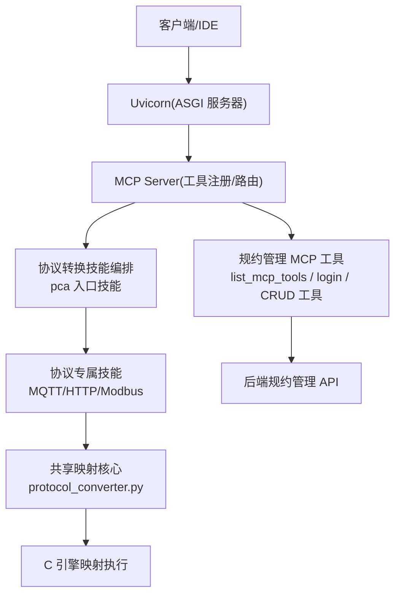
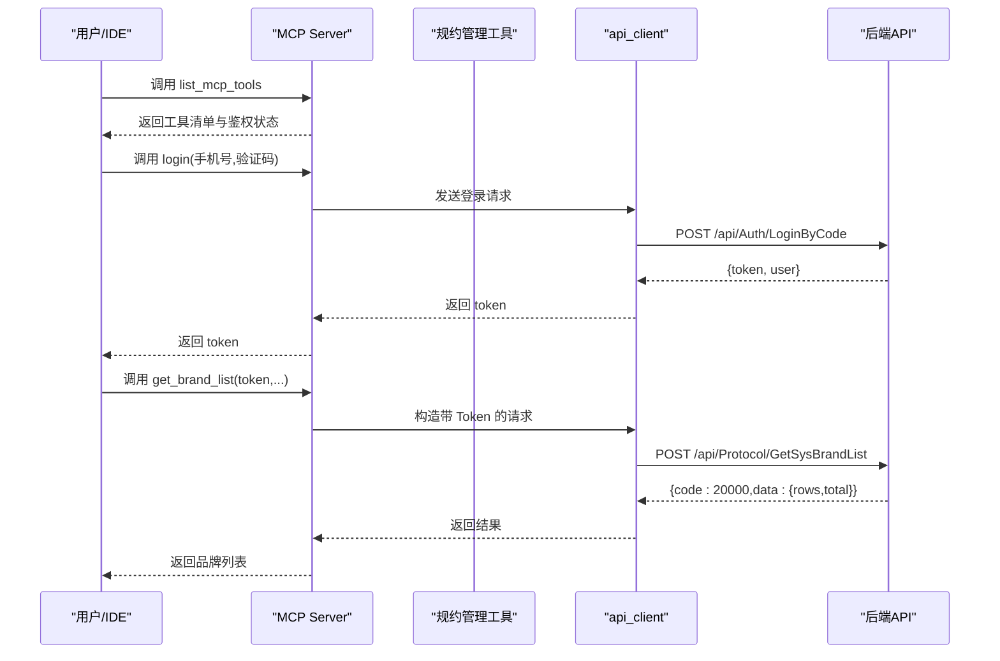
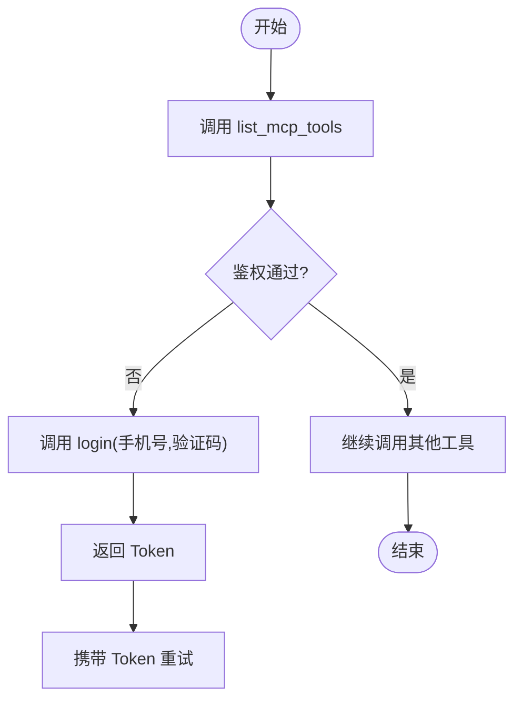
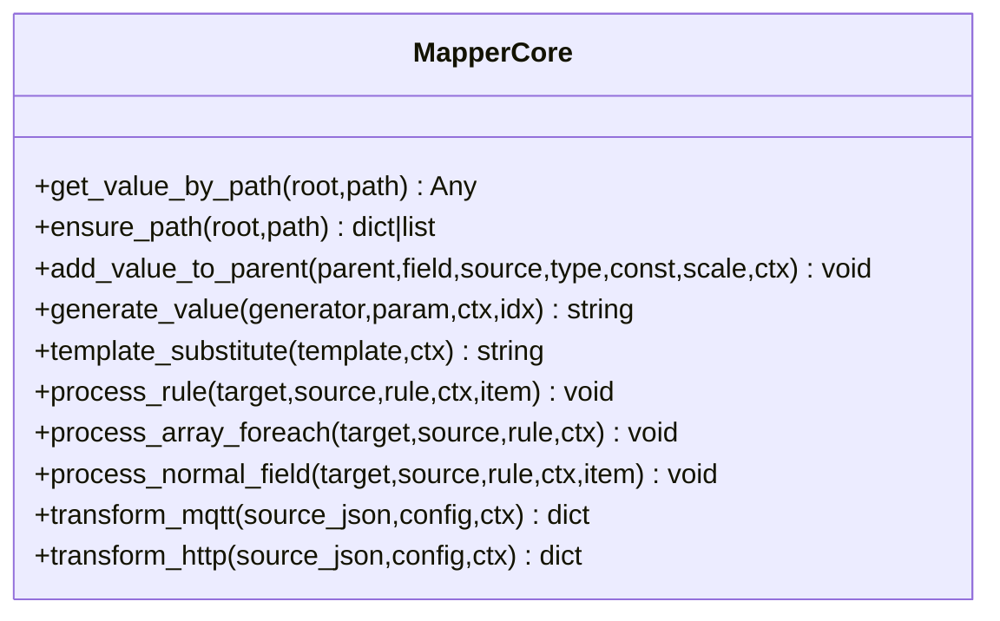
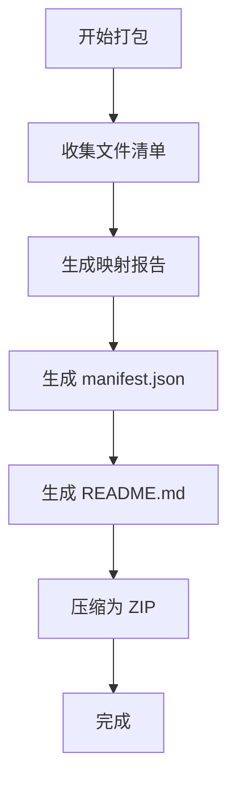
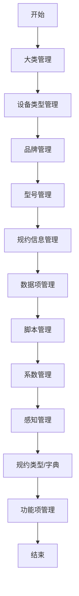
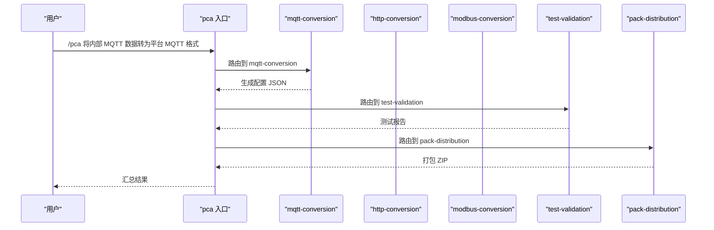
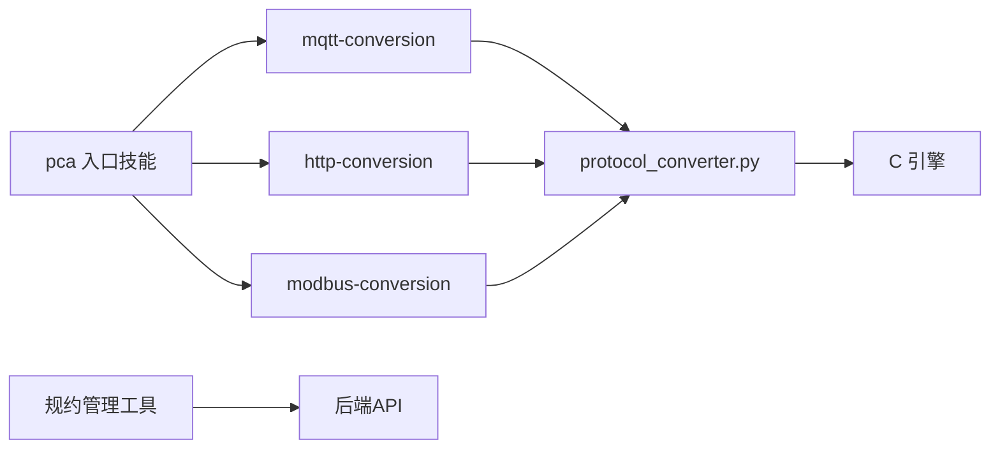

# 核心功能特性

<cite>
**本文引用的文件**
- [mcp server部署.md](file://mcp server部署.md)
- [规约管理MCP服务化Spec.md](file://规约管理MCP服务化Spec.md)
- [规约管理基础数据模块Spec.md](file://规约管理基础数据模块Spec.md)
- [.trae/skills/pca/SKILL.md](file://.trae/skills/pca/SKILL.md)
- [.trae/skills/protocol-conversion/scripts/build_pack.py](file://.trae/skills/protocol-conversion/scripts/build_pack.py)
- [.trae/skills/protocol-conversion/scripts/protocol_converter.py](file://.trae/skills/protocol-conversion/scripts/protocol_converter.py)
</cite>

## 目录
1. [简介](#简介)
2. [项目结构](#项目结构)
3. [核心组件](#核心组件)
4. [架构总览](#架构总览)
5. [详细组件分析](#详细组件分析)
6. [依赖关系分析](#依赖关系分析)
7. [性能与可靠性](#性能与可靠性)
8. [故障排查指南](#故障排查指南)
9. [结论](#结论)
10. [附录](#附录)

## 简介
本文件面向“协议转换 MCP 服务器”的核心功能特性，聚焦以下目标：
- 全面说明系统提供的 MCP 工具能力：已实现的 list_mcp_tools 探测工具，以及规划中的登录与规约管理相关工具（含桩函数设计意图）。
- 阐述认证授权体系：Token 自动分配、IP 关联管理、权限分级控制（系统级/用户级）。
- 解释协议转换引擎能力：支持 Modbus、BACnet、OPC-UA、MQTT、HTTP 等多协议映射与转换。
- 描述技能包系统：自动打包、文档生成、版本管理与测试报告集成。
- 说明规约管理的 CRUD 能力：大类、设备类型、品牌、型号、规约信息等的管理。
- 强调各功能的实际应用场景与价值，并给出功能间的依赖与协作方式。

## 项目结构
本项目由三部分构成：
- MCP 服务端：基于 Uvicorn + MCP 协议提供工具调用能力，包含安装与启动脚本、鉴权配置等。
- 规约管理服务化 Spec：将后端规约管理 API 封装为 MCP 原子工具，形成细粒度可编排能力。
- 协议转换技能集：以 Skill 形式组织多协议转换流程，包含共享映射核心、协议专属逻辑、测试验证与打包分发。

图表来源
- [mcp server部署.md:110-261](file://mcp server部署.md#L110-L261)
- [规约管理MCP服务化Spec.md:44-66](file://规约管理MCP服务化Spec.md#L44-L66)
- [.trae/skills/pca/SKILL.md:37-95](file://.trae/skills/pca/SKILL.md#L37-L95)

章节来源
- [mcp server部署.md:25-125](file://mcp server部署.md#L25-L125)
- [规约管理MCP服务化Spec.md:44-66](file://规约管理MCP服务化Spec.md#L44-L66)

## 核心组件
- MCP 工具层
  - 探测工具：list_mcp_tools，用于发现可用工具与鉴权状态。
  - 登录工具：login，手机号+验证码获取 Token，后续工具需显式传入 Token。
  - 规约管理工具：按 API 粒度暴露的 CRUD 工具（大类、设备类型、品牌、型号、规约信息、数据项、脚本、系数、感知、字典、功能项、导出等）。
- 协议转换技能层
  - 入口技能 pca：意图识别、路由到子技能、编排全流程。
  - 协议专属技能：mqtt-conversion、http-conversion、modbus-conversion、modbus-cq-adapt。
  - 共享子技能：protocol-conversion（共享映射核心）、test-validation（测试验证）、pack-distribution（打包分发）。
- 共享映射核心
  - protocol_converter.py：镜像 C 引擎 mapper_core.c，统一路径解析、类型转换、数组遍历、模板替换、生成器、对象嵌套等。
- 打包与发布
  - build_pack.py：收集文件、生成映射报告、manifest.json、README.md，并打包 ZIP，附带测试报告摘要。

章节来源
- [规约管理MCP服务化Spec.md:132-246](file://规约管理MCP服务化Spec.md#L132-L246)
- [.trae/skills/pca/SKILL.md:225-260](file://.trae/skills/pca/SKILL.md#L225-L260)
- [.trae/skills/protocol-conversion/scripts/protocol_converter.py:32-602](file://.trae/skills/protocol-conversion/scripts/protocol_converter.py#L32-L602)
- [.trae/skills/protocol-conversion/scripts/build_pack.py:1-409](file://.trae/skills/protocol-conversion/scripts/build_pack.py#L1-L409)

## 架构总览
系统采用分层与解耦设计：
- 网络层：Uvicorn 负责 HTTP/SSE 接入与高并发事件循环。
- 应用层：MCP 工具注册与路由；Skill 编排层负责意图识别与流程编排。
- 业务层：规约管理 API 封装为原子工具；协议转换引擎执行 JSON 映射规则。
- 数据层：后端规约管理数据库与文件存储；C 引擎读取 JSON 配置进行运行时转换。

图表来源
- [规约管理MCP服务化Spec.md:132-139](file://规约管理MCP服务化Spec.md#L132-L139)
- [规约管理MCP服务化Spec.md:295-319](file://规约管理MCP服务化Spec.md#L295-L319)
- [规约管理MCP服务化Spec.md:327-335](file://规约管理MCP服务化Spec.md#L327-L335)

章节来源
- [mcp server部署.md:110-261](file://mcp server部署.md#L110-L261)
- [规约管理MCP服务化Spec.md:44-66](file://规约管理MCP服务化Spec.md#L44-L66)

## 详细组件分析

### 组件一：MCP 工具与鉴权
- 探测工具 list_mcp_tools
  - 用途：列出所有工具与鉴权探测，便于客户端快速适配。
  - 价值：降低对接成本，确保连接与鉴权状态可见。
- 登录工具 login
  - 用途：手机号+验证码登录，返回 Token；后续工具需显式传入 Token。
  - 价值：无状态、透明传递，避免服务端维护会话。
- 规约管理工具（CRUD）
  - 覆盖：大类、设备类型、品牌、型号、规约信息、数据项、脚本、系数、感知、字典、功能项、导出等。
  - 价值：将 Web 平台操作原子化为可编排的工具，支持自动化流程。
- 桩函数设计意图
  - 背景：当前 server.py 存在若干桩工具仅返回 not_implemented。
  - 意图：保留 list_mcp_tools 作为探测入口；删除无用桩，保持工具清单干净；后续逐步实现对应 API 的原子工具。

图表来源
- [规约管理MCP服务化Spec.md:132-139](file://规约管理MCP服务化Spec.md#L132-L139)
- [规约管理MCP服务化Spec.md:295-319](file://规约管理MCP服务化Spec.md#L295-L319)

章节来源
- [规约管理MCP服务化Spec.md:132-246](file://规约管理MCP服务化Spec.md#L132-L246)
- [mcp server部署.md:645-663](file://mcp server部署.md#L645-L663)

### 组件二：协议转换引擎（共享映射核心）
- 核心能力
  - 路径解析：支持 a.b.c、a[0]、a[*]、"."根对象。
  - 类型转换：int/double/long/bool/object/string，支持 scale 缩放。
  - 数组遍历：object/key_value 模式，支持 $idx/$item 变量替换与嵌套 [*] 展平。
  - 模板替换：$var$ 语法，支持嵌套路径取值。
  - 生成器：uuid、timestamp、datetime、md5_sign、batch_id、sequence 等。
  - 引擎入口：transform_mqtt、transform_http，分别处理 MQTT 与 HTTP 特有配置。
- 价值
  - 统一 MQTT 与 HTTP 映射逻辑，降低重复维护成本。
  - 为 Skill 提供稳定可靠的映射执行能力，支撑多协议转换。

图表来源
- [.trae/skills/protocol-conversion/scripts/protocol_converter.py:32-602](file://.trae/skills/protocol-conversion/scripts/protocol_converter.py#L32-L602)

章节来源
- [.trae/skills/protocol-conversion/scripts/protocol_converter.py:32-602](file://.trae/skills/protocol-conversion/scripts/protocol_converter.py#L32-L602)

### 组件三：技能包系统与打包分发
- 自动打包
  - 收集协议转换相关文件（SKILL.md、agents/openai.yaml、映射核心、测试套件等）。
  - 生成 mapping_report.md、manifest.json（含 SHA256 校验和）、README.md。
  - 输出 ZIP 包，便于分发与安装。
- 版本管理与测试集成
  - manifest.json 记录 packId、version、dependencies、testStatus、changes。
  - 读取 test_report.json，汇总通过/跳过/失败统计。
- 价值
  - 标准化交付物，提升可追溯性与一致性。
  - 一键打包与分发，缩短上线周期。

图表来源
- [.trae/skills/protocol-conversion/scripts/build_pack.py:1-409](file://.trae/skills/protocol-conversion/scripts/build_pack.py#L1-L409)

章节来源
- [.trae/skills/protocol-conversion/scripts/build_pack.py:1-409](file://.trae/skills/protocol-conversion/scripts/build_pack.py#L1-L409)

### 组件四：规约管理 CRUD 能力
- 大类管理：查询、新增、更新、删除。
- 设备类型管理：查询、新增、更新、删除，支持按大类筛选。
- 品牌管理：查询、新增、更新、删除，支持按设备类型筛选。
- 型号管理：查询、新增、更新、删除，支持按品牌筛选与导出统计。
- 规约信息管理：查询、新增、更新、删除、上传文档、导出数据项、导出脚本、查询系数与感知、查询功能项。
- 规约类型与功能项：查询、保存、删除。
- 价值
  - 将复杂 Web 操作拆解为原子工具，便于 Skill 编排自动化。
  - 支持四级分类联动与多维筛选，满足工业场景下的精细化管理。

图表来源
- [规约管理基础数据模块Spec.md:1-16](file://规约管理基础数据模块Spec.md#L1-L16)
- [规约管理基础数据模块Spec.md:304-325](file://规约管理基础数据模块Spec.md#L304-L325)

章节来源
- [规约管理基础数据模块Spec.md:1-16](file://规约管理基础数据模块Spec.md#L1-L16)
- [规约管理基础数据模块Spec.md:304-325](file://规约管理基础数据模块Spec.md#L304-L325)

### 组件五：协议转换流程编排（pca 入口技能）
- 意图识别：根据关键词路由到 mqtt-conversion、http-conversion、modbus-conversion、modbus-cq-adapt、test-validation、pack-distribution。
- 全流程编排：Phase 1 协议分析与配置生成 → Phase 2 测试验证 → Phase 3 打包分发。
- 单步执行：支持只执行单个步骤，灵活适配不同需求。
- 价值
  - 降低用户门槛，自然语言即可驱动复杂流程。
  - 统一输出 JSON 配置，供 C 引擎执行，保证一致性与可移植性。

图表来源
- [.trae/skills/pca/SKILL.md:171-223](file://.trae/skills/pca/SKILL.md#L171-L223)
- [.trae/skills/pca/SKILL.md:270-314](file://.trae/skills/pca/SKILL.md#L270-L314)

章节来源
- [.trae/skills/pca/SKILL.md:171-223](file://.trae/skills/pca/SKILL.md#L171-L223)
- [.trae/skills/pca/SKILL.md:270-314](file://.trae/skills/pca/SKILL.md#L270-L314)

## 依赖关系分析
- 组件耦合
  - pca 入口技能依赖协议专属技能与共享映射核心。
  - 协议专属技能依赖 protocol_converter.py 的映射能力。
  - 规约管理工具依赖 api_client 与后端 API。
- 外部依赖
  - Uvicorn：高性能 ASGI 服务器。
  - MCP SDK：工具注册与 JSON-RPC 处理。
  - httpx：异步 HTTP 客户端（规约管理工具使用）。
- 潜在风险
  - 后端 API 变更需同步更新工具参数与响应处理。
  - 协议转换配置格式变化需同步更新 Skill 与 C 引擎。

图表来源
- [.trae/skills/pca/SKILL.md:225-260](file://.trae/skills/pca/SKILL.md#L225-L260)
- [规约管理MCP服务化Spec.md:44-66](file://规约管理MCP服务化Spec.md#L44-L66)

章节来源
- [.trae/skills/pca/SKILL.md:225-260](file://.trae/skills/pca/SKILL.md#L225-L260)
- [规约管理MCP服务化Spec.md:44-66](file://规约管理MCP服务化Spec.md#L44-L66)

## 性能与可靠性
- 高并发与异步
  - Uvicorn 基于 uvloop 与 httptools，原生支持 async/await，适合 I/O 密集型任务。
  - 规约管理工具使用 httpx 异步客户端，避免阻塞事件循环。
- 错误处理与容错
  - 统一错误归一化：网络异常、HTTP 异常、业务错误码、认证错误。
  - 工具幂等与安全：先查后改、最小权限、操作可逆。
- 测试与质量保障
  - 共享映射核心具备完备测试套件，覆盖路径解析、类型转换、生成器、模板替换、数组遍历、边界条件等。
  - 打包脚本集成测试报告，确保交付物质量。

章节来源
- [mcp server部署.md:82-125](file://mcp server部署.md#L82-L125)
- [规约管理MCP服务化Spec.md:123-130](file://规约管理MCP服务化Spec.md#L123-L130)
- [.trae/skills/protocol-conversion/scripts/build_pack.py:154-179](file://.trae/skills/protocol-conversion/scripts/build_pack.py#L154-L179)

## 故障排查指南
- 常见问题
  - Python 未安装或版本过低：检查 Python 版本并重新安装。
  - 虚拟环境创建失败：确认权限与磁盘空间。
  - 依赖安装失败：检查网络与 pip 版本，尝试国内镜像源。
  - 启动时找不到虚拟环境：运行 install.bat 重新初始化。
  - Token 未配置：运行 install.bat 或手动创建 .env。
  - 端口被占用：查找并结束占用进程或修改端口。
- 安全注意事项
  - Token 管理：仅本地开发使用，生产环境更换更强认证机制。
  - 权限模型：localhost 系统级读写，其他 IP 用户级只读，其他用户通过访问页面获取 Token。
  - 生产建议：启用 HTTPS、进程管理、日志审计、限制访问来源。

章节来源
- [mcp server部署.md:505-673](file://mcp server部署.md#L505-L673)

## 结论
本系统通过 MCP 工具与 Skill 编排，实现了规约管理的自动化与协议转换的一体化：
- MCP 工具提供细粒度原子能力，便于编排与复用。
- 协议转换引擎统一映射逻辑，降低维护成本，提升扩展性。
- 技能包系统标准化交付，提升可追溯性与一致性。
- 规约管理 CRUD 能力覆盖完整生命周期，支撑工业场景精细化管理。
- 认证授权与权限分级保障安全性与可控性。

## 附录
- 典型调用流程参考
  - 登录与工具调用：从 login 获取 Token，后续工具显式传入。
  - 协议转换全流程：分析→映射→测试→打包。
- 配置输出说明
  - 统一 JSON 配置文件，供 C 引擎读取执行。
- 扩展指引
  - 新增协议步骤：创建目录、编写 SKILL.md、更新路由表、可选添加 MCP 工具。

章节来源
- [规约管理MCP服务化Spec.md:295-319](file://规约管理MCP服务化Spec.md#L295-L319)
- [.trae/skills/pca/SKILL.md:316-346](file://.trae/skills/pca/SKILL.md#L316-L346)
- [.trae/skills/pca/SKILL.md:374-385](file://.trae/skills/pca/SKILL.md#L374-L385)