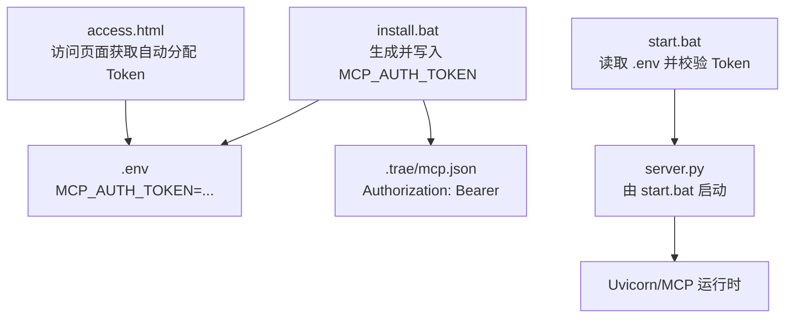
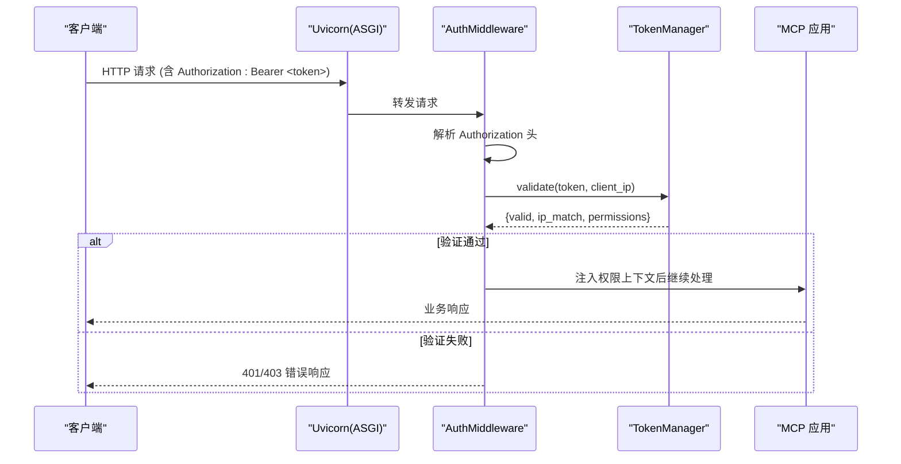
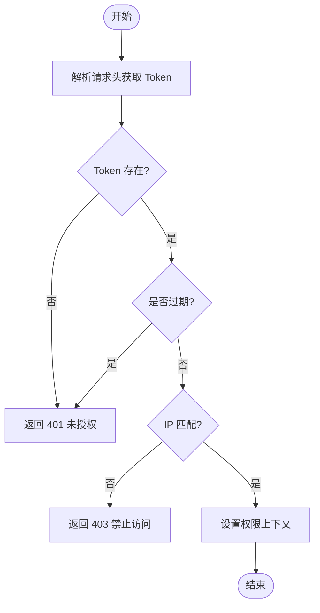
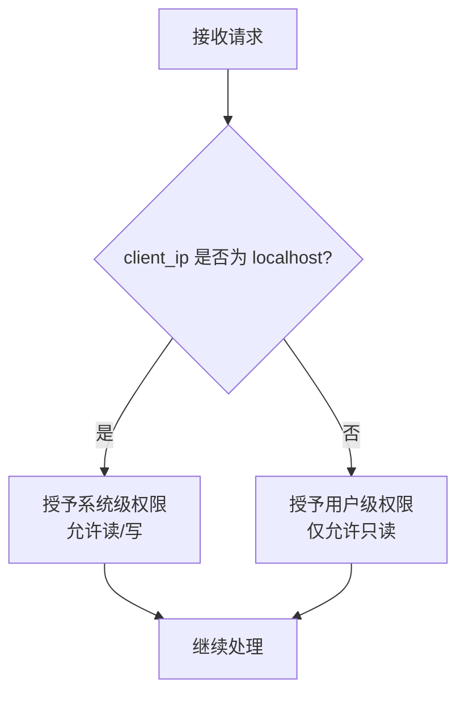
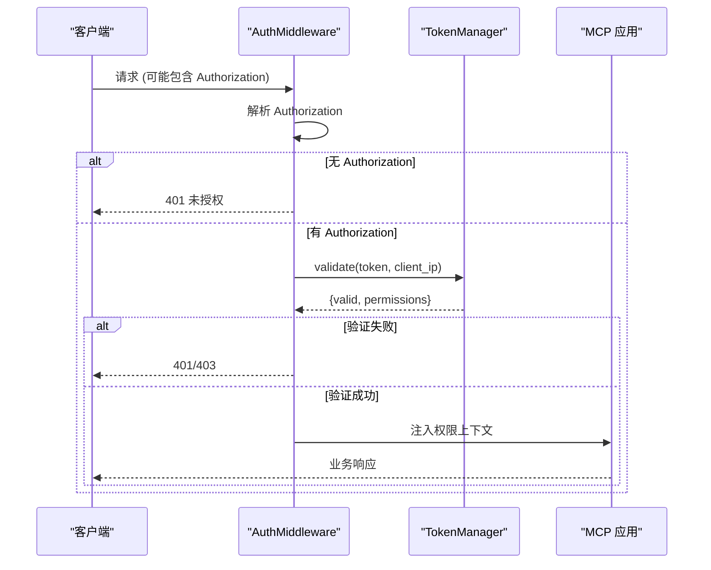
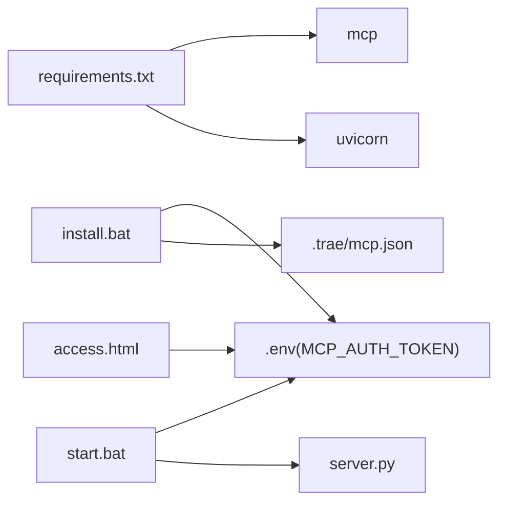

# 认证授权系统

<cite>
**本文引用的文件**
- [install.bat](file://mcp_server/install.bat)
- [start.bat](file://mcp_server/start.bat)
- [requirements.txt](file://mcp_server/requirements.txt)
- [access.html](file://mcp_server/static/access.html)
- [mcp server部署.md](file://mcp server部署.md)
</cite>

## 目录
1. [简介](#简介)
2. [项目结构](#项目结构)
3. [核心组件](#核心组件)
4. [架构总览](#架构总览)
5. [详细组件分析](#详细组件分析)
6. [依赖关系分析](#依赖关系分析)
7. [性能考虑](#性能考虑)
8. [故障排查指南](#故障排查指南)
9. [结论](#结论)
10. [附录](#附录)

## 简介
本文件面向 MCP 服务器的认证与授权子系统，围绕 Token 管理、权限分级模型、ASGI 中间件（AuthMiddleware）以及环境变量配置进行系统化说明。重点覆盖：
- TokenManager 类的设计与实现要点：Token 自动生成机制、IP 关联管理、Token 验证逻辑
- 权限分级模型：localhost（127.0.0.1/::1）获得系统级权限（读写），非 localhost 客户端获得用户级权限（只读）
- AuthMiddleware ASGI 中间件的工作流程：Bearer Token 验证、权限上下文设置、错误处理
- 环境变量 MCP_AUTH_TOKEN 的作用与安全注意事项
- 完整认证流程图与实际使用示例（如何获取 Token、如何进行鉴权调用）
- 常见认证问题排查方法与最佳实践建议

## 项目结构
本项目采用“脚本 + 文档 + 静态资源”的轻量组织方式，认证相关的关键入口与配置集中在以下位置：
- mcp_server/install.bat：安装时生成并写入 MCP_AUTH_TOKEN，同时生成 .trae/mcp.json 以便 IDE 自动携带 Authorization 头
- mcp_server/start.bat：启动前读取 .env 中的 MCP_AUTH_TOKEN，校验缺失则中止启动
- mcp_server/static/access.html：用于访问页面（结合部署文档可知，非本地用户可通过该页面获取自动分配的 Token）
- mcp server部署.md：对权限模型、安全注意事项、常见问题等进行详细说明

图表来源
- [install.bat:52-72](file://mcp_server/install.bat#L52-L72)
- [start.bat:15-27](file://mcp_server/start.bat#L15-L27)
- [mcp server部署.md:338-378](file://mcp server部署.md#L338-L378)

章节来源
- [install.bat:52-72](file://mcp_server/install.bat#L52-L72)
- [start.bat:15-27](file://mcp_server/start.bat#L15-L27)
- [mcp server部署.md:338-378](file://mcp server部署.md#L338-L378)

## 核心组件
- TokenManager（概念性组件）
  - 职责：负责 Token 的生成、存储、绑定 IP、验证与过期策略（在代码仓库中未直接提供源码，但行为可由安装脚本与部署文档推导）
  - 关键能力：
    - Token 自动生成：基于密码学安全的随机源生成，格式为“metam_pat_ + 32 位十六进制字符串”
    - IP 关联管理：将 Token 与发起请求的客户端 IP 绑定，便于审计与限制
    - Token 验证逻辑：从请求头提取 Bearer Token，校验有效性、是否过期、是否与当前 IP 匹配等
- 权限分级模型
  - localhost（127.0.0.1/::1）：系统级权限，支持读/写操作
  - 非 localhost 客户端：用户级权限，仅允许只读访问
- AuthMiddleware（ASGI 中间件，概念性组件）
  - 职责：拦截请求，解析 Authorization 头，完成 Bearer Token 验证，注入权限上下文，统一错误处理
  - 典型流程：
    - 解析请求头 Authorization: Bearer <token>
    - 调用 TokenManager.validate(token, client_ip)
    - 根据 client_ip 判定权限级别（localhost → 系统级；其他 → 用户级）
    - 将权限上下文注入到请求作用域，供后续处理器使用
    - 失败时返回 401/403 等标准错误响应
- 环境变量 MCP_AUTH_TOKEN
  - 作用：作为管理员 Token，用于本地开发或受控环境下的系统级访问
  - 安全考虑：仅用于本地开发，避免提交至版本库；生产环境建议使用更强认证机制

章节来源
- [mcp server部署.md:338-378](file://mcp server部署.md#L338-L378)
- [mcp server部署.md:645-674](file://mcp server部署.md#L645-L674)

## 架构总览
下图展示了从客户端到服务端的认证授权整体流程，包括 Token 生成、注入、验证与权限判定。

图表来源
- [mcp server部署.md:215-261](file://mcp server部署.md#L215-L261)
- [mcp server部署.md:338-378](file://mcp server部署.md#L338-L378)

## 详细组件分析

### TokenManager（概念性）
- 设计目标
  - 提供统一的 Token 生命周期管理能力：生成、绑定、验证、撤销
- 关键实现要点
  - Token 自动生成机制：使用密码学安全随机源生成，确保不可预测性与唯一性
  - IP 关联管理：记录 Token 首次使用的客户端 IP，并在后续请求中进行比对，防止跨 IP 滥用
  - Token 验证逻辑：检查 Token 是否存在、是否过期、是否与当前 IP 匹配、是否被撤销
- 复杂度与优化
  - 时间复杂度：验证通常为 O(1)（哈希表查找）
  - 空间复杂度：O(N)（N 为已签发 Token 数量）
  - 优化建议：引入缓存层（如内存/Redis）提升高频验证性能；定期清理过期 Token

图表来源
- [mcp server部署.md:645-674](file://mcp server部署.md#L645-L674)

章节来源
- [mcp server部署.md:645-674](file://mcp server部署.md#L645-L674)

### 权限分级模型
- localhost（127.0.0.1/::1）：系统级权限，支持读/写
- 非 localhost：用户级权限，仅只读
- 决策依据：根据请求来源 IP 判断是否为本地回环地址

图表来源
- [mcp server部署.md:655-663](file://mcp server部署.md#L655-L663)

章节来源
- [mcp server部署.md:655-663](file://mcp server部署.md#L655-L663)

### AuthMiddleware（ASGI 中间件，概念性）
- 工作流程
  - 解析 Authorization 头，提取 Bearer Token
  - 调用 TokenManager 进行验证与权限判定
  - 将权限上下文注入到请求作用域
  - 统一错误处理：未授权（401）、禁止访问（403）
- 错误处理机制
  - 缺少 Authorization 头：返回 401
  - Token 无效/过期：返回 401
  - IP 不匹配或权限不足：返回 403

图表来源
- [mcp server部署.md:215-261](file://mcp server部署.md#L215-L261)
- [mcp server部署.md:645-674](file://mcp server部署.md#L645-L674)

章节来源
- [mcp server部署.md:215-261](file://mcp server部署.md#L215-L261)
- [mcp server部署.md:645-674](file://mcp server部署.md#L645-L674)

### 环境变量 MCP_AUTH_TOKEN
- 作用
  - 作为管理员 Token，用于本地开发或受控环境下的系统级访问
  - install.bat 会生成并写入 .env；start.bat 启动前读取并校验
- 安全考虑
  - 仅用于本地开发，不要部署到生产环境
  - 确保 .env 不被提交到版本库
  - 如需共享项目，告知用户重新生成 Token

章节来源
- [install.bat:52-72](file://mcp_server/install.bat#L52-L72)
- [start.bat:15-27](file://mcp_server/start.bat#L15-L27)
- [mcp server部署.md:338-378](file://mcp server部署.md#L338-L378)
- [mcp server部署.md:645-674](file://mcp server部署.md#L645-L674)

## 依赖关系分析
- 运行依赖
  - mcp>=1.0.0,<2.0.0：MCP 框架依赖
  - uvicorn>=0.30.0：ASGI 服务器，承载 MCP 应用
- 启动与配置依赖
  - install.bat：生成 MCP_AUTH_TOKEN 并写入 .env，同时生成 .trae/mcp.json
  - start.bat：读取 .env 中的 MCP_AUTH_TOKEN，校验缺失则中止启动
  - access.html：用于访问页面（结合部署文档可知，非本地用户可通过该页面获取自动分配的 Token）

图表来源
- [requirements.txt:1-2](file://mcp_server/requirements.txt#L1-L2)
- [install.bat:52-72](file://mcp_server/install.bat#L52-L72)
- [start.bat:15-27](file://mcp_server/start.bat#L15-L27)

章节来源
- [requirements.txt:1-2](file://mcp_server/requirements.txt#L1-L2)
- [install.bat:52-72](file://mcp_server/install.bat#L52-L72)
- [start.bat:15-27](file://mcp_server/start.bat#L15-L27)

## 性能考虑
- Token 验证性能
  - 使用哈希表存储 Token 元数据，验证复杂度 O(1)
  - 可引入内存/分布式缓存降低 I/O 开销
- 并发与异步
  - 基于 Uvicorn 的异步事件循环，适合高并发场景
  - 避免在认证路径中进行阻塞 I/O 操作
- 资源清理
  - 定期清理过期 Token，控制内存占用
  - 限制单 IP 的 Token 数量，防止资源耗尽

[本节为通用性能建议，无需特定文件引用]

## 故障排查指南
- 无法启动服务
  - 现象：提示 MCP_AUTH_TOKEN 未设置
  - 原因：未运行 install.bat 或未正确配置 .env
  - 解决：运行 install.bat 或手动创建 .env 并设置 MCP_AUTH_TOKEN
- 端口被占用
  - 现象：绑定端口失败
  - 解决：查找并结束占用进程，或修改端口号
- 移动项目后虚拟环境失效
  - 原因：activate.bat 中硬编码了绝对路径
  - 解决：删除旧 .venv 并重新运行 install.bat
- 认证失败
  - 现象：401/403 错误
  - 排查：
    - 确认 Authorization 头是否正确携带 Bearer Token
    - 确认 Token 是否有效且未过期
    - 确认请求 IP 是否与 Token 绑定的 IP 一致
    - 确认权限级别是否满足操作要求（localhost 系统级读写；非 localhost 用户级只读）

章节来源
- [mcp server部署.md:599-643](file://mcp server部署.md#L599-L643)
- [mcp server部署.md:645-674](file://mcp server部署.md#L645-L674)

## 结论
本认证授权系统以轻量化的脚本与文档为核心，配合环境变量 MCP_AUTH_TOKEN 与访问页面，实现了本地系统级权限与非本地用户级权限的分层控制。通过概念性的 TokenManager 与 AuthMiddleware，完成了 Token 生成、IP 关联、验证与权限上下文注入的完整链路。建议在生产环境中升级认证机制（如 OAuth2/JWT）、启用 HTTPS、增加日志审计与访问来源限制，以提升安全性与可观测性。

[本节为总结性内容，无需特定文件引用]

## 附录
- 快速命令参考
  - 首次安装：mcp_server\install.bat
  - 启动服务：mcp_server\start.bat
  - 停止服务：按 Ctrl+C
  - 手动激活虚拟环境：.venv\Scripts\activate.bat
  - 退出虚拟环境：deactivate
  - 手动启动服务：python mcp_server\server.py

章节来源
- [mcp server部署.md:677-687](file://mcp server部署.md#L677-L687)