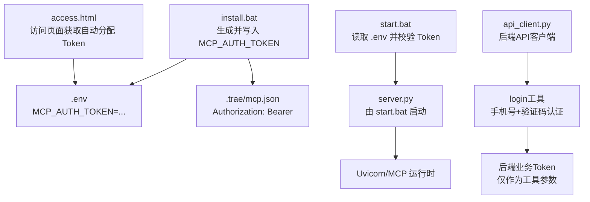
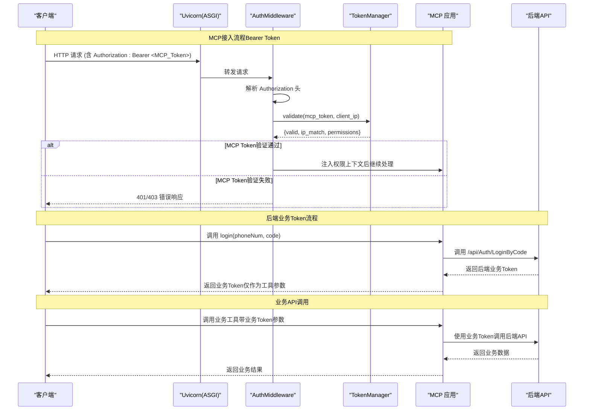
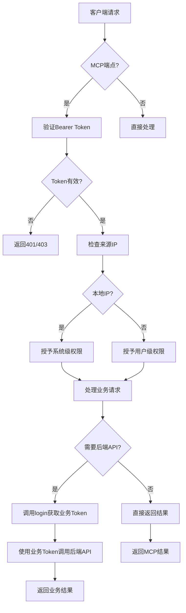
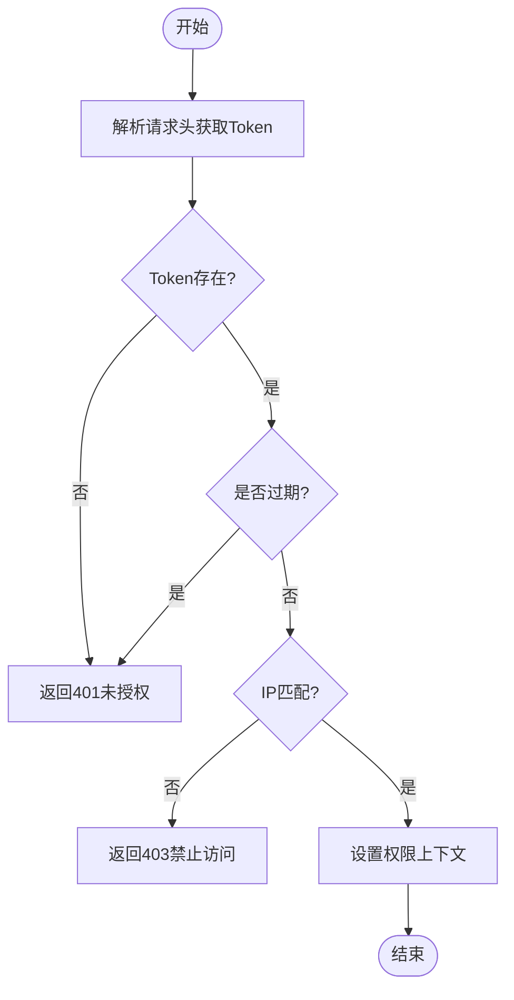
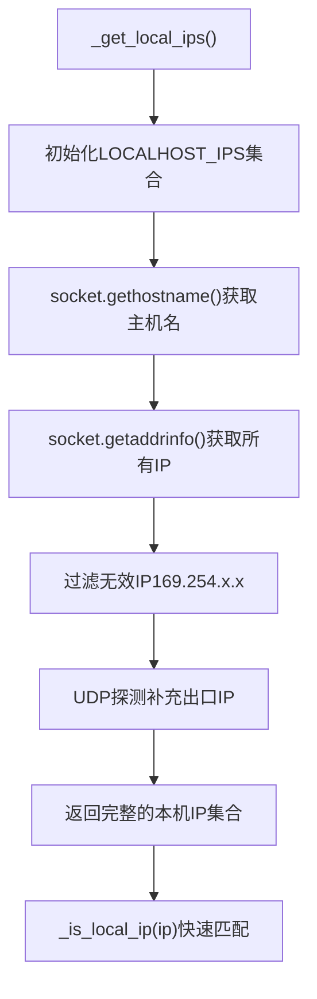
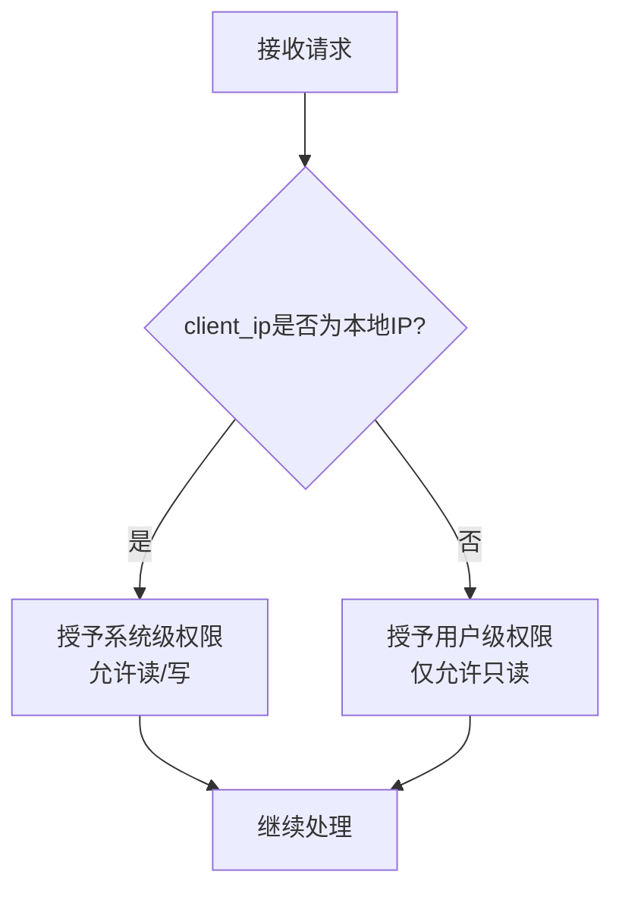
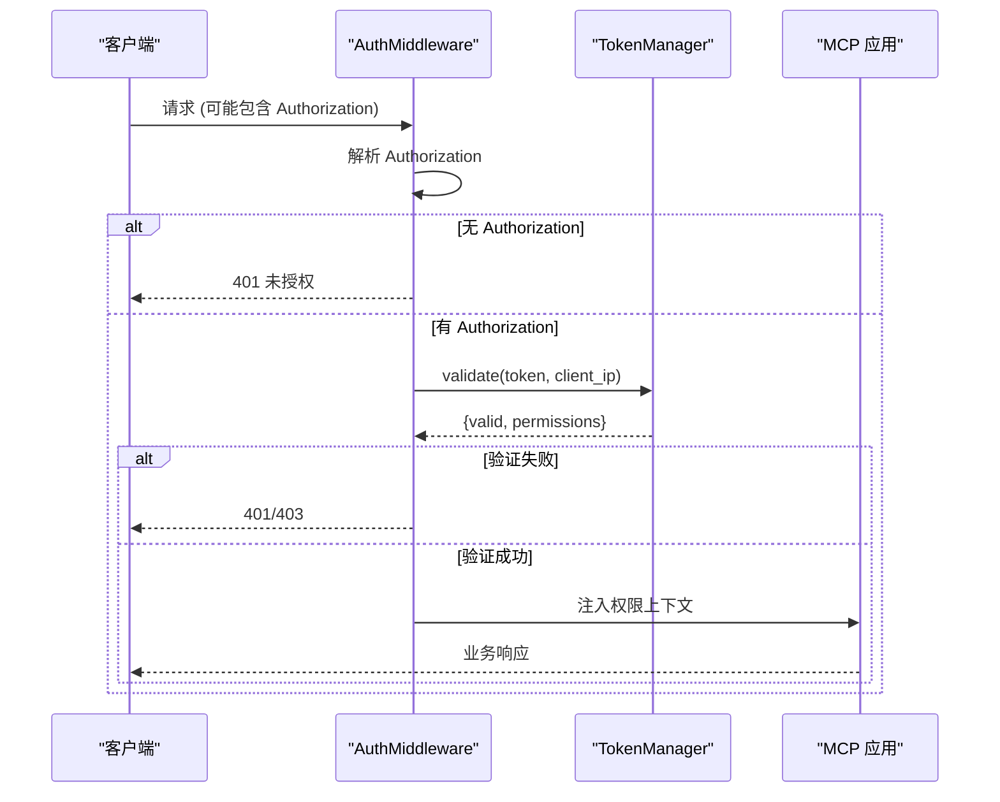
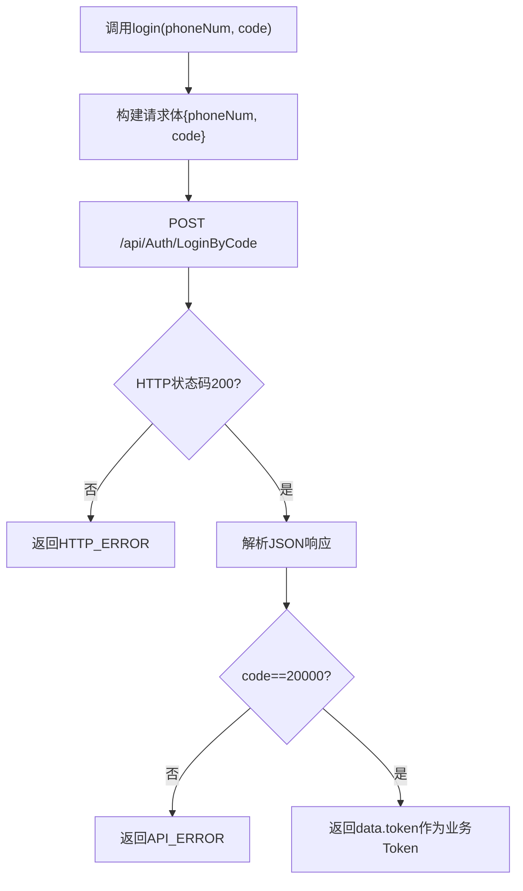
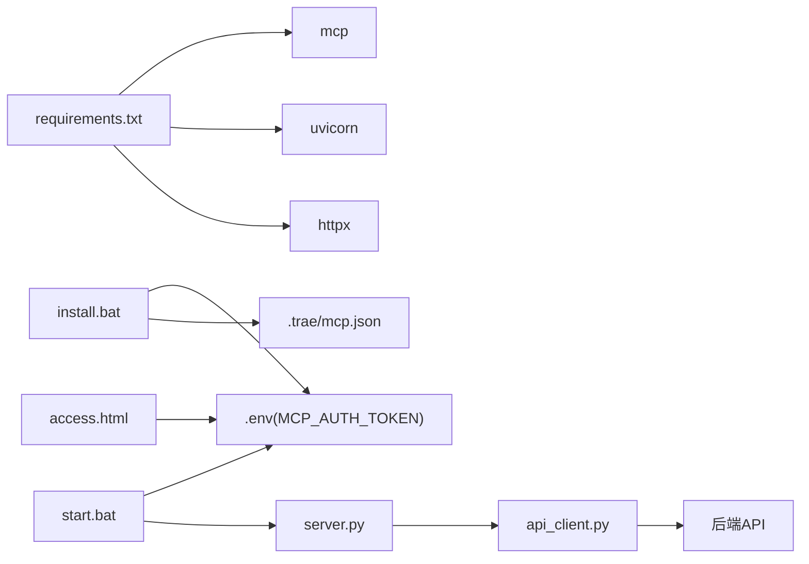

# 认证授权系统

<cite>
**本文引用的文件**
- [server.py](file://mcp_server/server.py)
- [api_client.py](file://mcp_server/api_client.py)
- [install.bat](file://mcp_server/install.bat)
- [start.bat](file://mcp_server/start.bat)
- [access.html](file://mcp_server/static/access.html)
- [mcp server部署.md](file://mcp server部署.md)
</cite>

## 更新摘要
**变更内容**
- 新增双令牌模型：MCP接入Token与后端业务Token分离
- 新增login工具：支持手机号+验证码认证获取后端业务令牌
- 增强本地IP检测：支持所有网络接口IP识别的_is_local_ip()函数
- 更新TokenManager：配合新的本地IP检测逻辑
- 完善权限分级模型：localhost获得系统级权限，非localhost客户端获得用户级权限

## 目录
1. [简介](#简介)
2. [项目结构](#项目结构)
3. [核心组件](#核心组件)
4. [架构总览](#架构总览)
5. [详细组件分析](#详细组件分析)
6. [依赖关系分析](#依赖关系分析)
7. [性能考虑](#性能考虑)
8. [故障排查指南](#故障排查指南)
9. [结论](#结论)
10. [附录](#附录)

## 简介
本文件面向 MCP 服务器的认证与授权子系统，围绕双令牌模型、Token 管理、权限分级模型、ASGI 中间件（AuthMiddleware）以及环境变量配置进行系统化说明。重点覆盖：
- **双令牌模型**：MCP接入Token（Bearer Token）与后端业务Token的分离设计
- TokenManager 类的设计与实现要点：Token 自动生成机制、IP 关联管理、Token 验证逻辑
- **增强的本地IP检测**：通过`_is_local_ip()`函数支持所有网络接口IP识别
- 权限分级模型：localhost（127.0.0.1/::1及所有本机网卡IP）获得系统级权限（读写），非 localhost 客户端获得用户级权限（只读）
- AuthMiddleware ASGI 中间件的工作流程：Bearer Token 验证、权限上下文设置、错误处理
- **新增login工具**：手机号+验证码认证获取后端业务令牌
- 环境变量 MCP_AUTH_TOKEN 的作用和安全注意事项
- 完整认证流程图与实际使用示例（如何获取Token、如何进行鉴权调用）
- 常见认证问题排查方法与最佳实践建议

## 项目结构
本项目采用"脚本 + 文档 + 静态资源"的轻量组织方式，认证相关的关键入口与配置集中在以下位置：
- mcp_server/install.bat：安装时生成并写入 MCP_AUTH_TOKEN，同时生成 .trae/mcp.json 以便 IDE 自动携带 Authorization 头
- mcp_server/start.bat：启动前读取 .env 中的 MCP_AUTH_TOKEN，校验缺失则中止启动
- mcp_server/static/access.html：用于访问页面（结合部署文档可知，非本地用户可通过该页面获取自动分配的 Token）
- mcp_server/server.py：包含完整的认证授权系统实现，包括双令牌模型、IP检测、权限控制
- mcp_server/api_client.py：封装后端API调用，提供login工具和业务Token管理

**图表来源**
- [install.bat:52-72](file://mcp_server/install.bat#L52-L72)
- [start.bat:15-27](file://mcp_server/start.bat#L15-L27)
- [server.py:471-482](file://mcp_server/server.py#L471-L482)
- [api_client.py:312-359](file://mcp_server/api_client.py#L312-L359)

**章节来源**
- [install.bat:52-72](file://mcp_server/install.bat#L52-L72)
- [start.bat:15-27](file://mcp_server/start.bat#L15-L27)
- [mcp server部署.md:338-378](file://mcp server部署.md#L338-L378)

## 核心组件
- **双令牌模型**
  - **MCP接入Token**：用于MCP端点鉴权，通过Authorization: Bearer传递，存储在内存中
  - **后端业务Token**：通过login工具获取，仅作为工具参数传递给后端API，不传给MCP层
- **TokenManager（核心组件）**
  - 职责：负责MCP接入Token的生成、存储、绑定 IP、验证与过期策略
  - 关键能力：
    - Token 自动生成：基于密码学安全的随机源生成，格式为"metam_pat_ + 32 位十六进制字符串"
    - IP 关联管理：将 Token 与发起请求的客户端 IP 绑定，便于审计与限制
    - Token 验证逻辑：从请求头提取 Bearer Token，校验有效性、是否过期、是否与当前 IP 匹配等
- **增强的本地IP检测**
  - `_is_local_ip()`函数：判断IP是否属于本机（含localhost和所有本机网卡IP）
  - `_get_local_ips()`函数：获取本机的所有有效IPv4地址（含localhost和LAN IP）
  - 支持所有网络接口IP识别，不仅限于127.0.0.1/::1
- **权限分级模型**
  - localhost（127.0.0.1/::1及所有本机网卡IP）：系统级权限，支持读/写操作
  - 非 localhost 客户端：用户级权限，仅允许只读访问
- **AuthMiddleware（ASGI 中间件）**
  - 职责：拦截请求，解析 Authorization 头，完成 Bearer Token 验证，注入权限上下文，统一错误处理
  - 典型流程：
    - 解析请求头 Authorization: Bearer <token>
    - 调用 TokenManager.validate(token, client_ip)
    - 根据 client_ip 判定权限级别（localhost → 系统级；其他 → 用户级）
    - 将权限上下文注入到请求作用域，供后续处理器使用
    - 失败时返回 401/403 等标准错误响应
- **新增login工具**
  - 功能：手机号+验证码登录，返回后端业务Token
  - 实现：通过api_client.login()方法调用后端/api/Auth/LoginByCode接口
  - 安全：业务Token仅作为工具参数使用，不与MCP接入Token混淆
- **环境变量 MCP_AUTH_TOKEN**
  - 作用：作为管理员Token，用于本地开发或受控环境下的系统级访问
  - 安全考虑：仅用于本地开发，避免提交至版本库；生产环境建议使用更强认证机制

**章节来源**
- [server.py:203-242](file://mcp_server/server.py#L203-L242)
- [server.py:63-88](file://mcp_server/server.py#L63-L88)
- [server.py:302-304](file://mcp_server/server.py#L302-L304)
- [server.py:1304-1362](file://mcp_server/server.py#L1304-L1362)
- [server.py:471-482](file://mcp_server/server.py#L471-L482)
- [api_client.py:312-359](file://mcp_server/api_client.py#L312-L359)

## 架构总览
下图展示了从客户端到服务端的认证授权整体流程，包括双令牌模型、Token 生成、注入、验证与权限判定。

**图表来源**
- [server.py:1304-1362](file://mcp_server/server.py#L1304-L1362)
- [server.py:471-482](file://mcp_server/server.py#L471-L482)
- [api_client.py:312-359](file://mcp_server/api_client.py#L312-L359)

## 详细组件分析

### 双令牌模型
系统实现了两种独立的令牌机制：

1. **MCP接入Token（Bearer Token）**
   - 用途：MCP端点鉴权，通过Authorization: Bearer传递
   - 存储：服务器内存中，按IP映射存储
   - 验证：AuthMiddleware在请求入口处验证
   - 权限：根据来源IP决定系统级或用户级权限

2. **后端业务Token**
   - 用途：调用后端API的业务认证
   - 获取：通过login(phoneNum, code)接口获取
   - 传递：仅作为工具参数传递给后端API，不进入MCP层
   - 生命周期：由后端API管理，可能过期失效

**图表来源**
- [server.py:1304-1362](file://mcp_server/server.py#L1304-L1362)
- [server.py:471-482](file://mcp_server/server.py#L471-L482)
- [api_client.py:312-359](file://mcp_server/api_client.py#L312-L359)

**章节来源**
- [server.py:14-26](file://mcp_server/server.py#L14-L26)
- [server.py:471-482](file://mcp_server/server.py#L471-L482)
- [api_client.py:123-127](file://mcp_server/api_client.py#L123-L127)

### TokenManager（核心组件）
- 设计目标
  - 提供统一的MCP接入Token生命周期管理能力：生成、绑定、验证、撤销
  - 实现基于IP的权限分级控制
- 关键实现要点
  - Token 自动生成机制：使用密码学安全随机源生成，确保不可预测性与唯一性
  - IP 关联管理：记录每个IP对应的Token，支持多客户端并发访问
  - Token 验证逻辑：检查Token是否存在、是否过期、是否与当前IP匹配、是否被撤销
  - 增强的本地IP检测：集成`_is_local_ip()`函数，支持所有网络接口IP识别
- 复杂度与优化
  - 时间复杂度：验证通常为 O(1)（哈希表查找）
  - 空间复杂度：O(N)（N为已签发Token数量）
  - 优化建议：引入缓存层（如内存/Redis）提升高频验证性能；定期清理过期Token

**图表来源**
- [server.py:203-242](file://mcp_server/server.py#L203-L242)
- [server.py:302-304](file://mcp_server/server.py#L302-L304)

**章节来源**
- [server.py:203-242](file://mcp_server/server.py#L203-L242)

### 增强的本地IP检测
系统实现了强大的本地IP检测机制：

1. **`_get_local_ips()`函数**
   - 获取本机的所有有效IPv4地址（含localhost和LAN IP）
   - 通过socket.getaddrinfo()获取主机名对应的所有IP
   - 排除APIPA地址（169.254.x.x）和无效IP
   - 通过UDP探测补充出口IP

2. **`_is_local_ip()`函数**
   - 判断IP是否属于本机（含localhost和所有本机网卡IP）
   - 使用预计算的LOCAL_IPS集合进行快速匹配
   - 支持IPv4和IPv6地址

3. **启动时初始化**
   - 服务器启动时计算一次本机IP集合
   - 避免每次请求都进行IP查询，提升性能

**图表来源**
- [server.py:63-88](file://mcp_server/server.py#L63-L88)
- [server.py:302-304](file://mcp_server/server.py#L302-L304)

**章节来源**
- [server.py:63-88](file://mcp_server/server.py#L63-L88)
- [server.py:302-304](file://mcp_server/server.py#L302-L304)

### 权限分级模型
系统实现了基于IP的权限分级控制：

- **localhost（127.0.0.1/::1及所有本机网卡IP）**：系统级权限，支持读/写
- **非 localhost**：用户级权限，仅只读
- **决策依据**：根据请求来源IP判断是否为本地回环地址或本机网卡IP

**图表来源**
- [server.py:273-284](file://mcp_server/server.py#L273-L284)
- [server.py:1336-1342](file://mcp_server/server.py#L1336-L1342)

**章节来源**
- [server.py:273-284](file://mcp_server/server.py#L273-L284)
- [server.py:1336-1342](file://mcp_server/server.py#L1336-L1342)

### AuthMiddleware（ASGI 中间件）
- 工作流程
  - 解析 Authorization 头，提取 Bearer Token
  - 调用 TokenManager 进行验证与权限判定
  - 将权限上下文注入到请求作用域
  - 统一错误处理：未授权（401）、禁止访问（403）
- 错误处理机制
  - 缺少 Authorization 头：返回 401
  - Token 无效/过期：返回 401
  - IP 不匹配或权限不足：返回 403

**图表来源**
- [server.py:1304-1362](file://mcp_server/server.py#L1304-L1362)

**章节来源**
- [server.py:1304-1362](file://mcp_server/server.py#L1304-L1362)

### 新增login工具
系统新增了手机号+验证码认证功能：

- **功能特性**
  - 支持手机号和短信验证码登录
  - 返回后端业务Token，仅作为工具参数使用
  - 与MCP接入Token完全独立，互不影响
- **实现细节**
  - 通过api_client.login()方法调用后端/api/Auth/LoginByCode接口
  - 统一错误处理：网络异常、HTTP异常、业务异常
  - 返回标准化的成功/失败响应结构
- **安全考虑**
  - 业务Token不存储在MCP层，仅作为参数传递
  - 验证码不会过期，但业务Token可能由后端管理有效期
  - 登录失败时不创建或复用任何Token

**图表来源**
- [server.py:471-482](file://mcp_server/server.py#L471-L482)
- [api_client.py:312-359](file://mcp_server/api_client.py#L312-L359)

**章节来源**
- [server.py:471-482](file://mcp_server/server.py#L471-L482)
- [api_client.py:312-359](file://mcp_server/api_client.py#L312-L359)

### 环境变量 MCP_AUTH_TOKEN
- 作用
  - 作为管理员Token，用于本地开发或受控环境下的系统级访问
  - install.bat会生成并写入.env；start.bat启动前读取并校验
- 安全考虑
  - 仅用于本地开发，不要部署到生产环境
  - 确保.env不被提交到版本库
  - 如需共享项目，告知用户重新生成Token

**章节来源**
- [install.bat:52-72](file://mcp_server/install.bat#L52-L72)
- [start.bat:15-27](file://mcp_server/start.bat#L15-L27)
- [mcp server部署.md:338-378](file://mcp server部署.md#L338-L378)
- [mcp server部署.md:645-674](file://mcp server部署.md#L645-L674)

## 依赖关系分析
- 运行依赖
  - mcp>=1.0.0,<2.0.0：MCP框架依赖
  - uvicorn>=0.30.0：ASGI服务器，承载MCP应用
  - httpx：异步HTTP客户端，用于后端API调用
- 启动与配置依赖
  - install.bat：生成MCP_AUTH_TOKEN并写入.env，同时生成.trae/mcp.json
  - start.bat：读取.env中的MCP_AUTH_TOKEN，校验缺失则中止启动
  - access.html：用于访问页面（结合部署文档可知，非本地用户可通过该页面获取自动分配的Token）

**图表来源**
- [requirements.txt:1-2](file://mcp_server/requirements.txt#L1-L2)
- [install.bat:52-72](file://mcp_server/install.bat#L52-L72)
- [start.bat:15-27](file://mcp_server/start.bat#L15-L27)

**章节来源**
- [requirements.txt:1-2](file://mcp_server/requirements.txt#L1-L2)
- [install.bat:52-72](file://mcp_server/install.bat#L52-L72)
- [start.bat:15-27](file://mcp_server/start.bat#L15-L27)

## 性能考虑
- Token验证性能
  - 使用哈希表存储Token元数据，验证复杂度O(1)
  - 可引入内存/分布式缓存降低I/O开销
- 并发与异步
  - 基于Uvicorn的异步事件循环，适合高并发场景
  - 避免在认证路径中进行阻塞I/O操作
- 资源清理
  - 定期清理过期Token，控制内存占用
  - 限制单IP的Token数量，防止资源耗尽
- IP检测优化
  - 启动时计算一次本机IP集合，避免重复查询
  - 使用集合进行快速IP匹配，时间复杂度O(1)

## 故障排查指南
- 无法启动服务
  - 现象：提示MCP_AUTH_TOKEN未设置
  - 原因：未运行install.bat或未正确配置.env
  - 解决：运行install.bat或手动创建.env并设置MCP_AUTH_TOKEN
- 端口被占用
  - 现象：绑定端口失败
  - 解决：查找并结束占用进程，或修改端口号
- 移动项目后虚拟环境失效
  - 原因：activate.bat中硬编码了绝对路径
  - 解决：删除旧.venv并重新运行install.bat
- 认证失败
  - 现象：401/403错误
  - 排查：
    - 确认Authorization头是否正确携带Bearer Token
    - 确认Token是否有效且未过期
    - 确认请求IP是否与Token绑定的IP一致
    - 确认权限级别是否满足操作要求（localhost系统级读写；非localhost用户级只读）
- 登录失败
  - 现象：login工具返回错误
  - 排查：
    - 确认手机号和验证码格式正确
    - 确认网络连接正常
    - 确认后端API服务可用
    - 查看具体的错误码和消息

**章节来源**
- [mcp server部署.md:599-643](file://mcp server部署.md#L599-L643)
- [mcp server部署.md:645-674](file://mcp server部署.md#L645-L674)

## 结论
本认证授权系统通过双令牌模型实现了MCP接入认证与后端业务认证的完全分离，提供了更灵活和安全的认证机制。通过增强的本地IP检测功能，系统能够准确识别本机访问并获得系统级权限，同时为非本机访问提供受限的用户级权限。新增的login工具支持手机号+验证码认证，为用户提供了便捷的后端业务Token获取方式。

系统的主要优势包括：
- **安全性**：双令牌隔离，减少安全风险
- **灵活性**：支持多种认证方式和权限级别
- **易用性**：自动IP检测和Token分配，简化用户配置
- **可扩展性**：模块化设计，便于功能扩展

建议在生产环境中进一步升级认证机制（如OAuth2/JWT）、启用HTTPS、增加日志审计与访问来源限制，以提升安全性与可观测性。

## 附录
- 快速命令参考
  - 首次安装：mcp_server\install.bat
  - 启动服务：mcp_server\start.bat
  - 停止服务：按Ctrl+C
  - 手动激活虚拟环境：.venv\Scripts\activate.bat
  - 退出虚拟环境：deactivate
  - 手动启动服务：python mcp_server\server.py

**章节来源**
- [mcp server部署.md:677-687](file://mcp server部署.md#L677-L687)