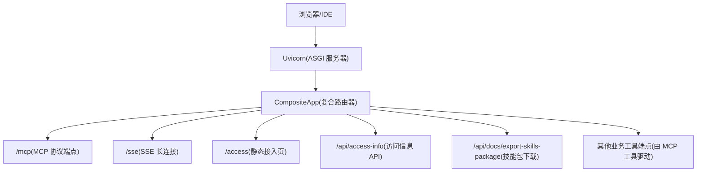
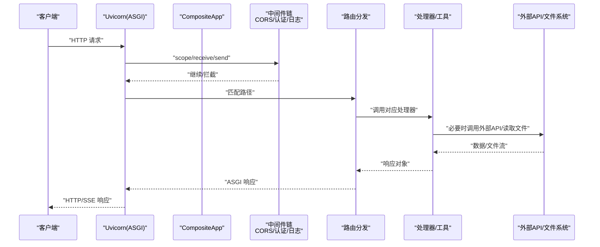
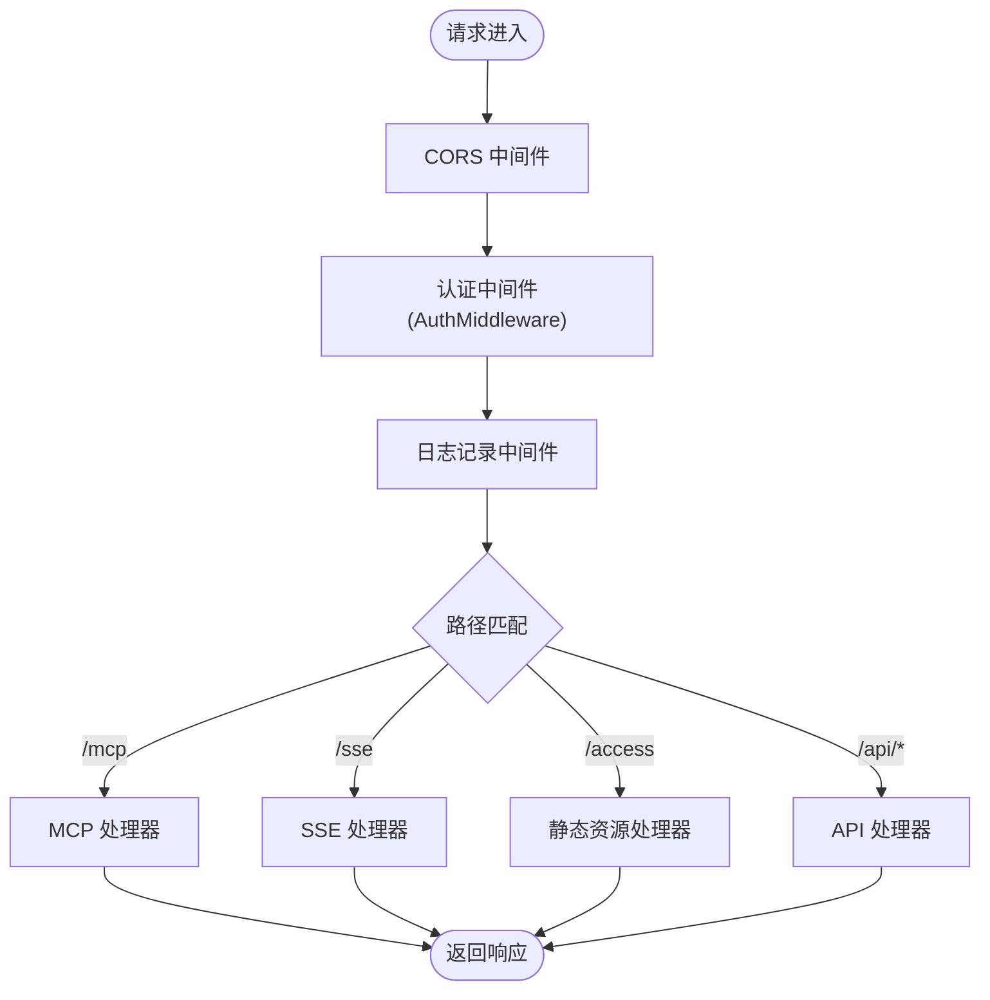
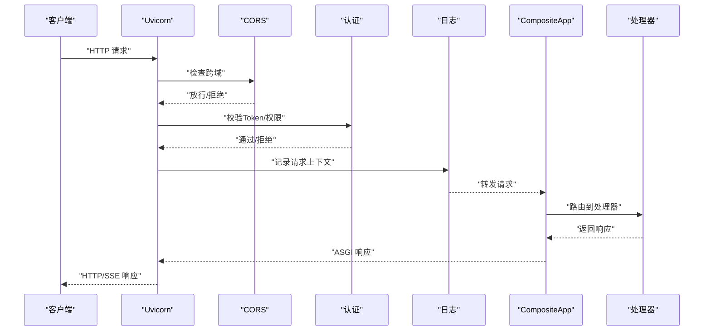
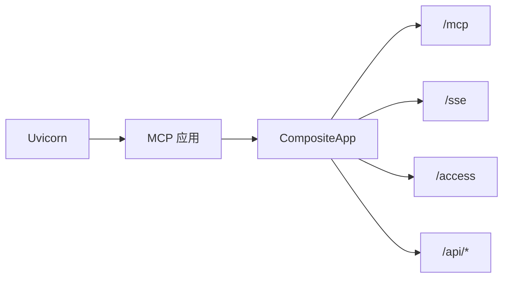

# 路由与中间件

<cite>
**本文引用的文件**
- [mcp server部署.md](file://mcp server部署.md)
- [access.html](file://mcp_server/static/access.html)
- [requirements.txt](file://mcp_server/requirements.txt)
- [规约管理MCP服务化Spec.md](file://规约管理MCP服务化Spec.md)
</cite>

## 目录
1. [简介](#简介)
2. [项目结构](#项目结构)
3. [核心组件](#核心组件)
4. [架构总览](#架构总览)
5. [详细组件分析](#详细组件分析)
6. [依赖分析](#依赖分析)
7. [性能考虑](#性能考虑)
8. [故障排查指南](#故障排查指南)
9. [结论](#结论)
10. [附录](#附录)

## 简介
本技术文档聚焦于“路由与中间件系统”，围绕 CompositeApp 复合路由器、ASGI 中间件执行流程、请求处理管道、静态资源处理、跨域资源共享（CORS）与安全策略、端点功能说明、日志与监控方案、以及扩展开发指南展开。内容基于仓库中的部署文档、接入页面与规范设计，确保读者既能理解整体架构，也能按图索骥进行二次开发与排障。

## 项目结构
- mcp_server：服务端代码与脚本所在目录
  - static/access.html：接入配置页面（前端），通过 /api/access-info 获取服务器地址、Token、权限级别等信息
  - requirements.txt：声明运行依赖（mcp、uvicorn）
- 根目录文档：
  - mcp server部署.md：描述 ASGI、Uvicorn、MCP 的协作方式、启动流程、端口与工具清单等
  - 规约管理MCP服务化Spec.md：定义 MCP 工具、鉴权、API 客户端封装、CompositeApp 与 AuthMiddleware 等关键设计

图示来源
- [mcp server部署.md:129-261](file://mcp server部署.md#L129-L261)
- [规约管理MCP服务化Spec.md:247-286](file://规约管理MCP服务化Spec.md#L247-L286)

章节来源
- [mcp server部署.md:129-261](file://mcp server部署.md#L129-L261)
- [requirements.txt:1-3](file://mcp_server/requirements.txt#L1-L3)

## 核心组件
- CompositeApp（复合路由器）
  - 职责：统一注册并分发 HTTP/MCP/SSE/静态资源等路由；在请求进入具体处理器前，可挂载鉴权、日志、CORS 等中间件
  - 关键点：支持多协议端点共存（HTTP JSON、SSE、MCP JSON-RPC over HTTP/SSE）、集中式路由表、可扩展的中间件链
- ASGI 中间件链
  - 典型顺序：CORS → 认证（AuthMiddleware）→ 日志记录 → 路由分发 → 业务处理器
  - 作用：横切关注点解耦，便于安全、审计、性能观测
- 静态资源处理
  - /access 提供 access.html，用于生成接入文本、展示 Token、权限级别、服务器 IP 列表等
- 端点集合
  - /：根路径（可由 CompositeApp 返回欢迎或重定向到 /access）
  - /access：接入页面（静态 HTML + 前端逻辑）
  - /api/access-info：返回 baseUrl、token、accessLevel、source、serverIPs 等
  - /api/docs/export-skills-package：打包并下载 Skills ZIP
  - /mcp：MCP 协议主端点（JSON-RPC over HTTP/SSE）
  - /sse：SSE 长连接端点（用于持续消息通道）

章节来源
- [规约管理MCP服务化Spec.md:247-286](file://规约管理MCP服务化Spec.md#L247-L286)
- [mcp server部署.md:129-261](file://mcp server部署.md#L129-L261)
- [access.html:241-318](file://mcp_server/static/access.html#L241-L318)

## 架构总览
下图展示了从客户端到后端处理的完整链路，包括 ASGI 中间件、CompositeApp 路由分发、MCP 工具调用与响应返回。

图示来源
- [mcp server部署.md:129-261](file://mcp server部署.md#L129-L261)
- [规约管理MCP服务化Spec.md:247-286](file://规约管理MCP服务化Spec.md#L247-L286)

## 详细组件分析

### CompositeApp 复合路由器
- 设计要点
  - 集中式路由表：将 /mcp、/sse、/access、/api/* 等统一注册
  - 中间件前置：在路由前注入 CORS、认证、日志等横切能力
  - 协议适配：对 MCP 的 JSON-RPC、SSE 流式响应做专门适配
- 扩展点
  - 新增路由：在路由表中添加路径与处理器映射
  - 新增中间件：实现标准 ASGI 中间件接口，插入到链中合适位置
  - 静态资源：为 /static 或特定路径提供文件服务

图示来源
- [规约管理MCP服务化Spec.md:247-286](file://规约管理MCP服务化Spec.md#L247-L286)
- [mcp server部署.md:129-261](file://mcp server部署.md#L129-L261)

章节来源
- [规约管理MCP服务化Spec.md:247-286](file://规约管理MCP服务化Spec.md#L247-L286)

### 端点功能说明
- 根路径 /
  - 行为建议：返回欢迎信息或重定向至 /access
  - 用途：作为入口提示，引导用户前往接入页面
- /access（接入页面）
  - 功能：展示服务器地址、自动分配的 Token、权限级别、来源 IP；支持选择目标平台生成接入文本、复制与下载 .md
  - 数据来源：前端通过 /api/access-info 获取动态信息
- /api/access-info（访问信息 API）
  - 返回字段：baseUrl、token、accessLevel、source、serverIPs
  - 用途：供接入页面渲染与生成不同平台的配置
- /api/docs/export-skills-package（技能包下载）
  - 功能：打包 .trae/skills/ 目录为 ZIP 并提供下载
  - 参数：通常包含 baseUrl 等用于生成说明或校验
- /mcp（MCP 协议端点）
  - 协议：JSON-RPC over HTTP/SSE
  - 能力：工具调用、资源访问、提示词管理等
- /sse（SSE 长连接）
  - 用途：建立持久连接，服务端推送消息（如工具调用结果）

章节来源
- [access.html:241-318](file://mcp_server/static/access.html#L241-L318)
- [access.html:401-417](file://mcp_server/static/access.html#L401-L417)
- [mcp server部署.md:74-79](file://mcp server部署.md#L74-L79)
- [mcp server部署.md:185-211](file://mcp server部署.md#L185-L211)

### ASGI 中间件执行流程与请求处理管道
- 执行顺序
  - 请求进入 Uvicorn，封装为 ASGI scope/receive/send
  - 依次经过 CORS、认证、日志等中间件
  - 到达 CompositeApp 路由分发，调用具体处理器
  - 处理器完成业务逻辑后返回响应
- 关键中间件
  - CORS：控制跨域访问策略（允许的来源、方法、头部、凭证等）
  - AuthMiddleware：校验 Authorization/Bearer Token，区分 localhost 与远程 IP 的权限级别
  - 日志中间件：记录请求方法、路径、状态码、耗时、来源 IP 等
- 错误处理
  - 中间件层捕获异常并转换为统一错误响应
  - 业务层返回结构化错误（含 code/message/raw）

图示来源
- [mcp server部署.md:129-261](file://mcp server部署.md#L129-L261)
- [规约管理MCP服务化Spec.md:247-286](file://规约管理MCP服务化Spec.md#L247-L286)

章节来源
- [mcp server部署.md:129-261](file://mcp server部署.md#L129-L261)
- [规约管理MCP服务化Spec.md:247-286](file://规约管理MCP服务化Spec.md#L247-L286)

### 跨域资源共享（CORS）配置与安全考虑
- 配置建议
  - 允许的源：限制为可信域名或内网段
  - 允许的头部：仅暴露必要头部（如 Authorization、Content-Type）
  - 允许的 Method：GET/POST/OPTIONS 等最小集
  - 凭证：谨慎启用 withCredentials，避免泄露敏感 Cookie
- 安全注意事项
  - 生产环境务必启用 HTTPS
  - 结合反向代理（Nginx/Traefik）统一处理 CORS 与 TLS
  - 配合认证中间件，确保即使跨域也需有效 Token
  - 对敏感端点增加速率限制与审计日志

章节来源
- [mcp server部署.md:665-674](file://mcp server部署.md#L665-L674)

### 请求日志记录与性能监控
- 日志记录
  - 记录项：时间戳、请求方法、路径、状态码、耗时、来源 IP、User-Agent、Token 摘要（脱敏）
  - 输出：控制台/文件/集中式日志系统（如 ELK）
- 性能监控
  - 指标：QPS、P95/P99 延迟、错误率、慢请求占比
  - 手段：中间件埋点、异步计数器、分布式追踪（OpenTelemetry）
- 优化建议
  - 使用连接池（httpx.AsyncClient）减少握手开销
  - 缓存热点数据（如工具列表、字典）
  - 合理设置超时与重试策略

章节来源
- [规约管理MCP服务化Spec.md:287-320](file://规约管理MCP服务化Spec.md#L287-L320)
- [mcp server部署.md:265-279](file://mcp server部署.md#L265-L279)

### 处理不同类型的 HTTP 请求与响应格式
- 请求类型
  - JSON：/api/* 与 MCP JSON-RPC
  - 文件流：/api/docs/export-skills-package 返回 ZIP
  - 流式响应：/sse 使用 Server-Sent Events
- 响应格式
  - 成功：{ code: 20000, data: ... }
  - 失败：{ error: true, code: "ERROR_CODE", message: "...", raw: ... }
  - 文件：Content-Disposition 与正确的 MIME 类型
- 错误处理
  - 网络异常、HTTP 状态码异常、业务错误码统一归一化处理

章节来源
- [规约管理MCP服务化Spec.md:123-131](file://规约管理MCP服务化Spec.md#L123-L131)
- [mcp server部署.md:215-261](file://mcp server部署.md#L215-L261)

### 路由扩展开发指南
- 新增路由
  - 在 CompositeApp 的路由表中添加路径与处理器映射
  - 若涉及静态资源，确保路径与文件目录一致
- 自定义中间件
  - 实现 ASGI 中间件接口（接收 scope/receive/send）
  - 在中间件链中插入到合适位置（如认证前/后）
- 最佳实践
  - 保持中间件单一职责
  - 对异常进行统一捕获与格式化
  - 对耗时操作进行异步化与超时控制

章节来源
- [规约管理MCP服务化Spec.md:247-286](file://规约管理MCP服务化Spec.md#L247-L286)

### 静态资源处理
- /access 页面
  - 提供接入配置生成器，自动检测服务器地址与 Token，支持多平台配置生成与下载
  - 前端通过 /api/access-info 获取动态信息并渲染
- 静态文件服务
  - 建议将静态资源置于 static 目录，并通过路由映射到 /static 或 /access
  - 注意缓存头与压缩以提升加载性能

章节来源
- [access.html:241-318](file://mcp_server/static/access.html#L241-L318)
- [access.html:401-417](file://mcp_server/static/access.html#L401-L417)

## 依赖分析
- 运行时依赖
  - mcp：提供 MCP 协议支持与工具注册
  - uvicorn：ASGI 服务器，负责网络层与事件循环
- 依赖关系
  - Uvicorn 监听端口并将请求转交给 MCP 应用
  - CompositeApp 作为应用入口，协调中间件与路由
  - 静态资源与 API 由 CompositeApp 统一管理

图示来源
- [mcp server部署.md:129-261](file://mcp server部署.md#L129-L261)
- [requirements.txt:1-3](file://mcp_server/requirements.txt#L1-L3)

章节来源
- [requirements.txt:1-3](file://mcp_server/requirements.txt#L1-L3)
- [mcp server部署.md:129-261](file://mcp server部署.md#L129-L261)

## 性能考虑
- 高并发模型
  - Uvicorn 基于异步事件循环，适合 I/O 密集型任务
  - 合理使用 httpx 连接池与超时配置
- 缓存与去重
  - 对频繁查询的数据（如工具列表、字典）进行缓存
  - 对重复请求进行去重或限流
- 监控与告警
  - 采集关键指标（QPS、延迟、错误率）
  - 对慢请求与异常进行告警

[本节为通用指导，不直接分析具体文件]

## 故障排查指南
- 常见问题
  - 端口占用：修改端口或结束占用进程
  - Token 未配置：运行安装脚本或手动写入环境变量
  - 虚拟环境问题：重新创建虚拟环境并安装依赖
- 排查步骤
  - 检查 Uvicorn 启动日志与绑定端口
  - 验证中间件链是否拦截请求（CORS/认证）
  - 查看日志中间件输出的请求上下文与错误堆栈
- 恢复建议
  - 重启服务、清理临时文件、回滚变更
  - 使用只读模式先验证问题范围

章节来源
- [mcp server部署.md:505-632](file://mcp server部署.md#L505-L632)

## 结论
本项目通过 CompositeApp 实现了统一的路由与中间件编排，结合 Uvicorn 的 ASGI 能力与 MCP 协议支持，提供了 /mcp、/sse、/access、/api/* 等多类端点。通过合理的 CORS、认证、日志与监控策略，确保了安全性与可观测性。开发者可按指南扩展路由与中间件，快速迭代新功能。

[本节为总结，不直接分析具体文件]

## 附录
- 快速命令参考
  - 首次安装：mcp_server\install.bat
  - 启动服务：mcp_server\start.bat
  - 手动启动：python mcp_server\server.py
- 相关端点
  - /mcp：MCP 协议主端点
  - /sse：SSE 长连接
  - /access：接入页面
  - /api/access-info：访问信息 API
  - /api/docs/export-skills-package：技能包下载

章节来源
- [mcp server部署.md:677-687](file://mcp server部署.md#L677-L687)