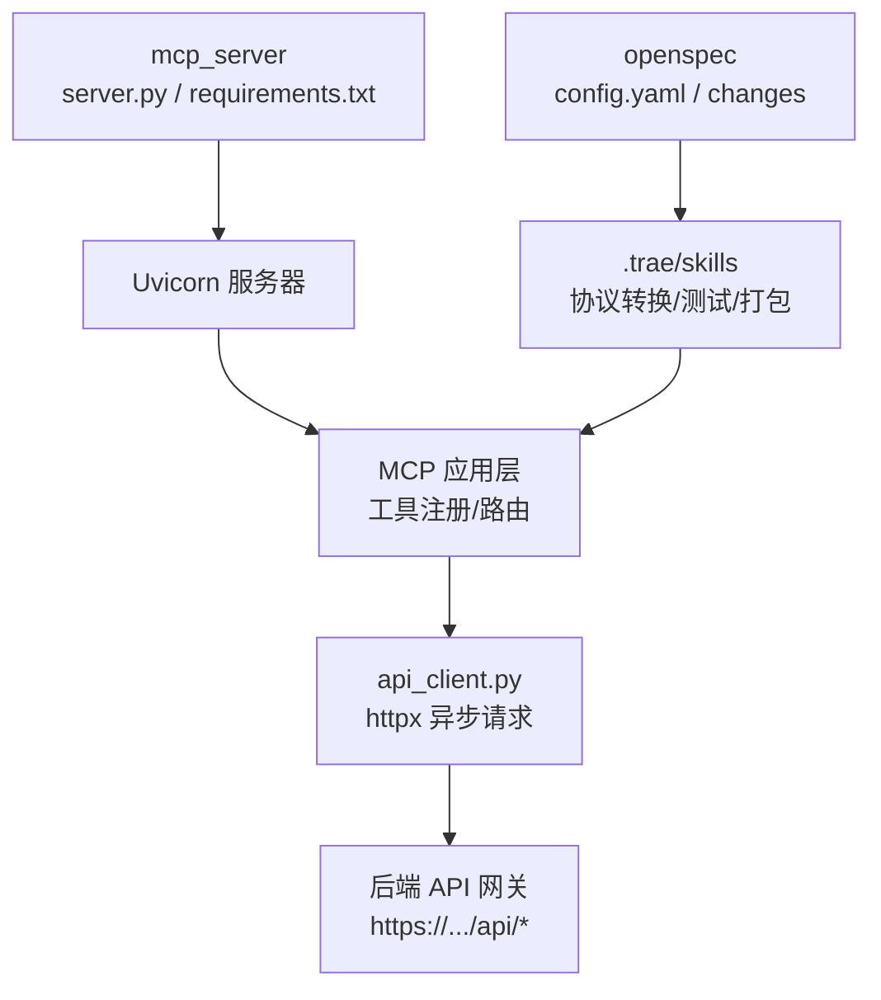
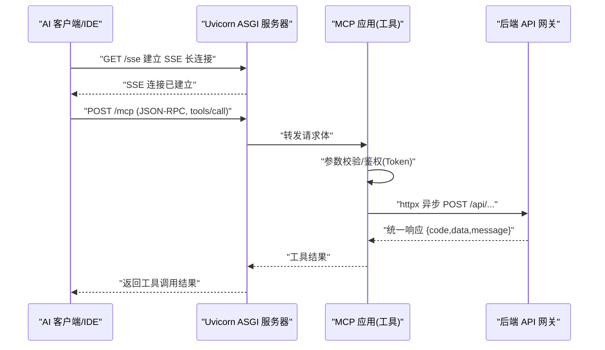
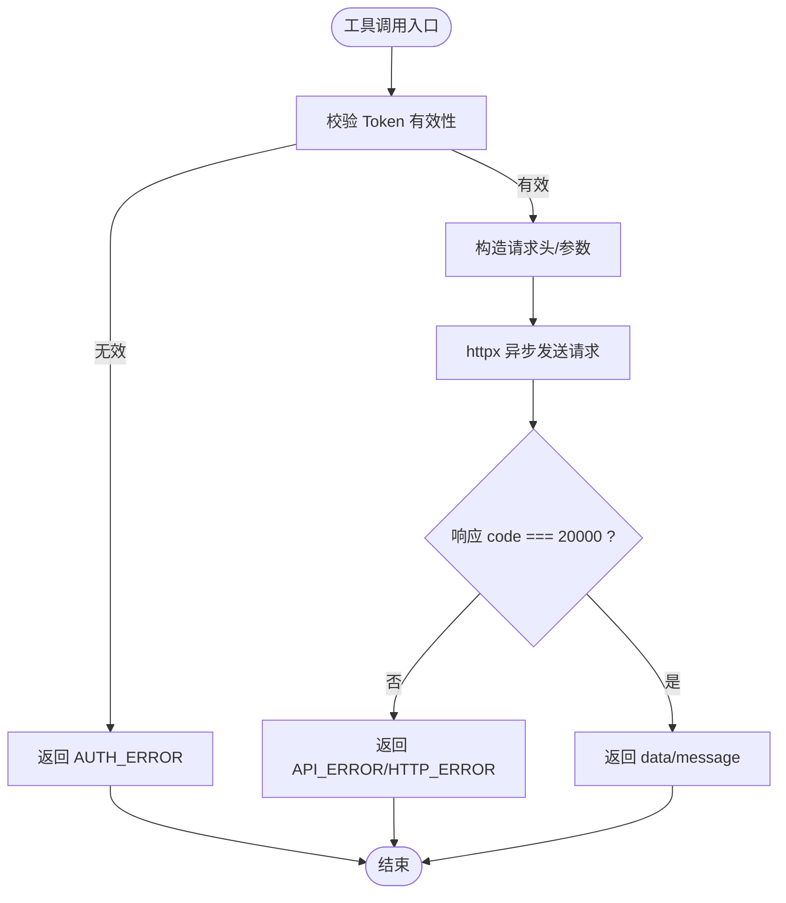
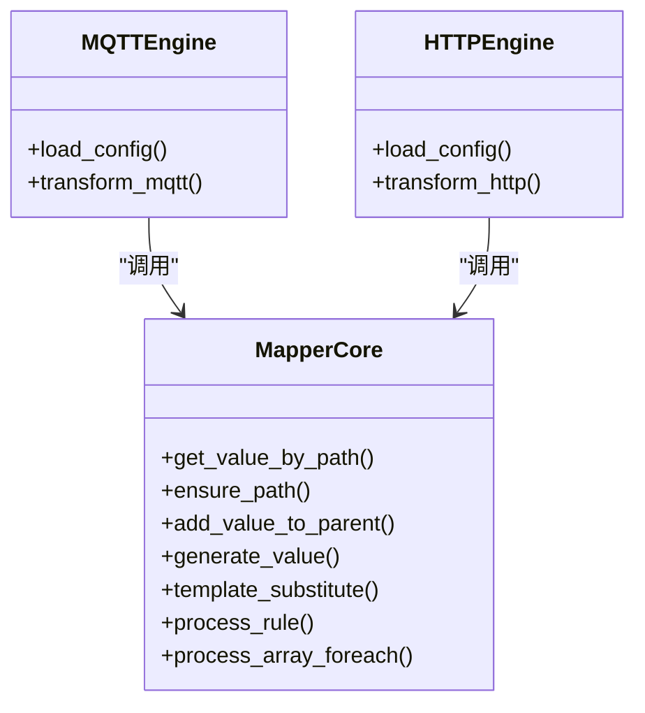
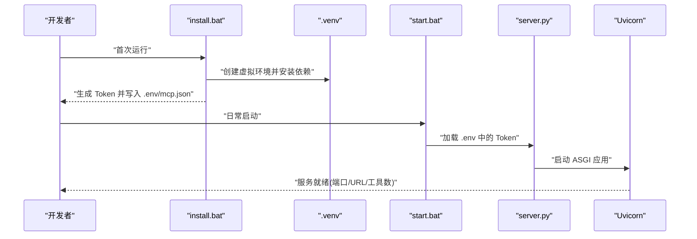
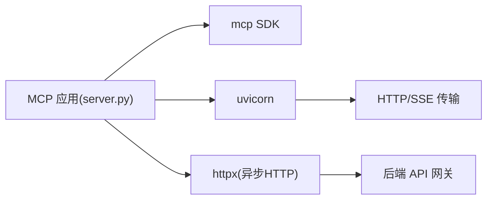

# 项目介绍与目标

<cite>
**本文引用的文件**
- [规约管理MCP服务化Spec.md](file://规约管理MCP服务化Spec.md)
- [mcp server部署.md](file://mcp server部署.md)
- [requirements.txt](file://mcp_server/requirements.txt)
- [install.bat](file://mcp_server/install.bat)
- [start.bat](file://mcp_server/start.bat)
- [SKILL.md（协议转换共享映射核心）](file://.trae/skills/protocol-conversion/SKILL.md)
- [config.yaml（OpenSpec 配置）](file://openspec/config.yaml)
- [proposal.md（增强 Modbus MCP 工作流提案）](file://openspec/changes/enhance-modbus-mcp-workflow/proposal.md)
</cite>

## 目录
1. [引言](#引言)
2. [项目结构](#项目结构)
3. [核心组件](#核心组件)
4. [架构总览](#架构总览)
5. [详细组件分析](#详细组件分析)
6. [依赖分析](#依赖分析)
7. [性能考虑](#性能考虑)
8. [故障排查指南](#故障排查指南)
9. [结论](#结论)
10. [附录](#附录)

## 引言
本项目是一个基于 MCP（Model Context Protocol，模型上下文协议）的“规约管理服务”服务器。其核心目标是：将工业设备协议配置的复杂流程标准化、工具化，并通过统一的 MCP 接口为 AI 助手提供可编排、可复用、可审计的规约管理能力。

- 为什么需要 MCP 协议的规约管理服务
  - 工业现场协议繁多（如 Modbus、BACnet、OPC-UA、MQTT、HTTP 等），配置项复杂、版本迭代频繁，人工维护成本高且易出错。
  - 传统 Web 操作路径长、步骤多，难以被 AI 助手直接调用和编排；通过 MCP 将后端 API 封装为细粒度工具，使 AI 可以按原子能力组合出完整工作流。
  - 统一 Token 鉴权、统一错误处理与响应格式，降低集成成本，提升稳定性与可观测性。

- 解决的实际问题
  - 品牌/型号/规约/数据项/脚本/系数/感知等多实体管理的繁琐流程自动化。
  - 多协议支持带来的配置复杂度与一致性挑战。
  - AI 助手对运维平台能力的“即插即用”式接入需求。

- 技术愿景
  - 以 MCP 为标准接口层，屏蔽后端 API 差异，向 AI 暴露稳定、清晰、可组合的工具集合。
  - 通过 Skill 编排实现端到端自动化：登录→查询→创建→生成脚本→导出/删除等。
  - 沉淀统一的映射引擎与测试体系，保障跨协议的一致性与可回归性。

- 适用场景
  - 工业自动化：产线设备数据采集与协议适配。
  - 物联网平台：海量设备接入、协议解析与数据上报。
  - 设备管理系统：设备元数据、规约模板、脚本资产的全生命周期管理。

- 面向初学者的 MCP 概念速览
  - MCP 是客户端与服务端之间的标准通信协议，服务端通过“工具（Tools）”对外暴露能力，客户端通过“工具调用”完成业务编排。
  - 本项目的 MCP 服务运行在 Uvicorn 之上，使用 SSE 长连接进行消息交换，并以 Token 进行鉴权。

- 面向资深开发者的背景与决策
  - 采用 httpx 异步 HTTP 客户端，避免阻塞事件循环。
  - 工具粒度细化到每个后端 API，便于错误隔离与复用。
  - 鉴权采用显式 Token 传递，无状态、透明可控。
  - 代码组织上分离 server.py（工具注册与路由）与 api_client.py（API 调用封装）。

**章节来源**
- [mcp server部署.md:25-35](file://mcp server部署.md#L25-L35)
- [mcp server部署.md:64-79](file://mcp server部署.md#L64-L79)
- [mcp server部署.md:110-125](file://mcp server部署.md#L110-L125)
- [mcp server部署.md:163-280](file://mcp server部署.md#L163-L280)
- [规约管理MCP服务化Spec.md:8-43](file://规约管理MCP服务化Spec.md#L8-L43)
- [规约管理MCP服务化Spec.md:56-78](file://规约管理MCP服务化Spec.md#L56-L78)

## 项目结构
项目围绕“MCP 服务 + 技能（Skill）+ 规范（OpenSpec）”三层组织：
- mcp_server：MCP 服务入口、依赖声明、一键安装与启动脚本。
- .trae/skills：AI 技能集合，包含协议转换、测试验证、打包分发等能力。
- openspec：变更驱动的开发规范与提案归档。

**图表来源**
- [mcp server部署.md:285-305](file://mcp server部署.md#L285-L305)
- [mcp server部署.md:163-280](file://mcp server部署.md#L163-L280)
- [SKILL.md:19-35](file://.trae/skills/protocol-conversion/SKILL.md#L19-L35)

**章节来源**
- [mcp server部署.md:285-305](file://mcp server部署.md#L285-L305)
- [mcp server部署.md:163-280](file://mcp server部署.md#L163-L280)
- [SKILL.md:19-35](file://.trae/skills/protocol-conversion/SKILL.md#L19-L35)

## 核心组件
- MCP 工具集：覆盖大类/设备类型/品牌/型号/规约信息/数据项/脚本/系数/感知/字典/功能项/导出与文件管理等，共计数十个工具，全部对应后端 API。
- 认证与鉴权：Token 由 login 返回并随后续工具调用传入；服务端通过中间件校验 Token。
- 异步 HTTP 客户端：基于 httpx.AsyncClient，统一构造请求头、超时控制与错误归一化。
- 部署与启动：Windows 一键 install/start 脚本，自动创建虚拟环境、安装依赖、生成 Token、写入 IDE 配置。

**章节来源**
- [规约管理MCP服务化Spec.md:132-246](file://规约管理MCP服务化Spec.md#L132-L246)
- [规约管理MCP服务化Spec.md:79-131](file://规约管理MCP服务化Spec.md#L79-L131)
- [mcp server部署.md:309-380](file://mcp server部署.md#L309-L380)
- [mcp server部署.md:415-459](file://mcp server部署.md#L415-L459)

## 架构总览
从客户端到后端的完整调用链路如下：

**图表来源**
- [mcp server部署.md:163-280](file://mcp server部署.md#L163-L280)
- [规约管理MCP服务化Spec.md:56-78](file://规约管理MCP服务化Spec.md#L56-L78)

## 详细组件分析

### 组件A：MCP 工具与后端 API 映射
- 工具粒度：每个后端 API 对应一个 MCP 工具，保证原子性、可复用与错误隔离。
- 鉴权策略：login 返回 Token，后续工具需显式传入，无状态、更透明。
- 错误处理：网络异常、业务错误码、Token 无效/过期、HTTP 状态异常均统一包装为结构化错误对象。

**图表来源**
- [规约管理MCP服务化Spec.md:79-131](file://规约管理MCP服务化Spec.md#L79-L131)
- [规约管理MCP服务化Spec.md:132-246](file://规约管理MCP服务化Spec.md#L132-L246)

**章节来源**
- [规约管理MCP服务化Spec.md:79-131](file://规约管理MCP服务化Spec.md#L79-L131)
- [规约管理MCP服务化Spec.md:132-246](file://规约管理MCP服务化Spec.md#L132-L246)

### 组件B：协议转换共享映射核心（Skill）
- 角色定位：为 MQTT 与 HTTP 两种协议转换提供共享的映射规则与执行引擎。
- 引擎归属：MQTT 使用 config_loader.c → mapper_core.c；HTTP 使用 vpp_http_config.load.c → mapper_core.c。
- 映射能力：路径语法、类型系统、数组遍历、模板变量替换、生成器、缩放、预处理/后处理等。
- 测试保障：Python 镜像实现 + 91 项单元测试，覆盖路径解析、类型转换、生成器、模板替换、数组遍历、真实配置集成等。

**图表来源**
- [SKILL.md:19-35](file://.trae/skills/protocol-conversion/SKILL.md#L19-L35)
- [SKILL.md:266-299](file://.trae/skills/protocol-conversion/SKILL.md#L266-L299)
- [SKILL.md:301-338](file://.trae/skills/protocol-conversion/SKILL.md#L301-L338)

**章节来源**
- [SKILL.md:19-35](file://.trae/skills/protocol-conversion/SKILL.md#L19-L35)
- [SKILL.md:266-299](file://.trae/skills/protocol-conversion/SKILL.md#L266-L299)
- [SKILL.md:301-338](file://.trae/skills/protocol-conversion/SKILL.md#L301-L338)

### 组件C：部署与启动流程
- install.bat：检查 Python 版本、创建虚拟环境、安装依赖、生成 Token、写入 .env 与 IDE 配置。
- start.bat：激活虚拟环境、读取 Token、打印启动信息、启动 server.py。
- 运行时：Uvicorn 监听端口，MCP 通过 /sse 建立 SSE 长连接，/mcp 处理 JSON-RPC 工具调用。

**图表来源**
- [mcp server部署.md:309-380](file://mcp server部署.md#L309-L380)
- [mcp server部署.md:415-459](file://mcp server部署.md#L415-L459)

**章节来源**
- [install.bat:1-85](file://mcp_server/install.bat#L1-L85)
- [start.bat:1-41](file://mcp_server/start.bat#L1-L41)
- [mcp server部署.md:309-380](file://mcp server部署.md#L309-L380)
- [mcp server部署.md:415-459](file://mcp server部署.md#L415-L459)

## 依赖分析
- 运行时依赖
  - mcp：定义 MCP 协议的服务端 SDK，负责工具注册、JSON-RPC 消息处理与路由。
  - uvicorn：高性能 ASGI 服务器，承载 MCP 应用并提供 /sse 与 /mcp 端点。
- 扩展依赖（规划中）
  - httpx：用于异步 HTTP 调用后端 API，避免阻塞事件循环。

**图表来源**
- [mcp server部署.md:64-79](file://mcp server部署.md#L64-L79)
- [mcp server部署.md:82-108](file://mcp server部署.md#L82-L108)
- [规约管理MCP服务化Spec.md:79-131](file://规约管理MCP服务化Spec.md#L79-L131)

**章节来源**
- [requirements.txt:1-3](file://mcp_server/requirements.txt#L1-L3)
- [mcp server部署.md:64-108](file://mcp server部署.md#L64-L108)
- [规约管理MCP服务化Spec.md:79-131](file://规约管理MCP服务化Spec.md#L79-L131)

## 性能考虑
- 异步 I/O：Uvicorn + MCP 基于事件循环，I/O 等待时不阻塞，适合高并发场景。
- 连接复用：httpx.AsyncClient 可复用连接，减少握手开销。
- 超时与重试：合理设置请求超时，必要时增加重试与退避策略。
- 资源释放：确保客户端关闭与连接回收，避免内存泄漏。
- 生产建议：多进程模式（Gunicorn + Uvicorn）、HTTPS、访问白名单、日志审计。

[本节为通用指导，不直接分析具体文件]

## 故障排查指南
- Python 未安装或版本过低：安装 Python 3.10+，并确保加入 PATH。
- 虚拟环境创建失败：检查权限与磁盘空间，重新运行安装脚本。
- 依赖安装失败：检查网络或使用国内镜像源，升级 pip。
- 找不到虚拟环境：先运行 install.bat，再运行 start.bat。
- Token 未配置：运行 install.bat 生成 Token，或手动写入 .env。
- 端口被占用：查找并结束占用进程，或修改端口。
- 移动项目后虚拟环境失效：删除旧 .venv 并重新安装。

**章节来源**
- [mcp server部署.md:505-643](file://mcp server部署.md#L505-L643)

## 结论
本项目以 MCP 协议为核心，将复杂的工业协议配置流程抽象为可编排的工具集合，结合 Skill 与 OpenSpec 规范，形成“标准化接口 + 自动化编排 + 可演进规范”的技术闭环。它既降低了 AI 助手接入运维平台的门槛，也为多协议、多设备的统一管理提供了可扩展的基础设施。

[本节为总结性内容，不直接分析具体文件]

## 附录
- 发展历程
  - 现状：Web 页面手工操作链路长，server.py 仅有桩工具，未对接后端 API。
  - 改造方向：将后端 API 封装为 MCP 工具，Skill 编排自动化流程；迁移接入配置至 Vue 平台。
  - 当前阶段：已完成工具清单与 API 规格设计，待实施落地。
- 未来规划
  - 完善所有 30+ API 对应的 MCP 工具实现与测试。
  - 强化错误处理与可观测性（日志、指标、追踪）。
  - 推进 OpenSpec 驱动的变更管理与归档机制。
  - 探索更多协议（Modbus/BACnet/OPC-UA/MQTT/HTTP）的统一映射与自动化生成。

**章节来源**
- [规约管理MCP服务化Spec.md:8-43](file://规约管理MCP服务化Spec.md#L8-L43)
- [规约管理MCP服务化Spec.md:132-246](file://规约管理MCP服务化Spec.md#L132-L246)
- [config.yaml:1-33](file://openspec/config.yaml#L1-L33)
- [proposal.md:1-200](file://openspec/changes/enhance-modbus-mcp-workflow/proposal.md#L1-L200)