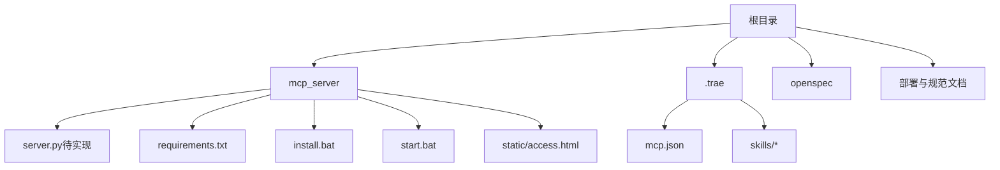
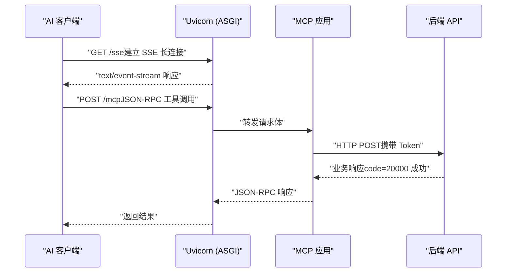
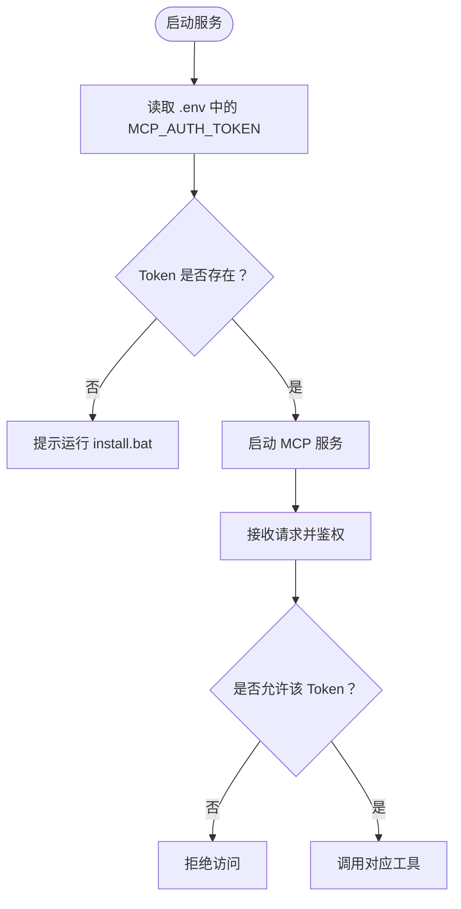
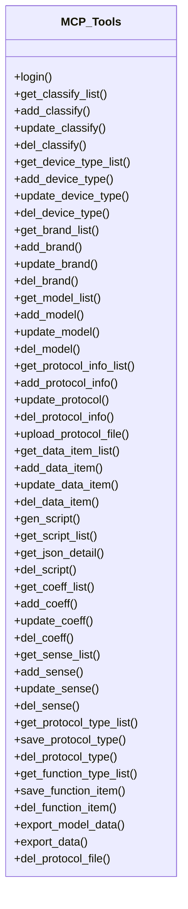
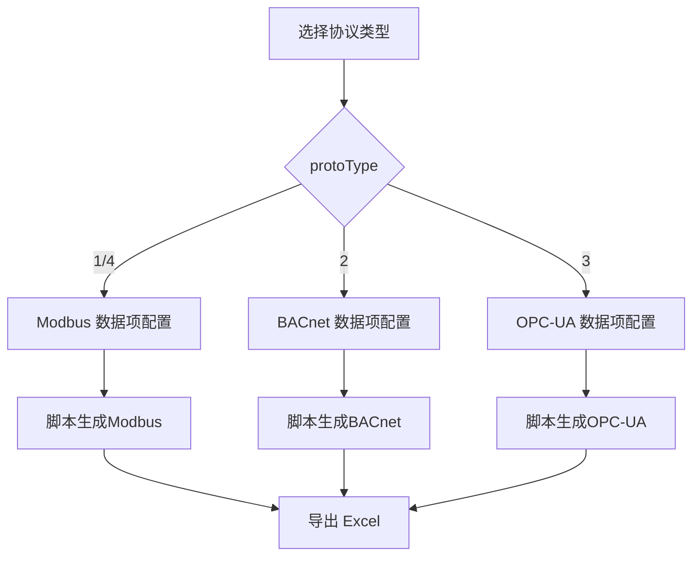
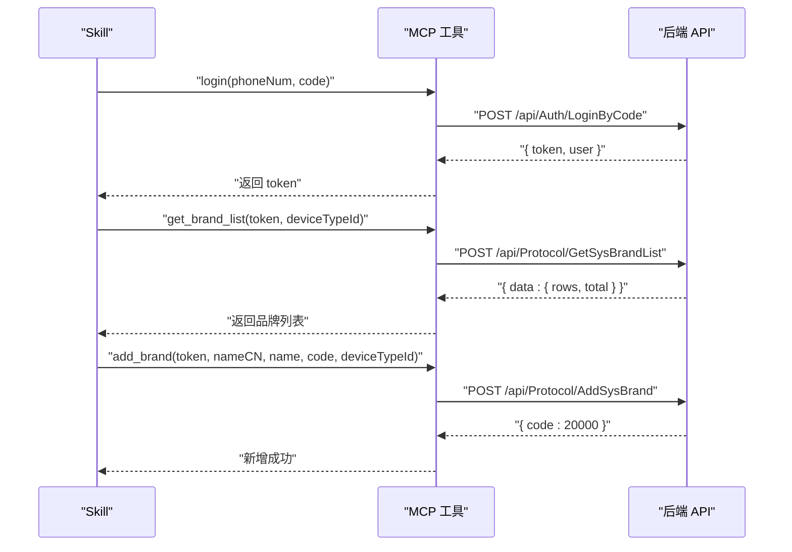
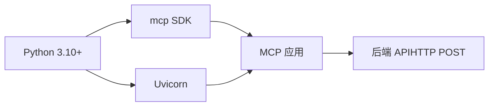

# 项目概述

<cite>
**本文引用的文件**
- [mcp server部署.md](file://mcp server部署.md)
- [规约管理MCP服务化Spec.md](file://规约管理MCP服务化Spec.md)
- [规约管理基础数据模块Spec.md](file://规约管理基础数据模块Spec.md)
- [requirements.txt](file://mcp_server/requirements.txt)
- [install.bat](file://mcp_server/install.bat)
- [start.bat](file://mcp_server/start.bat)
- [mcp.json](file://.trae/mcp.json)
</cite>

## 目录
1. [引言](#引言)
2. [项目结构](#项目结构)
3. [核心组件](#核心组件)
4. [架构总览](#架构总览)
5. [详细组件分析](#详细组件分析)
6. [依赖关系分析](#依赖关系分析)
7. [性能与并发特性](#性能与并发特性)
8. [故障排查指南](#故障排查指南)
9. [结论](#结论)
10. [附录](#附录)

## 引言
本项目是一个基于 MCP（Model Context Protocol）协议的协议转换与管理服务端，面向工业场景提供多协议（Modbus、BACnet、OPC-UA、MQTT、HTTP）的规约配置、管理与脚本生成能力。通过 MCP 工具将后端 API 封装为细粒度原子操作，结合 Skill 编排实现自动化流程；同时提供本地一键安装与启动脚本，便于开发与调试。

项目采用 Python 3.10+ 环境，使用 mcp SDK 与 Uvicorn 作为 ASGI 服务器，支持 SSE 长连接与 JSON-RPC 消息处理，并通过 Token 机制进行鉴权。

**章节来源**
- [mcp server部署.md:25-35](file://mcp server部署.md#L25-L35)
- [mcp server部署.md:64-80](file://mcp server部署.md#L64-L80)

## 项目结构
项目根目录包含部署文档、规范说明与可执行脚本等关键内容：
- mcp_server：服务端代码与依赖声明、安装与启动脚本、静态页面
- .trae：IDE 客户端配置与 Skills（如 Modbus、MQTT、HTTP 等协议转换相关技能）
- openspec：变更与规格管理
- 根级文档：部署说明与业务规范

**图表来源**
- [mcp server部署.md:285-305](file://mcp server部署.md#L285-L305)
- [.trae/mcp.json:1-1](file://.trae/mcp.json#L1-L1)

**章节来源**
- [mcp server部署.md:285-305](file://mcp server部署.md#L285-L305)

## 核心组件
- MCP 服务器与工具注册：基于 mcp SDK 暴露 Tools，供 AI 客户端调用；当前 server.py 存在桩函数，后续按 Spec 替换为真实 API 调用。
- 认证授权系统：Token 鉴权，支持本地系统级读写与远程只读策略；通过环境变量注入 Token，并在请求头中传递。
- 协议转换引擎：通过 Skills（如 modbus-conversion、mqtt-conversion、http-conversion）与后端 API 协作，完成协议数据的解析、映射与脚本生成。
- 规约管理服务：封装 30+ 个后端 API 为 MCP 工具，覆盖大类、设备类型、品牌、型号、规约信息、数据项、脚本、系数、感知、字典与功能项等全生命周期管理。
- 前端接入页：静态 access.html 用于获取 Token 或展示接入信息，后续计划迁移至 Vue 运维平台统一风格。

**章节来源**
- [规约管理MCP服务化Spec.md:24-41](file://规约管理MCP服务化Spec.md#L24-L41)
- [mcp server部署.md:64-80](file://mcp server部署.md#L64-L80)
- [mcp server部署.md:655-673](file://mcp server部署.md#L655-L673)

## 架构总览
整体架构由“客户端—Uvicorn—MCP 应用—后端 API”构成，通信遵循 ASGI 与 MCP 协议标准，SSE 建立长连接，JSON-RPC 承载工具调用。

**图表来源**
- [mcp server部署.md:163-261](file://mcp server部署.md#L163-L261)
- [mcp server部署.md:64-80](file://mcp server部署.md#L64-L80)

## 详细组件分析

### 认证与授权
- Token 管理：通过 install.bat 生成并写入 .env，start.bat 读取后注入到请求头；本地访问具备系统级权限，其他 IP 仅只读。
- 中间件与路由：MCP 应用层维护鉴权中间件，校验 Token 有效性并控制读写权限。

**图表来源**
- [mcp server部署.md:309-379](file://mcp server部署.md#L309-L379)
- [mcp server部署.md:415-459](file://mcp server部署.md#L415-L459)
- [mcp server部署.md:655-673](file://mcp server部署.md#L655-L673)

**章节来源**
- [mcp server部署.md:309-379](file://mcp server部署.md#L309-L379)
- [mcp server部署.md:415-459](file://mcp server部署.md#L415-L459)
- [mcp server部署.md:655-673](file://mcp server部署.md#L655-L673)

### 工具注册机制
- 工具清单：规划了 40+ 个 MCP 工具，覆盖登录、大类、设备类型、品牌、型号、规约信息、数据项、脚本、系数、感知、字典、功能项、导出与文件删除等。
- 工具粒度：每个后端 API 对应一个 MCP 工具，保证原子性、错误隔离与复用性。
- 调用约定：所有后端接口为 POST，统一响应码 code=20000 表示成功；分页列表 data.rows 结构一致。

**图表来源**
- [规约管理MCP服务化Spec.md:132-246](file://规约管理MCP服务化Spec.md#L132-L246)

**章节来源**
- [规约管理MCP服务化Spec.md:132-246](file://规约管理MCP服务化Spec.md#L132-L246)

### 协议转换引擎与多协议支持
- 支持的协议：Modbus、BACnet、OPC-UA、MQTT、HTTP。
- 转换方式：通过 Skills（如 modbus-conversion、mqtt-conversion、http-conversion）与 MCP 工具协同，调用后端 API 完成数据项配置、脚本生成与导出。
- 规约信息管理：根据 protoType（1=Modbus, 2=BACnet, 3=OPC-UA, 4=Modbus）动态加载不同子组件与处理逻辑。

**图表来源**
- [规约管理基础数据模块Spec.md:159-214](file://规约管理基础数据模块Spec.md#L159-L214)
- [规约管理基础数据模块Spec.md:218-235](file://规约管理基础数据模块Spec.md#L218-L235)

**章节来源**
- [规约管理基础数据模块Spec.md:159-214](file://规约管理基础数据模块Spec.md#L159-L214)
- [规约管理基础数据模块Spec.md:218-235](file://规约管理基础数据模块Spec.md#L218-L235)

### 典型调用流程（Skill 视角）

**图表来源**
- [规约管理MCP服务化Spec.md:295-319](file://规约管理MCP服务化Spec.md#L295-L319)

**章节来源**
- [规约管理MCP服务化Spec.md:295-319](file://规约管理MCP服务化Spec.md#L295-L319)

## 依赖关系分析
- 运行时依赖：mcp（>=1.0.0,<2.0.0）、uvicorn（>=0.30.0）。
- 开发环境：Python 3.10+，虚拟环境隔离依赖。
- 客户端配置：.trae/mcp.json 指定 MCP 服务端 URL 与鉴权头。

**图表来源**
- [requirements.txt:1-3](file://mcp_server/requirements.txt#L1-L3)
- [mcp server部署.md:40-61](file://mcp server部署.md#L40-L61)
- [.trae/mcp.json:1-1](file://.trae/mcp.json#L1-L1)

**章节来源**
- [requirements.txt:1-3](file://mcp_server/requirements.txt#L1-L3)
- [mcp server部署.md:40-61](file://mcp server部署.md#L40-L61)

## 性能与并发特性
- Uvicorn 基于异步事件循环，支持高并发 I/O 密集型任务，适合 MCP 的 SSE 长连接与 JSON-RPC 请求。
- 工具调用采用异步 HTTP 客户端（规划中使用 httpx），避免阻塞事件循环。
- 建议生产环境使用多进程模式（Gunicorn + Uvicorn）提升吞吐与稳定性。

**章节来源**
- [mcp server部署.md:82-108](file://mcp server部署.md#L82-L108)
- [mcp server部署.md:265-280](file://mcp server部署.md#L265-L280)
- [mcp server部署.md:665-673](file://mcp server部署.md#L665-L673)

## 故障排查指南
- Python 未安装或版本过低：确保安装 Python 3.10+ 并加入 PATH。
- 虚拟环境创建失败：检查权限与磁盘空间，重新运行 install.bat。
- 依赖安装失败：检查网络或使用国内镜像源，升级 pip。
- 启动时找不到虚拟环境：确认已运行 install.bat 且 .venv 存在。
- Token 未配置：运行 install.bat 生成 Token，或手动设置 MCP_AUTH_TOKEN。
- 端口被占用：查找并结束占用 8765 端口的进程，或修改端口。
- 移动项目后虚拟环境失效：删除旧 .venv 并重新运行 install.bat。

**章节来源**
- [mcp server部署.md:505-643](file://mcp server部署.md#L505-L643)

## 结论
本项目以 MCP 协议为核心，结合 Uvicorn 的高并发能力，提供了面向工业协议的规约管理与转换服务能力。通过细粒度工具封装与 Skill 编排，实现了从认证、配置到脚本生成的完整工作流。建议在生产环境中强化安全与监控，采用多进程部署与 HTTPS 加密，以提升系统的可靠性与安全性。

## 附录
- 快速命令参考：
  - 首次安装：mcp_server\install.bat
  - 启动服务：mcp_server\start.bat
  - 停止服务：Ctrl+C
  - 手动激活虚拟环境：.venv\Scripts\activate.bat
  - 退出虚拟环境：deactivate
  - 手动启动服务：python mcp_server\server.py

**章节来源**
- [mcp server部署.md:677-687](file://mcp server部署.md#L677-L687)