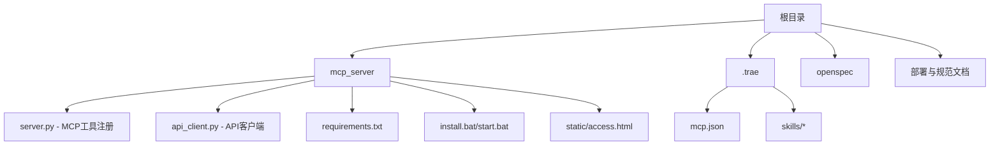
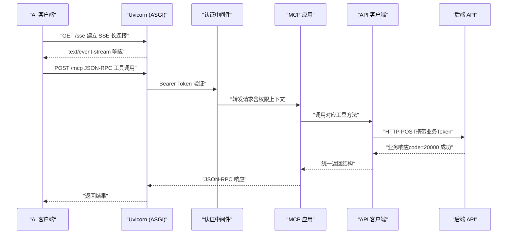
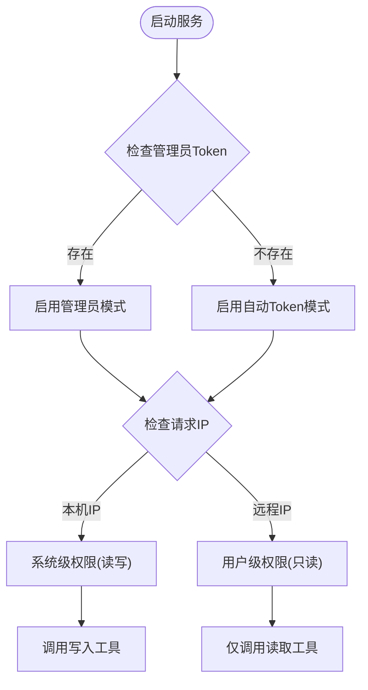
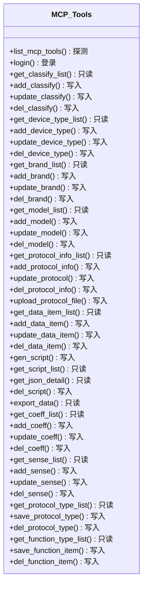
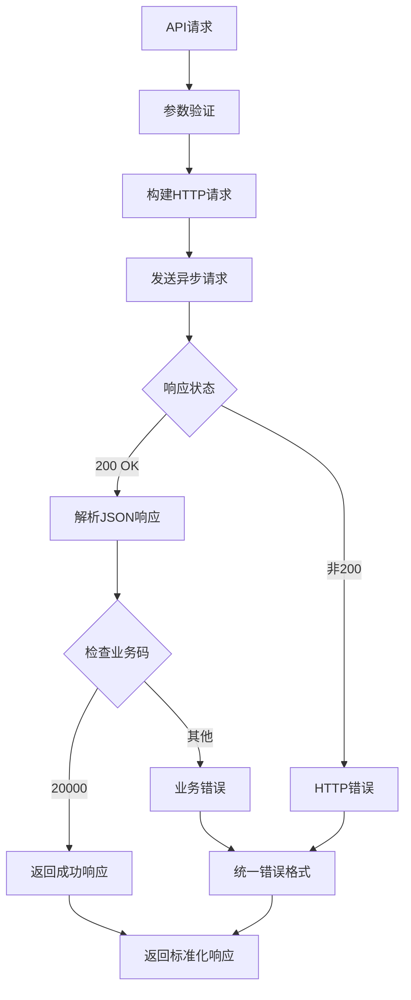
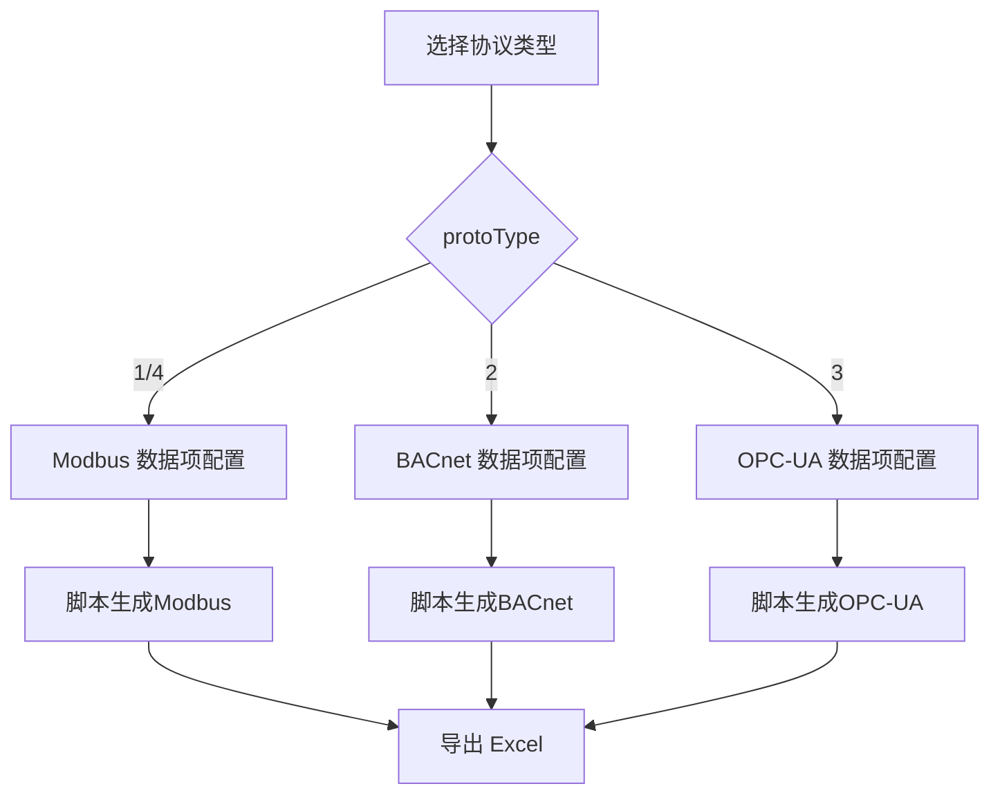
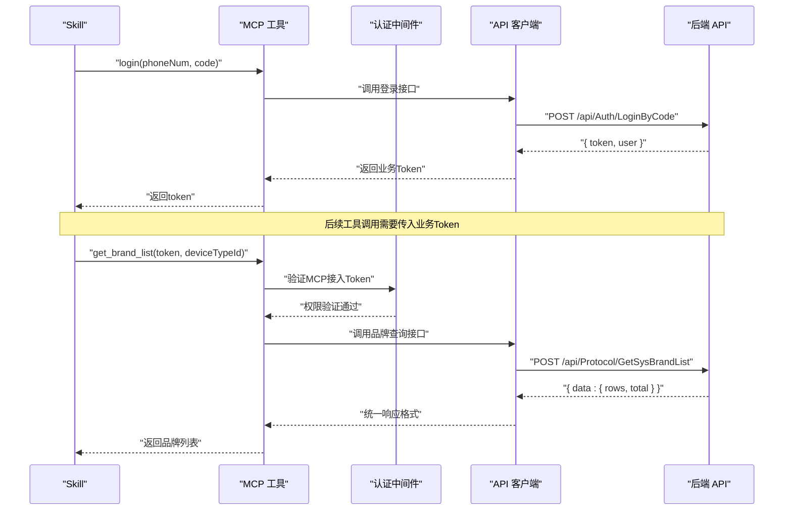
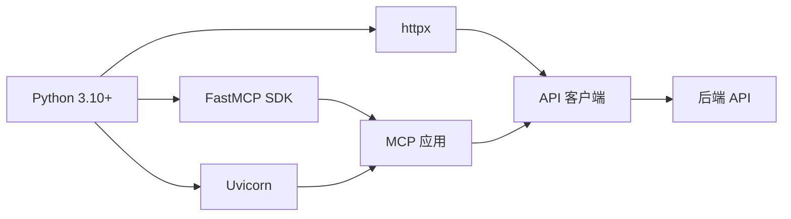

# 项目概述

<cite>
**本文引用的文件**
- [server.py](file://mcp_server/server.py)
- [api_client.py](file://mcp_server/api_client.py)
- [requirements.txt](file://mcp_server/requirements.txt)
- [mcp.json](file://.trae/mcp.json)
- [mcp server部署.md](file://mcp server部署.md)
- [规约管理MCP服务化Spec.md](file://规约管理MCP服务化Spec.md)
</cite>

## 更新摘要
**变更内容**
- 从简单桩函数升级为完整的API包装器架构
- 新增40+个MCP工具功能，覆盖规约管理的完整生命周期
- 实现双令牌认证系统（MCP接入Token + 后端业务Token）
- 完善异步HTTP客户端和统一错误处理机制
- 增强权限控制和访问控制中间件

## 目录
1. [引言](#引言)
2. [项目结构](#项目结构)
3. [核心组件](#核心组件)
4. [架构总览](#架构总览)
5. [详细组件分析](#详细组件分析)
6. [依赖关系分析](#依赖关系分析)
7. [性能与并发特性](#性能与并发特性)
8. [故障排查指南](#故障排查指南)
9. [结论](#结论)
10. [附录](#附录)

## 引言
本项目是一个基于 MCP（Model Context Protocol）协议的协议转换与管理服务端，面向工业场景提供多协议（Modbus、BACnet、OPC-UA、MQTT、HTTP）的规约配置、管理与脚本生成能力。通过 MCP 工具将后端 API 封装为细粒度原子操作，结合 Skill 编排实现自动化流程；同时提供本地一键安装与启动脚本，便于开发与调试。

**重大架构升级**：项目已从简单的桩函数实现转变为完整的API包装器架构，实现了40+个MCP工具功能和双令牌认证系统，支持完整的规约管理生命周期。

项目采用 Python 3.10+ 环境，使用 FastMCP SDK 与 Uvicorn 作为 ASGI 服务器，支持 SSE 长连接与 JSON-RPC 消息处理，并通过双令牌机制进行鉴权。

**章节来源**
- [server.py:1-30](file://mcp_server/server.py#L1-L30)
- [mcp server部署.md:25-35](file://mcp server部署.md#L25-L35)

## 项目结构
项目根目录包含部署文档、规范说明与可执行脚本等关键内容：
- mcp_server：服务端代码与依赖声明、安装与启动脚本、静态页面
- .trae：IDE 客户端配置与 Skills（如 Modbus、MQTT、HTTP 等协议转换相关技能）
- openspec：变更与规格管理
- 根级文档：部署说明与业务规范

**图表来源**
- [server.py:43-57](file://mcp_server/server.py#L43-L57)
- [.trae/mcp.json:1-1](file://.trae/mcp.json#L1-L1)

**章节来源**
- [server.py:43-57](file://mcp_server/server.py#L43-L57)

## 核心组件
- **MCP 服务器与工具注册**：基于 FastMCP 暴露 40+ 个 Tools，供 AI 客户端调用；每个后端 API 对应一个 MCP 工具，保证原子性、错误隔离与复用性。
- **双令牌认证系统**：MCP 接入 Token（Bearer）用于连接验证，后端业务 Token 用于 API 调用；支持本地系统级读写与远程只读策略。
- **异步 API 客户端**：基于 httpx.AsyncClient 封装所有后端 API 调用，提供统一的请求处理和错误处理机制。
- **协议转换引擎**：通过 Skills（如 modbus-conversion、mqtt-conversion、http-conversion）与后端 API 协作，完成协议数据的解析、映射与脚本生成。
- **规约管理服务**：封装 40+ 个后端 API 为 MCP 工具，覆盖大类、设备类型、品牌、型号、规约信息、数据项、脚本、系数、感知、字典与功能项等全生命周期管理。
- **前端接入页**：静态 access.html 用于获取 Token 或展示接入信息，支持自动检测服务器地址和权限级别。

**章节来源**
- [server.py:94-194](file://mcp_server/server.py#L94-L194)
- [api_client.py:34-40](file://mcp_server/api_client.py#L34-L40)
- [规约管理MCP服务化Spec.md:132-246](file://规约管理MCP服务化Spec.md#L132-L246)

## 架构总览
整体架构由"客户端—Uvicorn—MCP 应用—API 客户端—后端 API"构成，通信遵循 ASGI 与 MCP 协议标准，SSE 建立长连接，JSON-RPC 承载工具调用。

**图表来源**
- [server.py:1304-1363](file://mcp_server/server.py#L1304-L1363)
- [api_client.py:105-174](file://mcp_server/api_client.py#L105-L174)

## 详细组件分析

### 双令牌认证系统
- **MCP 接入 Token**：通过 Authorization: Bearer 传递，用于 MCP 端点访问控制
- **后端业务 Token**：通过 login 接口获取，用于后端 API 调用
- **权限分级**：localhost -> system（读写），非 localhost -> user（只读）
- **自动 Token 分配**：访问接入页面时根据 IP 自动生成用户级 Token

**图表来源**
- [server.py:203-243](file://mcp_server/server.py#L203-L243)
- [server.py:1304-1363](file://mcp_server/server.py#L1304-L1363)

**章节来源**
- [server.py:203-243](file://mcp_server/server.py#L203-L243)
- [server.py:1304-1363](file://mcp_server/server.py#L1304-L1363)

### 完整的工具注册机制
- **工具清单**：实现了 40+ 个 MCP 工具，覆盖登录、大类、设备类型、品牌、型号、规约信息、数据项、脚本、系数、感知、字典、功能项、导出与文件删除等完整功能集
- **工具分类**：probe（探测）、login（登录）、read（只读）、write（写入）四种类型
- **权限控制**：写入类工具统一要求系统级权限，普通用户返回 FORBIDDEN
- **调用约定**：所有后端接口为 POST，统一响应码 code=20000 表示成功；分页列表 data.rows 结构一致

**图表来源**
- [server.py:133-194](file://mcp_server/server.py#L133-L194)
- [server.py:441-1299](file://mcp_server/server.py#L441-L1299)

**章节来源**
- [server.py:133-194](file://mcp_server/server.py#L133-L194)
- [server.py:441-1299](file://mcp_server/server.py#L441-L1299)

### 异步 API 客户端设计
- **统一请求处理**：基于 httpx.AsyncClient 提供异步 HTTP 客户端
- **错误归一化**：网络异常、HTTP 异常、业务异常、认证异常均转换为统一格式
- **响应标准化**：成功时返回 `{error: false, empty: bool, code: 20000, message: "成功", data: ...}`
- **文件上传支持**：支持 multipart/form-data 文件上传和二进制文件流处理

**图表来源**
- [api_client.py:105-174](file://mcp_server/api_client.py#L105-L174)

**章节来源**
- [api_client.py:105-174](file://mcp_server/api_client.py#L105-L174)

### 协议转换引擎与多协议支持
- **支持的协议**：Modbus、BACnet、OPC-UA、MQTT、HTTP
- **转换方式**：通过 Skills（如 modbus-conversion、mqtt-conversion、http-conversion）与 MCP 工具协同，调用后端 API 完成数据项配置、脚本生成与导出
- **规约信息管理**：根据 protoType（1=Modbus, 2=BACnet, 3=OPC-UA, 4=Modbus）动态加载不同子组件与处理逻辑

**章节来源**
- [server.py:822-900](file://mcp_server/server.py#L822-L900)

### 典型调用流程（Skill 视角）

**图表来源**
- [server.py:471-483](file://mcp_server/server.py#L471-L483)
- [server.py:634-655](file://mcp_server/server.py#L634-L655)

**章节来源**
- [server.py:471-483](file://mcp_server/server.py#L471-L483)
- [server.py:634-655](file://mcp_server/server.py#L634-L655)

## 依赖关系分析
- **运行时依赖**：mcp（>=1.0.0,<2.0.0）、uvicorn（>=0.30.0）、httpx（>=0.27.0）
- **开发环境**：Python 3.10+，虚拟环境隔离依赖
- **客户端配置**：.trae/mcp.json 指定 MCP 服务端 URL 与鉴权头

**图表来源**
- [requirements.txt:1-4](file://mcp_server/requirements.txt#L1-L4)
- [server.py:43-45](file://mcp_server/server.py#L43-L45)

**章节来源**
- [requirements.txt:1-4](file://mcp_server/requirements.txt#L1-L4)

## 性能与并发特性
- **异步架构**：基于 asyncio 事件循环，支持高并发 I/O 密集型任务，适合 MCP 的 SSE 长连接与 JSON-RPC 请求
- **异步 HTTP 客户端**：使用 httpx.AsyncClient，避免阻塞事件循环
- **连接池管理**：httpx 自动管理连接池，提高网络请求效率
- **内存优化**：Token 管理器使用内存存储，服务器重启后重新生成
- **建议生产环境**：使用多进程模式（Gunicorn + Uvicorn）提升吞吐与稳定性

**章节来源**
- [api_client.py:51-59](file://mcp_server/api_client.py#L51-L59)
- [server.py:1509-1561](file://mcp_server/server.py#L1509-L1561)

## 故障排查指南
- **Python 未安装或版本过低**：确保安装 Python 3.10+ 并加入 PATH
- **虚拟环境创建失败**：检查权限与磁盘空间，重新运行 install.bat
- **依赖安装失败**：检查网络或使用国内镜像源，升级 pip
- **启动时找不到虚拟环境**：确认已运行 install.bat 且 .venv 存在
- **MCP 接入 Token 无效**：检查 Authorization: Bearer 头部是否正确设置
- **后端业务 Token 过期**：重新调用 login 接口获取新的业务 Token
- **端口被占用**：查找并结束占用 8765 端口的进程，或修改端口
- **移动项目后虚拟环境失效**：删除旧 .venv 并重新运行 install.bat

**章节来源**
- [mcp server部署.md:505-643](file://mcp server部署.md#L505-L643)

## 结论
本项目以 MCP 协议为核心，结合 FastMCP 的高并发能力和 httpx 的异步网络请求，提供了面向工业协议的完整规约管理与转换服务能力。通过 40+ 个细粒度工具封装和双令牌认证系统，实现了从认证、配置到脚本生成的完整工作流。项目架构清晰，职责分离明确，具备良好的可扩展性和维护性。建议在生产环境中强化安全与监控，采用多进程部署与 HTTPS 加密，以提升系统的可靠性与安全性。

## 附录
- **快速命令参考**：
  - 首次安装：`mcp_server\install.bat`
  - 启动服务：`mcp_server\start.bat`
  - 停止服务：Ctrl+C
  - 手动激活虚拟环境：`.venv\Scripts\activate.bat`
  - 退出虚拟环境：`deactivate`
  - 手动启动服务：`python mcp_server\server.py`

**章节来源**
- [mcp server部署.md:677-687](file://mcp server部署.md#L677-L687)