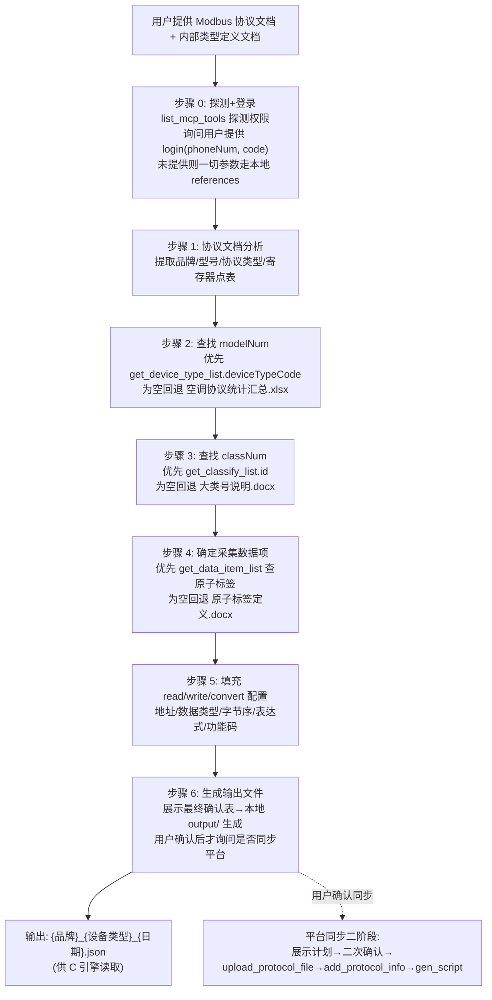

# Modbus 协议转换配置生成

> **目标：** 分析第三方 Modbus 协议文档和内部类型定义文档，生成供 C 协议转换引擎读取的 JSON 配置文件，实现 Modbus 寄存器数据到内部统一格式的转换。

## 适用场景

- 从第三方设备的 Modbus 寄存器读取数据并转换为内部统一格式
- 将 Modbus RTU 串口设备数据采集到平台
- 将 Modbus TCP 设备数据采集到平台
- 工业仪表/传感器/PLC/电表/温控仪的 Modbus 寄存器数据对接

## 目录结构

```
modbus-conversion/
├── agents/          
│   ├── openai.yaml       # skill配置信息
├── references/          # 参考文档（脚本参数来源）
│   ├── 空调协议统计汇总.xlsx        # modelNum 型号编码查找表
│   ├── 多类型设备集成系统大类号说明.docx  # classNum 大类号定义
│   ├── 原子标签定义.docx            # labels 中英文映射
│   └── 地址公式说明.png            # addr_exprs 地址公式规则
├── output/              # 生成脚本目录
│   └── {品牌}_{设备类型}_{日期}.json   # 命名规则：品牌+设备类型+日期
└── temp/                # 临时目录（中间转换文件）
```

## C 引擎实际读取的配置格式

### 根对象字段

| 字段          | 类型     | 必填  | 说明                                   |
| ----------- | ------ | --- | ------------------------------------ |
| `prtlType`  | string | 是   | 协议类型，如 `"MODBUS-RTU"`、`"MODBUS-TCP"` |
| `modelNum`  | int    | 是   | 型号编码（从 空调协议统计汇总.xlsx 查找）             |
| `classNum`  | int    | 是   | 大类号（从 多类型设备集成系统大类号说明.docx 查找）        |
| `taskList`  | array  | 是   | 任务列表，控制采集顺序                          |
| `labelList` | array  | 是   | 标签定义列表                               |

### taskList 结构

```json
{
  "taskList": [
    {
      "labels": ["PT", "CT", "DPT", "DCT", "voltageA", "voltageB"]
    }
  ]
}
```

`labels` 数组中的顺序决定采集顺序。被引用的辅助参数（如 DPT/DCT/DPQ/PT/CT/PQ）必须排在引用它们的标签之前。

### labelList 结构

```json
{
  "labelList": [
    {
      "name": "voltageA",
      "read": {
        "addr_base": 37,
        "data_type": "[UINT16]",
        "data_order": "AB",
        "addr_exprs": "",
        "data_exprs": "$D*pow(10,($'DPT'-4))",
        "func_code": 3
      },
      "write": {
        "addr_base": 100,
        "data_type": "[UINT16]",
        "data_order": "AB",
        "addr_exprs": "",
        "data_exprs": "",
        "func_code": 6
      },
      "convert": [
        {"name": "正常", "org": 0, "reg": 1},
        {"name": "故障", "org": 1, "reg": 2}
      ]
    }
  ]
}
```

- `read`：读操作配置（必填）
- `write`：写操作配置（可选，结构同 read）
- `convert`：枚举映射（可选）

read/write 对象字段：

| 字段           | 类型     | 必填  | 说明                           |
| ------------ | ------ | --- | ---------------------------- |
| `addr_base`  | int    | 是   | 寄存器基础地址                      |
| `data_type`  | string | 是   | 数据类型语法                       |
| `data_order` | string | 是   | 字节序                          |
| `addr_exprs` | string | 是   | 地址表达式（多路设备偏移），无则空字符串         |
| `data_exprs` | string | 是   | 数据表达式，无则空字符串                 |
| `func_code`  | int    | 是   | Modbus 功能码（读=3/4，写单=6，写多=16） |

## 处理流程



### 步骤 1：协议文档分析

从 Modbus 协议 PDF/DOCX 中提取：

- **品牌名称**：设备制造商
- **设备型号**：具体型号名称
- **协议类型**：通常为 MODBUS-RTU
- **数据项列表**：每个数据项的中文名称
- **功能码**：每个数据项对应的功能码（03=读保持寄存器，06=写单个寄存器，16=写多个寄存器等）
- **寄存器地址**：每个数据项的寄存器地址
- **数据类型**：UINT16、SINT16、UINT32 等
- **数据转换规则**：查找文档中对数据进行处理的规则，如转换为枚举值、进行数学运算（如除法、减法等）等
- **字节序**：AB、ABCD、CDAB 等
- **数据转换辅助参数**：协议文档中公式依赖的其他寄存器参数（如 DPT/DCT/DPQ 小数点位数、PQ 符号位、PT/CT 变比等），**这些参数必须作为独立标签采集**，供 data_exprs 跨寄存器引用。辅助参数的标签名即为 data_exprs 中 `$'label_name'` 引用的名字

若协议文档为 PDF/DOCX 等二进制格式，必须先转换为 Markdown 再分析：

- PDF：Python pypdf 库提取文本
- DOCX/DOC：pandoc convert-contents 工具
- 图片：使用 OCR 或直接分析
- 已是 .md/.txt/.json：无需转换

### 步骤 2：查找 modelNum

**优先 MCP 查询**（已登录时）：

1. 调用 `get_device_type_list(token=<业务Token>, deviceTypeName=<设备型号名称>)`
2. 命中 → 返回行的 `deviceTypeCode` 字段即为 `modelNum`，来源标记 `MCP:get_device_type_list.rows[i].deviceTypeCode`
3. 返回为空（`error=false, empty=true`）→ 回退本地查找或询问用户（见下）
4. 返回失败（`error=true`）→ 向用户展示错误原文，**不得**当作"不存在"，**不得**进入新增流程；由用户决定重试或改用本地参数

**本地兜底**（未登录或 MCP 查询为空）：

1. 打开 `references/空调协议统计汇总.xlsx`
2. 在 **SheetJS1**（型号列表）中，根据协议文档中的**品牌名称**和**设备型号**查找对应行
3. 该行的 **C列（型号编码）** 即为 `modelNum`，来源标记 `references:空调协议统计汇总.xlsx(SheetJS1.C列)`
4. 如果找不到精确匹配，用相似型号匹配，并告知用户确认
5. 仍无法确定时，询问用户提供 modelNum（来源标记 `user`）

SheetJS1 结构：
| A列：型号名称 | B列：所属品牌 | C列：型号编码 | D列：设备类型 |

### 步骤 3：查找 classNum

**优先 MCP 查询**（已登录时）：

1. 调用 `get_classify_list(token=<业务Token>, sysName=<大类名称>)`
2. 命中 → 返回行的 `id` 字段即大类编号 `classNum`，来源标记 `MCP:get_classify_list.rows[i].id`
3. 为空/失败的处理规则同步骤 2：为空回退本地，失败展示错误不当作不存在

**本地兜底**（未登录或 MCP 查询为空）：

1. 打开 `references/多类型设备集成系统大类号说明.docx`
2. 根据协议文档中的设备类型或业务类型，查找对应的 `classNum`，来源标记 `references:多类型设备集成系统大类号说明.docx`
3. 如果文档中无法直接确定，根据设备类型推断并告知用户确认

| 设备类型     | classNum | 设备类型       | classNum |
| -------- | -------- | ---------- | -------- |
| 水冷机组     | 1        | 单相智能插座     | 12       |
| 水泵       | 2        | 三相智能控制器    | 13       |
| 开关阀门     | 3        | 分体空调智能通信网关 | 14       |
| 空调面板末端   | 4        | 风冷热泵       | 15       |
| 热泵       | 5        | 开关量        | 16       |
| 多联机空调控制器 | 6        | 冷却塔        | 17       |
| 冷热量表     | 7        | 能源采集表      | 21       |
| 新风机      | 8        | 调节阀门       | 23       |
| 环境传感器    | 9        | 温控仪        | 24       |
| 智能通信单元   | 10       | 充电桩        | 25       |
| 电表       | 11       | 补水系统       | 29       |

### 步骤 4：确定采集数据项

#### 4.1 数据项歧义确认（前置必做）

当协议文档中同一数据项存在以下歧义时，**必须列出对比表格，由用户确认选择后再进入后续步骤**：

**歧义场景 1：同一数据项存在多种定义**

| 数据项  | 定义 A     | 定义 B      | 需确认内容            |
| ---- | -------- | --------- | ---------------- |
| 有功功率 | 绝对值（无符号） | 带符号值（含正负） | 是否存在符号位寄存器（如 PQ） |

**歧义场景 2：同一数据项存在多种计算方式**

| 数据项 | 方式 A           | 方式 B                       | 需确认内容          |
| --- | -------------- | -------------------------- | -------------- |
| 电能  | 二次侧值 `$D/1000` | 一次侧值 `$D/1000*$'PT'*$'CT'` | 是否需要乘 PT/CT 变比 |

**歧义场景 3：同一数据项存在多个寄存器地址**

| 数据项 | 地址 A         | 地址 B         | 需确认内容     |
| --- | ------------ | ------------ | --------- |
| 电压  | 0x0FFF（一次侧值） | 0x1003（二次侧值） | 取一次侧还是二次侧 |

> 用户未确认前，不得擅自选择其中一种。

#### 4.2 用户选择采集数据项

先推荐常采集的数据项组合，再询问用户需要采集哪些数据项（中文名称），来源于步骤 1 读取到的协议支持的数据项列表，区分**读**和**写**操作。

#### 4.3 查询原子标签（对应平台数据项）

原子标签对应平台的**数据项**，查询入口为 `get_data_item_list`：

1. **前置**：先调用 `get_protocol_info_list(token=..., name=<规约名或空串>, deviceTypeId=<设备类型ID>)` 查找该品牌/型号下的规约，取得 `id`；规约不存在或未登录时直接跳到本地查找（实测：规约名搜索字段为 `name`，后端不支持 `protoType` 过滤）
2. 调用 `get_data_item_list(token=..., protocolId=..., protoType=1)`（protoType=1 为 Modbus）
3. **命中**（`error=false, empty=false`）→ 返回数据项作为原子标签候选，来源标记 `MCP:get_data_item_list.rows[i]`
4. **查询失败**（`error=true`）→ 向用户展示错误原文，**不得**当作"不存在"，**不得**进入新增流程
5. **查询为空或未登录/规约不存在** → 从参考文档查找中文名称对应的英文标签：

**文档选择规则**：

| 数据类型  | 使用文档            | 说明                         |
| ----- | --------------- | -------------------------- |
| 电力数据  | `数据采集通信协议.docx` | 电能数据使用**示值**，非电能数据使用**曲线** |
| 非电力数据 | `原子标签定义.docx`   | 通用原子标签查找                   |

**原子标签新增（系统级用户，查询不到时）**：

1. 由用户提供标签定义，或从本地 `references/` 推荐候选（标注来源）
2. 展示将新增的数据项基础信息（中英文名称等），**请用户确认内容**
3. 用户确认后，再询问"是否新增到平台"；同意且为系统级用户时调用 `add_data_item`
4. **首期只新增基础信息**：不写寄存器地址、功能码、数据类型、字节序、表达式、枚举映射——这些仍只在本地 JSON 中维护
5. 普通用户（`accessLevel=user`）调用 `add_data_item` 会返回 `FORBIDDEN`，停止并提示需要系统级用户

常用原子标签速查表（完整定义见 `原子标签定义.docx`）：

| 中文名称    | 英文标签          | 中文名称    | 英文标签            |
| ------- | ------------- | ------- | --------------- |
| 当前运行状态  | cRunState     | 环境温度    | envTemp         |
| 当前运行模式  | cRunMode      | 水箱温度    | waterTankTemp   |
| 当前空调模式  | cWorkMode     | 冷冻水进水温度 | inputWaterTemp  |
| 主机开关机状态 | hostRunState  | 冷冻水出水温度 | outputWaterTemp |
| 主机工作模式  | hostWorkMode  | 电网频率    | gridFrequency   |
| 水泵运行状态  | pumpRunState  | A相电压    | voltageA        |
| 阀门状态    | valveState    | B相电压    | voltageB        |
| 阀门开度    | valveOpening  | C相电压    | voltageC        |
| 水泵频率    | pumpFrequency | A相电流    | currentA        |
| 故障状态    | pumpErrState  | 总有功功率   | activePowT      |
| 当前在线状态  | online        | 总功率因数   | powFactorsT     |

#### 4.4 汇总展示

将步骤 1 采集到的信息（寄存器地址、功能码、数据类型、字节序、转换规则）和确定的英文标签名以表格方式展示给用户确认：

| 中文名称 | 英文标签     | 寄存器地址 | 功能码 | 数据类型     | 字节序 | 转换规则                    | 读/写 |
| ---- | -------- | ----- | --- | -------- | --- | ----------------------- | --- |
| A相电压 | voltageA | 37    | 03  | [UINT16] | AB  | `$D*pow(10,($'DPT'-4))` | 读   |
| A相电流 | currentA | 43    | 03  | [UINT16] | AB  | `$D*pow(10,($'DCT'-4))` | 读   |

> 用户确认后，将英文标签填入 `taskList[0].labels` 数组。

### 步骤 5：填充 read/write/convert 配置

对 `labelList` 中的每个标签，从协议文档中提取并填充：

| 字段           | 来源          | 说明                                                                                                                          |
| ------------ | ----------- | --------------------------------------------------------------------------------------------------------------------------- |
| `name`       | 原子标签定义.docx | 英文标签名                                                                                                                       |
| `func_code`  | 协议文档        | 03=读保持寄存器，06=写单个寄存器，16=写多个寄存器等                                                                                              |
| `data_type`  | 协议文档        | [UINT16]、[SINT16]、[UINT32] 等                                                                                                |
| `data_order` | 协议文档        | AB、ABCD、CDAB、DCBA 等字节序                                                                                                      |
| `addr_base`  | 协议文档        | 寄存器起始地址（十进制）                                                                                                                |
| `addr_exprs` | 地址公式说明.png  | 多路设备时填写地址偏移公式，单路留空                                                                                                          |
| `data_exprs` | 协议文档        | 转换表达式。`$D`=当前寄存器值；**`$'label_name'`**=引用其他标签值，支持跨寄存器引用。当数据项存在符号位寄存器时，必须在 data_exprs 中加入符号位处理公式 `*(1-2*(($'符号位标签'&bit)!=0))` |
| `convert`    | 原子标签定义.docx | 枚举值映射关系                                                                                                                     |

### 步骤 6：生成输出文件（二阶段同步）

1. 先展示**最终确认表**（含每个参数的来源标记与待确认项，见"MCP 工具编排 → 参数来源标记与最终确认表"）
2. 用户确认后，将填充好的 JSON 写入 `output/` 目录
3. 文件命名格式：`{品牌}_{设备类型}_{日期}.json`（例如：`美的_水冷机组_20260721123000.json`）
4. 日期格式：YYYYMMDDHHMMSS
5. 本地生成完成后再询问"是否同步到平台"，按二阶段流程执行（见"MCP 工具编排 → 平台同步"）；用户未确认同步时**不得**调用 `upload_protocol_file`、`add_protocol_info`、`gen_script`

## 核心规则

### 1. data_type 数据类型语法

| 格式          | 含义                  | 长度   |
| ----------- | ------------------- | ---- |
| `[UINT16]`  | 无符号16位整数            | 1寄存器 |
| `[SINT16]`  | 有符号16位整数            | 1寄存器 |
| `[UINT32]`  | 无符号32位整数            | 2寄存器 |
| `[SINT32]`  | 有符号32位整数            | 2寄存器 |
| `[FLOAT32]` | 32位浮点数              | 2寄存器 |
| `[8:15]`    | 高字节提取（16位寄存器的8-15位） | 1寄存器 |
| `[0:7]`     | 低字节提取（16位寄存器的0-7位）  | 1寄存器 |

符号判定规则（按优先级）：

1. **若协议文档标注了符号位寄存器**（如 PQ），则该寄存器存的是绝对值，使用无符号类型（如 `[UINT16]`），符号由 data_exprs 中的位运算表达式处理
2. **若协议文档未标注符号位寄存器**，则直接以格式列的名称为准：
   - `Int` → 有符号 `[SINT]`
   - `UInt`/`Unsigned` → 无符号 `[UINT]`
   - `Float` → `[FLOAT32]`
   - `long` → 有符号 `[SINT]`

**示例**：

| 格式    | 长度（word 数） | 符号位寄存器 | data_type                     |
| ----- | ---------- | ------ | ----------------------------- |
| Int   | 1          | 无      | `[SINT16]`                    |
| Int   | 2          | 无      | `[SINT32]`                    |
| UInt  | 1          | 无      | `[UINT16]`                    |
| UInt  | 2          | 无      | `[UINT32]`                    |
| long  | 2          | 无      | `[SINT32]`                    |
| UInt  | 1          | 有（PQ）  | `[UINT16]`（符号由 data_exprs 处理） |
| Float | 2          | 无      | `[FLOAT32]`                   |

> **原则**：以协议文档数据格式为第一依据，不要凭物理含义推断。Int 就是有符号，即使电压电流物理上不会为负，也应严格按协议标注使用 `[SINT16]`。

### 2. data_order 字节序

| 值      | 含义          | 适用类型                              |
| ------ | ----------- | --------------------------------- |
| `AB`   | 16位大端       | `[UINT16]`/`[SINT16]`             |
| `ABCD` | 32位大端       | `[UINT32]`/`[SINT32]`/`[FLOAT32]` |
| `CDAB` | 32位中大端（字交换） | `[UINT32]`/`[SINT32]`/`[FLOAT32]` |
| `DCBA` | 32位小端       | `[UINT32]`/`[SINT32]`/`[FLOAT32]` |

### 3. data_exprs 表达式引擎

- `$D` — 当前寄存器原始值
- `$'label_name'` — 跨寄存器引用其他标签的值（注意单引号）
- `pow(x,y)` — 幂运算
- `&` — 按位与
- `*` `/` `+` `-` — 算术运算
- `>` `<` `!=` — 比较运算（返回 0/1）

| 场景      | 表达式                                          | 说明              |
| ------- | -------------------------------------------- | --------------- |
| 简单缩放    | `$D/10`                                      | 寄存器值除以10        |
| 动态精度    | `$D*pow(10,($'DPT'-4))`                      | 引用 DPT 标签值决定小数位 |
| 二次值计算   | `$D/1000*$'PT'*$'CT'`                        | 乘以 PT 和 CT 变比   |
| 带符号位功率  | `$D*pow(10,($'DPQ'-4))*(1-2*(($'PQ'&2)!=0))` | 引用 PQ 符号位       |
| 环境温度带符号 | `($D&32767)/10*(1-2*($D>32768))`             | 位掩码 + 符号判断      |
| 功率因数    | `$D/1000`                                    | 直接缩放            |
| 频率      | `$D/100`                                     | 直接缩放            |

### 4. addr_exprs 地址表达式（多路设备）

- `$A` — 基础地址（addr_base 的值）
- `$M` — 模块号
- `$I` — 通道号

示例：`$A+160*16*($M-1)+16*($I-1)` — 多路设备地址偏移

单路设备 addr_exprs 为空字符串 `""`。

### 5. convert 枚举映射

```json
"convert": [
  {"name": "自动", "org": 3, "reg": 0},
  {"name": "制热", "org": 1, "reg": 8},
  {"name": "制冷", "org": 2, "reg": 1}
]
```

| 字段     | 说明              |
| ------ | --------------- |
| `name` | 中文名称            |
| `org`  | 原始值（设备寄存器中的值）   |
| `reg`  | 映射后的值（内部统一格式的值） |

### 6. 符号位处理

功率符号位通过 PQ 寄存器的位来判断：

| 表达式         | 含义              |
| ----------- | --------------- |
| `$'PQ'&1`   | A 相有功功率符号（bit0） |
| `$'PQ'&2`   | B 相有功功率符号（bit1） |
| `$'PQ'&4`   | C 相有功功率符号（bit2） |
| `$'PQ'&8`   | 总有功功率符号（bit3）   |
| `$'PQ'&16`  | A 相无功功率符号（bit4） |
| `$'PQ'&32`  | B 相无功功率符号（bit5） |
| `$'PQ'&64`  | C 相无功功率符号（bit6） |
| `$'PQ'&128` | 总无功功率符号（bit7）   |

符号转换公式：`(1-2*(($'PQ'&bit)!=0))` — 正转为 1，负转为 -1

完整功率表达式示例：
`$D*pow(10,($'DPQ'-4))*(1-2*(($'PQ'&2)!=0))`

### 7. 位提取与按位运算互斥

- 需要按位运算（`&`）的字段，不能用 `[8:15]`/`[0:7]` 位提取，应读整个寄存器 `[UINT16]`
- 位提取 `[8:15]`/`[0:7]` 仅用于直接取高低字节（如 DPT/DCT/DPQ 从同一寄存器分别取高低字节）
- PQ 符号位寄存器必须用 `[UINT16]` 读取整个寄存器后用 `&` 运算

### 8. 一次值/二次值

| 类型   | 表达式                   | 说明                    |
| ---- | --------------------- | --------------------- |
| 二次侧值 | `$D/1000`             | 直接缩放（二次侧表计读数）         |
| 一次侧值 | `$D/1000*$'PT'*$'CT'` | 乘以 PT 和 CT 变比（一次侧实际值） |

需要用户确认选择哪种计算方式。

### 9. func_code 功能码

| 值   | 含义     | 用途        |
| --- | ------ | --------- |
| 3   | 读保持寄存器 | 读取数据（最常用） |
| 4   | 读输入寄存器 | 读取只读数据    |
| 6   | 写单个寄存器 | 写操作       |
| 16  | 写多个寄存器 | 写多寄存器     |

### 10. 转换公式查找顺序

分析协议文档时，按以下顺序查找数据转换规则：

1. **优先查找寄存器点表中的转换规则列**：寄存器表格通常有「转换公式」「系数」「单位」等列
2. **然后查找通讯章节末尾的独立小节**：部分协议将转换规则集中放在章节末尾（如「数据转换说明」「精度处理」等小节）
3. **最后查找附录或补充说明**：少数协议将转换规则放在文档附录中

> 若三处均未找到转换规则，则该数据项 `data_exprs` 填空字符串 `""`（即直接使用原始寄存器值）。

### 11. 原子标签匹配规则

从 `原子标签定义.docx` 或 `数据采集通信协议.docx` 查找中文名称对应的英文标签时：

1. **精确匹配**：中文名称完全对应（如「A相电压」→ `voltageA`）
2. **语义匹配**：中文名称不完全一致但含义相同（如「进水温度」→ `inputWaterTemp`），需告知用户匹配理由
3. **自定义命名**：找不到精确匹配和语义匹配时，使用用户之前审批过的自定义命名规则，并告知用户确认
4. **无匹配**：三步均未命中时，提示用户手动指定英文标签名

> 搜索时可以使用搜索工具按关键词查找，提高匹配效率。

## MCP 工具编排

> ⚠️ **废弃声明**：旧版文档中列出的 5 个高阶工具（`analyze_modbus_protocol`、`analyze_type_definitions`、`generate_modbus_config`、`validate_config_rules`、`save_conversion_config`）仅为早期示例名称，MCP Server 中**从未实现**，禁止调用。实际使用下表的原子工具。

### 步骤 0：登录与 Token（必做前置）

1. 调用 `list_mcp_tools` 探测连接与当前权限级别（`auth.accessLevel`：`system` 可读写 / `user` 只读）
2. 询问用户提供 `login(phoneNum, code)` 所需的手机号和验证码（验证码不会过期）：
   - **用户提供了** → 调用 `login` 获取后端业务 Token，后续所有需要 `token` 参数的工具一律使用返回的 `data.token`
   - **用户未提供** → 不调用 `login`，所有参数只从本地 `references/` 获取并在输出中标注来源 `references:<file>`；需要写入平台时停止并告知用户必须登录

**Token 隔离（重要）**：

| Token | 用途 | 传递方式 |
| --- | --- | --- |
| MCP 接入 Token | 连接 MCP 服务器（`/mcp` 端点）鉴权 | HTTP `Authorization: Bearer` 请求头，客户端自动携带 |
| 后端业务 Token | 调用规约管理后端 API | 仅作为工具的 `token` 参数，由 `login` 返回 |

两者不能混用：MCP 接入 Token 不传给后端，后端业务 Token 不用于 MCP 连接。

### 原子工具映射表

| 阶段 | 工具 | 类型 | 调用目的 | 触发条件 |
| --- | --- | --- | --- | --- |
| 探测 | `list_mcp_tools` | probe | 列出工具、探测鉴权与权限级别 | 流程启动时 |
| 登录 | `login` | login | 获取后端业务 Token | 用户提供手机号+验证码时 |
| 查 modelNum | `get_device_type_list` | read | 查设备类型，`deviceTypeCode` 即 modelNum | 步骤 2，登录后优先执行 |
| 查 classNum | `get_classify_list` | read | 查大类列表，`id` 即大类编号 | 步骤 3，登录后优先执行 |
| 查规约 | `get_protocol_info_list` | read | 查规约是否存在、获取 protocolId | 步骤 4 前置；平台同步前 |
| 查原子标签 | `get_data_item_list` | read | 查询协议数据项（原子标签候选） | 步骤 4，需 protocolId |
| 查品牌 | `get_brand_list` | read | 确认品牌是否已存在 | 平台同步前核对 |
| 查型号 | `get_model_list` | read | 确认型号是否已存在 | 平台同步前核对 |
| 条件写入 | `add_data_item` | write | 查询不到原子标签时新增基础信息 | 系统级用户 + 用户确认内容 + 同意新增 |
| 条件写入 | `add_brand` / `add_model` | write | 查询不到时新增品牌/型号基础信息 | 系统级用户 + 用户确认后 |
| 平台同步 | `upload_protocol_file` | write | 上传本地 JSON 到平台 | 同步计划二次确认后 |
| 平台同步 | `add_protocol_info` | write | 新增规约信息 | 同步计划二次确认后 |
| 平台同步 | `gen_script` | write | 触发脚本生成（可选） | 同步计划二次确认后 |

### 查询通用规则（品牌/型号/原子标签）

1. **优先查询**：已登录时一律先调用对应 `get_*` 工具
2. **命中复用**：查询到目标 → 直接使用返回值，不新增
3. **查询为空**（`error=false, empty=true`）→ 由用户提供，或从本地 `references/` 推荐候选并请用户确认；用户确认后，若为系统级用户再询问是否新增到平台
4. **查询失败**（`error=true`，网络/Token/业务错误）→ 展示错误原文，**不得**当作"不存在"，**不得**进入新增流程；由用户决定下一步（重试/登录/改用本地参数）

### 写入保护与返回值展示

- 普通用户（`accessLevel=user`）调用任何写入工具返回 `FORBIDDEN`：**立即停止**该步骤，告知用户"此操作需要系统级用户（localhost 访问）"；持有业务 Token 也不能绕过
- 系统级用户写入前必须**展示写入计划**（工具名 + 参数表）并请求用户确认
- 写入后**原样展示返回值**；失败时不自动重试，把返回值告知用户，由用户决定下一步

### 平台同步（二阶段流程，默认不执行）

1. **本地生成**：默认只生成本地 JSON `output/{品牌}_{设备类型}_{日期}.json`，并展示最终确认表
2. **询问同步**：用户确认本地 JSON 后，询问"是否同步到平台"；用户未同意前不得调用任何平台写入工具
3. **同步计划**：用户同意后展示同步计划（将调用的写入工具、顺序、参数），**再次请求确认**
4. **执行同步**：二次确认后按顺序调用 `upload_protocol_file` → `add_protocol_info` → （可选）`gen_script`，逐步展示返回值，失败即停

### 首期禁用的工具

MODBUS 首期**不调用**任何删除类工具：`del_classify`、`del_device_type`、`del_brand`、`del_model`、`del_protocol_info`、`del_protocol_file`、`del_data_item`、`del_script` 及其他 `del_*`。工具计划中不得出现。

### 参数来源标记与最终确认表

生成 JSON 前必须输出**最终确认表**，每个参数标注来源：

| 来源标记 | 含义 |
| --- | --- |
| `MCP:<tool>.<field>` | 来自 MCP 查询返回，如 `MCP:get_device_type_list.rows[0].deviceTypeCode` |
| `references:<file>` | 来自本地参考文档，如 `references:空调协议统计汇总.xlsx(SheetJS1.C列)` |
| `user` | 用户直接提供 |

最终确认表必含项：品牌、设备类型、classNum、modelNum、协议类型、采集数据项、原子标签（name 列表）、寄存器地址、功能码、data_type、data_order、data_exprs、来源、待确认项。

**缺失项清单**：任一必需参数无法从 MCP 查询/本地 references/用户确认中获得时，列出缺失项清单并**停止生成最终 JSON**，不得编造默认值。

## 参考文档使用说明

### 空调协议统计汇总.xlsx

- **SheetJS0**：汇总统计
- **SheetJS1**：型号列表，用于查找 modelNum，列结构：型号名称(A) | 所属品牌(B) | 型号编码(C) | 设备类型(D)
- **SheetJS2**：品牌列表，列结构：品牌名称(A) | 设备类型(B)

### 多类型设备集成系统大类号说明.docx

- 定义各设备类型对应的 classNum（大类号）
- 根据设备类型查找对应的大类号数值

### 原子标签定义.docx

- 定义数据项的英文标签名和中文含义的映射
- 用户输入中文数据项名称后，从此文档查找对应的英文标签
- 查看协议文档和 原子标签定义.docx 中数据项的定义是否一致，是否需要convert映射关系

### 地址公式说明.png

- 多路设备时，`addr_exprs` 使用 `$A+模块偏移`，`$A`=基地址，`$M`=模块号，`$I`=索引号
- 单路设备时 `addr_exprs` 留空
- `data_exprs` 中 `$D`=源数据寄存器值

## 实际 JSON 配置样例（安科瑞 AMC 电表）

```json
{
  "prtlType": "MODBUS-RTU",
  "modelNum": 440,
  "classNum": 11,
  "taskList": [
    {
      "labels": [
        "PT", "CT", "DPT", "DCT", "DPQ", "PQ",
        "voltageA", "voltageB", "voltageC",
        "currentA", "currentB", "currentC",
        "activePowPhaseA", "activePowPhaseB", "activePowPhaseC", "activePowT",
        "reactivePowPhaseA", "reactivePowPhaseB", "reactivePowPhaseC", "reactivePowT",
        "powFactorsT", "gridFrequency", "indicatedFApT"
      ]
    }
  ],
  "labelList": [
    {
      "name": "PT",
      "read": {"addr_base": 3, "data_type": "[UINT16]", "data_order": "AB", "addr_exprs": "", "data_exprs": "", "func_code": 3}
    },
    {
      "name": "CT",
      "read": {"addr_base": 4, "data_type": "[UINT16]", "data_order": "AB", "addr_exprs": "", "data_exprs": "", "func_code": 3}
    },
    {
      "name": "DPT",
      "read": {"addr_base": 35, "data_type": "[8:15]", "data_order": "AB", "addr_exprs": "", "data_exprs": "", "func_code": 3}
    },
    {
      "name": "DCT",
      "read": {"addr_base": 35, "data_type": "[0:7]", "data_order": "AB", "addr_exprs": "", "data_exprs": "", "func_code": 3}
    },
    {
      "name": "DPQ",
      "read": {"addr_base": 36, "data_type": "[8:15]", "data_order": "AB", "addr_exprs": "", "data_exprs": "", "func_code": 3}
    },
    {
      "name": "PQ",
      "read": {"addr_base": 36, "data_type": "[UINT16]", "data_order": "AB", "addr_exprs": "", "data_exprs": "", "func_code": 3}
    },
    {
      "name": "voltageA",
      "read": {"addr_base": 37, "data_type": "[UINT16]", "data_order": "AB", "addr_exprs": "", "data_exprs": "$D*pow(10,($'DPT'-4))", "func_code": 3}
    },
    {
      "name": "currentA",
      "read": {"addr_base": 43, "data_type": "[UINT16]", "data_order": "AB", "addr_exprs": "", "data_exprs": "$D*pow(10,($'DCT'-4))", "func_code": 3}
    },
    {
      "name": "activePowPhaseA",
      "read": {"addr_base": 46, "data_type": "[UINT16]", "data_order": "AB", "addr_exprs": "", "data_exprs": "$D*pow(10,($'DPQ'-4))*(1-2*(($'PQ'&2)!=0))", "func_code": 3}
    },
    {
      "name": "activePowT",
      "read": {"addr_base": 49, "data_type": "[UINT16]", "data_order": "AB", "addr_exprs": "", "data_exprs": "$D*pow(10,($'DPQ'-4))*(1-2*(($'PQ'&16)!=0))", "func_code": 3}
    },
    {
      "name": "powFactorsT",
      "read": {"addr_base": 57, "data_type": "[UINT16]", "data_order": "AB", "addr_exprs": "", "data_exprs": "$D/1000", "func_code": 3}
    },
    {
      "name": "gridFrequency",
      "read": {"addr_base": 62, "data_type": "[UINT16]", "data_order": "AB", "addr_exprs": "", "data_exprs": "$D/100", "func_code": 3}
    },
    {
      "name": "indicatedFApT",
      "read": {"addr_base": 63, "data_type": "[UINT32]", "data_order": "ABCD", "addr_exprs": "", "data_exprs": "$D/1000*$'PT'*$'CT'", "func_code": 3}
    }
  ]
}
```

## 多路设备配置样例（多联机空调，含 write/convert）

```json
{
  "prtlType": "MODBUS-RTU",
  "modelNum": 289,
  "classNum": 4,
  "taskList": [
    {
      "labels": ["remoteStatus", "setUpTemp", "airConPattern", "airConAirVolume", "airConTemp", "errCode"]
    }
  ],
  "labelList": [
    {
      "name": "remoteStatus",
      "read": {
        "addr_base": 24003, "data_type": "[UINT16]", "data_order": "AB",
        "addr_exprs": "$A+160*16*($M-1)+16*($I-1)", "data_exprs": "", "func_code": 3
      },
      "write": {
        "addr_base": 24003, "data_type": "[UINT16]", "data_order": "AB",
        "addr_exprs": "$A+160*16*($M-1)+16*($I-1)", "data_exprs": "", "func_code": 6
      }
    },
    {
      "name": "setUpTemp",
      "read": {
        "addr_base": 24004, "data_type": "[UINT16]", "data_order": "AB",
        "addr_exprs": "$A+160*16*($M-1)+16*($I-1)", "data_exprs": "", "func_code": 3
      },
      "write": {
        "addr_base": 24004, "data_type": "[UINT16]", "data_order": "AB",
        "addr_exprs": "$A+160*16*($M-1)+16*($I-1)", "data_exprs": "", "func_code": 6
      }
    },
    {
      "name": "airConPattern",
      "convert": [
        {"name": "自动", "org": 3, "reg": 0},
        {"name": "制冷", "org": 2, "reg": 1},
        {"name": "制热", "org": 1, "reg": 8},
        {"name": "送风", "org": 0, "reg": 4},
        {"name": "除湿", "org": 7, "reg": 2}
      ],
      "read": {
        "addr_base": 24005, "data_type": "[UINT16]", "data_order": "AB",
        "addr_exprs": "$A+160*16*($M-1)+16*($I-1)", "data_exprs": "", "func_code": 3
      },
      "write": {
        "addr_base": 24005, "data_type": "[UINT16]", "data_order": "AB",
        "addr_exprs": "$A+160*16*($M-1)+16*($I-1)", "data_exprs": "", "func_code": 6
      }
    },
    {
      "name": "errCode",
      "read": {
        "addr_base": 24014, "data_type": "[UINT32]", "data_order": "ABCD",
        "addr_exprs": "$A+160*16*($M-1)+16*($I-1)", "data_exprs": "", "func_code": 3
      }
    }
  ]
}
```

## 简单设备配置样例（环境传感器，无辅助参数）

```json
{
  "prtlType": "MODBUS-RTU",
  "modelNum": 23,
  "classNum": 9,
  "taskList": [
    {
      "labels": ["envTemp", "envHumidity", "deviceAddr"]
    }
  ],
  "labelList": [
    {
      "name": "envTemp",
      "read": {
        "addr_base": 0, "data_type": "[UINT16]", "data_order": "AB",
        "addr_exprs": "", "data_exprs": "($D&32767)/10*(1-2*($D>32768))", "func_code": 3
      }
    },
    {
      "name": "envHumidity",
      "read": {
        "addr_base": 1, "data_type": "[UINT16]", "data_order": "AB",
        "addr_exprs": "", "data_exprs": "$D/10", "func_code": 3
      }
    },
    {
      "name": "deviceAddr",
      "read": {
        "addr_base": 100, "data_type": "[UINT16]", "data_order": "AB",
        "addr_exprs": "", "data_exprs": "", "func_code": 3
      }
    }
  ]
}
```

此样例特点：无辅助参数、无跨标签引用、温度通过位掩码处理符号位（`$D&32767` 取绝对值，`$D>32768` 判断正负）。

## 注意事项

1. **data_exprs 操作可选**：根据文档数据转换表达式规则，填写 data_exprs 字段；无转换规则时填空字符串 `""`
2. **write 操作可选**：如果用户只要求读取数据，则不需要 write 字段
3. **convert 映射可选**：如果数据项有枚举值（如模式、档位），需要从协议文档中提取映射关系
4. **协议文档格式转换**：如果协议文档是 PDF/DOCX 等格式，先转换为可读文本再分析
5. **遇到不确定的信息**：及时与用户沟通确认，不要猜测
6. **生成脚本前预览**：在写入文件前，展示完整的 JSON 配置给用户确认
7. **跨寄存器引用**：当协议的转换公式依赖其他寄存器值（如 DPT/DCT/DPQ 小数点位数），必须将这些依赖参数也配置为标签，并在 data_exprs 中使用 `$'label_name'` 引用
8. **位提取**：当协议中一个寄存器的高字节和低字节含义不同时（如 0023H 高字节=DPT、低字节=DCT），使用 data_type 的 `[8:15]` / `[0:7]` 语法拆分
9. **位提取与按位运算互斥**：当某个寄存器值在 data_exprs 中需要做按位运算（如 `&`）时，应使用 `[UINT16]` 读整个寄存器，**不要**使用位提取。位提取仅适用于独立使用的值（如 DPT、DCT 等不需要再做按位拆分的参数）。例如：PQ 符号位需要在 data_exprs 中做 `($'PQ'&1)!=0` 等按位判断，因此 PQ 必须用 `[UINT16]` 读整寄存器，不能用 `[0:7]` 位提取
10. **一次值/二次值选择**：当协议文档中同一数据项存在两个寄存器地址（如一次侧值和二次侧值），或同一数据项存在多种计算方式（如电能二次侧值 `$D/1000` vs 一次侧值 `$D/1000*$'PT'*$'CT'`），必须将多个选项展示给用户，由用户决定取哪个值
11. **data_type 符号判定**：以协议文档数据格式为第一依据，不要凭物理含义推断。Int 就是有符号，即使电压电流物理上不会为负，也应严格按协议标注使用 `[SINT16]`

## 约束规则

| 规则           | 说明                                            |
| ------------ | --------------------------------------------- |
| 采集顺序         | 辅助参数（PT/CT/DPT/DCT/DPQ/PQ）必须排在引用它们的标签之前       |
| data_type 格式 | 必须用方括号包裹，如 `[UINT16]`、`[SINT16]`、`[8:15]`     |
| 位提取互斥        | 需按位运算（`&`）的字段用 `[UINT16]`，不用 `[8:15]`/`[0:7]` |
| 跨标签引用        | 必须用 `$'label_name'` 语法（单引号包裹标签名）              |
| 空表达式         | 无表达式时填空字符串 `""`，不能省略字段                        |
| 枚举映射         | `org`=设备原始值，`reg`=内部映射值                       |
| 字节序匹配        | 16位用 `AB`，32位用 `ABCD`/`CDAB`/`DCBA`           |
| 用户确认         | 一次值/二次值选择需用户确认；标签命名歧义需用户确认                    |
| 输出命名         | 文件名格式：`{品牌}_{设备类型}_{YYYYMMDDHHMMSS}.json`     |
| 输出目录         | 配置文件保存到 `output/` 目录                          |
| 参数来源标记       | 最终确认表每个参数标注 `MCP:<tool>.<field>` / `references:<file>` / `user` |
| 缺失项停止        | 必需参数无法确认时列出缺失项清单并停止生成，不编造默认值                  |
| 首期禁用删除       | MODBUS 首期不调用任何 `del_*` 删除类工具                  |
| 查询失败不新增      | 查询失败（error=true）不得当作不存在，不得进入新增流程              |
