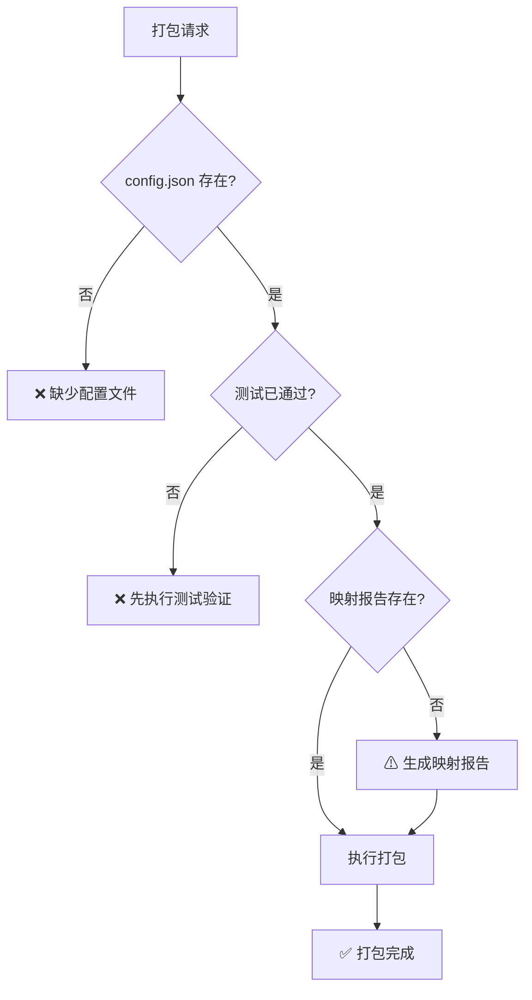

# 协议转换包打包分发

> **目标：** 将转换配置、映射报告、测试报告打包为 ZIP，支持一键安装到目标环境。

## 适用场景

- 转换配置测试通过后，打包发布
- 将配置分发到其他部署环境
- 版本管理和归档

## 打包内容

### ZIP 包目录结构

```
protocol-conversion-pack-{protocol}_{source}_to_{target}_{version}/
├── config.json                    ← 主配置文件（C 引擎读取）
├── mapping_report.md              ← 映射设计报告
├── test_report.json               ← 测试报告
├── source_protocol_spec.json      ← 源协议规格（归档）
├── target_protocol_spec.json      ← 目标协议规格（归档）
├── README.md                      ← 安装和使用说明
└── manifest.json                  ← 包清单（版本/协议类型/依赖）
```

### manifest.json 格式

```json
{
  "packId": "mqtt_to_mqtt_v1.0.0",
  "version": "1.0.0",
  "conversionType": "mqtt_to_mqtt",
  "sourceProtocol": "mqtt",
  "targetProtocol": "mqtt",
  "createdAt": "2026-08-17T10:00:00Z",
  "files": [
    { "name": "config.json", "size": 4096, "checksum": "sha256:..." },
    { "name": "mapping_report.md", "size": 2048, "checksum": "sha256:..." },
    { "name": "test_report.json", "size": 1024, "checksum": "sha256:..." }
  ],
  "dependencies": {
    "engine": "protocol-converter-c-engine",
    "engineVersion": ">=1.0.0",
    "libraries": ["cJSON", "paho.mqtt.c"]
  },
  "testStatus": "passed",
  "testSummary": "15/15 通过"
}
```

### README.md 模板

```markdown
# {协议类型} 转换包 v{version}

## 安装

1. 将 config.json 复制到 C 引擎配置目录
2. 替换配置中的占位符（${VAR_NAME}）为实际值
3. 启动 C 协议转换引擎

## 配置参数

| 占位符 | 说明 | 示例值 |
|--------|------|--------|
| ${SOURCE_BROKER} | 源 MQTT broker 地址 | 127.0.0.1 |
| ${TARGET_BROKER} | 目标 MQTT broker 地址 | 10.0.11.249 |
| ${GATEWAY_ID} | 网关 ID | GW_001 |

## 测试结果

- 测试时间：{testTime}
- 通过：{passed}/{total}
- 状态：{status}
```

## 操作流程

### Phase 1 — 打包前检查



### Phase 2 — 生成清单和文档

1. 计算 config.json 的 SHA256 校验和
2. 生成 manifest.json（包清单）
3. 生成 README.md（安装说明）
4. 归档源/目标协议规格 JSON

### Phase 3 — 打包为 ZIP

```
打包步骤:
  1. 创建临时目录
  2. 复制 config.json、mapping_report.md、test_report.json
  3. 复制 source_protocol_spec.json、target_protocol_spec.json
  4. 生成 manifest.json
  5. 生成 README.md
  6. 压缩为 ZIP
  7. 输出 ZIP 文件路径
```

### Phase 4 — 安装到目标环境

```
安装步骤:
  1. 解压 ZIP 到目标目录
  2. 替换 config.json 中的占位符为实际值
  3. 验证 C 引擎依赖（cJSON/paho.mqtt.c/libmicrohttpd 等）
  4. 启动 C 协议转换引擎
  5. 验证转换结果
```

## 调用的 MCP 工具（MCP 就绪后）

| 工具 | 用途 | 当前替代方案 |
|------|------|------------|
| `pack_bundle` | 打包配置+文档为 ZIP | AI 生成文件列表，用户手动打包 |
| `install_pack` | 安装 ZIP 到目标环境 | AI 输出安装步骤，用户手动执行 |
| `list_packs` | 列出所有已打包的转换包 | 无 |
| `get_pack_info` | 获取包详情 | 无 |
| `delete_pack` | 删除已打包的转换包 | 无 |

## 约束规则

| 规则 | 说明 |
|------|------|
| 测试门控 | 打包前必须通过测试验证（test-validation） |
| 校验和 | config.json 必须计算 SHA256 校验和 |
| 占位符清单 | README.md 必须列出所有需要替换的占位符 |
| 依赖声明 | manifest.json 必须声明 C 引擎版本和库依赖 |
| 版本管理 | 每次打包生成唯一 packId 和版本号 |
| 文件完整性 | ZIP 包必须包含 config.json + 测试报告 + 映射报告 |
