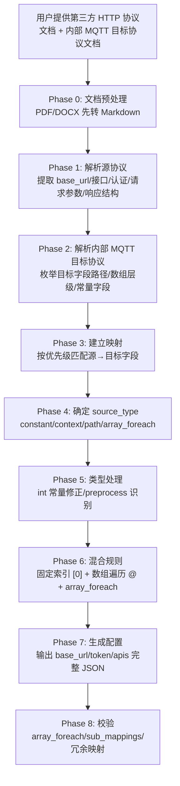

# HTTP 协议转换配置生成

> **职责：** 处理 HTTP 特有的配置格式和逻辑。共享映射规则（路径语法、类型系统、数组遍历等）见 `protocol-conversion`。

## 1. 概述

本 skill 用于生成驱动 `mapper_core.c` 引擎的 JSON 配置文件，将第三方 HTTP 接口数据采集并转换为内部 MQTT 格式后上报。

### 引擎链路

```
vpp_http_config.load.c (加载JSON配置) → mapper_core.c (执行映射) → 输出内部MQTT消息
```

### HTTP 特有功能

| 功能 | 说明 | 共享/特有 |
|------|------|-----------|
| `context` source_type | 运行时上下文变量 | **HTTP 特有** |
| `key_value` item_type | 键值对数组遍历模式 | **HTTP 特有** |
| `.` 源路径 | 返回根对象 | **HTTP 特有** |
| `preprocess` | 预处理函数（如 url_to_base64） | **HTTP 特有** |
| `body_params` | 请求参数配置 | **HTTP 特有** |
| Token 认证 | 登录获取 Token 后携带 | **HTTP 特有** |
| 链式调用 | next_api 串联多接口 | **HTTP 特有** |

> 以下功能由共享核心 `mapper_core.c` 统一实现，详见 `protocol-conversion`：
> 路径语法(`.`/`[index]`/`[*]`)、类型系统(string/int/double/long/bool/object)、数组遍历(`array_foreach`+`@`)、生成器、`constant`/`generated`/`path` source_type、`object` item_type。

## 2. HTTP 配置格式

> **引擎**：`vpp_http_config.load.c` 加载配置 → `mapper_core.c` 执行映射

### 2.1 根对象

| 字段 | 类型 | 必填 | 说明 |
|------|------|------|------|
| `base_url` | string | 是 | 基础 URL（含 API 路径前缀） |
| `timeout` | int | 否 | 请求超时毫秒，默认 30000 |
| `domain` | string | 否 | 从 base_url 提取主机名，IPv4 填 IP，否则空字符串 |
| `token` | object | 否 | Token 认证配置（无认证时省略） |
| `apis` | array | 是 | API 接口配置列表 |

### 2.2 Token 配置

| 字段 | 类型 | 必填 | 说明 |
|------|------|------|------|
| `login_path` | string | 是 | 登录接口路径（相对 base_url） |
| `login_method` | string | 是 | POST/GET |
| `content_type` | string | 是 | 请求内容类型 |
| `token_path` | string | 是 | 响应中 Token 的 JSON 路径 |
| `token_header` | string | 是 | 后续请求携带 Token 的 Header 名称 |
| `expires_in` | int | 是 | Token 有效期秒，默认 7200 |
| `login_params` | array | 是 | 登录参数列表（使用共享映射规则） |

### 2.3 API 配置

| 字段 | 类型 | 必填 | 说明 |
|------|------|------|------|
| `name` | string | 是 | API 唯一标识（用于 next_api 引用） |
| `method` | string | 是 | GET/POST/PUT/DELETE |
| `path` | string | 是 | 接口路径（相对 base_url） |
| `content_type` | string | 否 | 默认 application/json |
| `use_token` | bool | 否 | 默认 false |
| `interval` | int | 否 | 调用间隔数值 |
| `interval_type` | string | 否 | second/minute/hour/day |
| `skip_on_interval` | bool | 否 | 频率型调度默认 true |
| `param_process` | string | 否 | 参数预处理函数名，默认空 |
| `after_process` | string | 否 | 响应后处理函数名，默认空 |
| `topic_pattern` | string | 否 | MQTT Topic 模板，默认空 |
| `next_api` | string | 否 | 链式调用的下一个 API name，默认空 |
| `body_params` | array | 是 | 请求参数配置（使用共享映射规则） |
| `data_mappings` | array | 是 | 响应数据映射配置（使用共享映射规则） |

### 2.4 配置示例

```json
{
  "base_url": "http://cloud.example.com/meter2/api",
  "timeout": 30000,
  "domain": "",
  "token": {
    "login_path": "/user/login",
    "login_method": "POST",
    "content_type": "application/x-www-form-urlencoded",
    "token_path": "token",
    "token_header": "token",
    "expires_in": 604800,
    "login_params": [
      { "target": "username", "source_type": "constant", "constant": "${USERNAME}", "type": "string" },
      { "target": "password", "source_type": "constant", "constant": "${PASSWORD}", "type": "string" }
    ]
  },
  "apis": [{
    "name": "get_records",
    "method": "POST", "path": "/record/history",
    "content_type": "application/json", "use_token": true,
    "interval": 8, "interval_type": "hour",
    "param_process": "", "after_process": "", "topic_pattern": "", "next_api": "",
    "body_params": [
      { "target": "startTime", "source_type": "context", "source": "startTime", "type": "string" },
      { "target": "endTime", "source_type": "context", "source": "endTime", "type": "string" }
    ],
    "data_mappings": [
      { "target": "taskId", "source_type": "constant", "constant": 8220, "type": "int" },
      { "target": "commObj.commAddr", "source_type": "path", "source": "deviceId", "type": "string" },
      {
        "target": "businessObjList[0].dataObj.dataItemList[0].itemBody.@",
        "source": "data[*]",
        "source_type": "array_foreach",
        "item_type": "object",
        "sub_mappings": [
          { "target": "roadNo", "source_type": "constant", "constant": 1, "type": "int" },
          { "target": "dataTime", "source_type": "path", "source": "createTime", "type": "string" },
          {
            "target": "item.@",
            "source": ".",
            "source_type": "array_foreach",
            "item_type": "key_value",
            "sub_mappings": [
              { "target": "tolCumulativeFlow", "source_type": "path", "source": "value", "type": "string" },
              { "target": "cImageContent", "source_type": "path", "source": "photo", "preprocess": "url_to_base64", "type": "string" }
            ]
          }
        ]
      }
    ]
  }]
}
```

## 3. HTTP 特有功能详解

### 3.1 context source_type

`context` 用于从运行时上下文中取值（如 startTime/endTime），而非从源 JSON 数据中取值：

```json
{
  "target": "startTime",
  "source_type": "context",
  "source": "startTime",
  "type": "string"
}
```

> `source` 字段指定上下文变量名。MQTT 引擎不支持 `context`。

### 3.2 key_value item_type

`key_value` 模式下，每个源数组元素的每个 sub_mapping 生成一个独立的目标对象：

```json
{
  "target": "item.@",
  "source": ".",
  "source_type": "array_foreach",
  "item_type": "key_value",
  "sub_mappings": [
    { "target": "tolCumulativeFlow", "source_type": "path", "source": "value", "type": "string" },
    { "target": "cImageContent", "source_type": "path", "source": "photo", "type": "string" }
  ]
}
// 每个源元素生成 2 个对象（2 个 sub_mappings）：
// [{"tolCumulativeFlow": "100.5"}, {"cImageContent": "http://..."}]
```

对比 `object` 模式（共享，MQTT/HTTP 均可）：
```json
{
  "item_type": "object",
  "sub_mappings": [
    { "target": "tolCumulativeFlow", "source": "value", "type": "string" },
    { "target": "cImageContent", "source": "photo", "type": "string" }
  ]
}
// 每个源元素生成 1 个对象：
// [{"tolCumulativeFlow": "100.5", "cImageContent": "http://..."}]
```

### 3.3 "." 源路径

在 `array_foreach` 的 `source` 中使用 `.` 表示将当前源对象本身作为单元素数组遍历：

```json
{
  "target": "items.@",
  "source": ".",
  "source_type": "array_foreach",
  "sub_mappings": [
    { "target": "val", "source": "value", "type": "string" }
  ]
}
// 输入: {"value": "test", "id": 1}
// 输出: {"items": [{"val": "test"}]}
```

> MQTT 引擎不支持 `.` 源路径。

### 3.4 preprocess 预处理

`preprocess` 用于在映射前对源值执行预处理函数：

```json
{
  "target": "cImageContent",
  "source_type": "path",
  "source": "photo",
  "preprocess": "url_to_base64",
  "type": "string"
}
```

> `preprocess` 是 HTTP 特有字段，MQTT 不使用。

### 3.5 链式调用

通过 `next_api` 串联多个 API 调用：

```json
{
  "apis": [
    {
      "name": "get_customer_list",
      "method": "GET", "path": "/customer",
      "next_api": "query_record",
      "body_params": [...],
      "data_mappings": []
    },
    {
      "name": "query_record",
      "method": "GET", "path": "/record",
      "next_api": "",
      "body_params": [...],
      "data_mappings": [...]
    }
  ]
}
```

> Token 获取由独立的 `token` 对象管理，不属于链式调用范畴。

## 4. 处理流程



## 5. 核心规则

| # | 规则 | 说明 |
|---|------|------|
| 1 | base_url 提取 | 从文档登录接口 URL 提取到 api 部分 |
| 2 | domain 提取 | 从 base_url 提取主机名，IPv4 填 IP，否则空字符串 |
| 3 | timeout 默认 | 默认 30000ms；meter2 类接口默认 3000 |
| 4 | token.expires_in 默认 | 默认 7200；抄表平台 604800 |
| 5 | array_foreach 强制 | target 含 @ 且源为数组时必须使用，需非空 sub_mappings + item_type |
| 6 | 固定索引与数组混合 | 单数对象 [0]，复数数组 @ + array_foreach；多层嵌套每层独立 |
| 7 | int 常量自动修正 | type=="int" 且 constant 为字符串数字时自动转为数字 |
| 8 | 扩展字段 | param_process/after_process/topic_pattern/next_api 优先用文档值，未指明时空字符串 |
| 9 | commObj.commAddr 优先映射 | 自动将 commObj.commAddr 优先映射到 deviceId |
| 10 | url_to_base64 preprocess | 字段名含 photo/image/url 时默认加入 preprocess: url_to_base64 |
| 11 | 冗余映射检测 | 检测同一目标字段在父/子层重复映射并输出警告 |
| 12 | 链式调用 | next_api 指向下一个 API name；Token 不属于链式调用范畴 |

## 6. 真实协议示例

### 源协议：抄表终端平台接口

- 获取 Token：POST `http://cloud.linktheall.cn/meter2/api/user/login`
  - 参数：username/password
  - Content-Type：application/x-www-form-urlencoded
  - token 有效期 7 天
- 获取抄表记录：POST `http://cloud.linktheall.cn/meter2/api/record/history`
  - 需 token header，Content-Type：application/json
  - 请求参数：startTime, endTime（间隔≤24小时）
  - 返回：code/msg/data 数组

### 目标协议：内部 MQTT 上报格式

```json
{
  "taskId": 8220, "udSign": 1, "cmdType": 1, "priority": 0,
  "commObj": { "commAddr": "deviceId 值" },
  "businessObjList": [{
    "dataObj": {
      "timeType": 4, "collCycle": 1440,
      "dataItemList": [{
        "itemBody": [{
          "roadNo": 1, "dataTime": "createTime 值",
          "item": [{ "tolCumulativeFlow": "value 值", "cImageContent": "photo 转 base64" }]
        }]
      }]
    }
  }]
}
```

### 生成的配置

见 2.4 节配置示例。

## 7. 全量提取规则

| 场景 | 必须怎么提取 | 禁止做法 |
|------|------------|---------|
| 接口列表 | 每个真实接口逐项提取 | 只挑少数"常用接口" |
| 请求/响应字段 | 每个字段逐项提取，保留名称/类型/单位/范围/枚举 | 合并为"数据字段" |
| 认证方式 | 必须提取并单独列出 token 配置 | 忽略认证信息 |
| 分页参数 | 若接口有分页，在 body_params 中体现 | 遗漏分页字段 |
| 枚举字段 | 提取所有枚举值和对应含义 | 只写"状态字段" |
| login_params | 参数个数和名称从文档中提取 | 自行增删参数 |

## 8. 验证与告警

生成后输出验证报告：

- domain 提取结果（IPv4 判定）
- 数组遍历规则校验（每个 @ 是否对应 array_foreach）
- sub_mappings 是否非空
- item_type 是否指定
- 冗余映射警告（父/子层重复映射）
- int 常量是否已自动修正
- url_to_base64 preprocess 是否已应用

## 9. 输出文件保存

| 项 | 说明 |
|----|------|
| 主输出 | JSON 配置文件（C 引擎读取） |
| 保存目录 | 本 skill 目录下 `scripts/` 文件夹 |
| 命名规则 | `http_mapping_YYYYMMDDHHMM.json` |

## 10. MCP 工具集成

| 工具 | 用途 | 调用时机 |
|------|------|---------|
| `update_reference_file` | 更新本地参考文件 | 使用参考文件前 |
| `query_internal_protocol` | 查询内部MQTT协议格式 | 获取目标格式时 |

**调用约定**：
- MCP 就绪时优先调用，确保参考文件和参数为最新
- MCP 未就绪时，使用 `defaults/` 目录下的默认配置，并在输出中说明

## 11. 约束规则

| 规则 | 说明 |
|------|------|
| 引擎对齐 | HTTP → vpp_http_config.load.c + mapper_core.c |
| 共享规则 | 映射规则、路径语法、类型系统见 protocol-conversion |
| HTTP特有 | context、key_value、"."源路径、preprocess 在本 skill 处理 |
| 扁平结构 | 根对象为 base_url/timeout/domain/token/apis |
| 占位符 | 连接参数使用 `${VAR_NAME}` 占位 |
| 用户确认 | 字段映射设计完成后必须经用户确认 |
| 全量提取 | 协议文档中的字段/接口必须逐项提取 |

---

**文档版本**：2.0.0
**基于引擎**：vpp_http_config.load.c（加载）+ mapper_core.c（映射）
**共享规则**：见 protocol-conversion/SKILL.md
