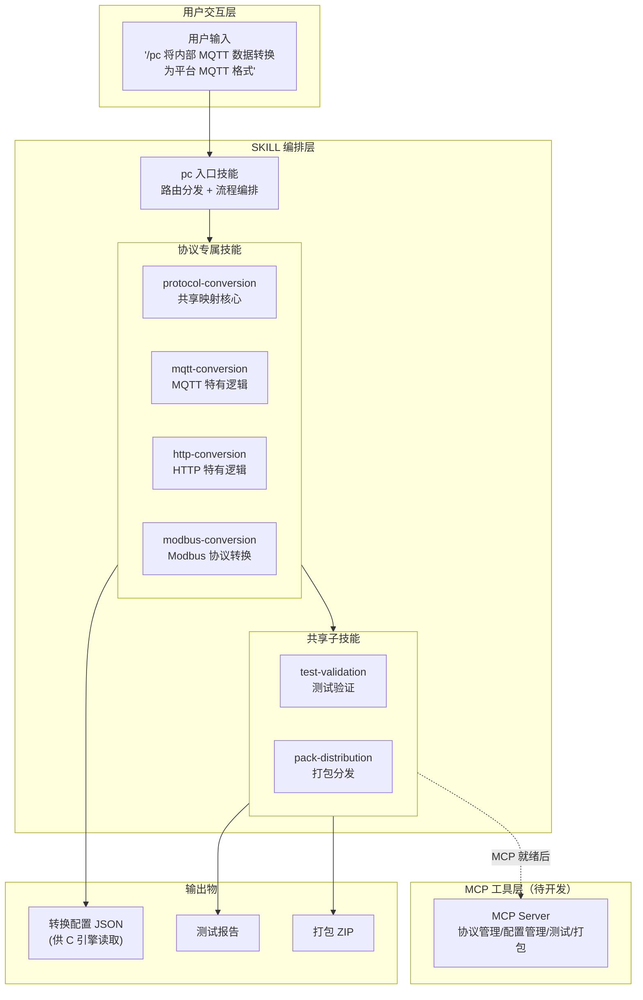
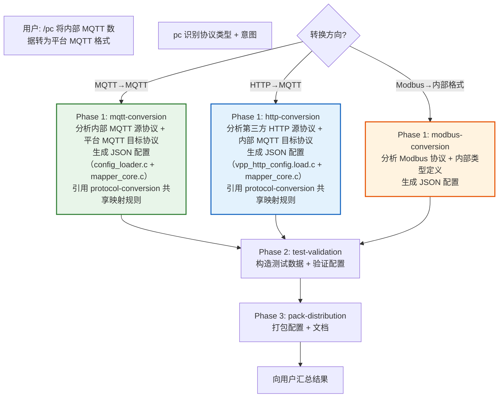
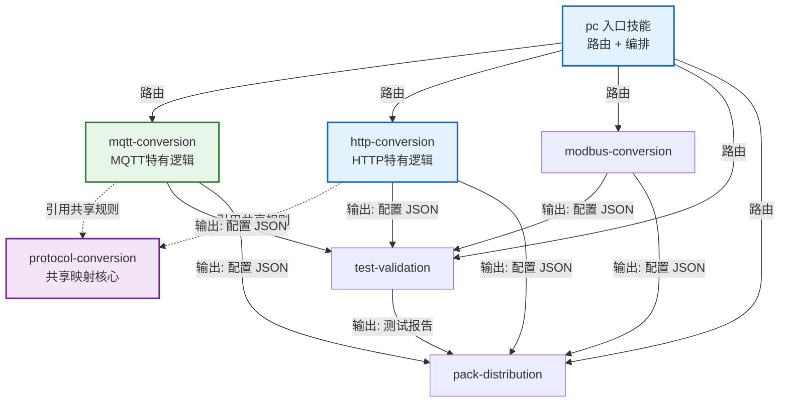
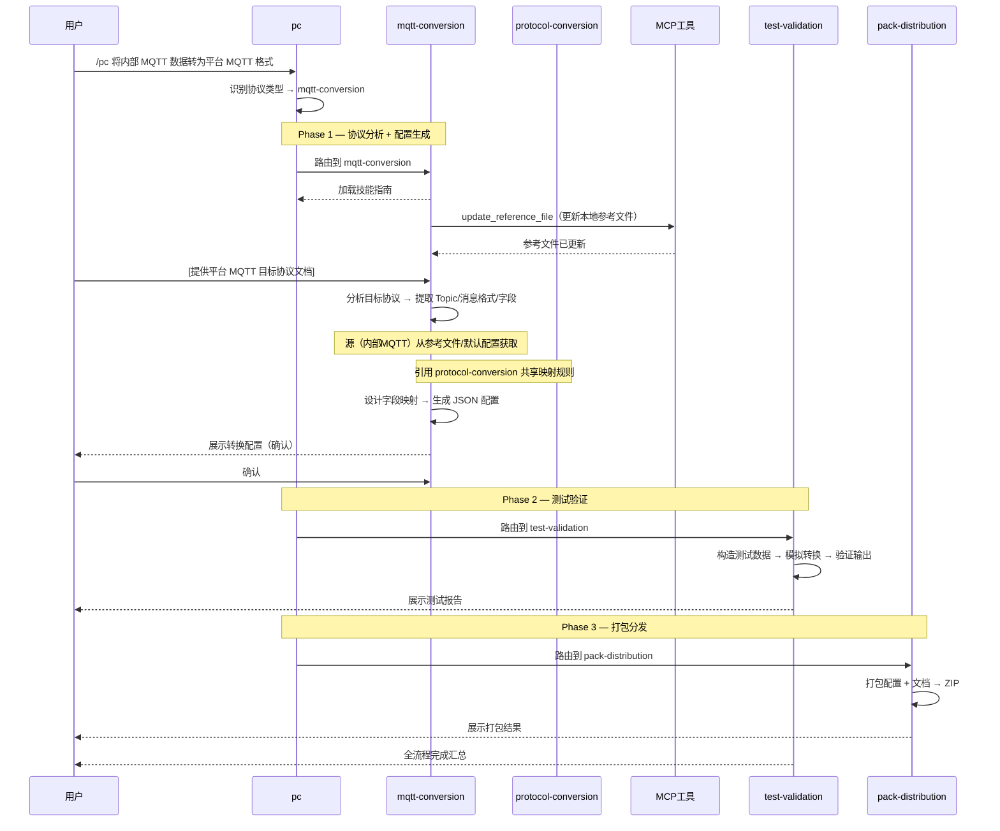
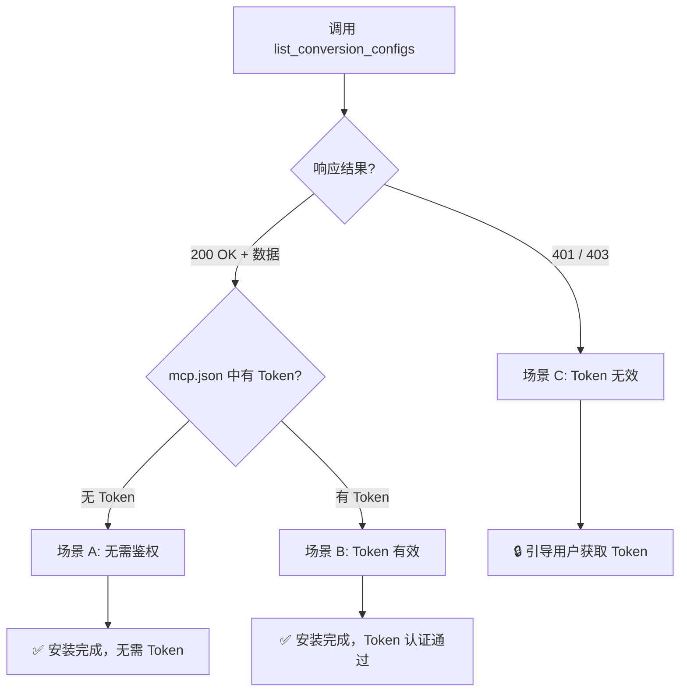
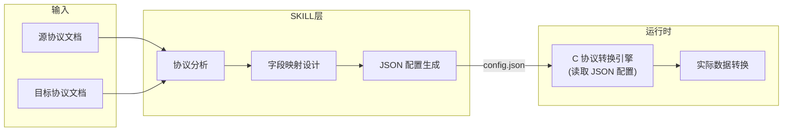

# 协议转换入口技能

> **目标：** 接收用户的协议转换需求，路由到对应的协议专属子技能，编排完整的转换流程。

## 适用场景

- 用户需要将内部 MQTT 数据转换为平台 MQTT 格式后上报（MQTT→MQTT）
- 用户需要采集第三方 HTTP 接口数据，转换为内部 JSON 格式后通过 MQTT 上报（HTTP→MQTT）
- 用户需要将 Modbus 寄存器数据读取并转换为内部统一格式（Modbus→内部格式）
- 用户提供了源协议文档 + 目标协议文档，需要生成转换配置
- 用户需要测试、打包已生成的协议转换配置

## 整体架构



## 意图路由表

| 用户意图关键词 | 路由到的子技能 | 说明 |
|---------------|--------------|------|
| MQTT、消息队列、broker、topic、publish/subscribe | `mqtt-conversion` | MQTT→MQTT 协议转换（引用 protocol-conversion 共享规则） |
| HTTP、REST、API、POST/GET、Webhook、接口 | `http-conversion` | HTTP→MQTT 协议转换（引用 protocol-conversion 共享规则） |
| Modbus、寄存器、register、RTU、TCP、功能码 | `modbus-conversion` | Modbus 协议转换 |
| 测试、验证、冒烟测试、检查结果 | `test-validation` | 测试转换配置 |
| 打包、分发、安装、导出、ZIP | `pack-distribution` | 打包分发 |
| 完整流程、端到端、从头到尾 | 全流程编排 | 触发完整 pipeline |

## 执行流程

### 全流程编排

当用户描述完整的转换需求时（如"将内部 MQTT 数据转为平台 MQTT 格式"），触发全流程：



### 单步执行

当用户只需要单个步骤时（如"分析这份 MQTT 协议文档"），直接路由到对应子技能：


## 子技能清单

| 子技能 | 职责 | 输入 | 输出 | 依赖 |
|--------|------|------|------|------|
| `protocol-conversion` | 共享映射核心（路径语法、类型系统、数组遍历、生成器等） | — | 映射规则定义 + mapper_core.c | 无 |
| `mqtt-conversion` | MQTT 特有逻辑（substitute/$idx/$item/嵌套[*]/post_process） | 源 MQTT 文档 + 目标 MQTT 文档 | 转换配置 JSON | protocol-conversion |
| `http-conversion` | HTTP 特有逻辑（context/key_value/"."源路径/preprocess/链式调用） | 源 HTTP 文档 + 目标 MQTT 文档 | 转换配置 JSON | protocol-conversion |
| `modbus-conversion` | Modbus 协议转换配置生成 | Modbus 协议文档 + 内部类型定义 | 转换配置 JSON | 无 |
| `test-validation` | 测试转换配置正确性 | 配置 JSON + 测试数据 | 测试报告 | 协议转换技能 |
| `pack-distribution` | 打包分发转换配置 | 配置 JSON + 测试报告 | ZIP 包 | test-validation |

## Skill 互调关系



### 数据流详解



## 安装验证

```
安装检查流程:
  1. 检查 .trae/skills/pc/SKILL.md 是否存在
  2. 验证子技能完整性：
     - protocol-conversion/SKILL.md（共享映射核心）
     - mqtt-conversion/SKILL.md（MQTT特有逻辑）
     - http-conversion/SKILL.md（HTTP特有逻辑）
     - modbus-conversion/SKILL.md
     - test-validation/SKILL.md
     - pack-distribution/SKILL.md
  3. 检查 protocol-conversion/defaults/internal_mqtt_protocol.json 是否存在
  4. （MCP 就绪后）探测 MCP 连接 → update_reference_file
  5. 根据响应判断鉴权状态（参考 HubPort 三场景模式）
```

### MCP 就绪后的鉴权探测

MCP 服务器开发完成后，安装验证流程：



> ⚠ 场景 C 下，未获取到有效 Token 前不得声称"安装完成"。

## 配置输出说明

所有协议转换技能的最终输出为 **JSON 配置文件**，该文件将被 C 协议转换引擎读取并执行。



> **C 引擎规则占位：** 当前 JSON 配置格式参考 `protocol-mapper-skill` 的输出规范。
> 待用户提供 C 转换引擎代码后，将根据引擎实际读取的配置字段优化各协议技能的输出格式。

## 约束规则

| 规则 | 说明 |
|------|------|
| 协议识别 | 根据用户描述和文档内容自动识别协议类型（MQTT/HTTP/Modbus） |
| 文档格式 | 源/目标协议文档支持 PDF/DOCX/URL/粘贴文本，非 Markdown 需先转换 |
| 配置格式 | 统一输出 JSON 配置文件，供 C 引擎读取 |
| 用户确认 | 协议分析和字段映射完成后必须经用户确认 |
| 全量提取 | 协议文档中的字段/接口/寄存器必须逐项提取，不得默认压缩 |
| MCP 兼容 | MCP 工具未就绪时，AI 直接输出 JSON，用户手动保存 |

## 后续扩展

当前支持 3 种协议，后续可通过新增协议专属技能扩展：

```
新增协议步骤:
  1. 创建 {protocol}-conversion/ 目录
  2. 编写 SKILL.md（参考现有协议技能结构）
  3. 在 pc 意图路由表添加新协议路由
  4. 创建 agents/openai.yaml
  5. （可选）在 MCP 工具中添加协议专属工具
```
