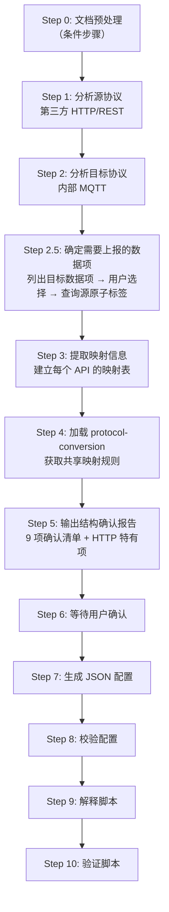

# HTTP 协议转换配置生成

> **目标：** 分析第三方 HTTP/REST 协议文档和内部 MQTT 目标协议文档，生成供 C 协议转换引擎（`vpp_http_config.load.c` + `mapper_core.c`）直接读取的 JSON 配置文件。

## 引擎架构

```
第三方 HTTP API ──→ vpp_http_config.load.c（加载配置）──→ mapper_core.c（执行映射）──→ 内部 MQTT JSON
```

- **配置加载引擎**：`vpp_http_config.load.c` — 读取 JSON 配置文件，解析 `base_url`/`token`/`apis` 结构
- **映射执行引擎**：`mapper_core.c` — 执行 `body_params` 和 `data_mappings` 中的字段映射
- **共享映射规则**：路径语法、类型系统、数组遍历准则等定义在 `protocol-conversion` skill 中

## 配置文件格式（vpp_http_config.load.c 读取）

### 根对象

| 字段         | 类型     | 必填  | 说明                                                 |
| ---------- | ------ | --- | -------------------------------------------------- |
| `base_url` | string | 是   | 基础 URL（含 API 路径前缀，如 `http://example.com:8080/api`） |
| `timeout`  | int    | 否   | 请求超时毫秒，默认 30000                                    |
| `domain`   | string | 否   | 从 base_url 提取主机名，IPv4 填 IP 否则空字符串                  |
| `token`    | object | 否   | Token 认证配置（无认证时省略）                                 |
| `apis`     | array  | 是   | API 接口配置列表                                         |

### Token 配置

| 字段             | 类型     | 必填  | 说明                                            |
| -------------- | ------ | --- | --------------------------------------------- |
| `login_path`   | string | 是   | 登录接口路径（相对 base_url）                           |
| `login_method` | string | 是   | POST/GET                                      |
| `content_type` | string | 是   | 请求内容类型                                        |
| `token_path`   | string | 是   | 响应中 Token 的 JSON 路径（如 `token` 或 `data.token`） |
| `token_header` | string | 是   | 后续请求携带 Token 的 Header 名称                      |
| `expires_in`   | int    | 是   | Token 有效期秒，默认 7200（抄表平台 604800）               |
| `login_params` | array  | 是   | 登录参数列表（字段定义同 body_params）                     |

### API 配置

| 字段                 | 类型     | 必填  | 说明                         |
| ------------------ | ------ | --- | -------------------------- |
| `name`             | string | 是   | API 唯一标识（用于 `next_api` 引用） |
| `method`           | string | 是   | GET/POST/PUT/DELETE        |
| `path`             | string | 是   | 接口路径（相对 base_url）          |
| `content_type`     | string | 否   | 默认 `application/json`      |
| `use_token`        | bool   | 否   | 默认 false                   |
| `interval`         | int    | 否   | 调用间隔数值                     |
| `interval_type`    | string | 否   | second/minute/hour/day     |
| `interval_offset`  | int    | 否   | 错峰偏移量，默认 0                 |
| `skip_on_interval` | bool   | 否   | 频率型调度默认 true               |
| `param_process`    | string | 否   | 参数预处理函数名，默认空字符串            |
| `after_process`    | string | 否   | 响应后处理函数名，默认空字符串            |
| `topic_pattern`    | string | 否   | MQTT Topic 模板，默认空字符串       |
| `next_api`         | string | 否   | 链式调用的下一个 API name，默认空字符串   |
| `body_params`      | array  | 是   | 请求参数配置                     |
| `data_mappings`    | array  | 是   | 响应数据映射配置                   |

### body_params / data_mappings 规则字段

`body_params` 和 `data_mappings` 中每条规则的完整字段定义（`target`/`source_type`/`source`/`type`/`constant`/`scale`/`preprocess`/`item_type`/`sub_mappings`）见 `protocol-conversion` skill 的「映射规则字段」章节。

HTTP 特有：

- `source_type` 支持 `context`（运行时上下文变量，HTTP 常用）
- 不使用 `substitute` 模板替换（MQTT 专用，HTTP 用 `context` 实现类似功能）
- `preprocess` 字段用于预处理（如 `url_to_base64`）
- `item_type` 支持 `key_value`（键值对列表模式）
- 模板变量替换已合并到 `source_type: "constant"` + `type: "substitute"`，HTTP 不使用此组合

## 工作流程（11 步，必须按序执行）



### Step 0: 文档预处理（条件步骤）

若源/目标协议文档为二进制格式（PDF/DOCX/DOC/RTF/ODT），先转换为 Markdown
（**转换结果与逐页抽取等中间文件一律写当前会话工作区，禁止写入技能目录**）：

| 源格式                       | 转换方式                                 |
| ------------------------- | ------------------------------------ |
| PDF                       | Python `pypdf` 库提取文本                 |
| DOCX/DOC/RTF/ODT          | `mcp_pandoc` 的 `convert-contents` 工具 |
| .json/.txt/.md/.yaml/.xml | 无需转换，跳过本步                            |

### Step 1: 分析源协议（第三方 HTTP/REST）

从源 HTTP 协议文档中提取：

1. **base_url**：从登录接口 URL 提取到 `api` 部分（如 `http://example.com:8080/api/login` → `http://example.com:8080/api`）
2. **domain**：从 base_url 提取主机名，IPv4 正则 `^([0-9]{1,3}\.){3}[0-9]{1,3}$` 匹配则填 IP，否则空字符串
3. **认证信息**：
   - `login_path`、`login_method`、`content_type`
   - `token_path`（响应中 Token 的 JSON 路径）
   - `token_header`（后续请求的 Header 名称）
   - `expires_in`（Token 有效期秒）
   - `login_params`（登录参数列表）
4. **API 列表**：每个 API 的 `name`/`method`/`path`/`content_type`/`use_token`/`interval`/`interval_type`
5. **请求参数**：`body_params`（名称/类型/来源）
6. **响应结构**：字段路径、数组层级、数据类型
7. **链式调用关系**：`next_api` 指向的下一个 API name

### Step 2: 分析目标协议（内部 MQTT）

从内部 MQTT 目标协议文档或默认配置中提取：

1. **目标 JSON 结构**：`businessObjList → dataObj → dataItemList → itemBody → item`
2. **目标字段路径**和数组层级
3. **常量字段**：如 `taskId=8220`、`udSign=1`、`cmdType=1`、`priority=0`
4. **上下文字段**：如 `startTime`/`endTime`（运行时动态传入）

> 若无用户提供文档，使用 `protocol-conversion` 的 `defaults/internal_mqtt_protocol.json` 默认配置。

### Step 2.5: 确定需要上报的数据项

从源协议（第三方 HTTP/REST）中提取所有可上报的数据项，让用户选择需要哪些，然后查询源原子标签建立映射候选。

#### 2.5.1 列出目标数据项

从 Step 2 分析的内部 MQTT 目标协议中，提取所有业务数据字段（排除 `taskId`/`udSign`/`cmdType`/`priority` 等框架字段），列出示例：

```markdown
## 目标协议可上报数据项

| 序号 | 目标字段 | 描述 | 类型 | 单位 |
|------|---------|------|------|------|
| 1 | tolCumulativeFlow | 累计流量 | string | m³ |
| 2 | cImageContent | 图片内容 | string | base64 |
| 3 | currentValue | 当前读数 | string | — |
| 4 | meterCode | 水表编号 | string | — |

请选择需要上报的数据项（可多选，如"1,2,3"或"全部"）。
```

#### 2.5.2 查询源原子标签

用户选择后，为每个选中的目标数据项查询对应的源原子标签。

**查询来源**（完全复用 Modbus 的做法）：

1. **MCP 就绪时**：调用 MCP 工具查询源数据原子标签
2. **MCP 未就绪时**：从本skill的 refrences/ 参考文件中查找

**文档选择规则**：

| 数据类型  | 使用文档            | 说明                         |
| ----- | --------------- | -------------------------- |
| 电力数据  | `数据采集通信协议.docx` | 电能数据使用**示值**，非电能数据使用**曲线** |
| 非电力数据 | `原子标签定义.docx`   | 通用原子标签查找                   |

**歧义处理**

当协议文档中同一数据项存在多种定义时，**必须列出对比表格，由用户确认选择后再进入后续步骤**

**匹配规则**（按优先级）：

从 `原子标签定义.docx` 或 `数据采集通信协议.docx` 查找中文名称对应的英文标签时：

1. **精确匹配**：中文名称完全对应（如「A相电压」→ `voltageA`）
2. **语义匹配**：中文名称不完全一致但含义相同（如「进水温度」→ `inputWaterTemp`），需告知用户匹配理由
3. **自定义命名**：找不到精确匹配和语义匹配时，使用用户之前审批过的自定义命名规则，并告知用户确认
4. **无匹配**：三步均未命中时，提示用户手动指定英文标签名

> 搜索时可以使用搜索工具按关键词查找，提高匹配效率。


**输出格式**：

```markdown
## 数据项映射候选

| 目标字段 | 目标描述 | 源原子标签/HTTP字段 | 源描述 | 匹配方式 | 确认状态 |
|---------|---------|-------------------|--------|---------|---------|
| commObj.commAddr | 通信地址 | deviceId | 设备ID | HTTP字段映射 | ✅ 自动 |
| tolCumulativeFlow | 累计流量 | value | 抄表值 | 语义匹配 | ⚠️ 需确认 |
| cImageContent | 图片内容 | picUrl | 拍照URL | HTTP字段映射 | ✅ 自动 |
| currentValue | 当前读数 | currentValue | 当前值 | 精确匹配 | ✅ 自动 |
```

**需用户确认的情况**：

- 匹配方式为「语义匹配」且存在歧义
- 无匹配结果，需用户手动指定 HTTP 响应字段路径
- 一个目标字段有多个候选源字段

> 用户确认后，已确认的映射关系将带入 Step 3 生成完整映射表。

### Step 3: 提取映射信息

为每个 API 建立映射表：

**body_params 映射表（请求参数）：**

| 目标字段        | source_type | source/constant | type   | 说明     |
| ----------- | ----------- | --------------- | ------ | ------ |
| `startTime` | context     | startTime       | string | 运行时上下文 |
| `endTime`   | context     | endTime         | string | 运行时上下文 |

**data_mappings 映射表（响应映射）：**

| 目标字段               | source_type   | source/constant | type   | preprocess | 说明     |
| ------------------ | ------------- | --------------- | ------ | ---------- | ------ |
| `taskId`           | constant      | 8220            | int    | —          | 固定值    |
| `commObj.commAddr` | path          | deviceId        | string | —          | 设备 ID  |
| `itemBody.@`       | array_foreach | data[*]         | object | —          | 遍历响应数组 |

同时标注：

- **数组遍历策略**：哪些用 `@` + `array_foreach`，哪些用 `[0]` 固定索引
- **preprocess 函数**：如 `url_to_base64`
- **链式调用顺序**：API 之间的 `next_api` 关系
- **int 常量修正**：`type=="int"` 且 `constant` 为字符串数字时需自动转为数字

### Step 4: 加载 protocol-conversion 获取映射规则

加载 `protocol-conversion` skill，按其定义的规则设计映射：

1. **路径语法**：按 `protocol-conversion` 第 3 节的路径语法设计 `target` 和 `source`
2. **类型系统**：按第 4 节的类型系统确定 `type` 字段
3. **数组遍历准则**：按第 6 节的准则判断遍历 vs 固定索引
4. **生成器**：按第 8 节选择合适的 `generator`（HTTP 使用 `timestamp_sec`/`timestamp_ms`/`datetime_str`）
5. **context 上下文**：使用 `source_type: "context"` 引用运行时变量
6. **key_value 模式**：`item_type: "key_value"` 用于键值对列表场景
7. **preprocess**：按第 11 节使用预处理函数
8. **结构确认报告**：引用第 14 节的 8 项确认清单模板

### Step 5: 输出结构确认报告

引用 `protocol-conversion` 的 8 项确认清单模板，补充 HTTP 特有项后输出：

```markdown
## 结构确认报告

### 1. 源 HTTP 协议概览
- base_url: http://cloud.linktheall.cn/meter2/api
- domain: ""（非 IPv4）
- 认证方式: Token（login_path: /user/login, expires_in: 604800）

### 2. API 列表
| name | method | path | use_token | next_api |
|------|--------|------|-----------|----------|
| get_history_records | POST | /record/history | true | — |

### 3. 链式调用关系
- get_customer_list → query_record（若有多 API 链式调用）

### 4. 目标协议结构
- 目标根路径: businessObjList[0].dataObj.dataItemList[0].itemBody
- 数组层级: itemBody（Array）

### 5. body_params 映射表（每个 API）
| API | 目标字段 | source_type | source | type |
|-----|---------|-------------|--------|------|
| get_history_records | startTime | context | startTime | string |
| get_history_records | endTime | context | endTime | string |

### 6. data_mappings 映射表（每个 API）
| API | 目标字段 | source_type | source | type | preprocess |
|-----|---------|-------------|--------|------|-----------|
| get_history_records | taskId | constant | 8220 | int | — |
| get_history_records | commObj.commAddr | path | deviceId | string | — |
| get_history_records | itemBody.@ | array_foreach | data[*] | object | — |

### 7. preprocess 函数清单
- url_to_base64 — photo 字段转 base64

### 8. 数据项确认
- 目标数据项选择: ✅ 已确认（Step 2.5）
- 源原子标签映射: ✅ 已确认
- 无匹配/歧义项: 无 / [列出待确认项]

### 9. 引擎对齐确认
- 配置加载引擎: vpp_http_config.load.c ✅
- 映射执行引擎: mapper_core.c ✅
- 配置格式: base_url + token + apis[] ✅

---
**请确认以上结构是否正确。确认后将生成完整的映射脚本。**
```

### Step 6: 等待用户确认

**必须等待用户明确回复**（如"确认"、"正确"、"可以生成"等），才能继续生成脚本。

### Step 7: 生成 JSON 配置

用户确认后，应用 HTTP 核心规则并组装完整 JSON：

1. **应用 HTTP 核心规则**（见下方「HTTP 核心规则」章节）
2. **根对象**：`base_url` + `timeout` + `domain` + `token{}`（如有认证）+ `apis[]`
3. **每个 API**：组装 `body_params` + `data_mappings`
4. **保存文件**：输出到 `scripts/protocol_mapping_output_YYYYMMDD_HHMMSS.json`

> MCP 就绪时调用 `generate_http_config` 生成 → `validate_config_rules` 校验 → `save_conversion_config` 保存。
> MCP 未就绪时，AI 直接生成 JSON 并输出。

### Step 8: 校验配置

生成后执行校验：

| 校验项               | 方法               | 通过标准                                                |
| ----------------- | ---------------- | --------------------------------------------------- |
| array_foreach 完整性 | 检查每个 `@`         | 每个含 `@` 的 target 都有对应的 `array_foreach`              |
| sub_mappings 非空   | 检查 array_foreach | 每个 `array_foreach` 的 `sub_mappings` 非空              |
| item_type 指定      | 检查 array_foreach | 每个 `array_foreach` 都有 `item_type`                   |
| 冗余映射检测            | 检查父/子层           | 同一目标字段不在父/子层重复映射                                    |
| int 常量修正          | 检查 int 类型        | `type=="int"` 且 `constant` 为字符串数字时已转为数字             |
| url_to_base64     | 检查字段名            | 含 photo/image/url 的字段已加 `preprocess: url_to_base64` |
| domain 提取         | 检查 domain 值      | IPv4 填 IP，否则空字符串                                    |

> 校验失败项需修复后重新生成。

### Step 9: 解释脚本

向用户解释：

1. **每个 API 的配置**：接口路径、请求方法、认证方式
2. **字段映射规则**：源字段如何转换到目标字段
3. **数组遍历**：哪些层级使用了 `@` 遍历，`item_type` 是 `object` 还是 `key_value`
4. **链式调用**：API 之间的调用顺序和参数传递
5. **Token 管理机制**：登录接口、Token 路径、有效期、Header 名称
6. **preprocess 函数**：如 `url_to_base64` 的用途
7. **占位符**：如 `${USERNAME}`/`${PASSWORD}` 需在部署环境替换
   
   

### Step10：验证脚本

### 构造测试数据

1. 基于 Step 2.5 确认的原子标签清单，构造源 JSON 和期望目标 JSON。

2. 为每个原子标签构造测试值，组装完整的源协议数据结构。

3. 根据映射规则手动推导正确的转换结果，作为比对基准。

### 选择执行引擎

    按优先级选择，需告知用户当前使用的引擎，优先使用Python 镜像，其次完全 AI 模拟。

### 执行转换

    将配置文件和源 JSON 喂给引擎，捕获输出

#### 比对结果表

| 序号  | 目标字段                     | 期望值              | 实际值              | 类型  | 值   | 结构  | 结果   |
| --- | ------------------------ | ---------------- | ---------------- | --- | --- | --- | ---- |
| 1   | action                   | "devData"        | "devData"        | ✅   | ✅   | ✅   | PASS |
| 2   | msgId                    | uuid格式           | "a1b2-..."       | —   | ✅格式 | ✅   | PASS |
| 3   | data.terdata[0].Ua       | 220.1            | 220.1            | ✅   | ✅   | ✅   | PASS |
| 4   | data.terdata[0].dataTime | "20260826100000" | "20260826100000" | ✅   | ✅   | ✅   | PASS |
| 5   | data.terdata[1].Ua       | 0                | 0                | ✅   | ✅   | ✅   | PASS |
| 6   | data.terdata[1].dataTime | null             | (缺失)             | —   | —   | ❌   | FAIL |

#### 转化结论

    生成测试结论报告。


## HTTP 核心规则

| 序号  | 规则                    | 说明                                                                  |
| --- | --------------------- | ------------------------------------------------------------------- |
| 1   | base_url 提取           | 从文档登录接口 URL 提取到 `api` 部分                                            |
| 2   | domain 提取             | 从 base_url 提取主机名，IPv4 填 IP，否则空字符串                                   |
| 3   | timeout 默认            | 默认 30000ms；meter2 类接口默认 3000                                        |
| 4   | token.expires_in 默认   | 默认 7200；抄表平台 604800                                                 |
| 5   | array_foreach 强制规则    | target 含 `@` 且源为数组时必须使用，需非空 `sub_mappings` + `item_type`            |
| 6   | 固定索引与数组混合             | 单数对象 `[0]`，复数数组 `@` + `array_foreach`；多层嵌套每层独立                      |
| 7   | int 常量自动修正            | `type=="int"` 且 `constant` 为字符串数字时自动转为数字                            |
| 8   | 扩展字段默认值               | `param_process`/`after_process`/`topic_pattern`/`next_api` 未指明时空字符串 |
| 9   | commObj.commAddr 优先映射 | 自动将 `commObj.commAddr` 优先映射到 `deviceId`                             |
| 10  | url_to_base64         | 字段名含 `photo`/`image`/`url` 时默认加入 `preprocess: url_to_base64`        |
| 11  | 冗余映射检测                | 检测同一目标字段在父/子层重复映射并输出警告                                              |
| 12  | 链式调用                  | `next_api` 指向下一个 API name；Token 不属于链式调用范畴                           |

### 链式调用规则

| 场景              | next_api 配置          |
| --------------- | -------------------- |
| 存在多个 API 需要依次调用 | 填写下一个 API 的 `name` 值 |
| 仅有一个业务 API      | 默认空字符串 `""`          |

> Token 获取由独立的 `token` 对象管理，不属于 `apis` 链式调用范畴。

## MCP 工具调用

| 工具                       | 用途           | 调用时机     | MCP 未就绪替代方案                               |
| ------------------------ | ------------ | -------- | ----------------------------------------- |
| `update_reference_file`  | 更新本地参考文件     | Step 2 前 | 使用 `defaults/internal_mqtt_protocol.json` |
| `analyze_http_protocol`  | 解析 HTTP 协议文档 | Step 1   | AI 直接分析文档                                 |
| `generate_http_config`   | 生成 JSON 配置   | Step 7   | AI 直接生成                                   |
| `validate_config_rules`  | 校验配置规则       | Step 8   | AI 人工检查                                   |
| `save_conversion_config` | 保存到 scripts/ | Step 7 后 | AI 输出 JSON，用户手动保存                         |

## 真实协议示例

### 源协议：抄表终端平台接口说明 v1.5.2（HTTP REST）

- 获取 Token：POST `http://cloud.linktheall.cn/meter2/api/user/login`
  - 参数：username/password
  - Content-Type：application/x-www-form-urlencoded
  - token 有效期 7 天
- 获取抄表记录：POST `http://cloud.linktheall.cn/meter2/api/record/history`
  - 需 token header，Content-Type：application/json
  - 请求参数：startTime, endTime（间隔 ≤ 24 小时）
  - 返回：code/msg/data 数组，data 元素含 id/deviceId/deviceName/value/voltage/state/checkResult/checkStatus/createTime/photo 等

### 目标协议：内部 MQTT 上报格式（businessObjList 结构）

```json
{
  "taskId": 8220, "udSign": 1, "cmdType": 1, "priority": 0,
  "commObj": { "commAddr": "deviceId 值" },
  "businessObjList": [{
    "dataObj": {
      "timeType": 4, "collCycle": 1440,
      "dataItemList": [{
        "itemId": "31800003", "itemName": "感知数据",
        "itemBody": [{
          "roadNo": 1, "taskFlag": 1, "dataTime": "createTime 值",
          "item": [{ "tolCumulativeFlow": "value 值", "cImageContent": "photo 转 base64" }]
        }]
      }]
    }
  }]
}
```

### 生成的 JSON 配置

```json
{
  "base_url": "http://cloud.linktheall.cn/meter2/api",
  "timeout": 30000,
  "domain": "",
  "token": {
    "login_path": "/user/login",
    "login_method": "POST",
    "content_type": "application/x-www-form-urlencoded",
    "token_path": "token",
    "token_header": "token",
    "expires_in": 604800,
    "login_params": [
      { "target": "username", "source_type": "constant", "constant": "${USERNAME}", "type": "string" },
      { "target": "password", "source_type": "constant", "constant": "${PASSWORD}", "type": "string" }
    ]
  },
  "apis": [{
    "name": "get_history_records",
    "method": "POST", "path": "/record/history",
    "content_type": "application/json", "use_token": true,
    "interval": 8, "interval_type": "hour",
    "param_process": "", "after_process": "", "topic_pattern": "", "next_api": "",
    "body_params": [
      { "target": "startTime", "source_type": "context", "source": "startTime", "type": "string" },
      { "target": "endTime", "source_type": "context", "source": "endTime", "type": "string" }
    ],
    "data_mappings": [
      { "target": "taskId", "source_type": "constant", "constant": 8220, "type": "int" },
      { "target": "commObj.commAddr", "source_type": "path", "source": "deviceId", "type": "string" },
      { "target": "businessObjList[0].dataObj.timeType", "source_type": "constant", "constant": 4, "type": "int" },
      {
        "target": "businessObjList[0].dataObj.dataItemList[0].itemBody.@",
        "source": "data[*]",
        "source_type": "array_foreach",
        "item_type": "object",
        "sub_mappings": [
          { "target": "roadNo", "source_type": "constant", "constant": 1, "type": "int" },
          { "target": "dataTime", "source_type": "path", "source": "createTime", "type": "string" },
          {
            "target": "item.@",
            "source": ".",
            "source_type": "array_foreach",
            "item_type": "key_value",
            "sub_mappings": [
              { "target": "tolCumulativeFlow", "source_type": "path", "source": "value", "type": "string" },
              { "target": "cImageContent", "source_type": "path", "source": "photo", "preprocess": "url_to_base64", "type": "string" }
            ]
          }
        ]
      }
    ]
  }]
}
```

### 链式调用示例（两个 API 依次执行）

```json
{
  "apis": [
    {
      "name": "get_customer_list",
      "method": "GET", "path": "/customer",
      "next_api": "query_record",
      "body_params": [
        { "target": "pageNo", "source_type": "context", "source": "pageNo", "type": "int" },
        { "target": "pageSize", "source_type": "context", "source": "pageSize", "type": "int" }
      ],
      "data_mappings": []
    },
    {
      "name": "query_record",
      "method": "GET", "path": "/record",
      "next_api": "",
      "body_params": [
        { "target": "meterCode", "source_type": "context", "source": "meterCode", "type": "string" }
      ],
      "data_mappings": [
        { "target": "commObj.commAddr", "source_type": "path", "source": "data.list[0].meterCode", "type": "string" }
      ]
    }
  ]
}
```

## 约束规则

| 规则               | 说明                                                                                   |
| ---------------- | ------------------------------------------------------------------------------------ |
| 配置格式             | 根对象为 `base_url`/`timeout`/`domain`/`token`/`apis`，禁止 MQTT 格式（platform_name/mappings） |
| 引擎对齐             | 配置格式对齐 `vpp_http_config.load.c` + `mapper_core.c`                                    |
| 共享规则             | 映射规则字段定义在 `protocol-conversion`，本 skill 不重复定义                                        |
| base_url         | 从文档登录接口 URL 提取到 `api` 部分                                                             |
| domain           | 从 base_url 提取主机名，IPv4 填 IP 否则空字符串                                                    |
| timeout          | 默认 30000ms，meter2 类接口默认 3000                                                         |
| token.expires_in | 未说明时默认 7200，抄表平台 604800                                                              |
| 占位符              | 连接参数使用 `${VAR_NAME}` 占位                                                              |
| array_foreach    | target 含 `@` 且源为数组时必须使用，`sub_mappings` 非空 + `item_type` 指定                           |
| int 常量           | `type=="int"` 且 `constant` 为字符串数字时自动转数字                                              |
| 扩展字段             | `param_process`/`after_process`/`topic_pattern`/`next_api` 优先用文档值，未指明时空字符串           |
| url_to_base64    | 字段名含 `photo`/`image`/`url` 时默认加入 `preprocess`                                        |
| 用户确认             | 字段映射设计完成后必须经用户确认                                                                     |
| 全量提取             | 协议文档中的字段/接口必须逐项提取，不得默认压缩                                                             |
| 输出命名             | `protocol_mapping_output_YYYYMMDD_HHMMSS.json`                                       |
| 输出目录             | `scripts/` 目录                                                                        |

## 部署说明

- 所有占位符（如 `${USERNAME}`、`${PASSWORD}`、`${deviceId}`）需在部署环境替换
- 预处理功能（`url_to_base64` 等）需由目标 C 引擎支持
- `timeout`/`domain` 由 `vpp_http_config.load.c` 读取，`body_params`/`data_mappings` 由 `mapper_core.c` 执行

---

**文档版本**：1.1.0
**基于引擎**：vpp_http_config.load.c + mapper_core.c
**共享规则**：见 protocol-conversion skill
