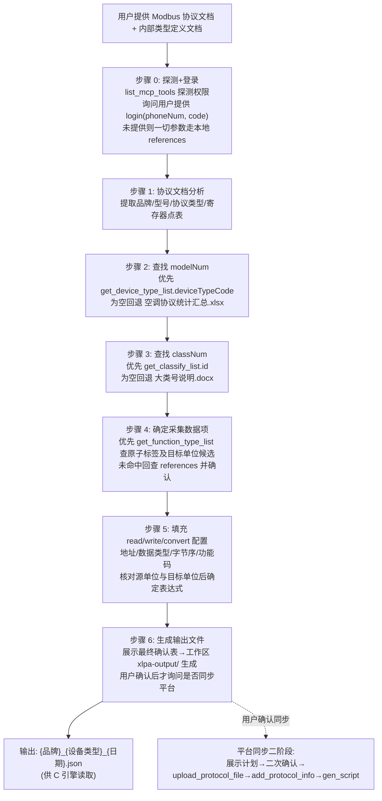

# Modbus 协议转换配置生成

> **目标：** 分析第三方 Modbus 协议文档和内部类型定义文档，生成供 C 协议转换引擎读取的 JSON 配置文件，实现 Modbus 寄存器数据到内部统一格式的转换。

## 适用场景

- 从第三方设备的 Modbus 寄存器读取数据并转换为内部统一格式
- 将 Modbus RTU 串口设备数据采集到平台
- 将 Modbus TCP 设备数据采集到平台
- 工业仪表/传感器/PLC/电表/温控仪的 Modbus 寄存器数据对接

## 目录结构

```
modbus-conversion/
├── agents/          
│   ├── openai.yaml       # skill配置信息
├── references/          # 参考文档（脚本参数来源）
│   ├── 空调协议统计汇总.xlsx        # modelNum 型号编码查找表
│   ├── 多类型设备集成系统大类号说明.docx  # classNum 大类号定义
│   ├── 原子标签定义.docx            # labels 中英文映射
│   └── 地址公式说明.png            # addr_exprs 地址公式规则
└── （技能目录只读：不得在本目录创建任何产物或临时目录，产物落位见下方约束）
```

> **目录只读与产物落位约束**：技能目录是多会话共享的只读分发母本，
> 禁止向本目录写入任何文件。PDF 逐页文本、页面图、临时 Markdown 等
> 一切**中间产物**写入 `<会话工作区>/xlpa-tmp/`；转换配置 JSON 等
> **最终产物**写入 `<会话工作区>/xlpa-output/`（用户显式指定目录时从其指定）。
> 写入技能目录会污染其他会话并使资源包升版失效。

## C 引擎实际读取的配置格式

### 根对象字段

| 字段          | 类型     | 必填  | 说明                                   |
| ----------- | ------ | --- | ------------------------------------ |
| `prtlType`  | string | 是   | 协议类型，如 `"MODBUS-RTU"`、`"MODBUS-TCP"` |
| `modelNum`  | int    | 是   | 型号编码（从 空调协议统计汇总.xlsx 查找）             |
| `classNum`  | int    | 是   | 大类号（从 多类型设备集成系统大类号说明.docx 查找）        |
| `taskList`  | array  | 是   | 任务列表，控制采集顺序                          |
| `labelList` | array  | 是   | 标签定义列表                               |

### taskList 结构

```json
{
  "taskList": [
    {
      "labels": ["PT", "CT", "DPT", "DCT", "voltageA", "voltageB"]
    }
  ]
}
```

`labels` 数组中的顺序决定采集顺序。被引用的辅助参数（如 DPT/DCT/DPQ/PT/CT/PQ）必须排在引用它们的标签之前。

### labelList 结构

```json
{
  "labelList": [
    {
      "name": "voltageA",
      "read": {
        "addr_base": 37,
        "data_type": "[UINT16]",
        "data_order": "AB",
        "addr_exprs": "",
        "data_exprs": "$D*pow(10,($'DPT'-4))",
        "func_code": 3
      },
      "write": {
        "addr_base": 100,
        "data_type": "[UINT16]",
        "data_order": "AB",
        "addr_exprs": "",
        "data_exprs": "",
        "func_code": 6
      },
      "convert": [
        {"name": "正常", "org": 0, "reg": 1},
        {"name": "故障", "org": 1, "reg": 2}
      ]
    }
  ]
}
```

- `read`：读操作配置（必填）
- `write`：写操作配置（可选，结构同 read）
- `convert`：枚举映射（可选）

read/write 对象字段：

| 字段           | 类型     | 必填  | 说明                           |
| ------------ | ------ | --- | ---------------------------- |
| `addr_base`  | int    | 是   | 寄存器基础地址                      |
| `data_type`  | string | 是   | 数据类型语法                       |
| `data_order` | string | 是   | 字节序                          |
| `addr_exprs` | string | 是   | 地址表达式（多路设备偏移），无则空字符串         |
| `data_exprs` | string | 是   | 数据表达式，无则空字符串                 |
| `func_code`  | int    | 是   | Modbus 功能码（读=3/4，写单=6，写多=16） |

## 处理流程



### 步骤 1：协议文档分析

从 Modbus 协议 PDF/DOCX 中提取：

- **品牌名称**：设备制造商
- **设备型号**：具体型号名称
- **协议类型**：通常为 MODBUS-RTU
- **数据项列表**：每个数据项的中文名称
- **功能码**：每个数据项对应的功能码（03=读保持寄存器，06=写单个寄存器，16=写多个寄存器等）
- **寄存器地址**：每个数据项的寄存器地址
- **数据类型**：UINT16、SINT16、UINT32、SINT32、FLOAT、UBCD16、SBCD16 或具体位范围；BITS 需查明实际起止位
- **数据转换规则**：查找文档中对数据进行处理的规则，如转换为枚举值、进行数学运算（如除法、减法等）等
- **字节序**：两字节 AB/BA；四字节 ABCD/DCBA/BADC/CDAB，记录协议依据，不设默认值
- **单位与精度**：源单位、每计数精度、原公式及其输出单位；目标单位在原子标签匹配时另行核对
- **数据转换辅助参数**：协议文档中公式依赖的其他寄存器参数（如 DPT/DCT/DPQ 小数点位数、PQ 符号位、PT/CT 变比等），**这些参数必须作为独立标签采集**，供 data_exprs 跨寄存器引用。辅助参数的标签名即为 data_exprs 中 `$'label_name'` 引用的名字

若协议文档为 PDF/DOCX 等二进制格式，必须先转换为 Markdown 再分析：

- PDF：Python pypdf 库提取文本
- DOCX/DOC：pandoc convert-contents 工具
- 图片：使用 OCR 或直接分析
- 已是 .md/.txt/.json：无需转换

### 步骤 2：查找 modelNum

**优先 MCP 查询**（已登录时）：

1. 调用 `get_device_type_list(deviceTypeName=<设备型号名称>)`
2. 命中 → 返回行的 `deviceTypeCode` 字段即为 `modelNum`，来源标记 `MCP:get_device_type_list.rows[i].deviceTypeCode`
3. 返回为空（`error=false, empty=true`）→ 回退本地查找或询问用户（见下）
4. 返回失败（`error=true`）→ 向用户展示错误原文，**不得**当作"不存在"，**不得**进入新增流程；由用户决定重试或改用本地参数

**本地兜底**（未登录或 MCP 查询为空）：

1. 打开 `references/空调协议统计汇总.xlsx`
2. 在 **SheetJS1**（型号列表）中，根据协议文档中的**品牌名称**和**设备型号**查找对应行
3. 该行的 **C列（型号编码）** 即为 `modelNum`，来源标记 `references:空调协议统计汇总.xlsx(SheetJS1.C列)`
4. 如果找不到精确匹配，用相似型号匹配，并告知用户确认
5. 仍无法确定时，询问用户提供 modelNum（来源标记 `user`）

SheetJS1 结构：
| A列：型号名称 | B列：所属品牌 | C列：型号编码 | D列：设备类型 |

### 步骤 3：查找 classNum

**优先 MCP 查询**（已登录时）：

1. 调用 `get_classify_list(sysName=<大类名称>)`
2. 命中 → 返回行的 `id` 字段即大类编号 `classNum`，来源标记 `MCP:get_classify_list.rows[i].id`
3. 为空/失败的处理规则同步骤 2：为空回退本地，失败展示错误不当作不存在

**本地兜底**（未登录或 MCP 查询为空）：

1. 打开 `references/多类型设备集成系统大类号说明.docx`
2. 根据协议文档中的设备类型或业务类型，查找对应的 `classNum`，来源标记 `references:多类型设备集成系统大类号说明.docx`
3. 如果文档中无法直接确定，根据设备类型推断并告知用户确认

| 设备类型     | classNum | 设备类型       | classNum |
| -------- | -------- | ---------- | -------- |
| 水冷机组     | 1        | 单相智能插座     | 12       |
| 水泵       | 2        | 三相智能控制器    | 13       |
| 开关阀门     | 3        | 分体空调智能通信网关 | 14       |
| 空调面板末端   | 4        | 风冷热泵       | 15       |
| 热泵       | 5        | 开关量        | 16       |
| 多联机空调控制器 | 6        | 冷却塔        | 17       |
| 冷热量表     | 7        | 能源采集表      | 21       |
| 新风机      | 8        | 调节阀门       | 23       |
| 环境传感器    | 9        | 温控仪        | 24       |
| 智能通信单元   | 10       | 充电桩        | 25       |
| 电表       | 11       | 补水系统       | 29       |

### 步骤 4：确定采集数据项

#### 4.1 数据项歧义确认（前置必做）

当协议文档中同一数据项存在以下歧义时，**必须列出对比表格，由用户确认选择后再进入后续步骤**：

**歧义场景 1：同一数据项存在多种定义**

| 数据项  | 定义 A     | 定义 B      | 需确认内容            |
| ---- | -------- | --------- | ---------------- |
| 有功功率 | 绝对值（无符号） | 带符号值（含正负） | 是否存在符号位寄存器（如 PQ） |

**歧义场景 2：同一数据项存在多种计算方式**

| 数据项 | 方式 A           | 方式 B                       | 需确认内容          |
| --- | -------------- | -------------------------- | -------------- |
| 电能  | 二次侧值 `$D/1000` | 一次侧值 `$D/1000*$'PT'*$'CT'` | 是否需要乘 PT/CT 变比 |

**歧义场景 3：同一数据项存在多个寄存器地址**

| 数据项 | 地址 A         | 地址 B         | 需确认内容     |
| --- | ------------ | ------------ | --------- |
| 电压  | 0x0FFF（一次侧值） | 0x1003（二次侧值） | 取一次侧还是二次侧 |

> 用户未确认前，不得擅自选择其中一种。

#### 4.2 用户选择采集数据项

先推荐常采集的数据项组合，再询问用户需要采集哪些数据项（中文名称），来源于步骤 1 读取到的协议支持的数据项列表，区分**读**和**写**操作。

#### 4.3 查询原子标签（平台功能项候选）

原子标签查询统一使用 `get_function_type_list`，不依赖 `protocolId`，不以前置规约查询作为门槛：

1. 已登录时调用 `get_function_type_list(functionTypeName="", functionCode="", pageIndex=1, pageSize=9999)`；可按名称或编码筛选。使用既有工具签名，不传 `protocolId`、`protoType` 或显式 `token` 参数。
2. 同一批点位复用已查询的候选，按精确、归一、同义词或模糊匹配展示置信度；根据实际分页信息按需翻页，记录查询条件、页码和行号，不把单页未命中当作不存在。
3. **命中**（`error=false, empty=false`）→ 将 `functionName`、`functionCode` 等作为匹配候选，与内部标签定义核对后交用户确认；来源如 `MCP:get_function_type_list.rows[i].functionCode`。
4. 功能项响应中的 `unit` 仅作为目标单位候选，来源如 `MCP:get_function_type_list.rows[i].unit`。字段缺失、为空或与内部类型定义冲突时，回查适用参考资料并交用户确认，不编造接口字段或单位。
5. **查询失败**（`error=true`）→ 展示错误原文，**不得**当作不存在或进入新增流程；用户知情后可改用本地参考资料。
6. **完成必要分页及匹配仍未命中，或未登录** → 从参考文档查找中文名称对应的英文标签及目标单位，并标注本地候选：

`functionCode` 是平台功能项编码，不是 MODBUS `func_code`；平台 `dataType` 是业务数据类型，不能直接作为寄存器 `data_type`。`functionId` 是功能项 ID，不是规约数据项 ID，不能混用于规约数据项管理。

**文档选择规则**：

| 数据类型  | 使用文档            | 说明                         |
| ----- | --------------- | -------------------------- |
| 电力数据  | `数据采集通信协议.docx` | 电能数据使用**示值**，非电能数据使用**曲线** |
| 非电力数据 | `原子标签定义.docx`   | 通用原子标签查找                   |

**缺失原子标签与规约数据项管理边界**：

1. 功能项和本地资料均未命中时，请用户补充标签定义及单位语义，标注来源并确认；不得编造标签，查询失败不得触发新增。
2. 本流程不新增平台功能项写入路径。缺失功能项只记录待处理需求，不能用 `add_data_item` 代替功能项新增。
3. `get_data_item_list` 保留规约数据项管理用途；仅在用户明确要求管理规约数据项时使用，所需 `protocolId` 与数据项 ID 必须来自对应规约查询，不得使用 `functionId` 替代。
4. 既有 `add_data_item` 仅用于规约数据项基础信息：云端写权限可用、用户确认基础信息及规约关联、同意新增后才执行；不写寄存器地址、功能码、数据类型、字节序、表达式或枚举映射。
5. 云端写权限不可用时跳过新增分支；写入保护仍按本 Skill 的既有规则执行，不因更换查询入口而改变权限或自动写入。

常用原子标签速查表（完整定义见 `原子标签定义.docx`）：

| 中文名称    | 英文标签          | 中文名称    | 英文标签            |
| ------- | ------------- | ------- | --------------- |
| 当前运行状态  | cRunState     | 环境温度    | envTemp         |
| 当前运行模式  | cRunMode      | 水箱温度    | waterTankTemp   |
| 当前空调模式  | cWorkMode     | 冷冻水进水温度 | inputWaterTemp  |
| 主机开关机状态 | hostRunState  | 冷冻水出水温度 | outputWaterTemp |
| 主机工作模式  | hostWorkMode  | 电网频率    | gridFrequency   |
| 水泵运行状态  | pumpRunState  | A相电压    | voltageA        |
| 阀门状态    | valveState    | B相电压    | voltageB        |
| 阀门开度    | valveOpening  | C相电压    | voltageC        |
| 水泵频率    | pumpFrequency | A相电流    | currentA        |
| 故障状态    | pumpErrState  | 总有功功率   | activePowT      |
| 当前在线状态  | online        | 总功率因数   | powFactorsT     |

#### 4.4 汇总展示

将步骤 1 采集到的信息和候选英文标签以表格展示；每点附单位核对记录（见核心规则 3.1），确认后才能生成：

| 中文名称 | 英文标签     | 寄存器地址 | 功能码 | 数据类型     | 字节序 | 转换规则                    | 读/写 |
| ---- | -------- | ----- | --- | -------- | --- | ----------------------- | --- |
| A相电压 | voltageA | 37    | 03  | [UINT16] | AB  | `$D*pow(10,($'DPT'-4))` | 读   |
| A相电流 | currentA | 43    | 03  | [UINT16] | AB  | `$D*pow(10,($'DCT'-4))` | 读   |

以上地址/公式为结构示例，不据此假定设备单位。每个点位还必须附以下分析记录：

| 英文标签 | 源单位 | 目标单位 | 协议精度/原公式 | 单位换算关系 | 最终 data_exprs | 来源 | 验证样例 |
| --- | --- | --- | --- | --- | --- | --- | --- |
| 待匹配标签 | W | kW | 每计数 0.1 W，`$D/10` 输出 W | W→kW，除以 1000 | `$D/10/1000` | 示例前提，实际填写协议位置和目标单位来源 | 15000→1.5 kW |

> 单位核对列仅为分析记录，不新增引擎 JSON 字段。用户确认后，将英文标签填入 `taskList[0].labels` 数组。

### 步骤 5：填充 read/write/convert 配置

对 `labelList` 中的每个标签，从协议文档中提取并填充：

| 字段           | 来源          | 说明                                                                                                                          |
| ------------ | ----------- | --------------------------------------------------------------------------------------------------------------------------- |
| `name`       | 功能项候选/内部标签定义/用户确认 | 已核对语义的英文标签名                                                                                                                       |
| `func_code`  | 协议文档        | 03=读保持寄存器，06=写单个寄存器，16=写多个寄存器等                                                                                              |
| `data_type`  | 协议文档        | [UINT16]、[SINT16]、[UINT32]、[SINT32]、[FLOAT]、[UBCD16]、[SBCD16] 或具体位范围（如 [0:3]）                                                                                                |
| `data_order` | 协议文档        | 两字节 AB/BA；四字节 ABCD/DCBA/BADC/CDAB                                                                                                      |
| `addr_base`  | 协议文档        | 寄存器起始地址（十进制）                                                                                                                |
| `addr_exprs` | 地址公式说明.png  | 多路设备时填写地址偏移公式，单路留空                                                                                                          |
| `data_exprs` | 协议文档 + 已确认目标单位 | 按精度/符号/一次二次侧语义及单位关系确定最终表达式，读写分别分析。`$D`=当前寄存器值；**`$'label_name'`**=引用其他标签值，支持跨寄存器引用。当数据项存在符号位寄存器时，必须在 data_exprs 中加入符号位处理公式 `*(1-2*(($'符号位标签'&bit)!=0))` |
| `convert`    | 原子标签定义.docx | 枚举值映射关系                                                                                                                     |

### 步骤 6：生成输出文件（二阶段同步）

1. 先展示**最终确认表**（含每个参数的来源标记与待确认项，见"MCP 工具编排 → 参数来源标记与最终确认表"）
2. 用户确认后，将填充好的 JSON 写入**会话工作区** `<会话工作区>/xlpa-output/` 目录（用户显式指定目录时从其指定）
3. 文件命名格式：`{品牌}_{设备类型}_{日期}.json`（例如：`美的_水冷机组_20260721123000.json`）
4. 日期格式：YYYYMMDDHHMMSS
5. 本地生成完成后再询问"是否同步到平台"，按二阶段流程执行（见"MCP 工具编排 → 平台同步"）；用户未确认同步时**不得**调用 `upload_protocol_file`、`add_protocol_info`、`gen_script`

## 核心规则

### 1. data_type 数据类型语法

| 格式         | 含义                  | 长度   |
| ---------- | ------------------- | ---- |
| `[UINT16]` | 无符号16位整数            | 1寄存器 |
| `[SINT16]` | 有符号16位整数            | 1寄存器 |
| `[UINT32]` | 无符号32位整数            | 2寄存器 |
| `[SINT32]` | 有符号32位整数            | 2寄存器 |
| `[FLOAT]`  | 32位浮点数              | 2寄存器 |
| `[UBCD16]` | 无符号16位 BCD          | 1寄存器 |
| `[SBCD16]` | 有符号16位 BCD          | 1寄存器 |
| `[0:3]`    | 提取 bit0～bit3（BITS 的具体范围示例） | 1寄存器 |
| `[8:15]`   | 高字节提取（16位寄存器的8-15位） | 1寄存器 |
| `[0:7]`    | 低字节提取（16位寄存器的0-7位）  | 1寄存器 |

`[BITS]` 是界面类型统称，表示一个 byte 未用满；最终 `data_type` 必须写具体 `[起始位:结束位]`，不能使用未指定范围的 `[BITS]`。bit0～bit3 写 `[0:3]`；byte `0xAB` 提取结果为 11。位号以协议为准，不把高字节位号擅自移到低字节；不足一个 byte 不代表读取不足一个 MODBUS 寄存器。保留 `[0:7]`、`[8:15]`，并遵守位提取与按位运算互斥规则。

BCD 仅补配置类型及依据要求，不实现新解码器。`[SBCD16]` 的符号位置、符号码及两种 BCD 的异常编码处理必须有设备协议依据；不得套用二进制补码规则，编码不明确的点位标记待确认，真实引擎解码列为未验证。

以下符号判定规则适用于协议明确的二进制整数/浮点，不覆盖 BCD 编码（按优先级）：

1. **若协议文档标注了符号位寄存器**（如 PQ），则该寄存器存的是绝对值，使用无符号类型（如 `[UINT16]`），符号由 data_exprs 中的位运算表达式处理
2. **若协议文档未标注符号位寄存器**，则直接以格式列的名称为准：
   - `Int` → 有符号 `[SINT]`
   - `UInt`/`Unsigned` → 无符号 `[UINT]`
   - `Float` → `[FLOAT]`
   - `long` → 有符号 `[SINT]`

**示例**：

| 格式    | 长度（word 数） | 符号位寄存器 | data_type                     |
| ----- | ---------- | ------ | ----------------------------- |
| Int   | 1          | 无      | `[SINT16]`                    |
| Int   | 2          | 无      | `[SINT32]`                    |
| UInt  | 1          | 无      | `[UINT16]`                    |
| UInt  | 2          | 无      | `[UINT32]`                    |
| long  | 2          | 无      | `[SINT32]`                    |
| UInt  | 1          | 有（PQ）  | `[UINT16]`（符号由 data_exprs 处理） |
| Float | 2          | 无      | `[FLOAT]`                     |

> **原则**：以协议文档数据格式为第一依据，不要凭物理含义推断。Int 就是有符号，即使电压电流物理上不会为负，也应严格按协议标注使用 `[SINT16]`。

> **data_type 优先级规则**：本地 JSON 必须优先使用本 Skill 规范的数据类型写法（如 `[FLOAT]`、`[UINT32]`、`[UINT16]`）。当平台历史脚本的数据类型写法与 Skill 规范不同时（如平台用 `[INT]` 而协议确认需 `[SINT32]`），必须在最终确认表或差异记录中标注该差异作为待验证项，不得默默跟随平台历史写法。

### 2. data_order 字节序

以数值从高位到低位的字节命名 A/B/C/D；两字节示例为 `0x12 34`，四字节示例为 `0x12 34 56 78`。下表展示排列，不隐含默认值：

| 值 | 含义 | 字节排列示例 | 长度 |
| --- | --- | --- | --- |
| `AB` | 两字节大端 | `12 34` | 2 字节 |
| `BA` | 两字节小端 | `34 12` | 2 字节 |
| `ABCD` | 四字节原顺序（大端） | `12 34 56 78` | 4 字节 |
| `DCBA` | 四字节全部反转（小端） | `78 56 34 12` | 4 字节 |
| `BADC` | 四字节中每个寄存器内部字节交换 | `34 12 78 56` | 4 字节 |
| `CDAB` | 四字节中两个寄存器交换 | `56 78 12 34` | 4 字节 |

两字节类型 `[UINT16]`/`[SINT16]`/`[UBCD16]`/`[SBCD16]` 的候选为 `AB/BA`；四字节类型 `[UINT32]`/`[SINT32]`/`[FLOAT]` 的候选为 `ABCD/DCBA/BADC/CDAB`。位范围按所在寄存器的协议字节序处理，保留原位号依据。具体选择必须有协议依据；界面选项及离线排列验证不等于真实引擎或现场兼容性验证。

### 3. data_exprs 表达式引擎

- `$D` — 当前寄存器原始值
- `$'label_name'` — 跨寄存器引用其他标签的值（注意单引号）
- `pow(x,y)` — 幂运算
- `&` — 按位与
- `*` `/` `+` `-` — 算术运算
- `>` `<` `!=` — 比较运算（返回 0/1）

| 场景      | 表达式                                          | 说明              |
| ------- | -------------------------------------------- | --------------- |
| 简单缩放    | `$D/10`                                      | 寄存器值除以10        |
| 动态精度    | `$D*pow(10,($'DPT'-4))`                      | 引用 DPT 标签值决定小数位 |
| 二次值计算   | `$D/1000*$'PT'*$'CT'`                        | 乘以 PT 和 CT 变比   |
| 带符号位功率  | `$D*pow(10,($'DPQ'-4))*(1-2*(($'PQ'&2)!=0))` | 引用 PQ 符号位       |
| 环境温度带符号 | `($D&32767)/10*(1-2*($D>32768))`             | 位掩码 + 符号判断      |
| 功率因数    | `$D/1000`                                    | 直接缩放            |
| 频率      | `$D/100`                                     | 直接缩放            |

#### 3.1 单位转换（每点必核对）

1. 记录源单位、目标单位、协议精度/原公式、单位换算关系、最终 `data_exprs`、来源和验证样例；这些是分析记录，不新增引擎 JSON 字段。
2. 读取分析顺序：按协议解码 → 还原精度、符号及经确认的一次/二次侧语义 → 换算到目标单位。先确定原公式输出单位，再判断是否追加倍率；PT/CT 变比不是单位换算，不重复乘变比，也不重复除以 1000。
3. 同一物理量可按已知倍率换算：W↔kW、Wh↔kWh、V↔kV、mV↔V、A↔kA、mA↔A，相邻上述量级差 1000；由左到右除以 1000，反向乘以 1000。单位大小写及物理量必须核对，不能将 W 与 kWh 直接换算。
4. 带偏移或其他复杂关系必须有明确公式；不得自行补公式或扩展表达式语法。无量纲量、百分比与枚举需单独确认语义，明确无物理单位的量不因单位为空而一律阻断。
5. 存量配置不自动迁移；原协议直接给出目标单位、已完成缩放或已有单位换算公式时，保持原有数值语义。同单位且无其他转换时才保留空表达式 `""`。
6. 写操作单独分析“目标值→设备值”的方向，保留既有 `write` 和 `convert` 机制，不直接复制读取公式或自动新增写操作。不可逆、舍入规则或写公式语义不明确时，阻断该未确认写配置，不擅自舍入、截断；确认读配置不等于授权设备写入。

**单位离线算例**（仅验证下列明确前提下的数学关系，不代表真实引擎执行）：

| 场景 | 源单位 | 目标单位 | 协议精度/原公式 | 单位换算关系 | 最终 data_exprs | 输入值 | 期望值 |
| --- | --- | --- | --- | --- | --- | --- | --- |
| W→kW | W | kW | 无 | 除以 1000 | `$D/1000` | 1500 | 1.5 |
| kW→W | kW | W | 无 | 乘以 1000 | `$D*1000` | 1.5 | 1500 |
| 0.1 W→kW | W | kW | 每计数 0.1 W，`$D/10` 输出 W | 再除以 1000 | `$D/10/1000` | 15000 | 1.5 |
| 负值 | W | kW | 已解码有符号值 | 除以 1000 | `$D/1000` | -1500 | -1.5 |
| 零值 | W | kW | 无 | 除以 1000 | `$D/1000` | 0 | 0 |
| 同单位 | kW | kW | 无 | 不换算 | `""` | 1.5 | 1.5 |
| 已有换算 | W | kW | 原公式 `$D/1000` 已输出 kW | 不重复缩放 | `$D/1000` | 1500 | 1.5 |
| 同单位精度 | kW | kW | 每计数 0.1 kW，`$D/10` | 不追加单位倍率 | `$D/10` | 15 | 1.5 |

**单位待确认门控**（未确认项不进入最终配置）：

| 情形 | 处理 |
| --- | --- |
| 单位未知 | 回查协议和内部类型定义，仍未知则标记待确认，阻断该点位最终配置 |
| 单位冲突 | 功能项 unit 与内部定义不一致时列出双方来源并交用户确认，阻断该点位最终配置 |
| 随设备配置变化 | 取得实际配置依据后确认单位，未确认时阻断该点位最终配置 |
| 不同物理量 | W 与 kWh 不能直接倍率换算，阻断该映射并请用户确认目标标签 |
| 复杂关系无公式 | 缺少偏移或其他关系的明确公式时阻断该点位最终配置 |
| 明确无量纲或枚举 | 分别核对精度或 convert 语义，不因无物理单位阻断 |

### 4. addr_exprs 地址表达式（多路设备）

- `$A` — 基础地址（addr_base 的值）
- `$M` — 模块号
- `$I` — 通道号

示例：`$A+160*16*($M-1)+16*($I-1)` — 多路设备地址偏移

单路设备 addr_exprs 为空字符串 `""`。

### 5. convert 枚举映射

```json
"convert": [
  {"name": "自动", "org": 3, "reg": 0},
  {"name": "制热", "org": 1, "reg": 8},
  {"name": "制冷", "org": 2, "reg": 1}
]
```

| 字段     | 说明              |
| ------ | --------------- |
| `name` | 中文名称            |
| `org`  | 原始值（设备寄存器中的值）   |
| `reg`  | 映射后的值（内部统一格式的值） |

### 6. 符号位处理

功率符号位通过 PQ 寄存器的位来判断：

| 表达式         | 含义              |
| ----------- | --------------- |
| `$'PQ'&1`   | A 相有功功率符号（bit0） |
| `$'PQ'&2`   | B 相有功功率符号（bit1） |
| `$'PQ'&4`   | C 相有功功率符号（bit2） |
| `$'PQ'&8`   | 总有功功率符号（bit3）   |
| `$'PQ'&16`  | A 相无功功率符号（bit4） |
| `$'PQ'&32`  | B 相无功功率符号（bit5） |
| `$'PQ'&64`  | C 相无功功率符号（bit6） |
| `$'PQ'&128` | 总无功功率符号（bit7）   |

符号转换公式：`(1-2*(($'PQ'&bit)!=0))` — 正转为 1，负转为 -1

完整功率表达式示例：
`$D*pow(10,($'DPQ'-4))*(1-2*(($'PQ'&2)!=0))`

### 7. 位提取与按位运算互斥

- 需要按位运算（`&`）的字段，不能用位范围（含 `[0:3]`、`[8:15]`、`[0:7]`）提取，应读整个寄存器 `[UINT16]`
- 位范围仅用于直接独立使用的值；`[8:15]`/`[0:7]` 保留直接取高低字节用途（如 DPT/DCT/DPQ）
- PQ 符号位寄存器必须用 `[UINT16]` 读取整个寄存器后用 `&` 运算

### 8. 一次值/二次值

| 类型   | 表达式                   | 说明                    |
| ---- | --------------------- | --------------------- |
| 二次侧值 | `$D/1000`             | 直接缩放（二次侧表计读数）         |
| 一次侧值 | `$D/1000*$'PT'*$'CT'` | 乘以 PT 和 CT 变比（一次侧实际值） |

需要用户确认选择哪种计算方式。以上公式只用于协议已确认的场景，必须另行记录其输出单位；`/1000` 可能已完成精度或单位换算，不能再机械追加同一倍率，PT/CT 也不得重复应用。

### 9. func_code 功能码

| 值   | 含义     | 用途        |
| --- | ------ | --------- |
| 3   | 读保持寄存器 | 读取数据（最常用） |
| 4   | 读输入寄存器 | 读取只读数据    |
| 6   | 写单个寄存器 | 写操作       |
| 16  | 写多个寄存器 | 写多寄存器     |

> **func_code 决策规则**：
> 
> 1. `func_code` 必须来自协议文档明确说明。查找顺序：
>    - 优先查找寄存器点表中的功能码列
>    - 然后查找通讯协议末尾的功能码汇总说明
>    - 最后查找附录中的功能码定义
> 2. 当协议文档未说明功能码、同一数据项支持多个功能码（如同时支持 03 和 04）、或平台历史脚本与协议文档功能码不同时：
>    - 必须列出候选功能码和差异
>    - 必须由用户确认最终 `func_code`
>    - 协议文档明确时默认以协议文档为准
> 3. 不得在存在歧义时自行选择功能码并生成 JSON

### 10. 转换公式查找顺序

分析协议文档时，按以下顺序查找数据转换规则：

1. **优先查找寄存器点表中的转换规则列**：寄存器表格通常有「转换公式」「系数」「单位」等列
2. **然后查找通讯章节末尾的独立小节**：部分协议将转换规则集中放在章节末尾（如「数据转换说明」「精度处理」等小节）
3. **最后查找附录或补充说明**：少数协议将转换规则放在文档附录中

> 三处均未找到转换规则也必须完成单位核对（核心规则 3.1）：仅在确认不需精度、符号、一次/二次侧或单位转换时，`data_exprs` 才填空字符串 `""`。单位不同且关系明确时补换算；必需信息不明时列待确认项，不把“未找到公式”当作“无需转换”。

### 11. 原子标签匹配规则

先按步骤 4.3 使用 `get_function_type_list` 匹配功能项候选并核对目标单位；本地回退到 `原子标签定义.docx` 或 `数据采集通信协议.docx` 时：

1. **精确匹配**：中文名称完全对应（如「A相电压」→ `voltageA`）
2. **语义匹配**：中文名称不完全一致但含义相同（如「进水温度」→ `inputWaterTemp`），需告知用户匹配理由
3. **自定义命名**：找不到精确匹配和语义匹配时，使用用户之前审批过的自定义命名规则，并告知用户确认
4. **无匹配**：三步均未命中时，提示用户手动指定英文标签名

> 搜索时可以使用搜索工具按关键词查找，提高匹配效率。

## MCP 工具编排

> ⚠️ **废弃声明**：旧版文档中列出的 4 个高阶工具（`analyze_modbus_protocol`、`analyze_type_definitions`、`generate_modbus_config`、`validate_config_rules`）仅为早期示例名称，MCP Server 中**从未实现**，禁止调用。实际使用下表的原子工具。服务端另有 exec 类工具：`validate_config_format` 支持 Modbus 契约结构校验；`save_conversion_config` 保存转换配置 JSON 产物；但 `execute_conversion_test` / `generate_test_data` **不支持 Modbus 方向**（无镜像引擎），Modbus 测试维持静态契约校验 + 离线算例，不执行真实引擎。

### 步骤 0：登录与 Token（必做前置）

1. 调用 `list_mcp_tools` 探测连接、MCP 接入 Token 状态（`auth.access_level` 固定为 `user`）与云端写权限来源（`auth.cloud_write_source`：业务登录账号命中超级账号配置）
2. 询问用户提供 `login(phoneNum, code)` 所需的手机号和验证码（验证码不会过期）：
   - **用户提供了** → 调用 `login` 获取后端业务 Token，后续所有需要 `token` 参数的工具一律使用返回的 `data.token`；云端写权限另由该业务账号是否命中超级账号表决定
   - **用户未提供** → 不调用 `login`，所有参数只从本地 `references/` 获取并在输出中标注来源 `references:<file>`；需要写入平台时停止并告知用户必须登录

**Token 隔离（重要）**：

| Token        | 用途                                 | 传递方式                                                 |
| ------------ | ---------------------------------- | ---------------------------------------------------- |
| MCP 接入 Token | 连接 MCP 服务器（`/mcp` 端点）鉴权（一律 user 级） | HTTP `Authorization: Bearer` 请求头，客户端自动携带             |
| 云端业务 Token   | 调用云端规约管理后端 API                     | 仅作为工具的 `token` 参数，由 `login` 返回                       |
| 边缘建档凭据       | 边缘 `:7500` RSA 登录（自动建档衔接时）         | 来自自动建档 Excel `任务配置` 的 `loginName`/`password`，仅存服务端会话 |

三者不能混用：MCP 接入 Token 不传给后端，云端业务 Token 不用于 MCP 连接或边缘登录，边缘 `loginName`/`password` 不用于云端平台；任一 Token 或凭据不得替代另一使用。云端平台写权限只由业务账号是否命中超级账号表决定，边缘建档写权限只由 Excel 任务凭据决定。

### 原子工具映射表

| 阶段         | 工具                        | 类型    | 调用目的                              | 触发条件                           |
| ---------- | ------------------------- | ----- | --------------------------------- | ------------------------------ |
| 探测         | `list_mcp_tools`          | probe | 列出工具、探测鉴权与权限级别                    | 流程启动时                          |
| 登录         | `login`                   | login | 获取后端业务 Token                      | 用户提供手机号+验证码时                   |
| 查 modelNum | `get_device_type_list`    | read  | 查设备类型，`deviceTypeCode` 即 modelNum | 步骤 2，登录后优先执行                   |
| 查 classNum | `get_classify_list`       | read  | 查大类列表，`id` 即大类编号                  | 步骤 3，登录后优先执行                   |
| 查规约        | `get_protocol_info_list`  | read  | 查规约及 protocolId，不是原子标签查询前置 | 规约数据项管理或平台同步前 |
| 查原子标签      | `get_function_type_list` | read | 查询功能项及目标单位候选 | 步骤 4，登录后查询并复用，按需分页 |
| 查规约数据项    | `get_data_item_list` | read | 仅查询特定规约的数据项 | 用户要求规约数据项管理且已确认 protocolId |
| 查品牌        | `get_brand_list`          | read  | 确认品牌是否已存在                         | 平台同步前核对                        |
| 查型号        | `get_model_list`          | read  | 确认型号是否已存在                         | 平台同步前核对                        |
| 条件写入       | `add_data_item` | write | 仅新增规约数据项基础信息，不代替功能项新增 | 云端写权限可用 + 用户确认内容及规约关联 + 同意新增 |
| 条件写入       | `add_brand` / `add_model` | write | 查询不到时新增品牌/型号基础信息                  | 云端写权限可用（超级账号命中）+ 用户确认后         |
| 平台同步       | `upload_protocol_file`    | write | 上传本地 JSON 到平台                     | 同步计划二次确认后                      |
| 平台同步       | `add_protocol_info`       | write | 新增规约信息                            | 同步计划二次确认后                      |
| 平台同步       | `gen_script`              | write | 触发脚本生成（可选）                        | 同步计划二次确认后                      |

### 查询通用规则（品牌/型号/原子标签）

1. **优先查询**：已登录时一律先调用对应 `get_*` 工具
2. **命中复用**：查询到目标 → 直接使用返回值，不新增
3. **查询为空**（`error=false, empty=true`）→ 完成必要分页与匹配后，由用户提供或从本地 `references/` 推荐候选并请用户确认；原子标签按步骤 4.3 记录缺失功能项需求，不转入规约数据项新增。既有品牌/型号及用户明确要求的规约数据项管理，仍按原写入保护确认新增
4. **查询失败**（`error=true`，网络/Token/业务错误）→ 展示错误原文，**不得**当作"不存在"，**不得**进入新增流程；由用户决定下一步（重试/登录/改用本地参数）

### 写入保护与返回值展示

- 云端写权限只由业务登录账号是否命中本地超级账号表决定，与 MCP 接入 Token、localhost 或来源 IP 无关
- 云端写权限不可用（未登录或账号未命中超级账号表）时，**不得**询问用户是否新增/同步云端平台，也不得调用写入工具以等待 `FORBIDDEN`；必须说明本次仅保留本地结果，云端写入需要超级账号登录
- 若仍调用写入工具并返回 `FORBIDDEN`：**立即停止**该步骤，告知用户"此操作需要超级账号登录"；持有业务 Token 但未命中超级账号表也不能绕过
- 云端写权限可用时，写入前必须**展示写入计划**（工具名 + 参数表）并请求用户逐项确认；超级账号命中不等于自动写入授权
- 写入后**原样展示返回值**；失败时不自动重试，把返回值告知用户，由用户决定下一步

### 平台同步（二阶段流程，默认不执行）

1. **本地生成**：默认只生成本地 JSON `<会话工作区>/xlpa-output/{品牌}_{设备类型}_{日期}.json`，并展示最终确认表
2. **写权限门控**：仅当云端写权限可用（已登录且业务账号命中超级账号表）时才进入同步分支；写权限不可用时**不得**展示“是否同步到平台”确认选项，必须说明平台同步未执行且需要超级账号登录
3. **询问同步**：用户确认本地 JSON 且写权限可用后，询问"是否同步到平台"；用户未同意前不得调用任何平台写入工具
4. **同步计划**：用户同意后展示同步计划（将调用的写入工具、顺序、参数），**再次请求确认**
5. **执行同步**：二次确认后按顺序调用 `upload_protocol_file` → `add_protocol_info` → （可选）`gen_script`，逐步展示返回值，失败即停

### 可选衔接 XLPA 自动建档（MODBUS 转换完成后）

MODBUS JSON 生成后，可提供**可选**的边缘自动建档衔接；该衔接使用自动建档 Excel 模板与边缘任务凭据，**先执行 dry-run**，不得直接写入边缘后端：

1. **提示衔接**：本地 JSON 已生成后，提示用户可提供或生成 XLPA 自动建档 Excel 模板（参考 `xlpa-device-archiving` Skill 与 `references/excel-template-schema.md`）
2. **不得臆造字段**：不得仅凭 MODBUS JSON 自动推断所有建档字段；建档字段来自 Excel 任务模板与设备 profile
3. **先 dry-run**：用户选择衔接时，路由到 `xlpa-device-archiving` Skill，先调用 `read_device_archive_template` 与 `plan_device_archive` 生成计划，展示冲突与缺失项，用户确认后才执行写入
4. **缺失项处理**：Excel 模板或协议文件缺少建档所需字段时，列出缺失项与来源，等待用户补充或选择跳过
5. **跳过衔接**：用户未选择自动建档或缺少必要 Excel 信息时，说明自动建档未执行，并**保留**本地 JSON、确认表和可复用产物供后续续跑
6. **凭据隔离**：边缘建档 `loginName`/`password` 仅用于边缘 `:7500` RSA 登录，与 MCP 接入 Token、云端业务 Token 不得混用；边缘写入权限来自 Excel 任务凭据，不需要云端超级账号

### 首期禁用的工具

MODBUS 首期**不调用**任何删除类工具：`del_classify`、`del_device_type`、`del_brand`、`del_model`、`del_protocol_info`、`del_protocol_file`、`del_data_item`、`del_script` 及其他 `del_*`。工具计划中不得出现。

### 参数来源标记与最终确认表

生成 JSON 前必须输出**最终确认表**，每个参数标注来源：

| 来源标记                 | 含义          | 精确度要求                                                       |
| -------------------- | ----------- | ----------------------------------------------------------- |
| `MCP:<tool>.<field>` | 来自 MCP 查询返回 | 必须精确到工具名、rows 下标和字段名，如 `MCP:get_model_list.rows[0].brandId` |
| `references:<file>`  | 来自本地参考文档    | 必须精确到文件名和可识别位置，如 `references:空调协议统计汇总.xlsx(SheetJS1.C列)`    |
| `user`               | 用户直接提供      | 标注 `user` 即可                                                |

> **禁止模糊标记**：不得只写 `MCP:get_model_list` 作为唯一来源标记，必须精确到具体字段。本地来源同样必须包含文件名和位置（sheet 名、章节名、表名或用户上传文档名称）。

最终确认表必含项：品牌、设备类型、classNum、modelNum、协议类型、采集数据项、原子标签（name 列表）、寄存器地址、功能码、data_type、data_order、源单位、目标单位、协议精度/原公式及其输出单位、单位换算关系、最终 data_exprs、来源、验证样例、待确认项。单位核对记录不新增引擎 JSON 字段。

### 字段语义拆分规则

最终确认表中必须拆分以下三类字段，并说明每个字段的业务含义和是否写入本地 JSON：

| 字段               | 业务含义               | 是否写入本地 JSON        | 来源示例                                                                           |
| ---------------- | ------------------ | ------------------ | ------------------------------------------------------------------------------ |
| `classNum`       | 大类编号               | 是                  | `MCP:get_classify_list.rows[i].id` 或 `references:大类号说明.docx`                   |
| `modelNum`       | 型号编码               | 是                  | `MCP:get_device_type_list.rows[i].deviceTypeCode` 或 `references:空调协议统计汇总.xlsx` |
| `classifyId`     | 大类记录 ID（平台主键）      | 否，仅用于平台查询/同步       | `MCP:get_classify_list.rows[i].id`                                             |
| `deviceTypeId`   | 设备类型记录 ID（平台主键）    | 否，仅用于平台查询/同步       | `MCP:get_device_type_list.rows[i].id`                                          |
| `deviceTypeCode` | 设备类型编码（= modelNum） | 是（即 modelNum 的值来源） | `MCP:get_device_type_list.rows[i].deviceTypeCode`                              |
| `brandId`        | 品牌记录 ID（平台主键）      | 否，仅用于平台查询/同步       | `MCP:get_brand_list.rows[i].id`                                                |
| `modelId`        | 型号记录 ID（平台主键）      | 否，仅用于平台查询/同步       | `MCP:get_model_list.rows[i].id`                                                |
| `protocolId`     | 规约记录 ID（平台主键）      | 否，仅用于平台查询/同步       | `MCP:get_protocol_info_list.rows[i].id`                                        |

> **规则**：平台主键字段（`classifyId`、`deviceTypeId`、`brandId`、`modelId`、`protocolId`）不写入本地 JSON，仅用于平台查询和同步操作。`classNum` 和 `modelNum` 是 C 引擎字段，写入本地 JSON。

### 平台暂无数据项处理规则

当平台数据项不存在但本地 JSON 需要保留该点位时，必须明确输出以下信息：

| 项目     | 说明                                   |
| ------ | ------------------------------------ |
| 本地保留   | 该数据项在本地 JSON 中保留，不删除                 |
| 平台新增需求 | 说明后续新增到平台需要哪些基础信息（如中英文名称、设备类型、规约关联等） |
| 权限要求   | 说明新增数据项需要云端写权限（业务账号命中超级账号表）          |
| 是否阻塞同步 | 说明该缺失项是否阻塞当前平台同步操作                   |

**处理流程**：

1. 平台数据项查询为空但用户确认本地 JSON 保留该数据项 → 在最终输出中列出该数据项，说明未同步到平台
2. 用户请求同步平台且存在平台暂无的数据项 → 先展示缺失项清单，不得自动新增，等待用户确认新增内容和同步计划
3. 云端写权限不可用（未命中超级账号表）时请求新增 → 提示需要超级账号登录

**缺失项清单**：任一必需参数无法从 MCP 查询/本地 references/用户确认中获得时，列出缺失项清单并**停止生成最终 JSON**，不得编造默认值。

## 参考文档使用说明

### 空调协议统计汇总.xlsx

- **SheetJS0**：汇总统计
- **SheetJS1**：型号列表，用于查找 modelNum，列结构：型号名称(A) | 所属品牌(B) | 型号编码(C) | 设备类型(D)
- **SheetJS2**：品牌列表，列结构：品牌名称(A) | 设备类型(B)

### 多类型设备集成系统大类号说明.docx

- 定义各设备类型对应的 classNum（大类号）
- 根据设备类型查找对应的大类号数值

### 原子标签定义.docx

- 定义数据项的英文标签名和中文含义的映射
- 用户输入中文数据项名称后，从此文档查找对应的英文标签
- 查看协议文档和 原子标签定义.docx 中数据项的定义是否一致，是否需要convert映射关系

### 地址公式说明.png

- 多路设备时，`addr_exprs` 使用 `$A+模块偏移`，`$A`=基地址，`$M`=模块号，`$I`=索引号
- 单路设备时 `addr_exprs` 留空
- `data_exprs` 中 `$D`=源数据寄存器值

## 实际 JSON 配置样例（安科瑞 AMC 电表）

```json
{
  "prtlType": "MODBUS-RTU",
  "modelNum": 440,
  "classNum": 11,
  "taskList": [
    {
      "labels": [
        "PT", "CT", "DPT", "DCT", "DPQ", "PQ",
        "voltageA", "voltageB", "voltageC",
        "currentA", "currentB", "currentC",
        "activePowPhaseA", "activePowPhaseB", "activePowPhaseC", "activePowT",
        "reactivePowPhaseA", "reactivePowPhaseB", "reactivePowPhaseC", "reactivePowT",
        "powFactorsT", "gridFrequency", "indicatedFApT"
      ]
    }
  ],
  "labelList": [
    {
      "name": "PT",
      "read": {"addr_base": 3, "data_type": "[UINT16]", "data_order": "AB", "addr_exprs": "", "data_exprs": "", "func_code": 3}
    },
    {
      "name": "CT",
      "read": {"addr_base": 4, "data_type": "[UINT16]", "data_order": "AB", "addr_exprs": "", "data_exprs": "", "func_code": 3}
    },
    {
      "name": "DPT",
      "read": {"addr_base": 35, "data_type": "[8:15]", "data_order": "AB", "addr_exprs": "", "data_exprs": "", "func_code": 3}
    },
    {
      "name": "DCT",
      "read": {"addr_base": 35, "data_type": "[0:7]", "data_order": "AB", "addr_exprs": "", "data_exprs": "", "func_code": 3}
    },
    {
      "name": "DPQ",
      "read": {"addr_base": 36, "data_type": "[8:15]", "data_order": "AB", "addr_exprs": "", "data_exprs": "", "func_code": 3}
    },
    {
      "name": "PQ",
      "read": {"addr_base": 36, "data_type": "[UINT16]", "data_order": "AB", "addr_exprs": "", "data_exprs": "", "func_code": 3}
    },
    {
      "name": "voltageA",
      "read": {"addr_base": 37, "data_type": "[UINT16]", "data_order": "AB", "addr_exprs": "", "data_exprs": "$D*pow(10,($'DPT'-4))", "func_code": 3}
    },
    {
      "name": "currentA",
      "read": {"addr_base": 43, "data_type": "[UINT16]", "data_order": "AB", "addr_exprs": "", "data_exprs": "$D*pow(10,($'DCT'-4))", "func_code": 3}
    },
    {
      "name": "activePowPhaseA",
      "read": {"addr_base": 46, "data_type": "[UINT16]", "data_order": "AB", "addr_exprs": "", "data_exprs": "$D*pow(10,($'DPQ'-4))*(1-2*(($'PQ'&2)!=0))", "func_code": 3}
    },
    {
      "name": "activePowT",
      "read": {"addr_base": 49, "data_type": "[UINT16]", "data_order": "AB", "addr_exprs": "", "data_exprs": "$D*pow(10,($'DPQ'-4))*(1-2*(($'PQ'&16)!=0))", "func_code": 3}
    },
    {
      "name": "powFactorsT",
      "read": {"addr_base": 57, "data_type": "[UINT16]", "data_order": "AB", "addr_exprs": "", "data_exprs": "$D/1000", "func_code": 3}
    },
    {
      "name": "gridFrequency",
      "read": {"addr_base": 62, "data_type": "[UINT16]", "data_order": "AB", "addr_exprs": "", "data_exprs": "$D/100", "func_code": 3}
    },
    {
      "name": "indicatedFApT",
      "read": {"addr_base": 63, "data_type": "[UINT32]", "data_order": "ABCD", "addr_exprs": "", "data_exprs": "$D/1000*$'PT'*$'CT'", "func_code": 3}
    }
  ]
}
```

## 多路设备配置样例（多联机空调，含 write/convert）

```json
{
  "prtlType": "MODBUS-RTU",
  "modelNum": 289,
  "classNum": 4,
  "taskList": [
    {
      "labels": ["remoteStatus", "setUpTemp", "airConPattern", "airConAirVolume", "airConTemp", "errCode"]
    }
  ],
  "labelList": [
    {
      "name": "remoteStatus",
      "read": {
        "addr_base": 24003, "data_type": "[UINT16]", "data_order": "AB",
        "addr_exprs": "$A+160*16*($M-1)+16*($I-1)", "data_exprs": "", "func_code": 3
      },
      "write": {
        "addr_base": 24003, "data_type": "[UINT16]", "data_order": "AB",
        "addr_exprs": "$A+160*16*($M-1)+16*($I-1)", "data_exprs": "", "func_code": 6
      }
    },
    {
      "name": "setUpTemp",
      "read": {
        "addr_base": 24004, "data_type": "[UINT16]", "data_order": "AB",
        "addr_exprs": "$A+160*16*($M-1)+16*($I-1)", "data_exprs": "", "func_code": 3
      },
      "write": {
        "addr_base": 24004, "data_type": "[UINT16]", "data_order": "AB",
        "addr_exprs": "$A+160*16*($M-1)+16*($I-1)", "data_exprs": "", "func_code": 6
      }
    },
    {
      "name": "airConPattern",
      "convert": [
        {"name": "自动", "org": 3, "reg": 0},
        {"name": "制冷", "org": 2, "reg": 1},
        {"name": "制热", "org": 1, "reg": 8},
        {"name": "送风", "org": 0, "reg": 4},
        {"name": "除湿", "org": 7, "reg": 2}
      ],
      "read": {
        "addr_base": 24005, "data_type": "[UINT16]", "data_order": "AB",
        "addr_exprs": "$A+160*16*($M-1)+16*($I-1)", "data_exprs": "", "func_code": 3
      },
      "write": {
        "addr_base": 24005, "data_type": "[UINT16]", "data_order": "AB",
        "addr_exprs": "$A+160*16*($M-1)+16*($I-1)", "data_exprs": "", "func_code": 6
      }
    },
    {
      "name": "errCode",
      "read": {
        "addr_base": 24014, "data_type": "[UINT32]", "data_order": "ABCD",
        "addr_exprs": "$A+160*16*($M-1)+16*($I-1)", "data_exprs": "", "func_code": 3
      }
    }
  ]
}
```

## 简单设备配置样例（环境传感器，无辅助参数）

```json
{
  "prtlType": "MODBUS-RTU",
  "modelNum": 23,
  "classNum": 9,
  "taskList": [
    {
      "labels": ["envTemp", "envHumidity", "deviceAddr"]
    }
  ],
  "labelList": [
    {
      "name": "envTemp",
      "read": {
        "addr_base": 0, "data_type": "[UINT16]", "data_order": "AB",
        "addr_exprs": "", "data_exprs": "($D&32767)/10*(1-2*($D>32768))", "func_code": 3
      }
    },
    {
      "name": "envHumidity",
      "read": {
        "addr_base": 1, "data_type": "[UINT16]", "data_order": "AB",
        "addr_exprs": "", "data_exprs": "$D/10", "func_code": 3
      }
    },
    {
      "name": "deviceAddr",
      "read": {
        "addr_base": 100, "data_type": "[UINT16]", "data_order": "AB",
        "addr_exprs": "", "data_exprs": "", "func_code": 3
      }
    }
  ]
}
```

此样例特点：无辅助参数、无跨标签引用、温度通过位掩码处理符号位（`$D&32767` 取绝对值，`$D>32768` 判断正负）。

## 交互记录输出规范

MODBUS 协议转换完成或阶段性结束时，必须输出结构化交互记录。以下为输出模板的各组成部分。

### 输出结构

交互记录必须包含以下章节，按顺序输出：

1. **结论摘要**：MCP 接入状态、云端业务 Token 状态、本地 JSON 是否生成、云端平台同步是否执行、自动建档是否已准备、关键风险或待处理项
2. **环境与接入**：MCP 服务名、工具数量、MCP 接入 Token 状态（一律 user 级）、请求来源、云端业务 Token 状态与云端写权限来源
3. **阶段一：协议分析与数据项确认**：协议文档来源、提取的数据项列表、歧义确认结果
4. **阶段二：配置生成**：classNum/modelNum 来源、原子标签匹配、最终确认表（含字段语义拆分）
5. **阶段三：平台同步（如适用）**：同步计划、用户确认、写入工具调用结果
6. **最终确认表**：含增强点表、字段语义拆分、来源标记
7. **冒烟测试清单**：见下方
8. **未验证项清单**：见下方
9. **产物清单**：本地 JSON 文件路径、文件名、大小
10. **续跑摘要**：已确认实体、已确认点位、待确认点位、本地 JSON 状态、平台同步状态和自动建档准备状态，并给出可执行续跑动作（继续确认点位、跳过未确认点位、重新匹配原子标签、以超级账号登录同步平台、提供自动建档 Excel 执行 dry-run）
11. **变更影响提示**：用户选择候选原子标签、补充新标签、确认平台新增或选择衔接自动建档时，说明该选择对 `taskList`、`labelList`、本地 JSON、可选平台同步和可选建档下发的影响，以及是否触发平台写入、边缘建档写入或下发审计副作用与所需权限/凭据
12. **下一步建议**：用户可执行的后续操作（测试验证、打包分发、在云端写权限可用时同步平台、提供自动建档 Excel 执行 dry-run 等）
13. **安全说明**：Token 保护、权限限制、操作审计；password/token/登录响应必须脱敏

> **阶段化命名**：必须使用“阶段一/阶段二/阶段三”描述过程，不得使用容易与软件版本混淆的“版本交互一/版本交互二”作为阶段标题。

### 增强点表格式

最终确认表中的点表必须包含以下字段。下表各行示例用于说明字段，电压地址与功率单位示例不代表同一个点位；实际点位必须使用其自身已确认的单位与公式：

| 字段         | 说明        | 示例                                                           |
| ---------- | --------- | ------------------------------------------------------------ |
| 中文名        | 数据项中文名称   | A相电压                                                         |
| 英文标签       | 原子标签名     | voltageA                                                     |
| Hex 地址     | 寄存器十六进制地址 | 0x0025                                                       |
| Dec 地址     | 寄存器十进制地址  | 37                                                           |
| 寄存器跨度      | 占用寄存器数    | 1（UINT16）/ 2（UINT32/FLOAT）                                   |
| 源单位 | 协议物理单位 | W；每计数 0.1 W 另列精度 |
| 目标单位 | 功能项与内部类型定义核对后的单位 | kW |
| 协议精度/原公式 | 原公式及其输出单位 | `$D/10` 输出 W |
| 单位换算关系 | 原公式输出单位到目标单位 | W→kW，除以 1000；已是 kW 则不追加 |
| data_type | 数据类型或实际位范围 | [UINT16]、[SBCD16]、[UBCD16]、[FLOAT]、[0:3] |
| data_order | 按协议选择 | AB/BA；ABCD/DCBA/BADC/CDAB |
| func_code | 功能码 | read=3/4；write=6/16 |
| 最终 data_exprs | 含全部已确认转换的表达式 | `$D/10/1000` |
| 来源 | 源单位与目标单位分别可追溯 | `references:协议文档.pdf(表3)`；`MCP:get_function_type_list.rows[0].unit` |
| 验证样例 | 输入与目标单位下的期望值 | 15000→1.5 kW |
| 读写属性       | 读/写       | 读、写、读写                                                       |

**单位不确定时**：源单位或目标单位缺失、随仪表配置变化或来源冲突时，按核心规则 3.1 列待确认项，不得编造固定单位或直接生成未确认点位；明确无量纲量和枚举另行核对。

### 歧义项确认表

在生成最终 JSON 前，必须将以下影响输出的歧义项列出并由用户确认：

| 歧义类型  | 说明             | 示例                                     |
| ----- | -------------- | -------------------------------------- |
| 功能码   | 协议文档未说明或存在多个候选 | 03 vs 04                               |
| 单位    | 协议文档未明确或随配置变化  | kWh vs MWh                             |
| 标签语义  | 同一寄存器存在多种解释    | 地址 0x0FFF 是一次侧还是二次侧                    |
| 地址变体  | 同一数据项存在多个寄存器地址 | 0x0FFF vs 0x1003                       |
| 累积量精度 | 电能等累积量的计算方式    | 二次侧 $D/1000 vs 一次侧 $D/1000*$'PT'*$'CT' |
| 平台差异 | 平台历史脚本与协议文档不一致 | 平台用 [INT]，协议确认需 [SINT32] |
| BITS/BCD | 位号或 BCD 编码依据不明 | 实际位范围、SBCD16 符号位置待确认 |
| 单位关系 | 原公式输出单位或换算方向不明 | 已输出 kW 时不能再除以 1000；写操作单独确认 |

> 用户未确认前，不得生成最终 JSON 或执行平台写入。

### 最小冒烟测试清单

JSON 生成后，必须输出以下可执行的最小冒烟测试清单：

| 测试项          | 测试内容                                                   |
| ------------ | ------------------------------------------------------ |
| JSON 结构一致性   | prtlType、modelNum、classNum、taskList、labelList 是否完整     |
| Hex/Dec 地址对应 | addr_base 的十进制与十六进制是否一致                                |
| 寄存器跨度 | UINT16/SINT16/UBCD16/SBCD16/单寄存器位范围=1；UINT32/SINT32/FLOAT=2 |
| 功能码来源        | 每个 func_code 是否可追溯到协议文档或用户确认                           |
| data_type 规范 | [FLOAT]、两种 BCD 及具体位范围；最终不得使用未指定范围的 [BITS] |
| 字节序示例 | 两字节 AB/BA、四字节 ABCD/DCBA/BADC/CDAB，按核心表不同字节值核验排列及协议依据 |
| 位范围 | 0xAB 的 [0:3]=11；0x1234 的 [8:15]=18、[0:7]=52；保留原位号及按位运算互斥 |
| 转换公式 | 跨标签引用存在且辅助标签先采集，动态精度、符号及 PT/CT 不重复应用 |
| 单位换算 | 执行核心规则 3.1 的全部离线算例，覆盖正负、零、同单位和已有换算 |
| 单位门控 | 未知、冲突、随配置变化、不同物理量、无依据复杂公式必须拦截；无量纲/枚举不误阻断 |
| 写配置 | 独立确认反向公式、convert 语义及精度，未确认不生成，不执行设备写入 |

### 未验证项清单

必须列出未验证项、未验证原因和是否阻塞当前产物。静态契约检查、离线算例、真实引擎测试、现场测试分开报告；未执行不得标记通过。下表非阻塞结论仅适用于生成所需语义均已确认的点位：

| 未验证项          | 未验证原因              | 是否阻塞          |
| ------------- | ------------------ | ------------- |
| 现场设备读取        | 需要实际设备连接验证         | 否，本地 JSON 已生成 |
| 平台写入          | 需要超级账号登录和后端连接      | 否，本地 JSON 已生成 |
| 平台新增数据项       | 平台暂无该数据项           | 否，但阻塞平台同步     |
| 功能码现场兼容性      | 需要实际设备确认           | 否，但可能影响读取     |
| data_type 兼容性 | 平台历史写法与 Skill 规范不同 | 否，但需要平台侧验证    |
| BCD 真实解码 | 无实际引擎或符号/异常编码证据 | 编码语义不明阻塞对应点位；已确认编码仍需引擎验证 |
| 字节序真实兼容 | 尚未通过实际引擎及设备读数验证 | 缺协议依据阻塞对应点位；离线排列不等于现场通过 |
| 单位或写公式语义 | 来源缺失、冲突、不可逆或舍入未明确 | 阻塞对应未确认配置 |

---

## 注意事项

1. **data_exprs 操作可选**：核对协议精度、原公式输出单位与目标单位后填写；确认无任何转换才填空字符串 `""`，已有缩放不得重复
2. **write 操作可选**：如果用户只要求读取数据，则不需要 write 字段
3. **convert 映射可选**：如果数据项有枚举值（如模式、档位），需要从协议文档中提取映射关系
4. **协议文档格式转换**：如果协议文档是 PDF/DOCX 等格式，先转换为可读文本再分析
5. **遇到不确定的信息**：及时与用户沟通确认，不要猜测
6. **生成脚本前预览**：在写入文件前，展示完整的 JSON 配置给用户确认
7. **跨寄存器引用**：当协议的转换公式依赖其他寄存器值（如 DPT/DCT/DPQ 小数点位数），必须将这些依赖参数也配置为标签，并在 data_exprs 中使用 `$'label_name'` 引用
8. **位提取**：高低字节含义不同时（如 0023H 高字节=DPT、低字节=DCT）保留 `[8:15]` / `[0:7]`；byte 未用满（BITS）写具体范围如 `[0:3]`，不得擅自更改高低位号
9. **位提取与按位运算互斥**：当某个寄存器值在 data_exprs 中需要做按位运算（如 `&`）时，应使用 `[UINT16]` 读整个寄存器，**不要**使用位提取。位提取仅适用于独立使用的值（如 DPT、DCT 等不需要再做按位拆分的参数）。例如：PQ 符号位需要在 data_exprs 中做 `($'PQ'&1)!=0` 等按位判断，因此 PQ 必须用 `[UINT16]` 读整寄存器，不能用 `[0:7]` 位提取
10. **一次值/二次值选择**：当协议文档中同一数据项存在两个寄存器地址（如一次侧值和二次侧值），或同一数据项存在多种计算方式（如电能二次侧值 `$D/1000` vs 一次侧值 `$D/1000*$'PT'*$'CT'`），必须将多个选项展示给用户，由用户决定取哪个值
11. **data_type 符号判定**：以协议文档数据格式为第一依据，不要凭物理含义推断。Int 就是有符号，即使电压电流物理上不会为负，也应严格按协议标注使用 `[SINT16]`

## 约束规则

| 规则           | 说明                                                              |
| ------------ | --------------------------------------------------------------- |
| 采集顺序         | 辅助参数（PT/CT/DPT/DCT/DPQ/PQ）必须排在引用它们的标签之前                         |
| data_type 格式 | 使用 [UINT16]/[SINT16]/[UINT32]/[SINT32]/[FLOAT]/[UBCD16]/[SBCD16] 或具体位范围；BITS 必须落为如 [0:3] |
| BCD 依据 | 不推定符号位置、符号码及异常编码，不套用二进制补码，缺依据则待确认 |
| 位提取互斥 | 需按位运算（`&`）的字段用 `[UINT16]`，不用位范围（含 [0:3]/[8:15]/[0:7]） |
| 跨标签引用        | 必须用 `$'label_name'` 语法（单引号包裹标签名）                                |
| 空表达式         | 无表达式时填空字符串 `""`，不能省略字段                                          |
| 枚举映射         | `org`=设备原始值，`reg`=内部映射值                                         |
| 字节序匹配 | 两字节候选 `AB`/`BA`；四字节候选 `ABCD`/`DCBA`/`BADC`/`CDAB`，以协议为据，不新增默认值 |
| 单位核对 | 先判定原公式输出单位再换算；不重复缩放或 PT/CT，不直接换算不同物理量 |
| 写入方向 | write/convert 保留，写公式独立确认，不可逆或舍入不明则阻断未确认写配置 |
| 存量兼容 | 不自动迁移已有配置或改动历史样例的数值语义 |
| 用户确认         | 一次值/二次值选择需用户确认；标签命名歧义需用户确认                                      |
| 输出命名         | 文件名格式：`{品牌}_{设备类型}_{YYYYMMDDHHMMSS}.json`                       |
| 输出目录         | 配置文件保存到会话工作区 `<会话工作区>/xlpa-output/`（或用户指定目录）                                            |
| 参数来源标记       | 最终确认表每个参数标注 `MCP:<tool>.<field>` / `references:<file>` / `user` |
| 缺失项停止        | 必需参数无法确认时列出缺失项清单并停止生成，不编造默认值                                    |
| 首期禁用删除       | MODBUS 首期不调用任何 `del_*` 删除类工具                                    |
| 查询失败不新增      | 查询失败（error=true）不得当作不存在，不得进入新增流程                                |
