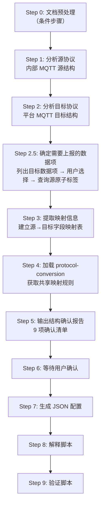

# MQTT 协议转换配置生成

> **目标：** 分析内部 MQTT 源协议文档和平台 MQTT 目标协议文档，生成供 C 协议转换引擎（`config_loader.c` + `mapper_core.c`）读取的 JSON 配置文件。

## 引擎架构

```
源 MQTT JSON ──→ config_loader.c（加载配置）──→ mapper_core.c（执行映射）──→ 目标 MQTT JSON
```

- **配置加载引擎**：`config_loader.c` — 读取 JSON 配置文件，解析为内部 `MappingRule` 结构
- **映射执行引擎**：`mapper_core.c` — 按 `MappingRule` 执行字段取值、类型转换、数组遍历、生成器调用
- **共享映射规则**：路径语法、类型系统、数组遍历准则等定义在 `protocol-conversion` skill 中

## 配置文件格式（config_loader.c 读取）

### 根对象字段

| 字段              | 类型     | 必填  | 说明                                            |
| --------------- | ------ | --- | --------------------------------------------- |
| `platform_name` | string | 否   | 平台标识（仅用于元数据）                                  |
| `topic_pattern` | string | 否   | MQTT Topic 模板，支持 `{field}` 占位符替换              |
| `post_process`  | string | 否   | 全局后处理函数名，转换完成后对整个输出对象执行                       |
| `mappings`      | array  | 是   | 映射规则列表，每条规则遵循 `protocol-conversion` 定义的映射规则字段 |

### mappings 规则字段

每条映射规则的完整字段定义（`target`/`source_type`/`source`/`type`/`constant`/`generator`/`scale`/`post_process`/`sub_mappings`）见 `protocol-conversion` skill 的「映射规则字段」章节。

MQTT 特有：

- 模板变量替换通过 `source_type: "constant"` + `type: "substitute"` 组合实现（不再使用独立的 `substitute` source_type）
- `source_type` 支持 `context`（运行时上下文变量，通用，MQTT 较少使用）
- `preprocess` 字段通用（HTTP 常用 `url_to_base64`，MQTT 较少使用）
- `item_type` 支持 `object` 和 `key_value`（通用，MQTT 常用 `object`）
- `post_process` 字段通用，**当前 C 引擎实现待完成**（见 `mapper_core.c` TODO）

## 工作流程（10 步，必须按序执行）



### Step 0: 文档预处理（条件步骤）

若源/目标协议格式以文档形式提供（PDF、DOCX 等），先转换为 Markdown 再分析
（**转换结果与逐页抽取等中间文件一律写当前会话工作区，禁止写入技能目录**）：

| 源格式            | 转换方式                                 |
| -------------- | ------------------------------------ |
| PDF            | Python `pypdf` 库提取文本                 |
| DOCX/DOC       | `mcp_pandoc` 的 `convert-contents` 工具 |
| .md/.txt/.json | 无需转换，跳过本步                            |

### Step 1: 分析源协议（内部 MQTT）

从源 MQTT 协议文档或默认配置中提取：

1. **确定源MQTT格式**：若用户提供源MQTT协议文档，首先遍历文档，若存在多个消息，将遍历到的消息用列表的形式展示出来，询问用户到底使用哪个消息的json格式；若用户未提供源MQTT协议文档，使用默认配置
2. **识别源 JSON 结构层级**：典型为 `businessObjList → dataObj → dataItemList → itemBody → item`
3. **标注每个层级的类型**：是数组（`[*]`）还是单对象
4. **提取字段列表**：

| 路径                                                                         | 类型     | 说明    |
| -------------------------------------------------------------------------- | ------ | ----- |
| `businessObjList[0].dataObj.dataItemList[0].itemBody[*].commAddr`          | string | 设备地址  |
| `businessObjList[0].dataObj.dataItemList[0].itemBody[*].deviceType`        | int    | 设备类型  |
| `businessObjList[0].dataObj.dataItemList[0].itemBody[*].item[*].voltageA`  | double | A 相电压 |
| `businessObjList[0].dataObj.dataItemList[0].itemBody[*].item[*].timeStamp` | string | 时间戳   |

> 若无用户提供文档，使用 `protocol-conversion` 的默认配置。

### Step 2: 分析目标协议（平台 MQTT）

从目标 MQTT 协议文档（目标MQTT格式必须提供，若用户缺失，立即终止步骤并告知用户提供）中提取：

1. **确定目标MQTT格式**：遍历目标协议，若存在多个消息，将遍历到的消息用列表的形式展示出来，询问用户到底使用哪个消息的json格式；
2. **目标 Topic 模板**：如 `ywnyems/gw/{gatewayId}/up/data`
3. **目标消息结构**：识别每个字段的路径和类型（Array / Object）
4. **识别常量字段**：如 `action = "devData"`
5. **识别生成器字段**：如 `msgId = uuid`、`timestamp = current_timestamp_ms`
6. **识别 substitute 字段**：如 `devId = $ssl_mqtt_server.gatewayID$`

### Step 2.5: 确定需要上报的数据项

从目标协议文档中提取所有可上报的数据项，让用户选择需要哪些，然后查询源原子标签建立映射候选。

#### 2.5.1 列出目标数据项

从 Step 2 分析的目标协议文档中，提取所有业务数据字段（排除 `action`/`msgId`/`msgTime`/`devId` 等框架字段），列出示例：

```markdown
## 目标协议可上报数据项

| 序号 | 目标字段 | 描述 | 类型 | 单位 |
|------|---------|------|------|------|
| 1 | Ua | A相电压 | double | V |
| 2 | Ub | B相电压 | double | V |
| 3 | Uc | C相电压 | double | V |
| 4 | Ia | A线电流 | double | A |
| 5 | Ib | B线电流 | double | A |
| 6 | Ic | C线电流 | double | A |
| 7 | P | 总有功功率 | double | kW |
| 8 | Q | 总无功功率 | double | kVar |

请选择需要上报的数据项（可多选，如"1,2,3,7,8"或"全部"）。
```

#### 2.5.2 查询源原子标签

用户选择后，为每个选中的目标数据项查询对应的源原子标签。

**查询来源**

1. **MCP 就绪时**：调用 MCP 工具查询源数据原子标签
2. **MCP 未就绪时**：从本skill的  refrences/  参考文件中查找

**文档选择规则**：

| 数据类型  | 使用文档            | 说明                         |
| ----- | --------------- | -------------------------- |
| 电力数据  | `数据采集通信协议.docx` | 电能数据使用**示值**，非电能数据使用**曲线** |
| 非电力数据 | `原子标签定义.docx`   | 通用原子标签查找                   |

**歧义处理**

当协议文档中同一数据项存在多种定义时，**必须列出对比表格，由用户确认选择后再进入后续步骤**

**匹配规则**（按优先级）：

从 `原子标签定义.docx` 或 `数据采集通信协议.docx` 查找中文名称对应的英文标签时：

1. **精确匹配**：中文名称完全对应（如「A相电压」→ `voltageA`）
2. **语义匹配**：中文名称不完全一致但含义相同（如「进水温度」→ `inputWaterTemp`），需告知用户匹配理由
3. **自定义命名**：找不到精确匹配和语义匹配时，使用用户之前审批过的自定义命名规则，并告知用户确认
4. **无匹配**：三步均未命中时，提示用户手动指定英文标签名

> 搜索时可以使用搜索工具按关键词查找，提高匹配效率。

**输出格式**：

```markdown
## 数据项映射候选

| 目标字段 | 目标描述 | 源原子标签 | 源描述 | 匹配方式 | 确认状态 |
|---------|---------|----------|--------|---------|---------|
| Ua | A相电压 | voltageA | A相电压 | 语义匹配 | ✅ 自动 |
| Ia | A线电流 | currentA | A相电流 | 语义匹配 | ⚠️ 需确认（线电流 vs 相电流） |
| P | 总有功功率 | P | 有功功率 | 精确匹配 | ✅ 自动 |
| Q | 总无功功率 | Q | 无功功率 | 精确匹配 | ✅ 自动 |
```

**需用户确认的情况**：

- 匹配方式为「语义匹配」且存在歧义（如线电流 vs 相电流）
- 无匹配结果，需用户手动指定源字段路径
- 一个目标字段有多个候选源标签

> 用户确认后，已确认的映射关系将带入 Step 3 生成完整映射表。

### Step 3: 提取映射信息

建立源字段到目标字段的完整映射表：

**例如**：

| 源字段                | 目标字段                        | source_type   | type       | 说明                            |
| ------------------ | --------------------------- | ------------- | ---------- | ----------------------------- |
| —                  | `action`                    | constant      | string     | 固定值 "devData"                 |
| —                  | `msgId`                     | generated     | string     | uuid 生成器                      |
| —                  | `devId`                     | constant      | substitute | `$ssl_mqtt_server.gatewayID$` |
| `commAddr`         | `data.terdata[0].devId`     | constant      | substitute | 同上                            |
| `itemBody[*]`      | `data.terdata[0].terdata.@` | array_foreach | object     | 遍历设备层                         |
| `item[*].voltageA` | `terdata.@.Ua`              | path          | double     | A 相电压                         |

同时标注：

- **数组遍历策略**：哪些层级用 `[*]` + `@` 遍历，哪些用 `[0]` 固定索引
- **post_process 函数**：如需要加密处理等
- **substitute 变量清单**：需要哪些 `template_vars.def` 变量

### Step 4: 加载 protocol-conversion 获取映射规则

加载 `protocol-conversion` skill，按其定义的规则设计映射：

1. **路径语法**：按 `protocol-conversion` 第 3 节的路径语法设计 `target` 和 `source`
2. **类型系统**：按第 4 节的类型系统确定 `type` 字段
3. **数组遍历准则**：按第 6 节的准则判断遍历 vs 固定索引
4. **生成器**：按第 8 节的生成器清单选择合适的 `generator`
5. **substitute**：使用 `source_type: "constant"` + `type: "substitute"` 组合，按第 7 节的模板替换机制设计上下文变量引用
6. **结构确认报告**：引用第 14 节的确认清单模板（8 项基础 + MQTT 特有数据项确认）

### Step 5: 输出结构确认报告

引用 `protocol-conversion` 的 8 项确认清单模板，补充 MQTT 特有的数据项确认后输出（共 9 项）：

```markdown
## 结构确认报告

### 1. 源数据结构（路径分析）
- 源根路径: `businessObjList[0].dataObj.dataItemList[0].itemBody[*]`
- 源字段列表:
  | 路径 | 类型 | 说明 |
  |------|------|------|
  | `commAddr` | string | 设备 ID |
  | `item[*].voltageA` | double | A 相电压 |
  | `item[*].timeStamp` | string | 时间戳 |

### 2. 目标数据结构（协议分析）
- 目标路径: `data.terdata[0].terdata[@]`
- 目标字段类型: Array
- 目标字段列表:
  | 路径 | 类型 | 说明 |
  |------|------|------|
  | `devId` | string | 设备 ID |
  | `Ua` | double | A 相电压 |
  | `dataTime` | string | yyyyMMddHHmmss |

### 3. 层级对应关系
| 源层级 | 源路径 | 目标层级 | 目标路径 | 遍历策略 |
|--------|--------|----------|----------|----------|
| 设备层 | `itemBody[*]` | 设备层 | `data.terdata[0].terdata.@` | 遍历 |
| 测点层 | `item[*]` | 测点层 | `terdata.@` | 遍历 |

### 4. 字段映射表
| 源字段 | 目标字段 | type | post_process |
|--------|---------|------|-------------|
| `commAddr` | `devId` | string | — |
| `item[*].voltageA` | `Ua` | double | trim |
| `item[*].timeStamp` | `dataTime` | string | datetime_to_yyyyMMddHHmmss |

### 5. 常量/生成器清单
| 目标字段 | source_type | type | 值/生成器 |
|---------|-------------|------|---------|
| `action` | constant | string | "devData" |
| `msgId` | generated | string | uuid |
| `devId` | constant | substitute | $ssl_mqtt_server.gatewayID$ |

### 6. substitute 变量清单
- `$ssl_mqtt_server.gatewayID$` — 网关 ID

### 7. post_process 函数清单
- `datetime_to_yyyyMMddHHmmss` — 时间格式转换
- `trim` — 去除尾部空字符
- `sm4—encode` - 对处理好的数据进行sm4加密

### 8. 数据项确认
- 目标数据项选择: ✅ 已确认（Step 2.5）
- 源原子标签映射: ✅ 已确认
- 无匹配/歧义项: 无 / [列出待确认项]

### 9. 引擎对齐确认
- 配置加载引擎: config_loader.c ✅
- 映射执行引擎: mapper_core.c ✅
- 配置格式: platform_name + mappings[] ✅

---
**请确认以上结构是否正确。确认后将生成完整的映射脚本。**
```

### Step 6: 等待用户确认

**必须等待用户明确回复**（如"确认"、"正确"、"可以生成"等），才能继续生成脚本。

**禁止行为**：

- 未确认结构就输出脚本
- 在结构确认报告中夹带脚本
- 假设用户会同意而提前生成

### Step 7: 生成 JSON 配置

用户确认后，组装完整 JSON 配置：

1. **根对象**：`platform_name` + `topic_pattern`（如有）+ `post_process`（如有）
2. **mappings 数组**：按 Step 3 的映射表生成规则列表
3. **保存文件**：输出到 `scripts/mqtt_mapper_YYYYMMDDHHMM.json`

> AI 直接生成 JSON 并输出，由用户手动保存。

### Step 8: 解释脚本

向用户解释：

1. **每个映射规则的作用**：源字段如何转换到目标字段
2. **数组遍历层级关系**：哪些层级使用了 `@` 遍历，遍历的源数组是什么
3. **生成器用途**：如 `uuid` 生成唯一消息 ID
4. **post_process 函数**：如 `datetime_to_yyyyMMddHHmmss` 将时间格式转换
5. **substitute 变量**：如 `$ssl_mqtt_server.gatewayID$` 在运行时替换为实际网关 ID

## MCP 工具调用（下列的工具目前只是展示，暂不使用）

| 工具                       | 用途           | 调用时机     | MCP 未就绪替代方案       |
| ------------------------ | ------------ | -------- | ----------------- |
| `analyze_mqtt_protocol`  | 解析 MQTT 协议文档 | Step 1/2 | AI 直接分析文档         |
| `generate_mqtt_config`   | 生成 JSON 配置   | Step 7   | AI 直接生成           |
| `validate_config_rules`  | 校验配置规则       | Step 7 后 | AI 人工检查           |
| `save_conversion_config` | 保存到 scripts/ | Step 7 后 | AI 输出 JSON，用户手动保存 |

### Step9：验证脚本

### 构造测试数据

1. 基于 Step 2.5 确认的原子标签清单，构造源 JSON 和期望目标 JSON。

2. 为每个原子标签构造测试值，组装完整的源协议数据结构。

3. 根据映射规则手动推导正确的转换结果，作为比对基准。

### 选择执行引擎

    按优先级选择，需告知用户当前使用的引擎，优先使用Python 镜像，其次完全 AI 模拟。

### 执行转换

    将配置文件和源 JSON 喂给引擎，捕获输出

#### 比对结果表

| 序号  | 目标字段                     | 期望值              | 实际值              | 类型  | 值   | 结构  | 结果   |
| --- | ------------------------ | ---------------- | ---------------- | --- | --- | --- | ---- |
| 1   | action                   | "devData"        | "devData"        | ✅   | ✅   | ✅   | PASS |
| 2   | msgId                    | uuid格式           | "a1b2-..."       | —   | ✅格式 | ✅   | PASS |
| 3   | data.terdata[0].Ua       | 220.1            | 220.1            | ✅   | ✅   | ✅   | PASS |
| 4   | data.terdata[0].dataTime | "20260826100000" | "20260826100000" | ✅   | ✅   | ✅   | PASS |
| 5   | data.terdata[1].Ua       | 0                | 0                | ✅   | ✅   | ✅   | PASS |
| 6   | data.terdata[1].dataTime | null             | (缺失)             | —   | —   | ❌   | FAIL |

#### 转化结论

    生成测试结论报告。


## 真实协议示例

### 源协议：iot_agent 电气量采集数据

Topic：设备上报，payload 为 JSON：

```json
{
  "udSign": 1, "taskId": 1, "cmdType": 2, "priority": 2,
  "businessObjList": [{
    "dataObj": {
      "timeType": 0,
      "dataItemList": [{
        "itemId": "38000005", "finshFlag": 0,
        "itemBody": [{
          "commAddr": "1", "businessType": 1, "deviceType": 1,
          "item": [{"voltageA": 220.1, "voltageB": 223.1, "timeStamp": "2023-01-17 00:00:00"}]
        }]
      }]
    }
  }],
  "respResult": {"resultCode": 0, "errDesc": "OK"},
  "sender": "iot_agent"
}
```

### 目标协议：云南配电房协议（ywnyems）

Topic：`ywnyems/gw/{gatewayId}/up/data`，payload 为 JSON：

```json
{
  "action": "devData",
  "msgId": "UUID v4",
  "devId": "GW001",
  "data": {
    "terdata": [{
      "devId": "1",
      "terdata": [{"Ua": 220.1, "dataTime": "20230117000000"}]
    }]
  }
}
```

### 生成的 JSON 配置

```json
{
  "platform_name": "ywnyems",
  "mappings": [
    { "target": "action", "source_type": "constant", "constant": "devData", "type": "string" },
    { "target": "msgId", "source_type": "generated", "generator": "uuid", "type": "string" },
    { "target": "devId", "source_type": "constant", "type": "substitute", "constant": "$ssl_mqtt_server.gatewayID$" },
    { "target": "data.terdata[0].devId", "source_type": "constant", "type": "substitute", "constant": "$ssl_mqtt_server.gatewayID$" },
    {
      "target": "data.terdata[0].terdata.@",
      "source": "businessObjList[0].dataObj.dataItemList[0].itemBody[*]",
      "source_type": "array_foreach",
      "item_type": "object",
      "sub_mappings": [
        { "target": "devId", "source": "commAddr", "type": "string" },
        {
          "target": "terdata.@",
          "source": "item[*]",
          "source_type": "array_foreach",
          "item_type": "object",
          "sub_mappings": [
            { "target": "Ua", "source": "voltageA", "type": "double", "post_process": "trim" },
            { "target": "dataTime", "source": "timeStamp", "type": "string", "post_process": "datetime_to_yyyyMMddHHmmss" }
          ]
        }
      ]
    }
  ]
}
```

## 约束规则

| 规则         | 说明                                                            |
| ---------- | ------------------------------------------------------------- |
| 配置格式       | 根对象为 `platform_name` + `mappings[]`，禁止 HTTP 格式（base_url/apis） |
| 引擎对齐       | 配置格式对齐 `config_loader.c` + `mapper_core.c`                    |
| 共享规则       | 映射规则字段定义在 `protocol-conversion`，本 skill 不重复定义                 |
| substitute | `source_type: "constant"` + `type: "substitute"` 组合触发模板替换     |
| 常量键名       | JSON 键名是 `constant`（不是 `constant_value`）                      |
| 用户确认       | 协议分析和字段映射完成后必须经用户确认                                           |
| 全量提取       | 协议文档中的字段必须逐项提取，不得默认压缩                                         |
| 输出命名       | `mqtt_mapper_YYYYMMDDHHMM.json`                               |
| 输出目录       | `scripts/` 目录                                                 |

---

**文档版本**：2.1.0
**基于引擎**：config_loader.c + mapper_core.c
**共享规则**：见 protocol-conversion skill
