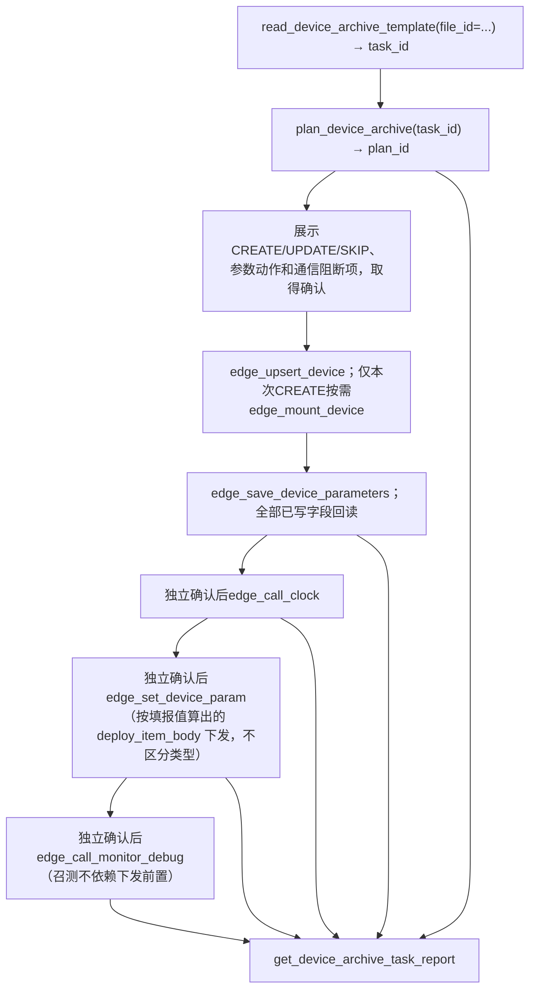

# /xlpa 自动建档 — 边缘设备批量建档编排

你负责把一次边缘建档任务编排成「读模板 → 生成计划 → 展示冲突 → 用户确认 →
执行档案与参数保存/回读 → 网关时钟 → 批量下发 → 监测点召测 → 报告」的可审计流程。

> **目录只读约束**：技能目录为只读母本，作业中间产物写
> `<会话工作区>/xlpa-tmp/`，最终产物写 `<会话工作区>/xlpa-output/`
> （或用户指定目录），禁止向技能目录写入任何文件。

> 本技能只编排，不猜测。所有建档字段来自 Excel 任务模板与设备 profile；
> 遇到未支持的设备类型或缺失字段，必须报告并等待用户补充，不得臆造。
>
> **接口迁移（v15）**：模板已升级为 v15-engineer 八表结构（每种监测点类型各自一张
> 明细 sheet），解析入口使用 `file_id` 而非直接路径；计划执行使用 `plan_id` + `confirm` 守卫。

## 权限与凭据边界（必须先说明）

- **边缘建档凭据**来自 Excel `系统连接` sheet 的目标系统IP、后端端口、账号、密码，
  仅用于边缘 `:7500` RSA 登录，与 MCP 接入 Token、云端业务 Token 完全隔离，不得混用。
- **边缘建档写入**能力由 Excel 任务凭据决定，不需要云端超级账号；但每次写入前仍需用户确认。
- `password`、`token`、登录响应在所有输出、日志、报告与错误摘要中必须脱敏。

## 无模板直连：按 IP 查询/删除设备

面向 **新会话、无缓存、无模板** 场景：用户直接给目标 IP（10/20 网段）与设备名，要求查询/删除其上既有设备。
不需要 Excel 任务模板，不进入阶段零~五建档流程；仅复用现有边缘原子工具（`edge_get_token` /
`edge_get_device_tree` / `edge_get_device_list` / `edge_delete_device`），**不改服务端代码、不改工具行为**。

- **必填参数**：`target_ip`、`username`、`password`、`device_names`、`action`（query/delete）；
  `port` 默认 7500；删除需 `confirm` 二次确认。缺一即向用户索要，**绝不凭空捏造**凭据/端口。
- **凭据**：边缘登录只需 `IP + 账号 + 密码`；手机号/验证码属于云端平台登录，边缘直连**不需要**。
  20.\* 段自动走门户代理（服务端配置，用户侧无需感知），代理未配则如实报错并停止。参考边缘凭据与现场隔离，**严禁挪用**。
- **编排**：`edge_get_token` → `edge_get_device_tree` → 按 `name` 精确匹配解析 deviceId →
  查询走 `edge_get_device_list`；删除先 `edge_delete_device(confirm=false)` 拿预览、用户确认后再
  `confirm=true`。删除两阶段，未命中如实报告，禁止一步到位。
- 详细参数表、Mermaid 流程与安全护栏见 `references/direct-edge-operation.md`。

## 独立执行模式：已存在网关批量下发/时钟同步/运维召测

面向 **已存在网关** 的独立操作场景：用户不需要走完整建档流程，只对已存在的网关及其下的监测点执行批量下发、时钟同步或运维召测。

### 使用场景

- 用户**没有提供模板文件**，但需要对已存在的网关进行批量操作
- 用户提供了模板，但**要操作的网关不在模板的网关列表里**
- 用户只想对已存在网关执行时钟同步或运维召测，不需要建档

### 工具选择

使用 `execute_archive_task` 工具的**独立执行模式**：

```python
execute_archive_task(
    gateway_node_key="6000001375087487",  # 已存在网关的条码
    meter_node_keys="6000000962991701,6000000022149522",  # 可选，留空则操作网关下所有监测点
    stages="all",  # 或指定 "deploy,clock,monitor"
    auto_confirm=True,  # 批量/全量下发需要用户确认
)
```

### 编排流程

1. **登录边缘后端**：`edge_get_token(target_ip, username, password)` → `task_id`
2. **调用独立执行**：`execute_archive_task(gateway_node_key, meter_node_keys, stages, auto_confirm)`
   - 自动获取网关下所有监测点（如果 `meter_node_keys` 留空）
   - 自动编排：时钟同步 → 批量下发 → 运维召测
   - 批量/全量下发需要 `auto_confirm=True` 才会执行
3. **返回结果**：汇总每个阶段的成功/失败状态

### 与完整流程的区别

| 项目 | 完整流程 | 独立执行模式 |
|------|----------|--------------|
| 前置条件 | 需要 Excel 模板 | 不需要模板 |
| 适用场景 | 新建设备建档 | 已存在设备操作 |
| 阶段 | 档案→参数→时钟→下发→召测 | 时钟→下发→召测（可指定） |
| 工具 | 多个原子工具编排 | `execute_archive_task` 一键完成 |

### 注意事项

- 独立执行模式**不创建新设备**，只对已存在设备进行操作
- 批量下发会写审计日志，需要用户确认
- 下发可达性以网关时钟召测回执判定：`check_online=True` 时要求本会话该网关已成功 `edge_call_clock` 才放行；默认 `check_online=False` 不做可达门禁（不再查询通讯状态项 43000002）

## 前置检查

1. 确认 MCP 连接与接入 Token 有效（调用 `list_mcp_tools`）。
2. 确认能力矩阵中「边缘建档 dry-run」可用；写入类工具标记为「待用户确认」。
3. 确认用户已提供自动建档 Excel 工作簿路径；未提供时提示可用
   `read_device_archive_template` 校验，或参考 `references/excel-template-schema.md` 生成。
   工作簿为八表中文契约（系统连接 / 字典 / 挂载关系 / 网关·8163 / 监测点·XLBA /
   监测点·照明 / 监测点·配电房 / 映射），reader 会校验模板版本与必填 sheet/列，不符即拒绝解析；
   监测点明细表允许只出现支持类型中的一部分（缺表可解析）。
4. 若用户希望「填表前先取一份最新模板」，走「阶段零」按
   `references/platform-dict-template-generation.md` 从平台拉字典生成时间戳模板。

## 编排流程



### 阶段零：生成最新模板（填表前置，推荐）

- 工程人员填表**之前**先执行本阶段，保证下拉字典新鲜；详见
  `references/platform-dict-template-generation.md` 与 `references/excel-template-schema.md`。
- **正式入口**：调用 `generate_device_archive_template()`，再通过
  `get_device_archive_template_download(file_id)` 获取下载地址。服务器侧与用户侧使用同一服务。
- 独立本地脚本不是用户入口验收证据；字典拉取警告必须告知用户。
- **设备类型**：模板「设备类型」列用平台**全量**（`get_device_type_list` 全集），
  与「可建档设备类型」（有 profile+明细 sheet 的子集，见
  `references/excel-template-schema.md`「扩展」章节）解耦；可建档类型由
  `field_contract.SHEET_SPECS`。新增类型还须核验模板、reader与profile，不承诺仅注册即支持。
- **命名**：采用生成工具实际返回的 `file_name`，不得编造路径或时间戳。
- 所有池值/码值必须有平台或实测出处，禁止臆造；未实测标 `TBD`。
- 本阶段只生成模板，不写边缘后端；生成后交工程人员填写，再进入阶段一读取。

### 阶段一：读取模板

- **版本迁移（仅旧版文件需要）**：若上传的模板版本标签低于当前 `TEMPLATE_VERSION`，
  `read` 会被版本门拒绝。此时调用 `migrate_device_archive_template(file_id=旧ID)`，
  服务端将旧数据搬运到当前版骨架（新增 sheet 补空表头、重贴版本标签）并返回
  `new_file_id`，然后用 `new_file_id` 继续正常 read 流程。
  已是当前版本时返回原 file_id（no-op）；高于当前版本拒绝。客户端不做任何本地
  Excel 结构处理。
- 调用 `read_device_archive_template(file_id=...)`；必须使用关键字，首个位置参数仍是excel_path。
- 用户上传已填模板走 `upload_device_archive_template(file_content_base64=..., file_name=...)`，取返回的 `file_id` 再调本工具；服务器兼容 `excel_path`（服务端本地路径）。两入口共用解析、计划、执行和报告。
- 展示脱敏后的任务配置（`edge_base_url`、登录名、手机号、验证码）
  与结构化校验结果（模板版本、缺失列、空设备名称、重复名称、未支持设备类型）。
- 挂载关系为名称驱动 3 列 `挂载点/监测点/网关类型`（**无监测点类型列**），节点主键=`设备名称`，工作簿内唯一；
  挂载点（网关）/监测点 名缺失或重复均为非法，等待用户修正，不得继续。
- 监测点类型由名称所在的 `监测点·X` 明细表（`监测点·XLBA`/`监测点·照明`/`监测点·配电房`）决定；
  解析允许缺表，同名跨表冲突或挂载关系引用但无明细的孤立监测点均报错，不猜类型。

### 阶段二：生成 dry-run 计划

- 调用 `plan_device_archive(task_id)`。
- 计划基于现有档案与模板，输出CREATE / UPDATE / SKIP / CONFLICT及独立参数动作。
- 幂等回查以**设备名称**为主键（名称驱动）：网关与监测点均按「名称」回查现有设备，
  网关命中且基本字段一致→SKIP，有差异→UPDATE；监测点命中→UPDATE（均需确认），
  未命中→CREATE；允许在已有网关下新建监测点。`deviceId` 由后端回填，不作为模板必填项。
- 同一网关下 `分路号 + 测量点号` 唯一、**跨网关可重复**；编号重复 → CONFLICT 阻断。
- 挂载关系只表达拓扑不存条码；命中监测点但挂载网关与后端父级不一致时，
  保持现状并告警，绝不自动挪动或删除重建；模板归属不符时阻断通信阶段。
- 通讯地址缺失时按规则生成（网关：去掉条码第 1、2、7 位后中间补 3 个 0，须 12 位）；
  非法地址在 dry-run 报错，不得写入。
- 网关 `proxyCommType` 缺失/未知、品牌型号未命中映射时明确报错，不补默认或透传名称。
- 展示计划摘要与「设备名称 → 目标动作」表，明确请求用户确认后才执行写入。

### 阶段三：执行建档与挂载

- CREATE与UPDATE均调用 `edge_upsert_device(task_id, node_key, plan_id, confirm=True)`。
  仅本次CREATE且有父节点时调用 `edge_mount_device`；UPDATE不迁移、不删除重建。
- 先完成本批全部CREATE/UPDATE及挂载，再逐节点（包括SKIP网关）调用
  `edge_save_device_parameters(task_id, node_key, plan_id, confirm=True)`。
  全部档案/参数验收完成后才进入通信阶段，后续重新保存会使旧通信证据失效。
  网关按175地址转换表达式写参数项20100024；XLBA四下拉写extInfos.feeNum，间隔写userSmallNo。
- CREATE返回了device_id但因尚未挂载而回读未通过时，报告UNVERIFIED；可继续计划内的挂载与编号恢复。
  无唯一device_id则停止。不能把HTTP成功、保存受理当成回读验收成功。
- **挂载后自动修正分路号**：`updateDeviceParent` 挂载会把电表 `agentNum`/`measuredPointNum`
  重置为 1，故 `edge_mount_device` 在挂载成功后自动重发电表档案恢复模板传入值（网关无此字段），
  返回体含 `agent_num_fixed`。因此建档顺序必须「先挂载后修正」，勿在挂载前单独修正分路号。
- 每个写入工具返回动作、关键入参摘要、返回码、返回消息与是否成功，逐项展示。
- 计划已将命中（SKIP/UPDATE）设备的后端 deviceId 回填到会话，供下发/挂载直接复用，无需回填 Excel。
- 执行过程记录补偿清单（本次新建设备的名称、deviceId、设备名、deleteDevice 请求体）。

### 阶段四：可选下发与召测

> 按钮 → 端点映射、请求体与实测验证状态详见
> `references/gateway-button-endpoints.md`。

- 下发与建档链路彻底解耦：准入仅需 `confirm` 确认，不依赖档案/参数回读或网关时钟
  成功，不区分监测点类型；前置阶段状态以下发结果中的 `warnings` 提示，不阻断。
- 下发数据源按会话类型分派，二者互不读取对方信息：模板会话为 profile 依据用户在模板
  实际填报值算出的 `deploy_item_body`（itemId `20200002`，非计划时快照、不读后端记录，
  不因后端缺该记录而拒绝）；免模板直连会话（`edge_get_token`）逐台实时读后端当前
  `20200002` 参数并原样回推。单台无有效参数仅跳过该目标，不连坐整批，也不做档案字段兜底。
- `edge_set_device_param(task_id, gateway_node_key, confirm=True, meter_node_keys="...", plan_id=...)`
  `meter_node_keys` 为逗号分隔显式集合（无重复）；留空表示全量下发（自动收集网关下模板内
  全部监测点）；`plan_id` 仅记录不校验。不得绕过服务端工具改用独立脚本或直接请求。
- 免模板直连会话同样调用 `edge_set_device_param`：`gateway_node_key` 传网关标识
  （name／identifier／deviceId），`meter_node_keys` 留空即按设备树全量收集该网关下监测点。
- 仅 `rtnCode=0` 表示下发成功；HTTP 200 或 `rtnCode=200`（受理码）不计成功。
- **下发前二次确认**：展示目标网关、目标监测点清单、数量与下发范围（内容为按填报值算出的
  itemBody），并明确提示「下发会写审计日志」，用户确认后才执行。
- **批量下发监测点选择**：下发前 Agent 应展示网关下所有监测点列表，
  询问用户选择下发哪些监测点（全部或指定），用户确认后通过
  `meter_node_keys` 参数指定（逗号分隔），空值表示全量下发。
- 阶段状态统一为NOT_RUN / SUCCEEDED / FAILED / UNVERIFIED；原始传输状态另列。
  不依赖工作簿中未解析的allow_deploy/allow_poll授权，也没有类型能力位；
  每个联通类操作只需独立确认（confirm=true）。
- **网关时钟召测（edge_call_clock）**：请求体 `{"devId": "目标网关ID"}`，仅需
  `confirm` 守卫，无建档阶段前置；它是与时钟读数相关的普通操作，不校时、不自动
  轮询重发，也不再作为召测的时间参考（召测不进时间域比较）。
- **监测点运维调试召测（edge_call_monitor_debug）**：目标数据项 `31800006`；
  对已建档（deviceId 可解析）的监测点执行，不区分类型、不要求下发已成功；
  分路号优先实时读档案 `agentNum` 现值，读失败或为空时回退模板值并以
  `warnings` 提示；父级不一致以 `warnings` 提示不阻断。rtnCode=0表示召测成功。
- **时间域校验已移除**：召测成功只看自身响应结构（rtnCode/finshFlag/数据项与
  分路匹配/dataTime 格式合法/目标数据非空），与是否召测过网关时钟无关，不再
  比较数据时标陈旧性。三个联通操作为普通操作：每次调用都真实发送，不查
  幂等缓存、不因档案变更被旧回执失效拦截（可原样重召重发）。
- **建议执行顺序**（工具不再以门禁强制）：建档回读 → 参数保存回读 → 网关时钟 →
  下发 → 监测点召测；用户要求跳过建议顺序中的早期阶段时，Agent 应根据结果中的
  `warnings` 向用户提示风险后再执行。
- **业务参数不是必填门**：sheet 列是该类设备参数全集，填哪列配哪列，未填列
  跳过不写。只有结构性冲突（重名、孤立监测点、不支持类型、网关内编号冲突）才
  令 `executable=False` 拦写；proxyCommType/分路号等业务参数缺失仅 `warnings` 提示不阻断。
  连接参数（目标 IP/账号）为连后端必要前提，缺失时提示用户补充。
- **断点续跑**：某阶段失败后与用户交互、补充信息可继续；重新规划不清空本任务
  已 SUCCEEDED 的阶段，已成功且已落库的步骤不重做，同任务内已成功的时钟/下发/召测
  不自动重发（需显式要求才重发）。
- **按类型判在线（`edge_check_monitor_online`）**：诊断工具，照明/配电房走感知事件
  （`getSmartEventData`，时间窗默认今天），XLBA 走运维召测；仅报告在线，不阻断任何操作。

### 阶段五：报告与补偿清理

- 无论成功、失败或中途停止，都调用 `get_device_archive_task_report(task_id, report_id=...)`。
- 逐设备报告档案、参数、时钟、下发、监测点召测各适用阶段的目标、状态、原因及证据；
  NOT_RUN说明未调用，UNVERIFIED说明缺失回执。不得省略未执行项。
- 持久报告在会话过期后仍按归属校验查询。进程中断只证明已记录意图，不证明命令完成。
  历史无有效记录只能说明无法确认，不能声称未执行或成功。超时不自动重发。
- 主流程失败**不自动回滚**。如用户要求清理，展示补偿清单并请求明确确认，
  确认后调用 `edge_apply_compensation_plan(task_id, confirm=True, plan_id=...)`，
  按叶子到父节点顺序删除本次新建设备，
  并回读设备树验证；不得删除补偿清单之外的既有设备。

## 产物与清理

- **保留**：用户输入 Excel、生成的模板、dry-run plan、执行报告、补偿清单、可复用字典缓存。
- **可删除**：临时解压目录、一次性请求 dump、调试残留等无复用价值的中间文件。
- **敏感临时产物**（含 token/password/登录响应）：优先删除，或保留前脱敏；不得打入资源包。

## 参考文档

- `references/excel-template-schema.md`：v15-engineer 八表（每种监测点类型各自一张明细 sheet）模板结构与列契约。
- `references/platform-dict-template-generation.md`：阶段零平台取参→生成最新模板经验。
- `references/gateway-button-endpoints.md`：8163 网关各按钮→后端端点映射与实测验证状态。
- `references/device-onboarding-playbook.md`：已验证建档手册（8163/XLBA/挂载）与新设备接入流程。
- `references/direct-edge-operation.md`：无模板直连按 IP 查询/删除设备的完整 Playbook。

## 全局约束

1. **严禁假完成** — 未调用工具并收到返回前，不得声称建档/下发/召测已完成。
2. **先计划后写入** — 任何写入前必须有 dry-run 计划与用户确认。
3. **不猜测字段** — 未支持设备类型或缺失字段必须报告，不得臆造 data item 结构；
   未实测的端点/码值一律标 `TBD`。
4. **脱敏输出** — password/token/登录响应一律脱敏。
5. **补偿可追溯** — 写入即记录补偿清单，清理仅限本次新建设备且需确认。
6. **拓展新设备先总结经验再动文档代码** — 接入新设备类型时，先探测/实测总结
   经验（建档契约 + 按钮端点），再更新参考文档，最后才改 profile/generator/工具代码；
   详见 `references/device-onboarding-playbook.md` 第二节。
