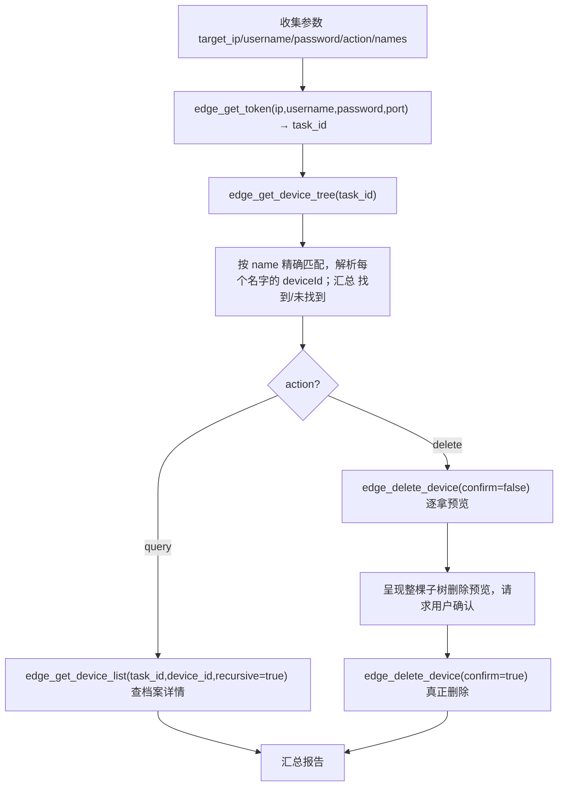

# 无模板直连：按 IP 查询/删除设备

本页规范 **新会话、无缓存、无模板** 场景下，直接按目标 IP（10/20 网段）对边缘后端设备做**查询/删除**的编排方式。
不生成 Excel 模板，不进入阶段零~五建档流程；复用现有边缘原子工具（`edge_get_token` / `edge_get_device_tree` /
`edge_get_device_list` / `edge_delete_device`），**不改任何服务端代码、不改工具行为**。

> 典型需求：
> - 「查一下 20.2.96.2 上有哪些 AI_test 设备」
> - 「帮我删除 10.5.8.3 上的 AI_test4\AI_test5\AI_test6」

## 凭据边界（先说清）

- **边缘登录只需 `IP + 账号 + 密码`（端口默认 7500）**。`EdgeDeviceClient.login` 请求体只含
  `loginName`/`password`/`keyName`/`symmetricKey`，**不使用手机号/验证码**。
- 手机号/验证码属于**云端平台登录**（`login` 工具的 phoneNum/code），用于确定你的 MCP 权限角色与拉平台字典，
  与「连接目标边缘后端」无关——直连查询/删除**不需要**它们。
- 目标 IP 为 `20.*` 段时，`edge_get_token` 自动启用门户代理模式（由服务端配置，用户侧无需感知细节）；
  若门户代理未配置，工具返回错误并请**服务端管理员**处理后重试，**不得绕过**。
- `XLPA_REFERENCE_EDGE_*`（参考边缘）凭据是模板字典来源、与现场**完全隔离**，**严禁**拿来到现场目标上查询/删除。

## 必填参数清单

缺一即向用户索要，**绝不凭空捏造**凭据/端口/设备名。

| 参数 | 必填 | 说明 |
|---|---|---|
| `target_ip` | ✓ | 目标边缘后端 IP，如 `20.2.96.2`；20.\* 走代理、10.\* 直连 |
| `username` | ✓ | 该边缘后端登录账号 |
| `password` | ✓ | 该边缘后端登录密码 |
| `port` | 可选 | 默认 `7500` |
| `device_names` | ✓ | 待操作设备名；支持一次多个（分隔符按用户输入，如 `\`、`、`、英文逗号） |
| `action` | ✓ | `query` 或 `delete` |
| `confirm` | 删除时 ✓ | 删除前必须二次确认 |

## 整体流程

## 查询编排

1. 缺参数时先补齐（见参数清单）。
2. `task_id = edge_get_token(target_ip, username, password, port=7500)`。
   - 返回 `ok:false`（如 20.\* 门户代理未配置、登录失败）→ 向用户如实报告，停止。
3. `tree = edge_get_device_tree(task_id)`。
4. 遍历树节点，用节点 `name` 字段对每个目标名做**精确匹配**，取节点 `id` 作为 deviceId；
   汇总 `找到`（名→deviceId）与 `未找到`（名）。
5. 对命中的 deviceId 可选调 `edge_get_device_list(task_id, device_id, recursive=True)`
   获取该设备及其递归子设备档案详情。
6. 未找到的名字必须如实列在「未找到」里，**不得**臆测其存在或假装已查询。

## 删除编排（两阶段确认，禁止一步到位）

1. 复用查询 1–4，先确认**每个目标名字都已命中**再继续；任一名字未命中，先向用户汇报并停下，不跳过。
2. 对每个命中 deviceId 调 `edge_delete_device(task_id, device_id, confirm=False)`：
   - 返回 `delete_order` 预览（含其递归子设备、叶子优先顺序）与 `count`；
   - 预览阶段 **不执行任何删除**。
3. 把完整预览（目标设备 + 全部将被递归删除的子设备）呈现给用户，说明删除**不可逆**。
4. 用户明确确认后，调 `edge_delete_device(task_id, device_id, confirm=True)` 逐个真正删除。
5. 逐设备汇总 `已删除 / 失败`；任一失败即停并如实报告，**不得**声称全部已删。

## 安全护栏

- 登录凭据缺失 → 要求补齐，不臆造账号/密码/端口。
- 不使用「参考边缘 XLPA_REFERENCE_EDGE_*」凭据操作现场目标。
- 删除前必须 `confirm=false` 预览 + 用户确认；不得直接 `confirm=true`。
- 名字未命中 → 如实报告「未找到」，不得声称已删/已查。
- password/token/登录响应在所有输出、日志、报告中一律脱敏。

## 失败与边界处理

- `edge_get_token` 或 `edge_get_device_tree` 失败 → 报告错误原因，不伪造设备列表。
- 设备树为空或无法读取 → `edge_delete_device` 会拒绝删除并报错；不要强行继续。
- 会话过期（`task_id` 失效）→ 重新 `edge_get_token` 取得新 task_id 后重试。
- 删除中途失败 → 停止并列出已删/失败，交用户决定是否继续，不自作主张重试到底。